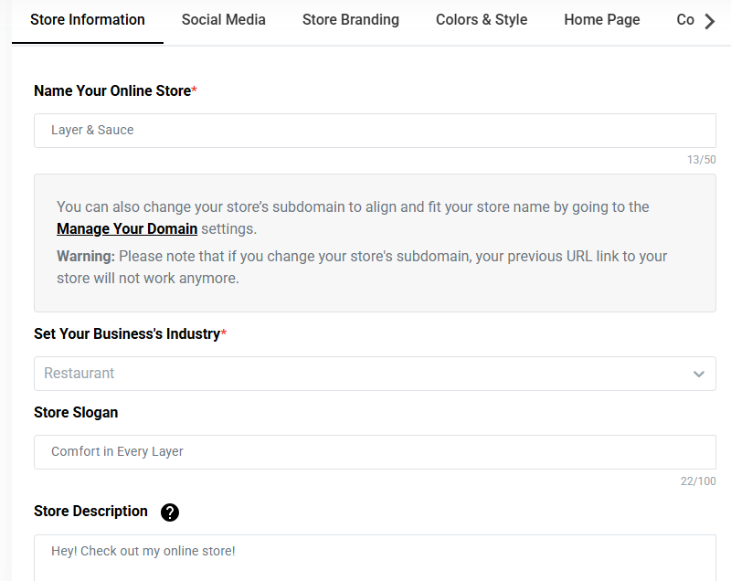
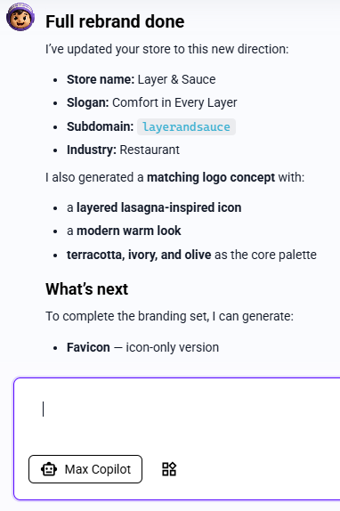

# Merchant Side | Max Ai |  Branding Tools (Change Name, Slogan, Subdomain) to Shared

- **Task ID**: `86exrj7az`
- **URL**: https://app.clickup.com/t/86exrj7az
- **Status**: deployed to prod
- **Assignees**: Angelo Kamachi, Michael Joseph Santos
- **Created**: 2026-05-28T06:06:43.864Z
- **Updated**: 2026-06-03T09:36:29.229Z
- **List**: P1 Delivery
- **Folder**: Shared with me

## Description

Enhancement: Move all branding tools from a sub agent into the shared folder for agents. Max AI should be able to change the branding details from the main agent as it uses the shared folder for all ages

| User Message | Expected Behavior | Tool Used |
| ---| ---| --- |
| Add `{store location}` as a store location | Max copilot should create or update physical location address | CreateStoreLocationTool |
| What industries are available for classification? | Max copilot should fetch a list of available industry classifications | GetIndustriesListTool |
| Set my store's industry into `{store industry}` | Max copilot should set the store's industry category | UpdateIndustryTool |
| Change my store name into `{store name}` | Max copilot should change the store name | UpdateStoreNameTool |
| Change my store's slogan into `{store slogan}` | Max copilot should edit the store's slogan | UpdateStoreSloganTool |
| Change my store subdomain into `{subdomain name}` | Max copilot should edit the store's subdomain slug | UpdateStoreSubdomainTool |
| Update my store branding settings. Here are the details: Store Name: `{store name}` Store Slogan: `{store slogan}` Subdomain: `{store subdomain}` Logo: Use the attached image | Max copilot should update multiple store profile configurations (name, logo, slogan, subdomain) concurrently | UpdateBrandingTool |
| Is `{store name}` available as a store name? | Max copilot should validate if a proposed store name is unique and available | StoreNameValidatorTool |
| Is `{subdomain name}` available as a subdomain? | Max copilot should validate if a proposed store subdomain is unique and available | StoreSubdomainValidatorTool |

## Media (2)

- `01_Screenshot_2026-05-28_160456.png` (source: attachment, uploader: Angelo Kamachi)

  

- `02_Screenshot_2026-05-28_160357.png` (source: attachment, uploader: Angelo Kamachi)

  

## Comments (10)

### Dyne (2026-06-03T09:36:29.229Z)

KB is here: help.prosperna.com/ai-artificial-intelligence/onboarding-with-max-ai 
 

### ClickBot (2026-05-28T08:05:46.163Z)

This task Merchant Side | Max Ai |  Branding Tools (Change Name, Slogan, Subdomain) to Shared has been move to PASSED TESTING 
Date updated: May 28 2026, 4:05PM (Asia/Singapore)
Triggered by: Angelo Kamachi

### ClickBot (2026-05-28T07:17:34.918Z)

This task Merchant Side | Max Ai |  Branding Tools (Change Name, Slogan, Subdomain) to Shared hss been move to IN TESTING 
Updated: May 28 2026, 3:17PM (Asia/Singapore)
Triggered by: Angelo Kamachi

### ClickBot (2026-05-28T07:17:26.811Z)

This Merchant Side | Max Ai |  Branding Tools (Change Name, Slogan, Subdomain) to Shared has been move to READY FOR TESTING
Date updated: May 28 2026, 3:17PM (Asia/Singapore)
Triggered by: Angelo Kamachi

### ClickBot (2026-05-28T06:25:20.658Z)

This Merchant Side | Max Ai |  Branding Tools (Change Name, Slogan, Subdomain) to Shared has been move to READY FOR TESTING
Date updated: May 28 2026, 2:25PM (Asia/Singapore)
Triggered by: Angelo Kamachi

### ClickBot (2026-05-28T06:25:12.566Z)

This Merchant Side | Max Ai |  Branding Tools (Change Name, Slogan, Subdomain) to Shared has been move to IN DEVELOPMENT
Date updated: May 28 2026, 2:25PM (Asia/Singapore)
Triggered by: Angelo Kamachi

### ClickBot (2026-05-28T06:25:04.008Z)

This task Merchant Side | Max Ai |  Branding Tools (Change Name, Slogan, Subdomain) to Shared hss been move to READY FOR DEVELOPMENT 
Updated: May 28 2026, 2:25PM (Asia/Singapore)
Triggered by: Angelo Kamachi

### ClickBot (2026-05-28T06:25:02.430Z)

This task Merchant Side | Max Ai |  Branding Tools (Change Name, Slogan, Subdomain) to Shared hss been move to READY FOR REVIEW 
Updated: May 28 2026, 2:25PM (Asia/Singapore)
Triggered by: Angelo Kamachi
READY FOR REVIEW by @Ruel 

### ClickBot (2026-05-28T06:25:00.148Z)

This task Merchant Side | Max Ai |  Branding Tools (Change Name, Slogan, Subdomain) to Shared hss been move to GATHERING REQUIREMENTS 
Updated: May 28 2026, 2:24PM (Asia/Singapore)
Triggered by: Angelo Kamachi

### ClickBot (2026-05-28T06:06:44.819Z)

This task Merchant Side | Max Ai |  Branding Tools (Change Name, Slogan, Subdomain) to Shared has been created 
Date: May 28 2026, 2:06PM (Asia/Manila)
By Michael Joseph Santos

