# Merchant Side | Front - End Standardization

- **Task ID**: `86exwu2xu`
- **URL**: https://app.clickup.com/t/86exwu2xu
- **Status**: in development
- **Assignees**: Cyril Ayson, Angelo Kamachi
- **Created**: 2026-06-10T02:14:01.587Z
- **Updated**: 2026-10-23T03:58:16.974Z
- **List**: P1 Delivery
- **Folder**: Shared with me

## Description

Phase out legacy Bootstrap and react-bootstrap pages to transition to the new Tailwind CSS v4 hybrid design system standards (aligned with Tailwind V4 best practices
)). This ensures responsive grid structures, elevated depth, tactile switches, and unified brand-purple components.

\## Collaboration & QA
\- **\*\*Development Coordination\*\***: Active coordination with @Mico Nakase to prevent branch conflict on shared pages.
\- **\*\*Design System Audits\*\***: Coordination with @Brian Millonte to check that the layout configuration adheres to [DESIGN.md](http://DESIGN.md) tokens.
\- **\*\*QA Rule\*\***: Complete 80% unit test coverage on new lines of code and verify with `npm run build` prior to branch merging.

\## 📅 Sprint Roadmap Status (June 10, 2026 - Day 3 Mid-Day)

\### 🟢 Completed Ahead of Schedule
\- **\*\*Layout Templates (\`src/layouts/\`)\*\*** - Cyril (Day 1)
\- **\*\*Shared Elements (\`src/components/Shared/\`)\*\*** - Cyril (Day 1)
\- **\*\*Auth & Account Pages (\`src/pages/account/\`)\*\*** - Kamachi (Day 1)
\- **\*\*Onboarding Wizards (\`src/pages/onBoarding/\`)\*\*** - Kamachi (Day 1)
\- **\*\*Discounts Modals & Forms (\`CouponCode/components/CreateCouponForm/\`)\*\*** - Cyril (Day 2)
\- **\*\*Add-on Modals & Menus (\`src/pages/home/Addon/components/\`)\*\*** - Cyril (Day 2)
\- **\*\*Media Library Uploads & Grids (\`src/pages/home/MediaLibrary/\`)\*\*** - Cyril (Day 2)
\- **\*\*Users & Permissions (\`src/pages/home/users/UserControl/\`)\*\*** - Kamachi (Day 2)
\- **\*\*Blogs Management (\`src/pages/home/Blogs/\`)\*\*** - Kamachi (Day 2)
\- **\*\*Orders & Fulfillment (\`src/pages/home/orders/\`)\*\*** - Cyril (Day 3)
\- **\*\*Messaging Settings SMTP (\`src/pages/home/MessageSettings/\`)\*\*** - Cyril (Day 3)
\- **\*\*Social Inbox Chat (\`src/pages/home/SocialInbox/\`)\*\*** - Cyril (Day 3)
\- **\*\*Contacts & Leads (\`src/pages/home/Leads/\`)\*\*** - Kamachi (Day 3)
\- **\*\*Announcements Banners (\`src/pages/home/Announcements/\`)\*\*** - Kamachi (Day 4 - Early)
\- **\*\*Inventory Listing Table & Drawers (\`src/pages/home/Inventory/\`)\*\*** - Cyril (Day 4 - Early)

\### 🔴 Overdue / Delayed
\- **\*\*Utilities -> Reward Points (\`src/pages/home/rewardPoints/\`)\*\*** - Kamachi (Day 2 EOD deadline missed)

\### 🟡 Active Today (Day 3)
\- **\*\*Pricing & Billing (\`src/pages/home/Pricing/\`)\*\*** - Kamachi (Expected EOD today)

\### 🚫 Skipped (Planned for Deprecation)
\- **\*\*Legacy Page Builder (\`src/pages/home/PageBuilder/\`)\*\*** - Cyril (Day 5 - Deprecated in favor of Max AI Builder)

## Media (28)

- `01_image.png` (source: attachment, uploader: Angelo Kamachi)

  

- `02_image.png` (source: attachment, uploader: Angelo Kamachi)

  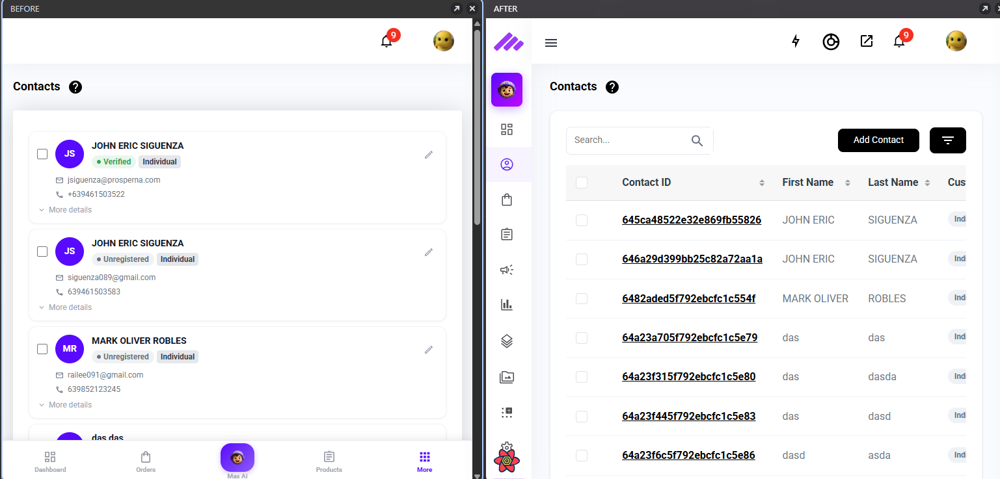

- `03_image.png` (source: attachment, uploader: Angelo Kamachi)

  

- `04_image.png` (source: attachment, uploader: Angelo Kamachi)

  

- `05_image.png` (source: attachment, uploader: Angelo Kamachi)

  

- `06_Screenshot_2026-06-10_094238.png` (source: attachment, uploader: Angelo Kamachi)

  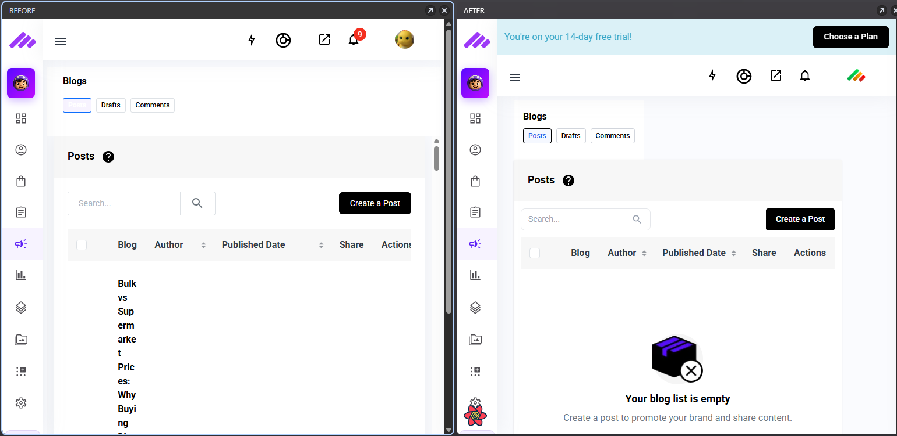

- `07_Screenshot_2026-06-10_093718.png` (source: attachment, uploader: Angelo Kamachi)

  

- `08_Screenshot_2026-06-09_160140.png` (source: attachment, uploader: Angelo Kamachi)

  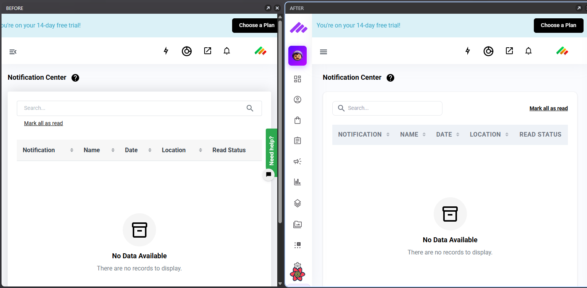

- `09_Screenshot_2026-06-09_145328.png` (source: attachment, uploader: Angelo Kamachi)

  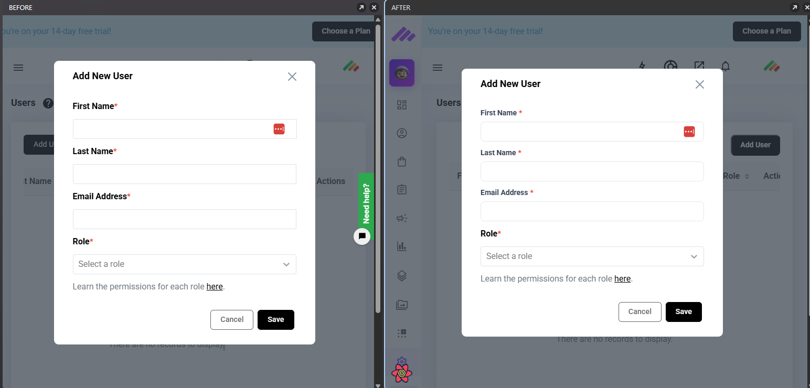

- `10_Screenshot_2026-06-09_142521.png` (source: attachment, uploader: Angelo Kamachi)

  

- `11_Screenshot_2026-06-09_101524.png` (source: attachment, uploader: Angelo Kamachi)

  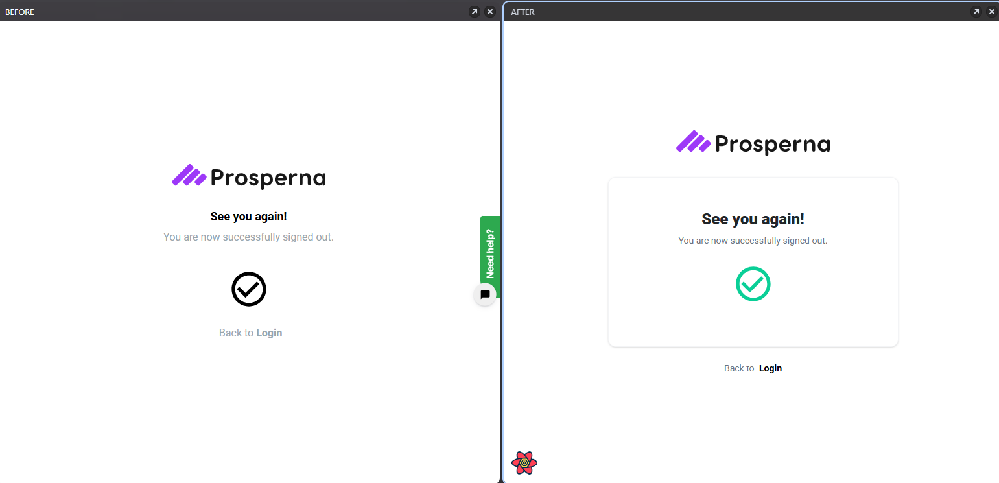

- `12_Screenshot_2026-06-09_101121.png` (source: attachment, uploader: Angelo Kamachi)

  

- `13_Screenshot_2026-06-09_100941.png` (source: attachment, uploader: Angelo Kamachi)

  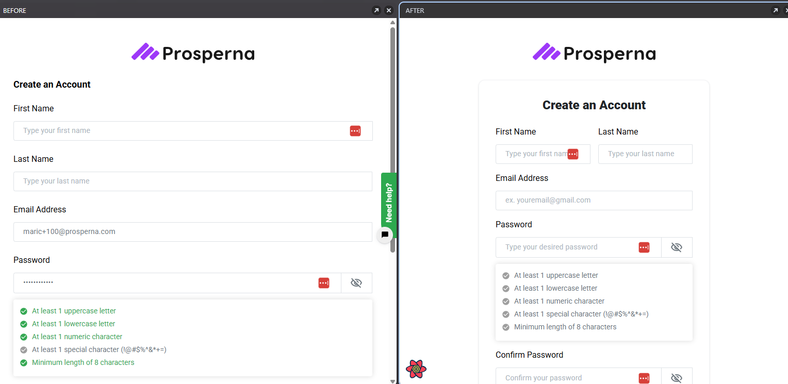

- `14_Screenshot_2026-06-09_100733.png` (source: attachment, uploader: Angelo Kamachi)

  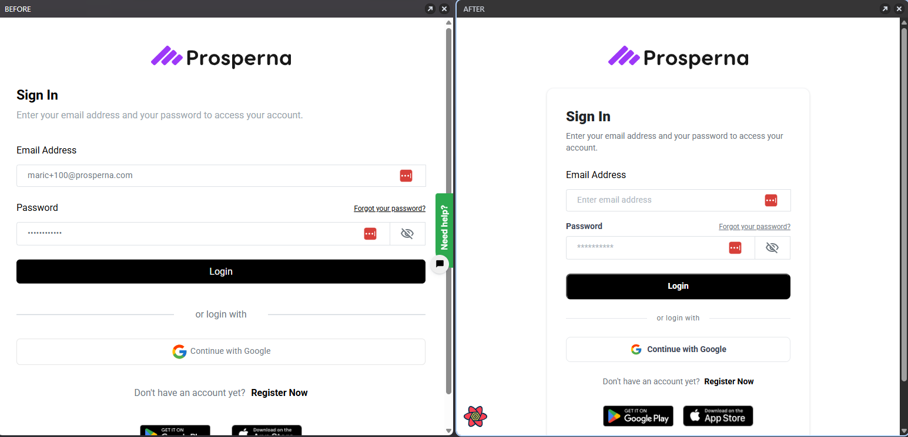

- `15_image.png` (source: comment, uploader: Angelo Kamachi)

  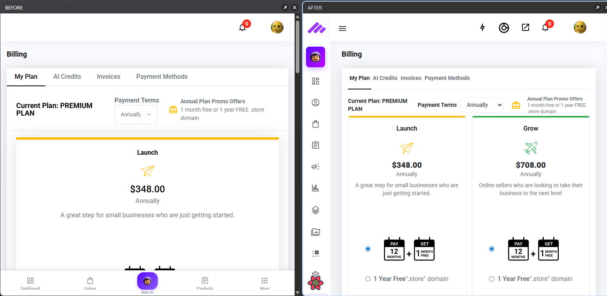

- `16_image.png` (source: comment, uploader: Angelo Kamachi)

  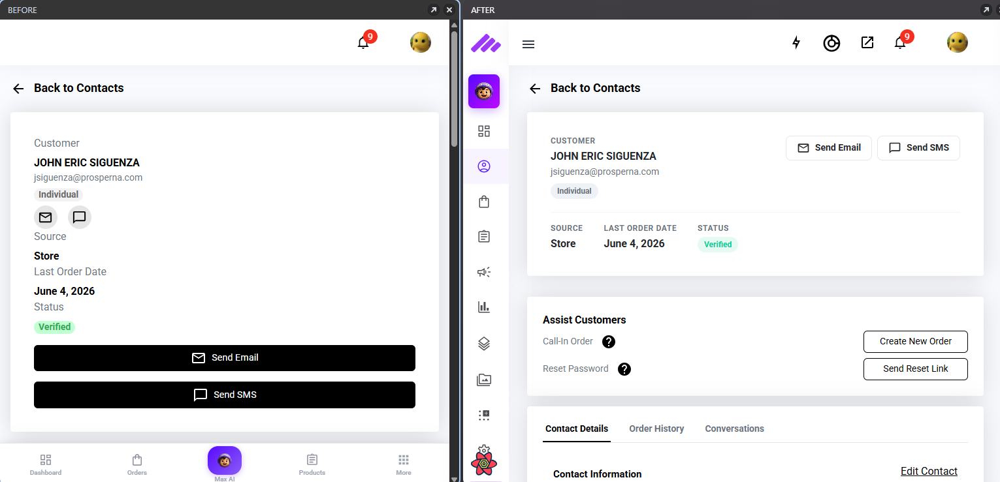

- `17_image.png` (source: comment, uploader: Angelo Kamachi)

  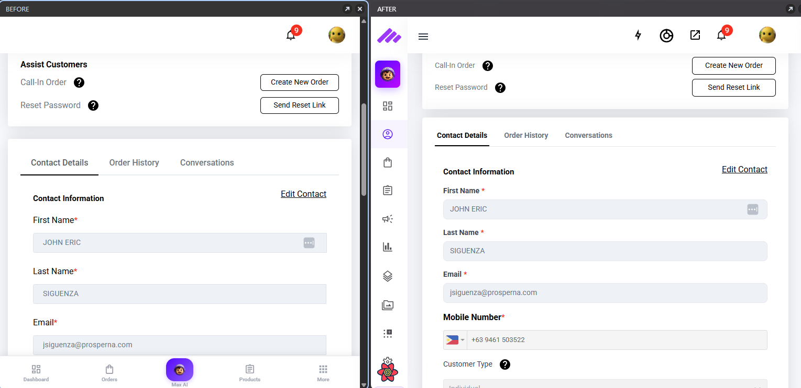

- `18_image.png` (source: comment, uploader: Angelo Kamachi)

  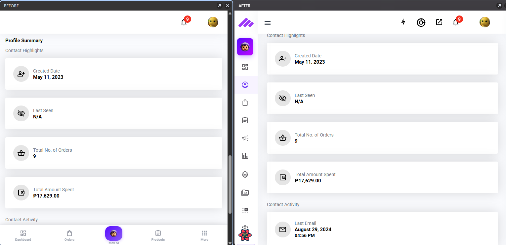

- `19_image.png` (source: comment, uploader: Angelo Kamachi)

  

- `20_Screenshot_2026-06-09_100733.png` (source: comment, uploader: Angelo Kamachi)

  

- `21_Screenshot_2026-06-09_100941.png` (source: comment, uploader: Angelo Kamachi)

  

- `22_Screenshot_2026-06-09_101121.png` (source: comment, uploader: Angelo Kamachi)

  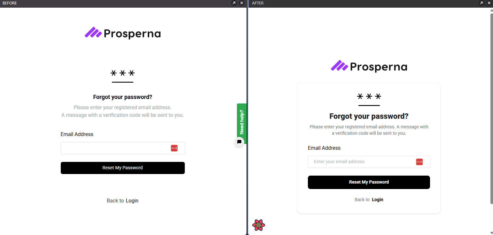

- `23_Screenshot_2026-06-09_101524.png` (source: comment, uploader: Angelo Kamachi)

  

- `24_Screenshot_2026-06-09_142521.png` (source: comment, uploader: Angelo Kamachi)

  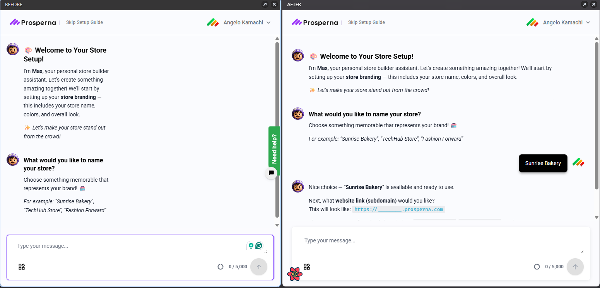

- `25_Screenshot_2026-06-09_145328.png` (source: comment, uploader: Angelo Kamachi)

  

- `26_Screenshot_2026-06-09_160140.png` (source: comment, uploader: Angelo Kamachi)

  

- `27_Screenshot_2026-06-10_093718.png` (source: comment, uploader: Angelo Kamachi)

  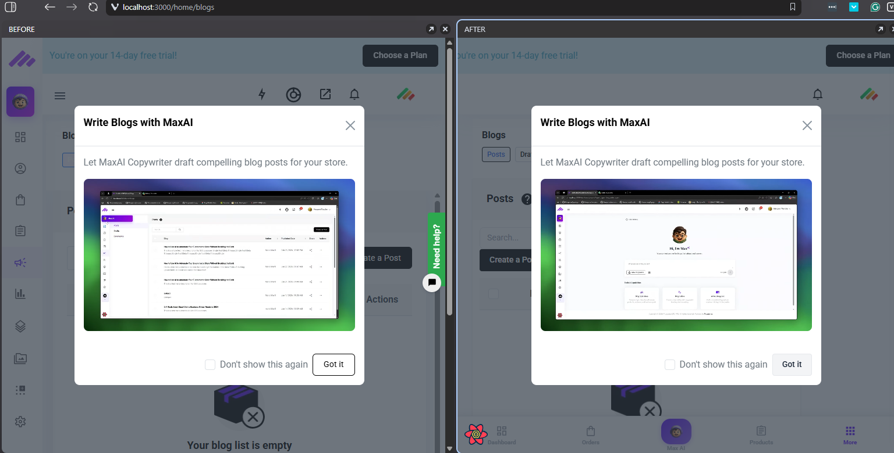

- `28_Screenshot_2026-06-10_094238.png` (source: comment, uploader: Angelo Kamachi)

  

## Comments (24)

### Cyril Ayson (2026-10-23T03:58:16.974Z)

SUMMARY: MY PAGES P1 TO P9 ARE DEPLOYED TO PRODUCTION

Every page assigned to me under this task (P1 to P8, then P9 Media Library) is migrated from Bootstrap to Tailwind v4, passed Mam Aira's QA, and is live on production. All their subtasks are Deployed to Prod.

DEPLOYED PAGES
1. P1 Dashboard: main #7560 (https://github.com/Prosperna/prosperna1/pull/7560), Jul 31
2. P2 Contacts (Contacts/Lead Listing, Send Email, Send SMS, Delete Contact, Individual Lead Dashboard): main #7857 (https://github.com/Prosperna/prosperna1/pull/7857), Sep 17
3. P3 Orders (View Customer Orders, Order Page): main #8655 (https://github.com/Prosperna/prosperna1/pull/8655), Oct 16
4. P9 Media Library: main #8590 (https://github.com/Prosperna/prosperna1/pull/8590), Sep 30
5. P4 Products, P5 Categories, P6 Add-Ons, P7 Product Labels, P8 Product Reviews: one promotion, main #8659 (https://github.com/Prosperna/prosperna1/pull/8659), Oct 22

HOW IT WAS DELIVERED
- Every QA return and code-review round went to dev first, then to staging, then to main.
- Approximate dev PR counts: Dashboard 20, Contacts 28, Orders 17, Products P4 to P8 41, Media Library 30.
- The staging and main promotions were each reviewed and approved by Kuya Ian. Mam Aira smoke-tested them on staging.

HIGHLIGHTS FOR MERCHANTS
- Mobile-first layouts:
  - Orders list as mobile cards with "More details"; the product listings use card views on phones.
  - The dashboard date picker opens as a bottom sheet on phones.
  - The product form fits a phone screen, with the Save bar pinned to the bottom.
- Dashboard quick filters: Today, This Week and This Month, one tap instead of three.
- Inventory: the Stock Alert card with 1-click Quick Reorder, and the Update Quantity window with real per-location stock.
- Product form: a side menu that follows the scroll, a compact floating Save bar with "Unsaved changes", Duplicate Product on Edit only, and safer media saves after a failed digital upload.
- Media Library: a two-pane Edit modal (Resize, Rotate & Flip, Crop) and "Edit with AI" with the AI Studio (Magic Eraser, Enhance, Filters, Background).
- Consistent shared Tailwind components across these pages: table and pagination, modals, dropdowns, tooltips and buttons. This includes fixes such as menus no longer being clipped by tables or hidden behind modals.
- These improvements also complete the Prosperna Admin Optimization task (https://app.clickup.com/t/7537039/86exrw1uc), now Deployed to Prod.

STILL OPEN UNDER THIS TASK (shared, not blocking my pages)
- Unified tailwind Components (86exzzc2q): in development, with Angelo and Mam Aira.
- App Wide Cleanup (86eyrdm4y): in product grooming.
- The remaining pages (P10 Store Settings, Finance, Marketing, Page Builder and the settings pages) are Angelo's.
- Related follow-ups owned by others: the frontend half of Kuya Ian's multilocation fix (86eyqf5gf). Its backend part has been live since Oct 15. Also Mico's table page-reset PRs to main (#9103, #9105).

Thank you to Mam Aira for the QA rounds and to Kuya Ian for the reviews!

### Angelo Kamachi (2026-10-16T04:51:26.981Z)

Angelo Kamachi
STATUS UPDATE: ANGELO'S STANDARDIZATION BRANCHES (Oct 16, 2026)
---
1. MARKETPLACE
Status: Staging smoke tests passed. Production PR open (ready for testing).
Latest Return Fixed: Code review return on PR #8971 by Ian Pelea (addressed in dev via #8974 and staging via #8975) — pressing Escape in "Add Credit Card" modal accidentally bubbled up and canceled the checkout dialog, discarding the merchant's plan and payment selections.
Next Steps: Awaiting Kuya Ian's code review and merge of production PR #8971 into main.

Pull Requests (5 Newest):
#8975 [staging | MERGED] — Promotes #8971 review fixes into staging carrier v22. Prevents checkout Escape.
#8974 [dev | MERGED] — Prevents modal Escape from canceling checkout. Scopes useEscapeToHide locally.
#8971 [main | OPEN] — Production promotion of Marketplace Tailwind migration across 81 files.
#8936 [staging | MERGED] — Fixes app logo containment in _helper.scss and modal dialog layering.
#8935 [dev | MERGED] — Gives Add Credit Card modal tw:z-[1060]! above checkout panel. Fixes field spacing.
(+ 13 older PRs: #8910, #8909, #8898, #8897, #8878, #8877, #8864, #8863, #8862, #8861, #8860, #8859, #8857)
---
2. PAGE BUILDER
Status: Blocked on dev; failed QA return logged today, Oct 16 (ready priority).
Latest Return Required (by QA): Logged on ClickUp (86ey1p7dy) by Aira Pilor on dev (Oct 16, 09:47 AM):
TC #11: On mobile (390px), tapping the ? icon on Cookie Policy fails to open tooltip.
TC #13 & #16: Last table row "..." menu opens downward over pagination instead of upward.
TC #19: Template Library last row "..." menu opens downward over page numbers instead of upward.
Next Steps: Fix the 3 return items on refactor/tw-page-builder-standard, test locally, cherry-pick to dev, and update staging carrier PR #8949.

Pull Requests (5 Newest):
#8949 [staging | OPEN] — Promotes Page Builder Tailwind migration and all QA fixes in staging carrier v5.
#8948 [dev | MERGED] — Constrains portaled dropdown menus to screen and flips only on real scrollers.
#8933 [staging | CLOSED] — Carrier v4 promoting mobile layout stacking across Page Builder & Mega Menu.
#8922 [staging | CLOSED] — Carrier v3 promoting Grid ref forwarding and tab accessibility updates.
#8905 [staging | CLOSED] — Carrier v2 updating grid breakpoints and SEO form labels. Superseded by v3.
(+ 6 older PRs: #8904, #8880, #8879, #8835, #8834, #8827)
---
3. FINANCE
Status: Passed testing on dev; marked ready for deployment as of Oct 15, 2026.
Latest Return Fixed: Round 10 QA return logged on ClickUp (86ey1p76h) and resolved in dev via #8902, #8912, #8923, and #8938 — fixed invalid Add Bank Account grey borders, 1.5rem card spacing drift, and balance card amount line-heights.
Next Steps: Ready for staging and main promotion PR creation.

Pull Requests (5 Newest):
#8938 [dev | MERGED] — Restores line-height on balance cards to prevent clipping; fixes card gap.
#8923 [dev | MERGED] — Re-aligns Balances cards and buttons with SaaS design system's 1.5rem base spacer.
#8912 [dev | MERGED] — Fixes card padding and divider spacing on Withdrawal Settings "My Banks" view.
#8902 [dev | MERGED] — Scopes red border rule to Add Bank Account form so invalid fields display red.
#8888 [dev | MERGED] — Derives exact rem values from Sass overrides; restores dark hover on Cancel.
---
4. MARKETING
Status: Passed testing on dev; marked ready for deployment as of Oct 16, 2026.
Latest Return Fixed: QA return on subtask 86ey5dnpn (Blogs) fixed in dev via #8934 — Categories click in blog editor left menu kept SEO highlighted due to scroll spy balance calculation.
Next Steps: Ready for staging and main promotion PR creation.

Pull Requests (5 Newest):
#8934 [dev | MERGED] — Restores end-of-form scroll threshold in ScrollSpyNav so Categories activates.
#8921 [dev | MERGED] — Restores visible dark button hover states on Marketing action bars to match main.
#8854 [dev | MERGED] — Fixes Discounts End Time date validation; renders Edit modal outside dropdown.
---
5. SETTINGS
Status: Shipping, Payment, Digital Products, Users, and Messaging are ready for deployment. Store Settings round 5 fix is on dev under ready for testing.
Latest Return Fixed: Round 5 QA return on Store Settings (86ey18b48) fixed in dev via #9002 — panel resize failed to re-measure after the 400ms menu collapse animation, leaving a 40px–187px gap above the footer.
Next Steps: Awaiting QA verification of Store Settings #9002 on dev, then proceed with promotion PRs.

Pull Requests (5 Newest):
#9002 [dev | MERGED] — Uses ResizeObserver on body & sidebar to re-fit panel on viewport size changes.
#8979 [dev | MERGED] — Stacks J&T connected status below badge on phones to prevent horizontal squeeze.
#8959 [dev | MERGED] — Adds delayed re-measure after window resize settles to prevent panel truncation.
#8853 [dev | MERGED] — Fixes Lalamove phone wrap; restores Order Management title & tooltip icon tests.

### Cyril Ayson (2026-10-16T03:38:12.652Z)

STATUS UPDATE: MY PAGES (Oct 16)

IN PRODUCTION
- P1 Dashboard (86exzjnrp), P2 Contacts (86ey03q1a), P9 Media Library (86ey18avv).
- P3 Orders (86exzpy5r): main PR https://github.com/Prosperna/prosperna1/pull/8655 merged on Oct 16. The last QA fix (order detail values wrapping on phones) went with it via staging #8940.

REMAINING: PRODUCTS (P4 to P8)
This is the last group from my side. It's on staging since Oct 8 (#8658); the main PR is what brings it to production.
- Staging follow-up PR: https://github.com/Prosperna/prosperna1/pull/8804
- Main PR: https://github.com/Prosperna/prosperna1/pull/8659
Both are in Kuya Ian's review (changes requested on the last round; all of it is addressed and re-requested today). Both merge cleanly. #8659 needed a merge with main's new Senior/PWD section today, which is resolved.

What was fixed this week (all from QA on DEV and Kuya Ian's reviews, carried to both PRs):
1. Create Product: the slug field now shows typed text and keeps hyphens.
2. Product form: Manage Locations and the add-on "More details" no longer submit the form.
3. Section lines, the variants Minimum Order Quantity box and the related product rows match production.
4. Product Reviews: filters on phones and tablets, image sizes on the single review page, and a review with only a video now shows its video (P8 case 31; that one was also broken on production).
5. Create Digital Product when the file upload fails: no duplicate product, the form keeps what was entered, Save retries on the same product, and thumbnails aren't added twice or left behind (cases 58, 58c, 58c-3, 58c-4, 58d).

Where QA stands:
- P5 Categories, P6 Add-Ons, P7 Product Labels: ready for deployment.
- P4 Products: ready for testing. Re-test of 58c-4 on dev (#9005).
- P8 Product Reviews: re-test of case 31 on dev (#9001).

BLOCKER FOR THE PRODUCTS PRODUCTION RELEASE
- Kuya Ian's 86eyqf5gf (multilocation stock Update + add-ons fixes). Without it, #8659 alone would bring an add-ons bug to production (saved add-ons show unticked, and ticking one drops the others). Mam Aira's Oct 13 dev re-test failed 3 cases there, and its staging/main PRs aren't open yet. I've asked Kuya Ian for the ETA and release order: https://app.clickup.com/t/86eyqf5gf?comment=1100740000169049
- Backend multilocation fixes (z93r0b6d76, z93r0b6d8b) are already on staging and production as of Oct 14 and 15.
- Adrianne's 86eyjwg0n (#8489 / #8458): per-location stock on other pages refreshes only after a reload until it's promoted. It doesn't block the release, but those staging test items stay "blocked".

NEXT
1. Mam Aira re-tests P4 58c-4 and P8 case 31 on dev.
2. Kuya Ian re-reviews #8804 and #8659.
3. 86eyqf5gf is fixed and ready to ship right behind #8659.
4. Merge #8804, then #8659, then a production smoke test of the product pages and multilocation stock.

### Cyril Ayson (2026-10-08T09:07:53.551Z)

STATUS UPDATE: MY PAGES (Oct 8)

IN PRODUCTION
- P1 Dashboard (86exzjnrp): deployed to prod
- P2 Contacts (86ey03q1a): deployed to prod
- P9 Media Library (86ey18avv): deployed to prod

NOW ON STAGING
- P3 Orders (86exzpy5r): staging PR https://github.com/Prosperna/prosperna1/pull/8654 merged on Oct 8.
- P4 Products, P5 Categories, P6 Add-Ons, P7 Product Labels, P8 Product Reviews (86exzpyxh, 86ey03v31, 86ey03w9u, 86ey03wm4, 86ey03y55):
  - The staging PR https://github.com/Prosperna/prosperna1/pull/8658 merged on Oct 8 after Kuya Ian approved it.
  - All 14 Products tasks and subtasks passed QA on dev.

WHAT'S LEFT
Products (P4 to P8):
1. A quick fix found on staging, already merged to dev (https://github.com/Prosperna/prosperna1/pull/8803):
   - Update Quantity now shows each product's real stock per location.
   - The Add-ons buttons and phone layout on the product form are fixed.
   Next: Mam Aira re-tests cases 52 and 53 on DEV, then Kuya Ian reviews the staging PR https://github.com/Prosperna/prosperna1/pull/8804 before it merges.
2. Staging smoke test by Mam Aira (checklist on P4).
   - Blocker: on staging, multilocation stock (Stock Alert > Adjust Stock / Quick Reorder, Edit Product > Multilocation Inventory) depends on fixes that are only on dev:
     - Kuya Ian's 86eyqf5gf;
     - products-service #1288 and the is_assigned fixes;
     - Adrianne's Multi-Location work 86eyjwg0n (#8489 / #8458).
     Those items are marked blocked, not failed, until they're promoted.
3. Main PR https://github.com/Prosperna/prosperna1/pull/8659: approved before the staging fix was added, review re-requested from Kuya Ian. It merges after the staging smoke test passes. That deploys Products to production.
4. After release: a production smoke test of multilocation stock, plus the pages outside Products this touches (Store Settings help icons, Leads, Reports > Filters).

Orders (P3):
5. Main PR https://github.com/Prosperna/prosperna1/pull/8655 is open. It merges after the Products main PR #8659.

Shared:
6. App Wide Cleanup (86eyrdm4y): still in product grooming.

Follow-ups to raise as their own tickets:
- staging's TooltipIcon is behind main;
- about 412 product spacings came out tighter in the migration;
- the Related Items Preview cards are narrow on phones.

### Cyril Ayson (2026-10-01T02:48:11.693Z)

PRODUCTS PROMOTION PRS OPEN (P4 to P8)

The Products page group (P4 Products, P5 Categories, P6 Add-Ons, P7 Product Labels, P8 Product Reviews) is ready for production and waiting for code review.

STAGING PR: https://github.com/Prosperna/prosperna1/pull/8658
MAIN PR: https://github.com/Prosperna/prosperna1/pull/8659

Four subtasks are still in testing: View Category, Create Product Label, View Product Label, View Product Review. Details: https://app.clickup.com/t/86exzpyxh?comment=1100740000112499

### Cyril Ayson (2026-09-29T03:23:58.235Z)

Update for this task, All my work assigned to me has passed the initial QA sweep and will now be undergoing code review phase, currently 1 code review has returned 86ey18avvand is currently being retested, and I am now opening 2 prs for Orders page 86exzpy5r and everything under products 86exzpyxh including p5 to p8 as they are all sharing one branch under products/inventory. Total of 3 branches being opened and pushed this week from my end. Thanks.

### Ian Pelea (2026-09-25T14:13:40.270Z)

Cyril, Angelo — what's the realistic finish date on this, and more specifically when does it reach staging and main?

Asking because it's now blocking releases rather than just being in progress. dev has the Tailwind version of these pages; staging and main are still on Bootstrap and react-bootstrap. That gap means any feature built on dev can't be promoted, it has to be hand-rewritten back to Bootstrap for each environment.

I'm doing exactly that today for Shipping Credits. prosperna1 dev is 2,622 commits ahead of main and 2,615 ahead of staging, and 17 files in this feature have to be ported by hand because the same components use Dialog and Transition on dev and Modal on staging. viewOrder/index.jsx alone differs by 744 added and 614 removed lines between the two. That's a day of careful work for one feature, it carries real risk of breaking the order page, and every future feature pays it again until the standardization lands in staging and main.

Two questions:

What's left, and when do you expect it done? The roadmap in the description still says "June 10, 2026 - Day 3", so it isn't telling anyone where this actually stands.
When will it be promoted to staging and main? Finishing on dev doesn't unblock anything on its own. If there's a reason it's being held on dev, say so and we'll plan around it.

If a date isn't possible yet, the list of what's still outstanding would help. I mainly need to know whether to keep hand-porting features backwards or wait for this.

### Cyril Ayson (2026-09-24T01:50:22.468Z)

Update on this task for my end, the only page that has currently not passed the initial QA sweep is P4: Products page86exzpyxh, for the rest it is currently undergoing code review or I am preparing it for Code review by opeing the PR, I am currently just staggering my code review requests since I am prioritizing more urgent or larger tasks. Thank you.

### Cyril Ayson (2026-09-17T01:04:53.479Z)

Update for this task for my end, Deploying my 2nd tailwind migration leg(p2 Contacts/leads), Currently working on a regression in media library and fixing returns for p4 products. Thank you.

### Cyril Ayson (2026-08-27T08:08:19.382Z)

Update for this Main tasks on my end, Currently My contacts/leads page is being tested in staging again after 2 rounds of code review(2nd one caused by a merge conflict and code reviewer requested tailwind tokens reorganizing). Still In testing in Dev is the Media Library and orders page, and Inventory.

### Dyne (2026-08-17T04:17:20.031Z)

@Cyril Ayson @Angelo Kamachi What is your estimated date to complete this task? cc @Dennis Velasco @Fro Oliva

### ClickBot (2026-08-10T09:29:32.490Z)

This task Merchant Side | Front - End Standardization has been move back to IN DEVELOPMENT 
as tag QA return
Date updated: Aug 10 2026, 5:29PM (Asia/Singapore)
Triggered by: Angelo Kamachi

### ClickBot (2026-08-10T09:29:29.790Z)

This task Merchant Side | Front - End Standardization hss been move to IN TESTING 
Updated: Aug 10 2026, 5:29PM (Asia/Singapore)
Triggered by: Angelo Kamachi

### ClickBot (2026-08-10T09:29:28.346Z)

This Merchant Side | Front - End Standardization has been move to READY FOR TESTING
Date updated: Aug 10 2026, 5:29PM (Asia/Singapore)
Triggered by: Angelo Kamachi

### Cyril Ayson (2026-08-05T07:43:53.406Z)

Screenshot (2990).png
@Aira Pilor Fixed side filter modal

### Aira Pilor (2026-08-05T03:04:02.827Z)

This task has been updated.

Kindly fix all the issue documented on each subtasks.
cc @Cyril Ayson @Angelo Kamachi

### Cyril Ayson (2026-07-28T07:54:50.547Z)

I will pass the fixes based on the code review tonight for the next code review.

### Cyril Ayson (2026-07-23T01:58:49.603Z)

ACCOMPLISHED:
- Resolved QA return items reported on Contacts/Lead Listing & P2: Contacts Page.
- Fixed Delete Lead confirmation prompt typo (Would you like to proceed?).
- Fixed customer_type filter empty state checking and empty state rendering.
- Standardized Export Contact button styling and right-aligned Amount Spent column values.
- Pinned footer buttons in Email and SMS modals to prevent cropping on mobile screens.
- Added max-height scroll wrapper to Tags modals to prevent unlimited tag stacking.

PULL REQUESTS:
- Dev PR: https://github.com/Prosperna/prosperna1/pull/7522

HOW IT WAS TESTED:
- Ran Vitest suite for src/pages/home/Leads (31 test files, 536 tests 100% PASSED).
- Ran ESLint --fix (0 errors, 0 warnings).

NEXT STEPS:
- QA testing and sign-off on DEV.
- Promotion to Staging & Main.

### Cyril Ayson (2026-07-21T05:41:09.829Z)

Update for this task for pages assigned to @Cyril Ayson specifically, I am already making fixes based on the QA returns by @Aira Pilor, which most of the issues in Dashboard page already being fixes and only small things remaining. For other 4 pages(Contacts,Orders,Products) I will be doing these pages after finishing the customer pages. For Media Library I only need to re upload the branch I am using and have QA check it once more.

### Cyril Ayson (2026-06-25T00:40:39.499Z)

@Aira Pilor Hi Ms. Aira, Some of our Pages, are ready for testing and is in dev, just waiting for your comments so we can make adjustments based on feedback

### Angelo Kamachi (2026-06-11T07:22:35.177Z)

image.png
/pages/home/pricing

### Angelo Kamachi (2026-06-10T05:12:06.729Z)

image.png
image.png
image.png
image.png
/pages/home/lead-listings

### Angelo Kamachi (2026-06-10T02:52:11.632Z)

Screenshot 2026-06-09 100733.png
Screenshot 2026-06-09 100941.png
Screenshot 2026-06-09 101121.png
Screenshot 2026-06-09 101524.png
/pages/account/ changes
Screenshot 2026-06-09 142521.png
/pages/onBoarding
Screenshot 2026-06-09 145328.png
/pages/UserControl
Screenshot 2026-06-09 160140.png
/pages/NotificationCenter
Screenshot 2026-06-10 093718.png
Screenshot 2026-06-10 094238.png
/pages/home/Blogs/

no human intervention as of now, spotted some unstandardized features not listen in the DESIGN.md

### ClickBot (2026-06-10T02:14:02.787Z)

This task Front - End Standardization has been created 
Date: Jun 10 2026, 10:14AM (Asia/Manila)
By Cyril Ayson

