# Business Operations

- **Task ID**: `86ey5ah7n`
- **URL**: https://app.clickup.com/t/86ey5ah7n
- **Status**: in testing
- **Assignees**: Angelo Kamachi, Aira Pilor
- **Created**: 2026-07-03T09:26:58.691Z
- **Updated**: 2026-11-03T01:23:08.031Z
- **List**: P1 Delivery
- **Folder**: Shared with me

## Description

_No description_

## Media (28)

- `01_tc09-url-tooltip-after-tap.png` (source: attachment, uploader: Aira Pilor)

  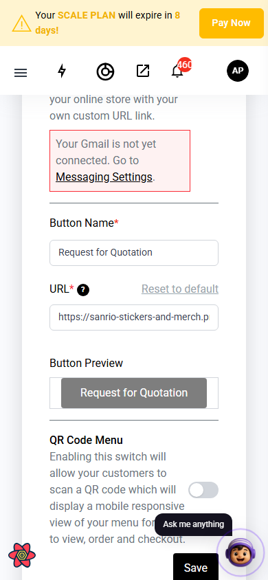

- `02_tc09-url-tooltip-hover.png` (source: attachment, uploader: Aira Pilor)

  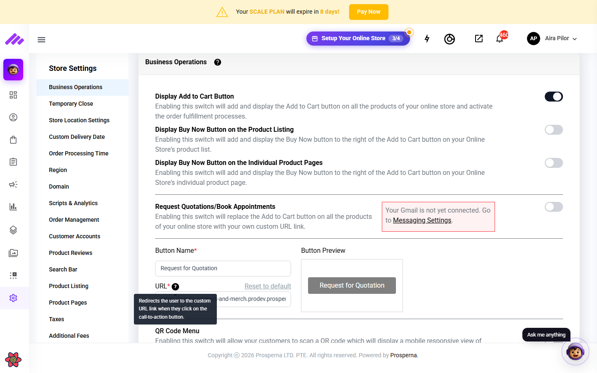

- `03_tc08-rfq-row-mobile.png` (source: attachment, uploader: Aira Pilor)

  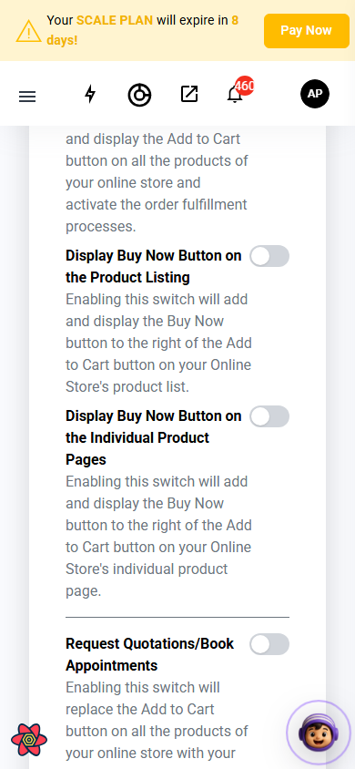

- `04_tc07-qr-codes-mobile.png` (source: attachment, uploader: Aira Pilor)

  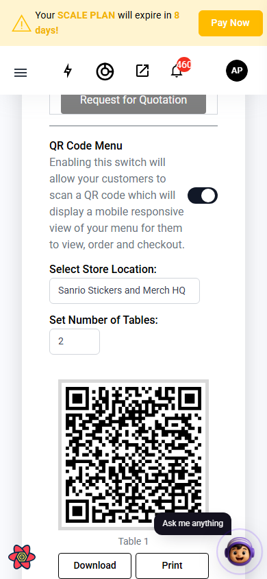

- `05_tc06-qr-code-menu-switch.png` (source: attachment, uploader: Aira Pilor)

  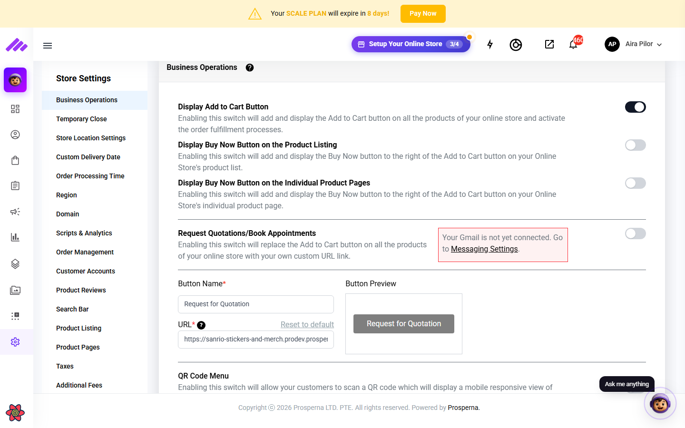

- `06_mobile-business_op.png` (source: attachment, uploader: Aira Pilor)

  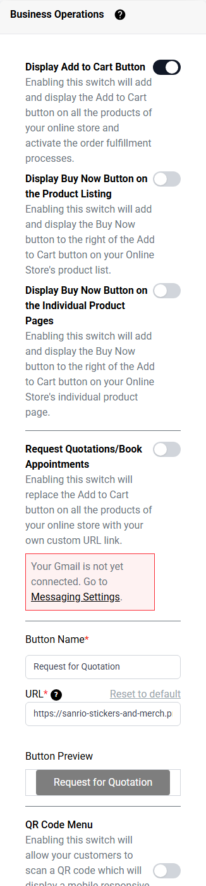

- `07_tc02-business_op-after-tap.png` (source: attachment, uploader: Aira Pilor)

  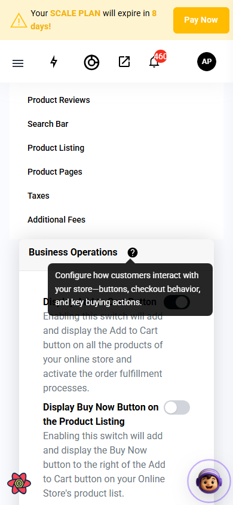

- `08_tc01-business_op-tooltip-open.png` (source: attachment, uploader: Aira Pilor)

  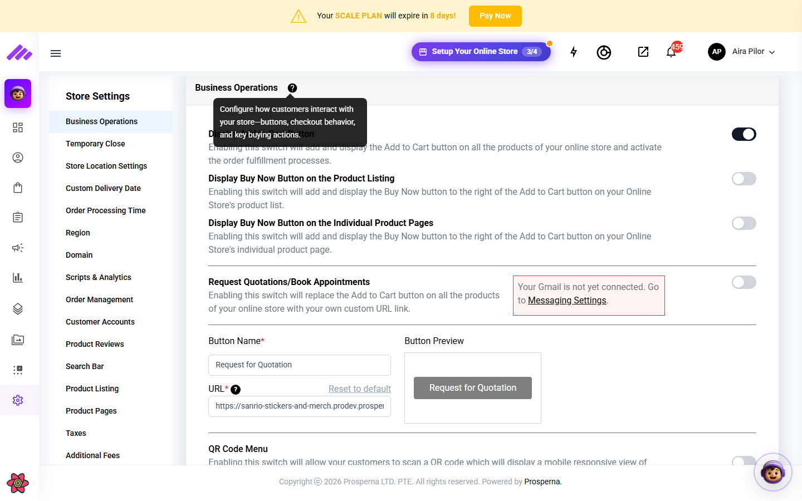

- `09_image.png` (source: attachment, uploader: Angelo Kamachi)

  

- `10_image.png` (source: attachment, uploader: Angelo Kamachi)

  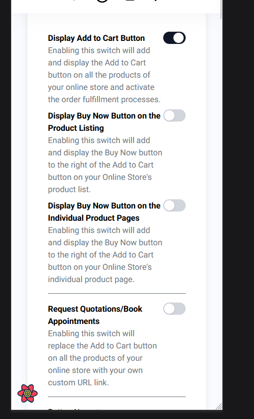

- `11_image.png` (source: attachment, uploader: Angelo Kamachi)

  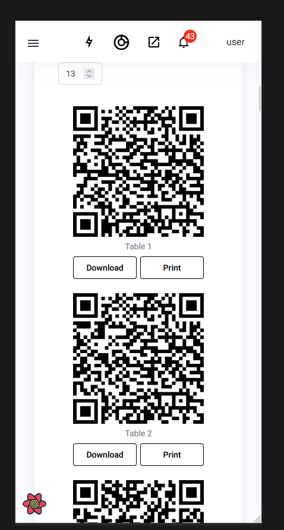

- `12_image.png` (source: attachment, uploader: Angelo Kamachi)

  

- `13_image.png` (source: attachment, uploader: Angelo Kamachi)

  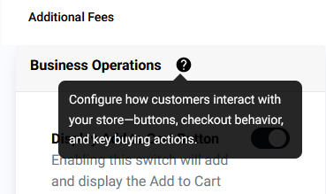

- `14_image.png` (source: attachment, uploader: Aira Pilor)

  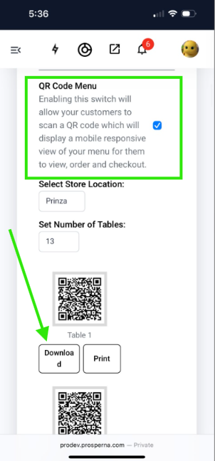

- `15_image.png` (source: attachment, uploader: Aira Pilor)

  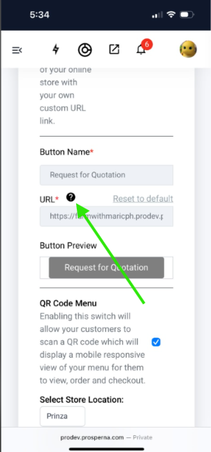

- `16_image.png` (source: attachment, uploader: Aira Pilor)

  

- `17_image.png` (source: attachment, uploader: Aira Pilor)

  

- `18_image.png` (source: attachment, uploader: Aira Pilor)

  

- `19_image.png` (source: comment, uploader: Angelo Kamachi)

  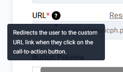

- `20_image.png` (source: comment, uploader: Angelo Kamachi)

  

- `21_image.png` (source: comment, uploader: Angelo Kamachi)

  

- `22_image.png` (source: comment, uploader: Angelo Kamachi)

  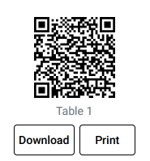

- `23_image.png` (source: comment, uploader: Angelo Kamachi)

  

- `24_image.png` (source: comment, uploader: Aira Pilor)

  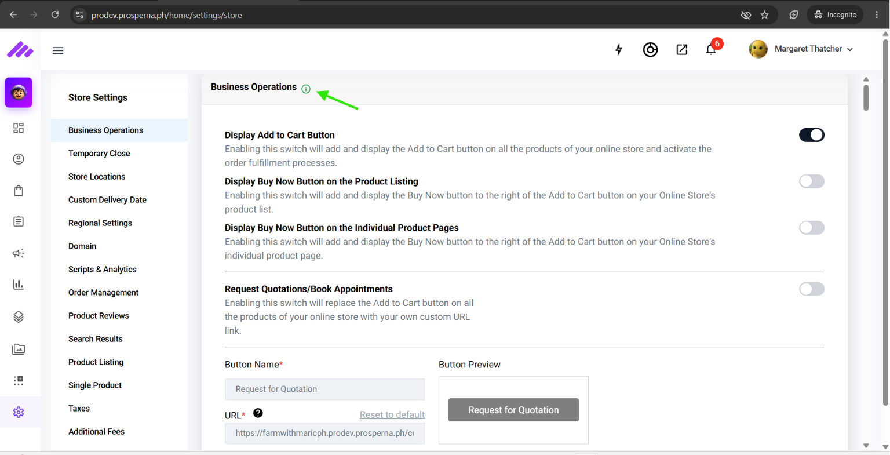

- `25_image.png` (source: comment, uploader: Aira Pilor)

  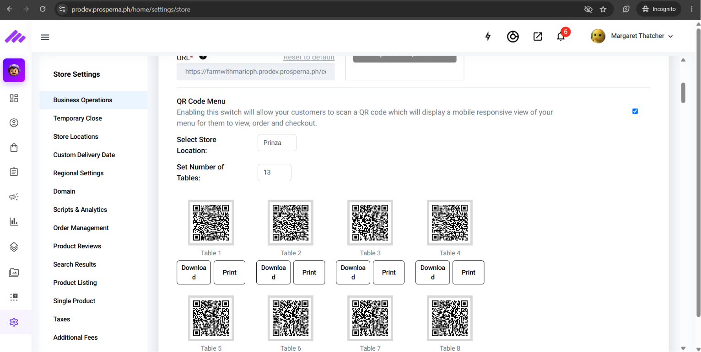

- `26_image.png` (source: comment, uploader: Aira Pilor)

  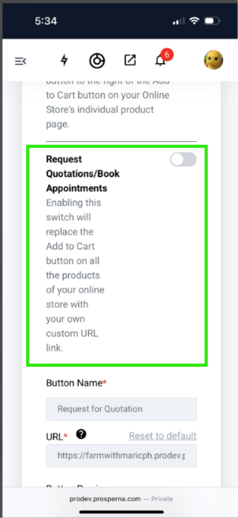

- `27_image.png` (source: comment, uploader: Aira Pilor)

  

- `28_image.png` (source: comment, uploader: Aira Pilor)

  

## Comments (14)

### ClickBot (2026-11-03T01:23:08.031Z)

This task Business Operations hss been move to IN TESTING 
Updated: Nov 3 2026, 9:23AM (Asia/Manila)
Triggered by: Aira Pilor

### ClickBot (2026-10-12T00:58:23.942Z)

This Business Operations has been move to READY FOR TESTING
Date updated: Oct 12 2026, 8:58AM (Asia/Singapore)
Triggered by: Angelo Kamachi

### Angelo Kamachi (2026-10-12T00:35:04.058Z)

QA RETURN FIX: URL "?" tooltip on a touch device (test case #7)

WHAT WAS FIXED
Tapping the "?" beside the URL label on a phone did not show the tooltip.

BRANCH: refactor/tw-settings-standard-v3-dev8 (into dev). Feature branch: refactor/tw-settings-standard-v3.

HOW IT WAS TESTED
- ESLint on the changed files
- Vitest: TooltipIcon, LalamoveConnect and all Store Settings tests (432 passed)
- New tests cover the tap sequence on the "?" tooltip: a tap opens it, a second tap closes it

WHY IT FAILED
The "?" tooltip opened on the emulated hover and the tap's click closed it again in the same gesture. The fix (the "?" now remembers a touch tap and lets the tap alone open/close it) was already merged to dev in commits 377c6f4e3 and c192d9bff, after this QA round was run. This round adds automated tests for the tap so it cannot regress.

NEW QA TEST CASES
1. Tap opens the tooltip
STEPS: On a phone (or touch emulation), open Settings > Store Settings > Business Operations. Tap the "?" beside the URL label.
EXPECTED: The tooltip appears and stays open.
2. Tap elsewhere closes it
STEPS: With the tooltip open, tap anywhere outside the "?".
EXPECTED: The tooltip closes.
3. Second tap closes it
STEPS: Tap the same "?" again.
EXPECTED: The tooltip closes.
4. Only one tooltip at a time
STEPS: Open one "?" tooltip, then tap a different "?" on the page.
EXPECTED: The first one closes and the second one opens.
5. Desktop unchanged (control)
STEPS: At desktop width, hover the "?", then click it, then move the mouse away.
EXPECTED: Hover opens it, the click keeps it open, moving away closes it.

### Aira Pilor (2026-10-06T07:56:32.417Z)

Env: DEV-local
Status: FAILED
URL: http://localhost:3000/home/settings/store?ref_key=business_op

TEST CASE #1: Section title "i" tooltip - desktop (case 1)
STEPS:
Step 1 - Open Settings > Store Settings at desktop width.
Step 2 - Hover the black "i" icon beside "Business Operations".
EXPECTED RESULT: The icon is black and aligned with the title; the tooltip opens without covering the title or being cut off at the screen edge.
EVIDENCE: tc01-business_op-tooltip-open.png
ACTUAL RESULT: Black icon aligned with the title; the tooltip opens below it, fully on screen. PASSED.

TEST CASE #2: Section title tooltip on mobile - tap (case 2)
STEPS:
Step 1 - Open Settings > Store Settings on a phone.
Step 2 - Tap the "i" icon beside "Business Operations" and wait.
EXPECTED RESULT: The tooltip opens on tap and does not close itself.
EVIDENCE: tc02-business_op-after-tap.png
ACTUAL RESULT: Opens on tap and is still open 700ms later. PASSED.

TEST CASE #3: Mobile view - section layout
STEPS:
Step 1 - Open Settings > Store Settings at 390px wide on a touch device.
Step 2 - Scroll to the Business Operations card.
EXPECTED RESULT: The whole card fits the phone screen; nothing runs past the edge and the page does not scroll sideways.
EVIDENCE: mobile-business_op.png
ACTUAL RESULT: The card and everything in it fit the screen; no sideways scroll. PASSED.

TEST CASE #4: QR Code Menu switch (case 6)
STEPS:
Step 1 - With the QR Code Menu app activated and Add to Cart on, view the QR Code Menu row.
EXPECTED RESULT: The toggle is the standard black on-brand switch, not a blue checkbox.
EVIDENCE: tc06-qr-code-menu-switch.png
ACTUAL RESULT: The on-brand switch is shown; no blue checkbox remains. PASSED.

TEST CASE #5: QR Download/Print buttons and mobile QR size (case 7)
STEPS:
Step 1 - Turn the QR Code Menu switch on with a store location that has tables set.
Step 2 - Check the Download/Print buttons on desktop, then view the QR codes on a phone.
EXPECTED RESULT: Button text stays on one line; on mobile the QR code is centred and larger than on desktop, not clipped.
EVIDENCE: tc07-qr-codes-mobile.png
ACTUAL RESULT: "Download" and "Print" stay on one line; on mobile the QR card is centred, larger than on desktop, and fully on screen. PASSED.

TEST CASE #6: Request Quotations/Book Appointments row on mobile (case 8)
STEPS:
Step 1 - View the "Request Quotations/Book Appointments" row at phone width.
EXPECTED RESULT: Title and description use the full width of the row, no large empty gap.
EVIDENCE: tc08-rfq-row-mobile.png
ACTUAL RESULT: The text uses well over 60% of the row and the warning box wraps below it. PASSED.

TEST CASE #7: URL field "?" tooltip (case 9)
STEPS:
Step 1 - Hover the "?" beside the URL label on desktop.
Step 2 - Tap the same "?" on a phone.
EXPECTED RESULT: The tooltip opens on both hover and tap.
EVIDENCE: tc09-url-tooltip-hover.png, tc09-url-tooltip-after-tap.png
ACTUAL RESULT: Hover opens it on desktop. On a phone the tap leaves the tooltip fully transparent - it never appears.

DEFECT: URL "?" tooltip cannot be opened on a touch device

WHERE: Settings > Store Settings > Business Operations, the "?" beside the URL label, phone/tablet.

STEPS TO RECREATE:
Step 1 - Open Settings > Store Settings on a phone.
Step 2 - Tap the "?" beside "URL".

EXPECTED RESULT: The tooltip opens and stays open until you tap elsewhere.

ACTUAL RESULT: Nothing appears. This "?" uses components/TooltipIcon/TooltipIcon.jsx, which has no touch handling: the tap's emulated mouseenter opens it and the click immediately toggles it shut. The touch fix exists only in components/ui/TooltipIcon.jsx (via components/ui/Overlay.jsx), which none of the Store Settings sections import.

### ClickBot (2026-09-04T04:18:09.257Z)

This task Business Operations hss been move to IN TESTING 
Updated: Sep 4 2026, 12:18PM (Asia/Shanghai)
Triggered by: Aira Pilor

### Aira Pilor (2026-09-04T04:18:02.648Z)

QA REPORT — Tailwind v4 standardization pass

Environment: DEV (localhost:3000) for cases 1/2/8; STAGING (prostage.prosperna.ph) for case 6, after activating the QR Code Menu marketplace app there
URL: /home/settings/store
Status: 3/3 PASSED

Section header tooltip is black, aligned with the title, and doesn't overlap it.
Section header tooltip opens on tap at mobile width and stays open (doesn't self-close).
QR Code Menu switch is the on-brand switch, not a blue checkbox - confirmed in DEV's current source. Live-checked on STAGING, which still shows the old checkbox pending this PR's promotion there (expected deployment lag, not a regression).
QR code Download/Print buttons stay on one line and mobile sizing (centered, larger than desktop) match the fix - confirmed in source (text-nowrap, w-[220px]/sm:w-[150px]).
"Request Quotations/Book Appointments" row uses the full row width on mobile once the email-setup warning box is hidden.

No defects found. Pre-existing QR Menu toggle-persist test also re-confirmed passing after the underlying switch component was swapped.

Deferred: URL field tooltip case, which requires RFQ mode active - mutually exclusive with QR Menu, so not chained into this same pass to avoid conflicting state changes. Can be picked up in a follow-up round.

### Angelo Kamachi (2026-08-18T05:28:22.292Z)

image.png
tool tip now working

### Angelo Kamachi (2026-08-18T05:27:54.071Z)

image.png
Paragraphs now more expanded

### Angelo Kamachi (2026-08-18T05:27:08.014Z)

image.png
I expanded QR in mobile for easier viewing

### Angelo Kamachi (2026-08-18T05:18:57.039Z)

image.png
QR buttons no longer cut themselves

### Angelo Kamachi (2026-08-18T05:18:05.157Z)

image.png
tool tips fixed

### Angelo Kamachi (2026-07-30T03:29:57.283Z)

All returns for this subtask fixed in PR #7595 (https://github.com/Prosperna/prosperna1/pull/7595):
Header tooltip: widened + clamped to viewport so it no longer overlaps the title.
QR Code Menu switch: replaced the blue bootstrap checkbox with the on-brand unified switch.
Download/Print buttons: no longer wrap mid-word.
Alignment issue (Request Quotations/Book Appointments on mobile): row now uses full width instead of wasting half of it.
URL field tooltip: now opens on tap, not just hover.

Full breakdown and test cases: https://app.clickup.com/t/86ey18b48?comment=90180242165685
Moving back for retest once the PR merges to dev.

### Aira Pilor (2026-07-03T09:40:42.794Z)

env: DEV
url: https://prodev.prosperna.ph/home/settings/store
Status: FAILED

The following are the issues under business operations:
------Tooltip Icon:
image.png
QR Code Menu:
image.png
Alignment issue:
image.png
image.png
Tooltip is not working:
image.png

Kindly fix all the returns.

Moving this subtask to "Ready Priority"
cc @Angelo Kamachi

### ClickBot (2026-07-03T09:27:03.352Z)

This task Business Operations has been created 
Date: Jul 3 2026, 5:26PM (Asia/Shanghai)
By Aira Pilor

