# Temporary Close

- **Task ID**: `86ey5ahfd`
- **URL**: https://app.clickup.com/t/86ey5ahfd
- **Status**: ready for deployment
- **Assignees**: Angelo Kamachi, Aira Pilor
- **Created**: 2026-07-03T09:27:24.418Z
- **Updated**: 2026-10-07T00:04:50.927Z
- **List**: P1 Delivery
- **Folder**: Shared with me

## Description

_No description_

## Media (32)

- `01_tc14-view-page-actions.png` (source: attachment, uploader: Aira Pilor)

  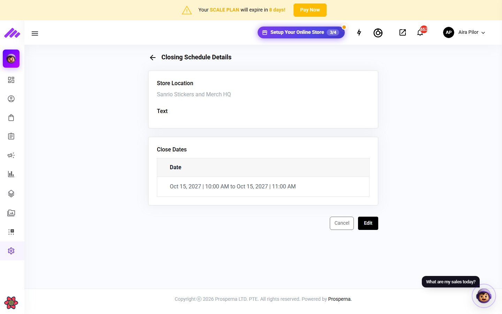

- `02_tc13-edit-mobile.png` (source: attachment, uploader: Aira Pilor)

  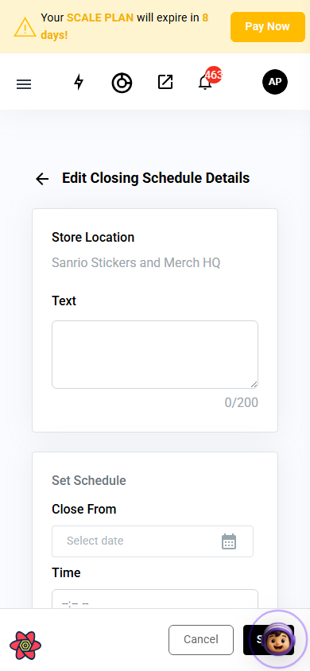

- `03_tc13-edit-desktop.png` (source: attachment, uploader: Aira Pilor)

  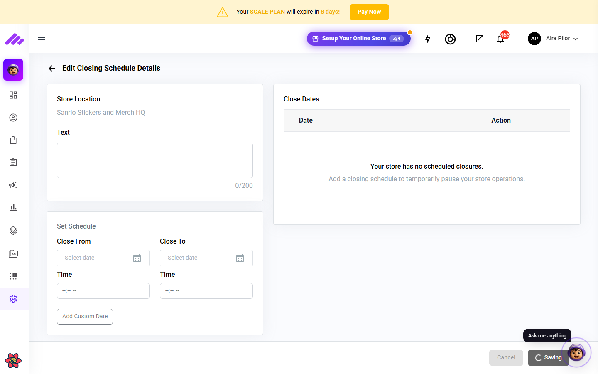

- `04_tc12-actions-menu-mobile.png` (source: attachment, uploader: Aira Pilor)

  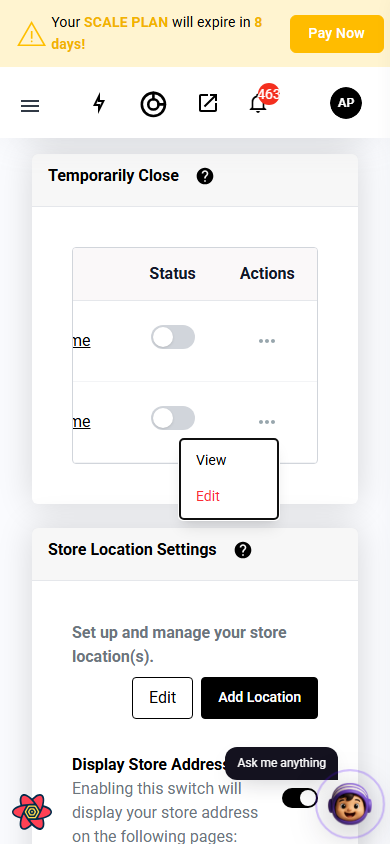

- `05_tc11-calendar-open.png` (source: attachment, uploader: Aira Pilor)

  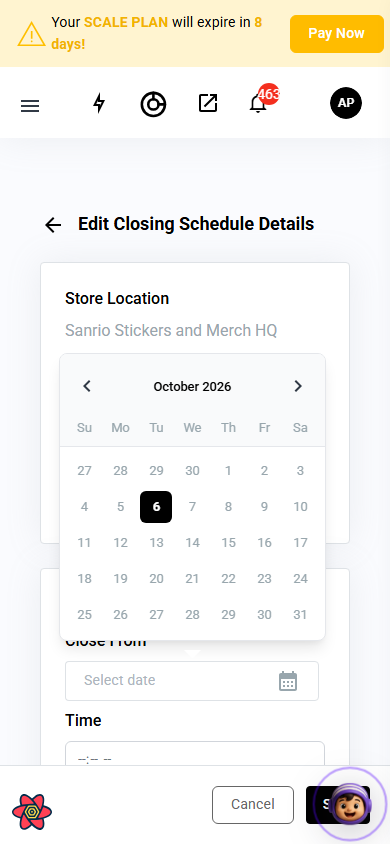

- `06_mobile-temporary_close.png` (source: attachment, uploader: Aira Pilor)

  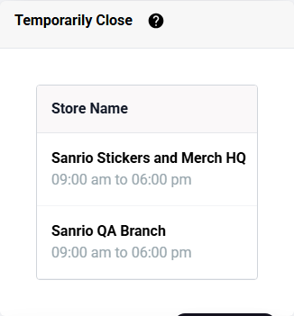

- `07_tc02-temporary_close-after-tap.png` (source: attachment, uploader: Aira Pilor)

  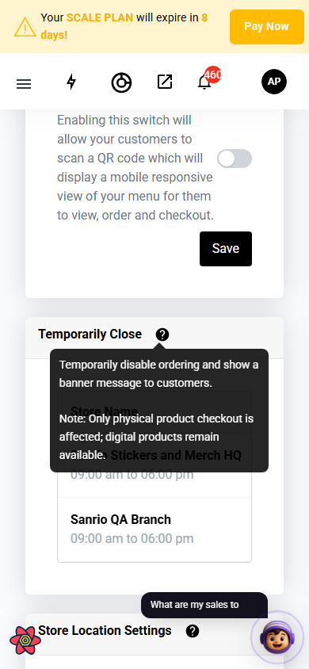

- `08_tc01-temporary_close-tooltip-open.png` (source: attachment, uploader: Aira Pilor)

  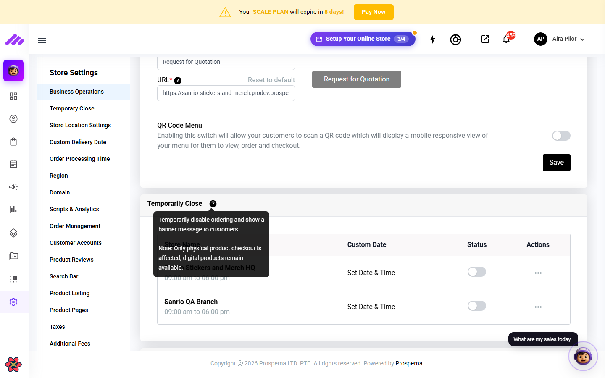

- `09_image.png` (source: attachment, uploader: Angelo Kamachi)

  

- `10_image.png` (source: attachment, uploader: Angelo Kamachi)

  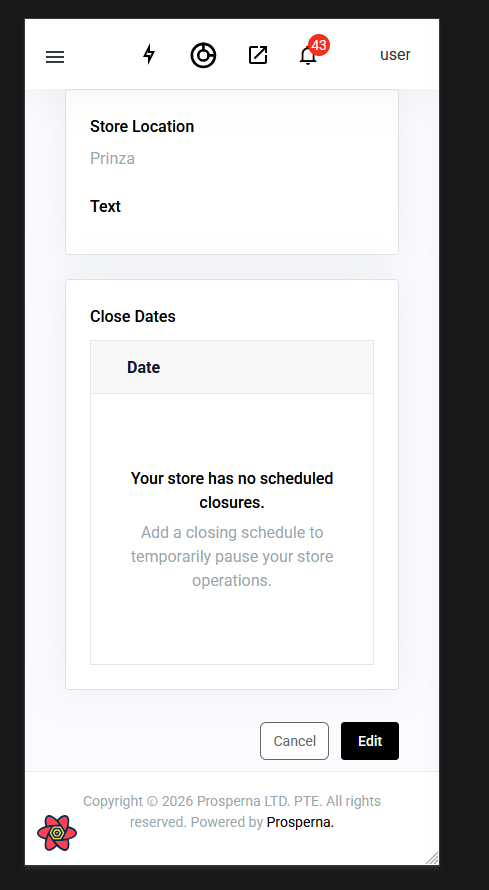

- `11_image.png` (source: attachment, uploader: Angelo Kamachi)

  

- `12_image.png` (source: attachment, uploader: Angelo Kamachi)

  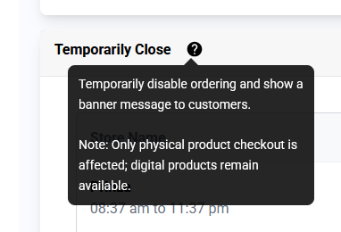

- `13_image.png` (source: attachment, uploader: Angelo Kamachi)

  

- `14_image.png` (source: attachment, uploader: Angelo Kamachi)

  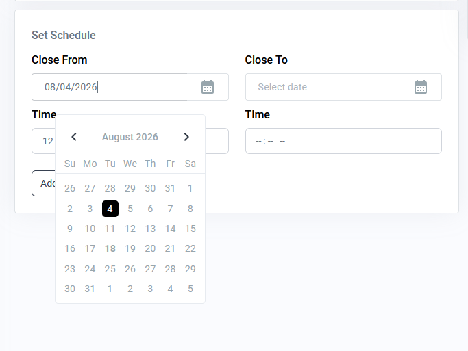

- `15_image.png` (source: attachment, uploader: Aira Pilor)

  

- `16_image.png` (source: attachment, uploader: Aira Pilor)

  

- `17_image.png` (source: attachment, uploader: Aira Pilor)

  

- `18_image.png` (source: attachment, uploader: Aira Pilor)

  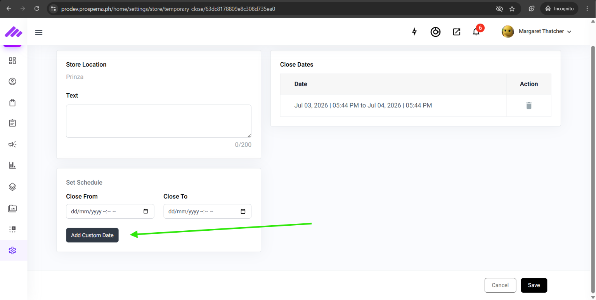

- `19_image.png` (source: attachment, uploader: Aira Pilor)

  

- `20_image.png` (source: attachment, uploader: Aira Pilor)

  

- `21_image.png` (source: comment, uploader: Angelo Kamachi)

  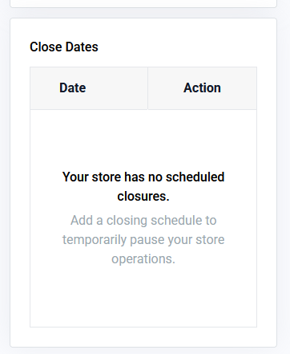

- `22_image.png` (source: comment, uploader: Angelo Kamachi)

  

- `23_image.png` (source: comment, uploader: Angelo Kamachi)

  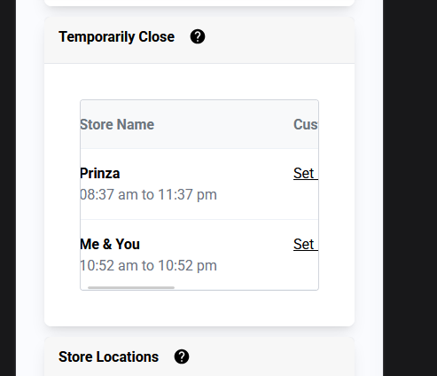

- `24_image.png` (source: comment, uploader: Angelo Kamachi)

  

- `25_image.png` (source: comment, uploader: Angelo Kamachi)

  

- `26_image.png` (source: comment, uploader: Angelo Kamachi)

  

- `27_image.png` (source: comment, uploader: Aira Pilor)

  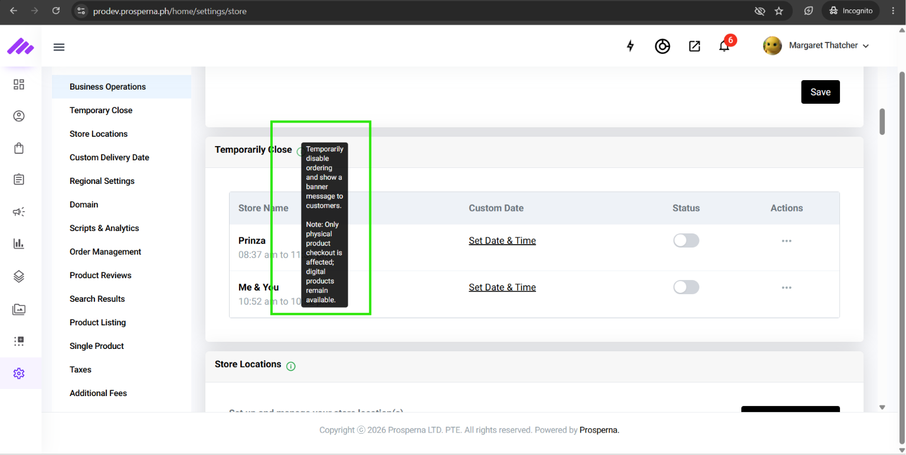

- `28_image.png` (source: comment, uploader: Aira Pilor)

  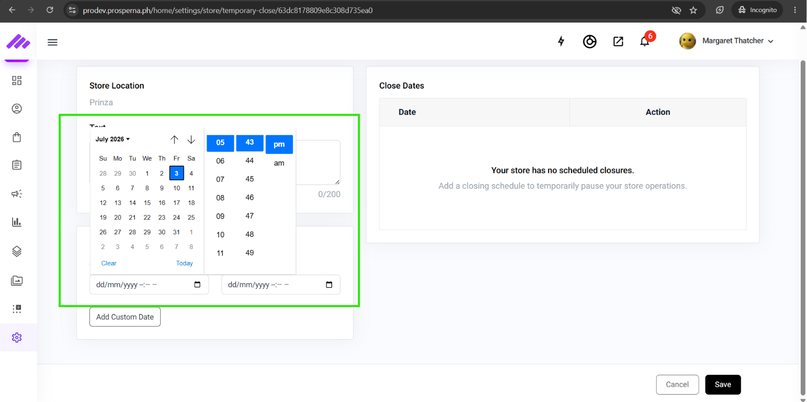

- `29_image.png` (source: comment, uploader: Aira Pilor)

  

- `30_image.png` (source: comment, uploader: Aira Pilor)

  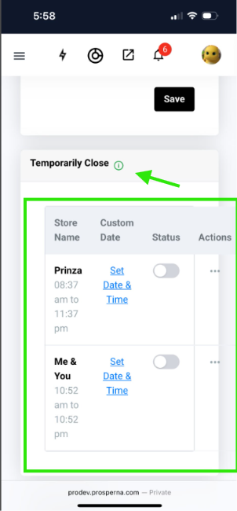

- `31_image.png` (source: comment, uploader: Aira Pilor)

  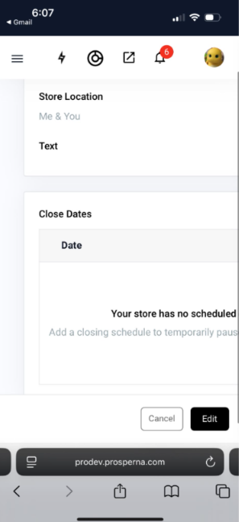

- `32_image.png` (source: comment, uploader: Aira Pilor)

  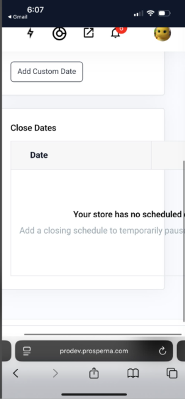

## Comments (13)

### Aira Pilor (2026-10-06T07:57:43.861Z)

Env: DEV-local
Status: PASSED
URL: http://localhost:3000/home/settings/store?ref_key=temporary_close

TEST CASE #1: Section title "i" tooltip - desktop (case 1)
STEPS:
Step 1 - Open Settings > Store Settings at desktop width.
Step 2 - Hover the "i" icon beside "Temporarily Close".
EXPECTED RESULT: Black icon aligned with the title; tooltip opens without covering the title or being cut off.
EVIDENCE: tc01-temporary_close-tooltip-open.png
ACTUAL RESULT: As expected. PASSED.

TEST CASE #2: Section title tooltip on mobile - tap (case 2)
STEPS:
Step 1 - Open Settings > Store Settings on a phone.
Step 2 - Tap the "i" icon beside "Temporarily Close" and wait.
EXPECTED RESULT: Opens on tap and does not close itself.
EVIDENCE: tc02-temporary_close-after-tap.png
ACTUAL RESULT: Opens on tap and stays open. PASSED.

TEST CASE #3: Mobile view - section layout
STEPS:
Step 1 - Open Settings > Store Settings at 390px wide on a touch device.
Step 2 - Scroll to the Temporarily Close card.
EXPECTED RESULT: The card fits the phone screen; the store table scrolls inside its own box; the page does not scroll sideways.
EVIDENCE: mobile-temporary_close.png
ACTUAL RESULT: As expected. PASSED.

TEST CASE #4: Close From / Close To fields (case 11)
STEPS:
Step 1 - Open a store's schedule ("Set Date & Time") on a phone.
Step 2 - Inspect Close From / Close To and click the calendar icon.
EXPECTED RESULT: Separate date and time fields, time below date on mobile; the calendar icon opens the picker; the selected date is black, not blue.
EVIDENCE: tc11-calendar-open.png
ACTUAL RESULT: Separate date and time fields with time below date; the icon opens the calendar; the selected day is black. PASSED.

TEST CASE #5: Store list table and Actions menu on mobile (case 12)
STEPS:
Step 1 - View the store list at phone width.
Step 2 - Open the "..." Actions menu on the last row.
EXPECTED RESULT: The table scrolls sideways instead of clipping; the Actions menu is never cut off.
EVIDENCE: tc12-actions-menu-mobile.png
ACTUAL RESULT: The table scrolls inside its own box and the last row's menu opens fully on screen. PASSED.

TEST CASE #6: Two-column edit layout (case 13)
STEPS:
Step 1 - Open a store's schedule for editing at desktop width, then at phone width.
EXPECTED RESULT: Two columns above the breakpoint, one stacked column below it.
EVIDENCE: tc13-edit-desktop.png, tc13-edit-mobile.png
ACTUAL RESULT: Close Dates sits to the right of Set Schedule on desktop and below it on a phone. PASSED.

TEST CASE #7: View page action buttons (case 14)
STEPS:
Step 1 - Add a future closing date to a store, then open its read-only "View" page.
Step 2 - Inspect the Cancel/Edit buttons.
EXPECTED RESULT: Visible spacing above them and no white box separating them from the footer.
EVIDENCE: tc14-view-page-actions.png
ACTUAL RESULT: Spacing above the buttons and no painted box behind them. PASSED.

### Aira Pilor (2026-09-04T13:50:31.832Z)

QA REPORT — Tailwind v4 standardization pass

Environment: DEV (localhost:3000)
URL: /home/settings/store
Status: 6/6 PASSED

Existing toggle-persist test - re-confirmed passing after this ticket's own component changes.
Time field (Close From/Close To) uses the brand black accent, not browser-default blue.
List table scrolls horizontally on mobile instead of clipping; Actions dropdown (real CSS anchor positioning) is not clipped near the bottom of the table.
Edit page shows two genuine columns at tablet width (1024px) - form on the left, Close Dates table on the right - collapsing to one column below it.
View page's Cancel/Edit buttons have proper spacing above them and no distracting white background box separating them from the footer.
"Add and remove a future closing date" - manually verified working; the underlying two-field date/time picker and calendar interaction is correct.

No defects found. SKIPPED (test data, not a defect): "view a location's scheduled closing dates" - no location on the accounts checked currently has a scheduled closing date configured.

### ClickBot (2026-09-04T13:50:23.607Z)

This task Temporary Close hss been move to IN TESTING 
Updated: Sep 4 2026, 9:50PM (Asia/Shanghai)
Triggered by: Aira Pilor

### Angelo Kamachi (2026-08-18T06:15:57.233Z)

image.png
no clipping

### Angelo Kamachi (2026-08-18T06:15:36.692Z)

image.png
view page now has mobile responsiveness

### Angelo Kamachi (2026-08-18T06:05:01.116Z)

image.png

temporary close now has proper horizontal scrolling

### Angelo Kamachi (2026-08-18T06:01:01.830Z)

image.png
tooltip is now black and aligned

### Angelo Kamachi (2026-08-18T06:00:30.806Z)

image.png
swapped custom date button styling

### Angelo Kamachi (2026-08-18T06:00:10.946Z)

image.png
to promote standardization, I have revised the calendar to match the ones found in /home/discounts. Date and time are no separate inputs

### Angelo Kamachi (2026-08-18T05:28:49.667Z)

Tooltip fix

### Angelo Kamachi (2026-07-30T03:30:07.178Z)

All returns for this subtask fixed in PR #7595 (https://github.com/Prosperna/prosperna1/pull/7595):
Tooltip Text Layout && Tooltip Icon: header tooltip widened + clamped to viewport, no longer overlaps the title.
Date Picker's Color: now brand black instead of browser-default blue.
Mobile View / Blue Text && Cropped && Tooltip Icon / Tap View / Tap Edit: both the store list table and the Close Dates table now scroll horizontally on mobile instead of clipping content.
Hover Effects (Add Custom Date button): reviewed — this is the button's normal :hover fill state, not a bug; the QA screenshot likely caught the cursor mid-hover. Flagging for a second look if you still see it look wrong when NOT hovering.

Full breakdown and test cases: https://app.clickup.com/t/86ey18b48?comment=90180242165685
Moving back for retest once the PR merges to dev.

### Aira Pilor (2026-07-03T10:10:43.758Z)

env: DEV
url: https://prodev.prosperna.ph/home/settings/store?ref_key=temporary_close
Status: FAILED

The following are the issues under Temporary Close:
------Tooltip Text Layout && Tooltip Icon:
image.png
Date Picker's Color:
image.png
Hover Effects:
image.png
Mobile View:
image.png
Blue Text && Cropped && Tooltip Icon
Tap View:
image.png
Tap Edit:
image.png
Kindly fix all the returns.

Moving this subtask to "Ready Priority"
cc @Angelo Kamachi

### ClickBot (2026-07-03T09:27:28.000Z)

This task Temporary Close has been created 
Date: Jul 3 2026, 5:27PM (Asia/Shanghai)
By Aira Pilor

