# Custom Delivery Dates

- **Task ID**: `86ey5bhmv`
- **URL**: https://app.clickup.com/t/86ey5bhmv
- **Status**: in testing
- **Assignees**: Angelo Kamachi, Aira Pilor
- **Created**: 2026-07-03T10:17:35.958Z
- **Updated**: 2026-11-03T01:23:09.791Z
- **List**: P1 Delivery
- **Folder**: Shared with me

## Description

_No description_

## Media (21)

- `01_tc15-time-slot-form-mobile.png` (source: attachment, uploader: Aira Pilor)

  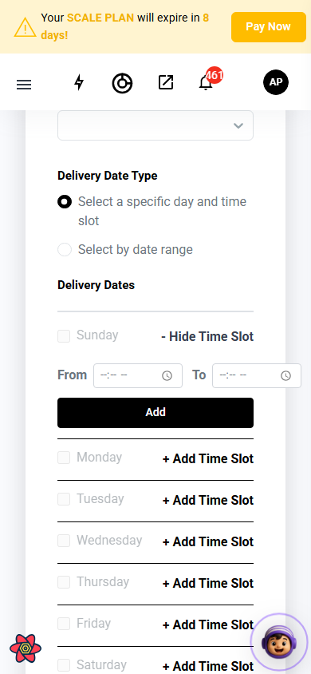

- `02_tc05-custom-delivery-date-tooltips.png` (source: attachment, uploader: Aira Pilor)

  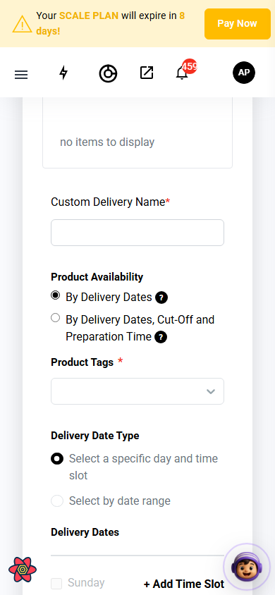

- `03_mobile-customer_delivery_date.png` (source: attachment, uploader: Aira Pilor)

  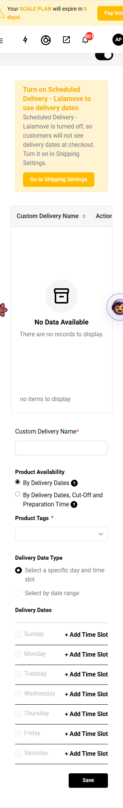

- `04_tc02-customer_delivery_date-after-tap.png` (source: attachment, uploader: Aira Pilor)

  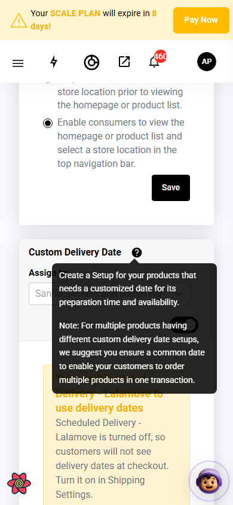

- `05_tc01-customer_delivery_date-tooltip-open.png` (source: attachment, uploader: Aira Pilor)

  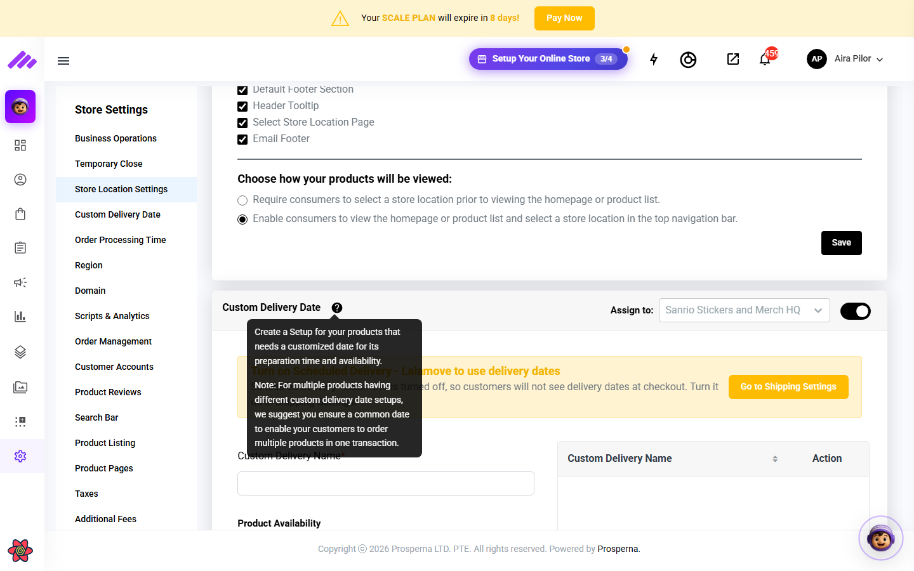

- `06_image.png` (source: attachment, uploader: Angelo Kamachi)

  

- `07_image.png` (source: attachment, uploader: Angelo Kamachi)

  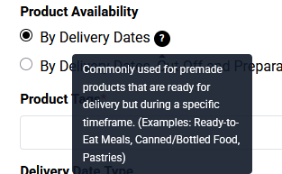

- `08_image.png` (source: attachment, uploader: Angelo Kamachi)

  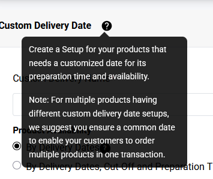

- `09_image.png` (source: attachment, uploader: Aira Pilor)

  

- `10_image.png` (source: attachment, uploader: Aira Pilor)

  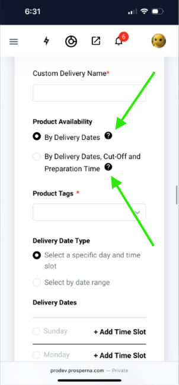

- `11_image.png` (source: attachment, uploader: Aira Pilor)

  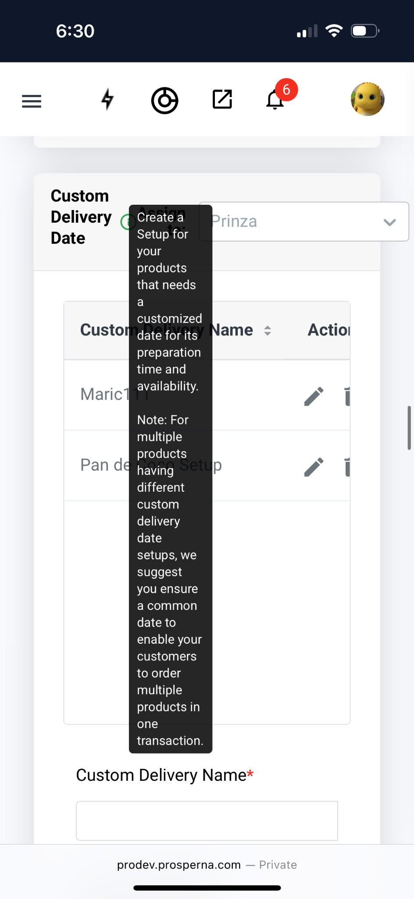

- `12_image.png` (source: attachment, uploader: Aira Pilor)

  

- `13_image.png` (source: attachment, uploader: Aira Pilor)

  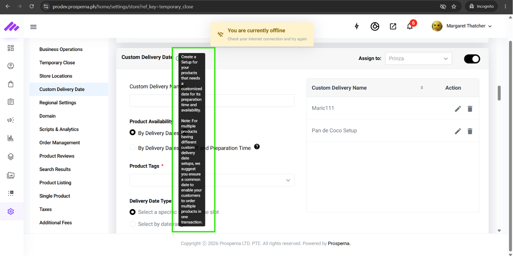

- `14_image.png` (source: comment, uploader: Angelo Kamachi)

  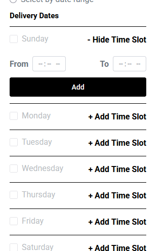

- `15_image.png` (source: comment, uploader: Angelo Kamachi)

  

- `16_image.png` (source: comment, uploader: Angelo Kamachi)

  

- `17_image.png` (source: comment, uploader: Aira Pilor)

  

- `18_image.png` (source: comment, uploader: Aira Pilor)

  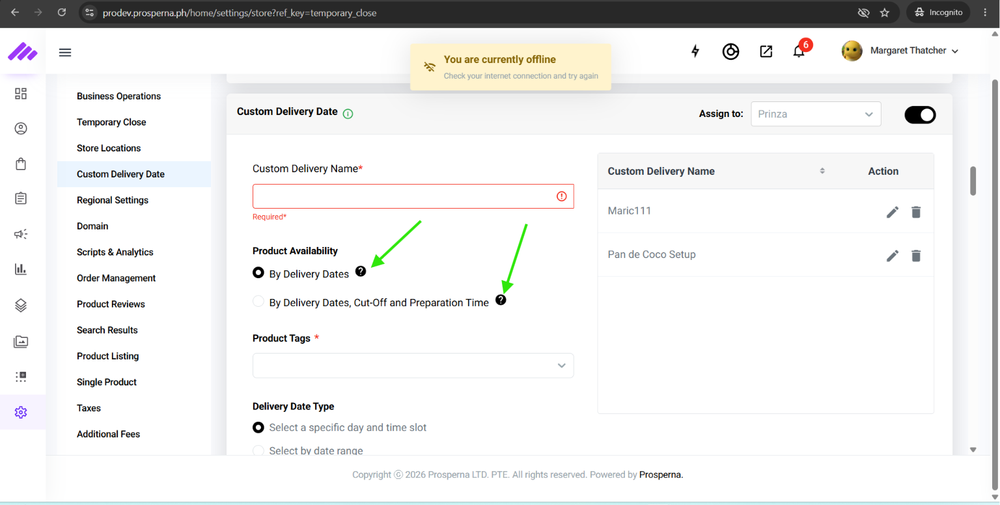

- `19_image.png` (source: comment, uploader: Aira Pilor)

  

- `20_image.png` (source: comment, uploader: Aira Pilor)

  

- `21_image.png` (source: comment, uploader: Aira Pilor)

  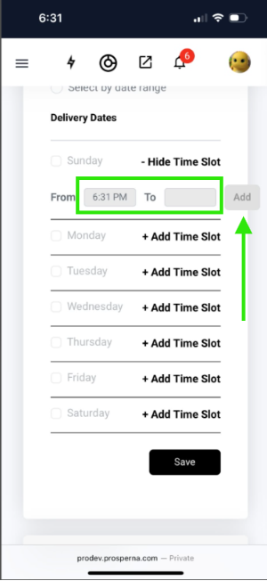

## Comments (10)

### ClickBot (2026-11-03T01:23:09.791Z)

This task Custom Delivery Dates hss been move to IN TESTING 
Updated: Nov 3 2026, 9:23AM (Asia/Manila)
Triggered by: Aira Pilor

### ClickBot (2026-10-12T00:58:32.824Z)

This Custom Delivery Dates has been move to READY FOR TESTING
Date updated: Oct 12 2026, 8:58AM (Asia/Singapore)
Triggered by: Angelo Kamachi

### Angelo Kamachi (2026-10-12T00:35:04.592Z)

QA RETURN FIX: "By Delivery Dates" "?" tooltips on a touch device (test case #4)

WHAT WAS FIXED
Tapping the "?" beside "By Delivery Dates" and "By Delivery Dates, Cut-Off and Preparation Time" on a phone did not show the tooltip.

BRANCH: refactor/tw-settings-standard-v3-dev8 (into dev). Feature branch: refactor/tw-settings-standard-v3.

HOW IT WAS TESTED
- ESLint on the changed files
- Vitest: TooltipIcon, LalamoveConnect and all Store Settings tests (432 passed)
- New tests cover the tap sequence on the "?" tooltip: a tap opens it, a second tap closes it

WHY IT FAILED
The "?" tooltip opened on the emulated hover and the tap's click closed it again in the same gesture. The fix (the "?" now remembers a touch tap and lets the tap alone open/close it) was already merged to dev in commits 377c6f4e3 and c192d9bff, after this QA round was run. This round adds automated tests for the tap so it cannot regress.

NEW QA TEST CASES
1. Tap opens the tooltip
STEPS: On a phone (or touch emulation), open Settings > Store Settings > Custom Delivery Date. Tap the "?" beside "By Delivery Dates", then the one beside "By Delivery Dates, Cut-Off and Preparation Time".
EXPECTED: The tooltip appears and stays open.
2. Tap elsewhere closes it
STEPS: With the tooltip open, tap anywhere outside the "?".
EXPECTED: The tooltip closes.
3. Second tap closes it
STEPS: Tap the same "?" again.
EXPECTED: The tooltip closes.
4. Only one tooltip at a time
STEPS: Open one "?" tooltip, then tap a different "?" on the page.
EXPECTED: The first one closes and the second one opens.
5. Desktop unchanged (control)
STEPS: At desktop width, hover the "?", then click it, then move the mouse away.
EXPECTED: Hover opens it, the click keeps it open, moving away closes it.

6. Radio selection unchanged
STEPS: Tap either "?".
EXPECTED: The selected radio option does not change.

### Aira Pilor (2026-10-06T07:59:17.518Z)

Env: DEV-local
Status: FAILED
URL: http://localhost:3000/home/settings/store?ref_key=customer_delivery_date

TEST CASE #1: Section title "i" tooltip - desktop (case 1)
STEPS:
Step 1 - Open Settings > Store Settings at desktop width.
Step 2 - Hover the "i" icon beside "Custom Delivery Date".
EXPECTED RESULT: Black icon aligned with the title; tooltip opens without covering the title or being cut off.
EVIDENCE: tc01-customer_delivery_date-tooltip-open.png
ACTUAL RESULT: As expected. PASSED.

TEST CASE #2: Section title tooltip on mobile - tap (case 2)
STEPS:
Step 1 - Open Settings > Store Settings on a phone.
Step 2 - Tap the "i" icon beside "Custom Delivery Date" and wait.
EXPECTED RESULT: Opens on tap and does not close itself.
EVIDENCE: tc02-customer_delivery_date-after-tap.png
ACTUAL RESULT: Opens on tap and stays open. PASSED.

TEST CASE #3: Mobile view - section layout
STEPS:
Step 1 - Open Settings > Store Settings at 390px wide on a touch device.
Step 2 - Scroll to the Custom Delivery Date card.
EXPECTED RESULT: The card fits the phone screen; nothing runs past the edge.
EVIDENCE: mobile-customer_delivery_date.png
ACTUAL RESULT: As expected. PASSED.

TEST CASE #4: "By Delivery Dates" radio "?" tooltips (case 5)
STEPS:
Step 1 - Open the Custom Delivery Date section on a phone.
Step 2 - Tap the "?" beside "By Delivery Dates", then beside "By Delivery Dates, Cut-Off and Preparation Time".
EXPECTED RESULT: Each tooltip opens and stays open until you tap elsewhere.
EVIDENCE: tc05-custom-delivery-date-tooltips.png
ACTUAL RESULT: Neither tooltip appears after the tap. The radio selection is correctly left unchanged.

TEST CASE #5: Time slot pickers (case 15)
STEPS:
Step 1 - Click "+ Add Time Slot" at phone width.
Step 2 - Inspect From/To and the Add button.
EXPECTED RESULT: Black accents; Add sits below From/To and spans the full width.
EVIDENCE: tc15-time-slot-form-mobile.png
ACTUAL RESULT: Black accents; Add sits below at full width. PASSED.

DEFECT: "By Delivery Dates" "?" tooltips cannot be opened on a touch device

WHERE: Settings > Store Settings > Custom Delivery Date, the two "?" icons beside the radio options, phone/tablet.

STEPS TO RECREATE:
Step 1 - Open Settings > Store Settings on a phone.
Step 2 - Tap the "?" beside "By Delivery Dates".

EXPECTED RESULT: The tooltip opens and stays open.

ACTUAL RESULT: Nothing appears. Both icons use components/TooltipIcon/TooltipIcon.jsx, which has no touch handling (the tap opens it and closes it in the same gesture). The touch fix lives only in components/ui/TooltipIcon.jsx, which this section does not import.

### Aira Pilor (2026-09-07T01:19:40.493Z)

Env: DEV (localhost:3000) | URL: /home/settings/store (Custom Delivery Date section)
Status: 3/3 PASSED (1 defect found, documented below)
undefined
Case 1/2 — Header info tooltip: desktop hover and mobile tap.
Steps: Hover the "?" icon next to the "Custom Delivery Date" section title (desktop); tap it on a 375px viewport (mobile).
Expected: Tooltip opens on hover (desktop) and on tap (mobile), stays open until dismissed, doesn't immediately close itself.
Actual: As expected. PASSED.

Case 5 — DEFECT: the two "By Delivery Dates" field tooltips do not open on click/tap.
Where: Custom Delivery Date card → Product Availability → the "?" icons next to "By Delivery Dates" and "By Delivery Dates, Cut-Off and Preparation Time"
Steps to Recreate: Enable the Custom Delivery Date addon. Tap/click either "?" icon (mobile or desktop).
Expected: Tooltip opens on tap/click and stays open until dismissed (per checklist case 5; a prior PR specifically claimed to have fixed this exact icon for this exact reason).
Actual: Click/tap does not open the tooltip at all - not even a brief flash before closing. Confirmed via direct measurement: the tooltip's opacity stayed at 0 across multiple timed samples after the click. Hover on the same icon opens it instantly, proving the tooltip content and positioning work correctly - the defect is isolated to the click/tap handler. Root cause: both tooltip icons sit inside a <label> wrapping the section's own radio input, the exact nesting pattern a previous PR (comment 90180242165685) says was already fixed for this icon. On a real mobile device (no hover), these two tooltips are completely unreachable.

Case 15 — Time slot From/To pickers: brand color + mobile layout.
Steps: Open a day's "+ Add Time Slot" form on a 375px viewport, check the From/To inputs and the Add button.
Expected: From/To inputs use brand-black accent color (not browser-default blue); Add button sits below the From/To row and spans full width.
Actual: As expected. PASSED.

### Angelo Kamachi (2026-08-18T06:32:04.509Z)

image.png
edited the color of add button and moved its positioning when in mobile view for better responsiveness

### Angelo Kamachi (2026-08-18T06:27:43.301Z)

image.png
tooltips fixed

### Angelo Kamachi (2026-08-18T06:21:10.232Z)

image.png
tooltip fixed

### Aira Pilor (2026-07-03T10:34:17.520Z)

env: DEV
url: https://prodev.prosperna.ph/home/settings/store?ref_key=temporary_close
Status: FAILED

The following are the issues under custom delivery dates:
------Tooltip Icon and Layout DESKTOP:
image.png
image.png
Tooltip Icon and Layout MOBILE:
image.png
Tooltip not Working:
image.png
Color and Layout:
image.png
Kindly fix all the returns.

Moving this subtask to "Ready Priority"
cc @Angelo Kamachi

### ClickBot (2026-07-03T10:17:37.189Z)

This task Custom Delivery Dates has been created 
Date: Jul 3 2026, 6:17PM (Asia/Shanghai)
By Aira Pilor

