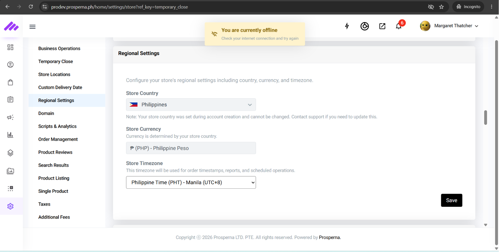
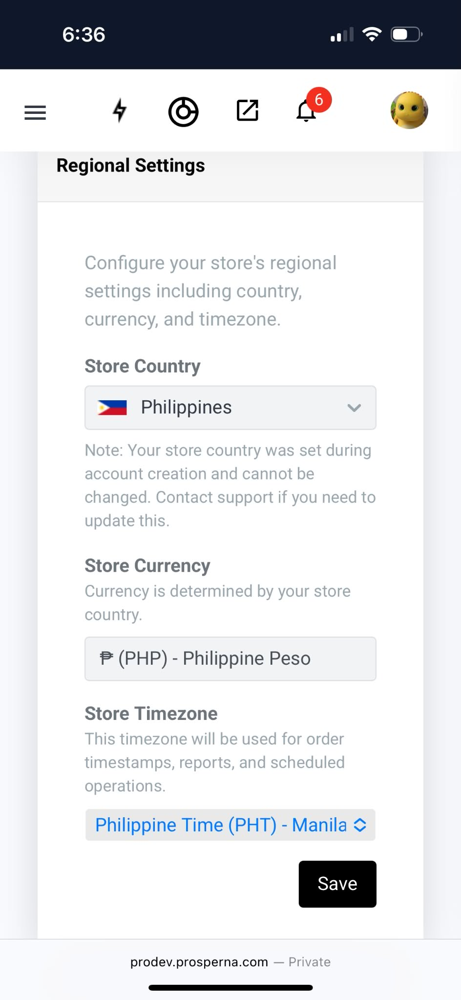

# Regional Settings

- **Task ID**: `86ey5bj2p`
- **URL**: https://app.clickup.com/t/86ey5bj2p
- **Status**: ready for deployment
- **Assignees**: Angelo Kamachi, Aira Pilor
- **Created**: 2026-07-03T10:18:35.073Z
- **Updated**: 2026-07-03T10:38:52.841Z
- **List**: P1 Delivery
- **Folder**: Shared with me

## Description

_No description_

## Media (4)

- `01_image.png` (source: attachment, uploader: Aira Pilor)

  

- `02_image.png` (source: attachment, uploader: Aira Pilor)

  

- `03_image.png` (source: comment, uploader: Aira Pilor)

  

- `04_image.png` (source: comment, uploader: Aira Pilor)

  

## Comments (2)

### Aira Pilor (2026-07-03T10:38:52.841Z)

env: DEV
Status: PASSED

DESKTOP VIEW:
image.png
MOBILE VIEW:
image.png
No issues found for this subtask.

We can now deploy this subtask to production.
cc @Angelo Kamachi

### ClickBot (2026-07-03T10:18:41.316Z)

This task Regional Settings has been created 
Date: Jul 3 2026, 6:18PM (Asia/Shanghai)
By Aira Pilor

