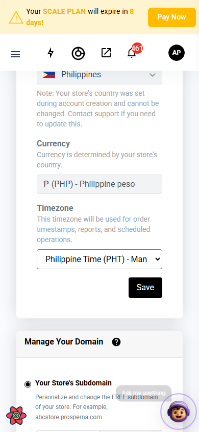
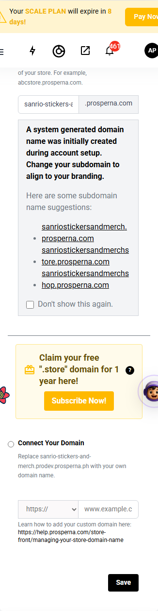
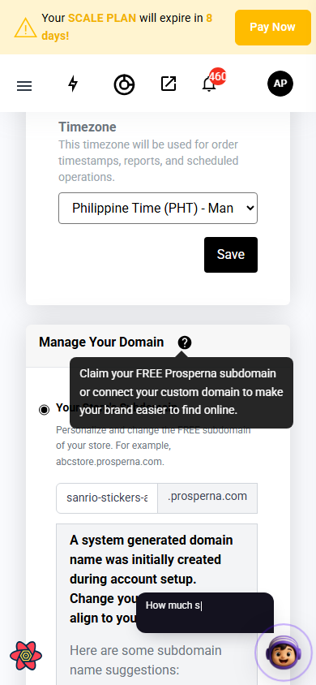
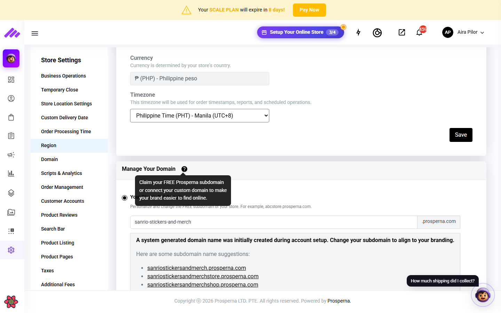
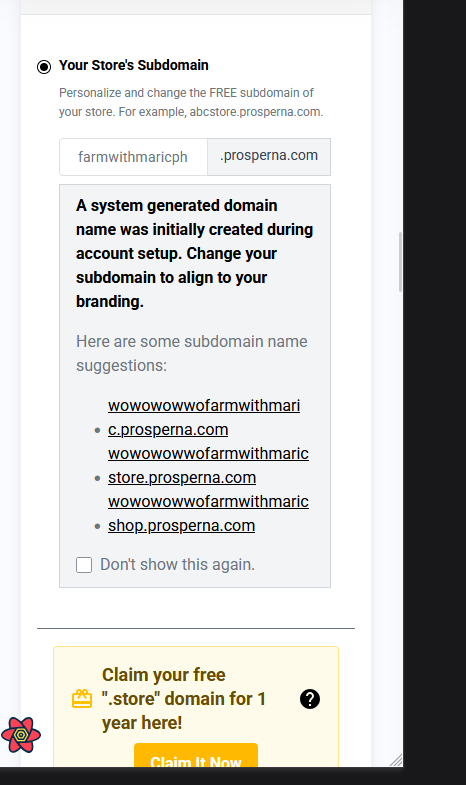
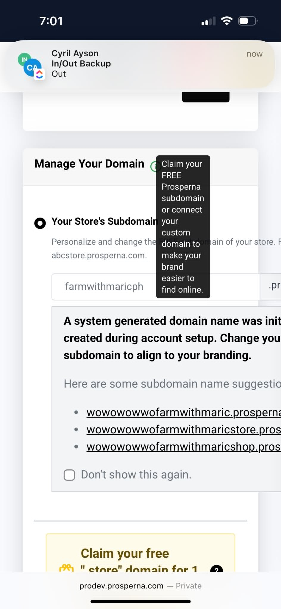
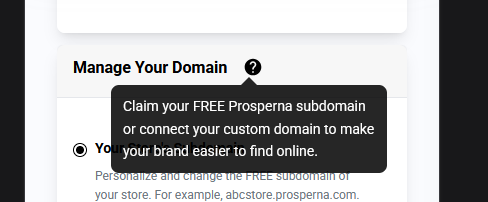
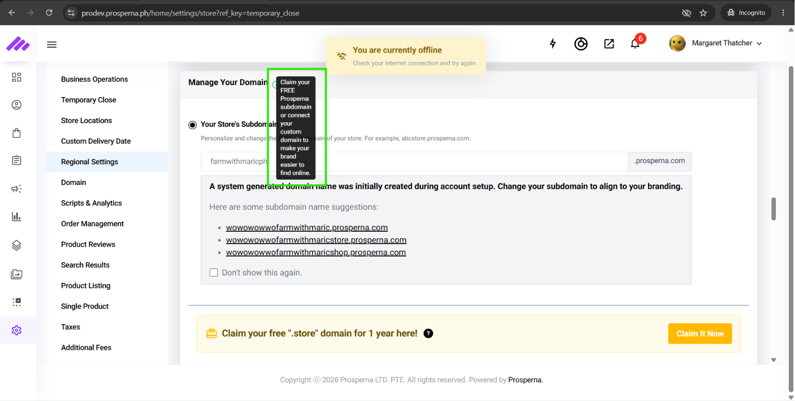

# Domain

- **Task ID**: `86ey5bjbw`
- **URL**: https://app.clickup.com/t/86ey5bjbw
- **Status**: ready for deployment
- **Assignees**: Angelo Kamachi, Aira Pilor
- **Created**: 2026-07-03T10:19:08.900Z
- **Updated**: 2026-10-07T00:05:24.353Z
- **List**: P1 Delivery
- **Folder**: Shared with me

## Description

_No description_

## Media (12)

- `01_tc16-domain-suggestions-mobile.png` (source: attachment, uploader: Aira Pilor)

  

- `02_mobile-manage_domain.png` (source: attachment, uploader: Aira Pilor)

  

- `03_tc02-manage_domain-after-tap.png` (source: attachment, uploader: Aira Pilor)

  

- `04_tc01-manage_domain-tooltip-open.png` (source: attachment, uploader: Aira Pilor)

  

- `05_image.png` (source: attachment, uploader: Angelo Kamachi)

  

- `06_image.png` (source: attachment, uploader: Angelo Kamachi)

  

- `07_image.png` (source: attachment, uploader: Aira Pilor)

  

- `08_image.png` (source: attachment, uploader: Aira Pilor)

  

- `09_image.png` (source: comment, uploader: Angelo Kamachi)

  

- `10_image.png` (source: comment, uploader: Angelo Kamachi)

  

- `11_image.png` (source: comment, uploader: Aira Pilor)

  

- `12_image.png` (source: comment, uploader: Aira Pilor)

  

## Comments (6)

### Aira Pilor (2026-10-06T08:01:01.167Z)

Env: DEV-local
Status: PASSED
URL: http://localhost:3000/home/settings/store?ref_key=manage_domain

TEST CASE #1: Section title "i" tooltip - desktop (case 1)
STEPS:
Step 1 - Open Settings > Store Settings at desktop width.
Step 2 - Hover the "i" icon beside "Manage Your Domain".
EXPECTED RESULT: Black icon aligned with the title; tooltip opens without covering the title or being cut off.
EVIDENCE: tc01-manage_domain-tooltip-open.png
ACTUAL RESULT: As expected. PASSED.

TEST CASE #2: Section title tooltip on mobile - tap (case 2)
STEPS:
Step 1 - Open Settings > Store Settings on a phone.
Step 2 - Tap the "i" icon beside "Manage Your Domain" and wait.
EXPECTED RESULT: Opens on tap and does not close itself.
EVIDENCE: tc02-manage_domain-after-tap.png
ACTUAL RESULT: Opens on tap and stays open. PASSED.

TEST CASE #3: Mobile view - section layout
STEPS:
Step 1 - Open Settings > Store Settings at 390px wide on a touch device.
Step 2 - Scroll to the Manage Your Domain card.
EXPECTED RESULT: The card fits the phone screen; nothing runs past the edge.
EVIDENCE: mobile-manage_domain.png
ACTUAL RESULT: As expected. PASSED.

TEST CASE #4: Subdomain suggestions on mobile (case 16)
STEPS:
Step 1 - View the suggestions under "Your Store's Subdomain" at phone width.
EXPECTED RESULT: Long suggestions wrap instead of pushing the page sideways or cropping the hint text.
EVIDENCE: tc16-domain-suggestions-mobile.png
ACTUAL RESULT: No suggestion overflows; neither the card nor the page scrolls sideways. PASSED.

### Aira Pilor (2026-09-07T01:58:29.450Z)

Env: DEV (localhost:3000) | URL: /home/settings/store (Manage Your Domain section)
Status: 2/2 PASSED
undefined
Case 1/2 — Header info tooltip: desktop hover and mobile tap.
Steps: Hover the "?" icon next to the "Manage Your Domain" section title (desktop); tap it on a 375px viewport (mobile).
Expected: Tooltip opens on hover (desktop) and on tap (mobile), stays open until dismissed.
Actual: As expected. PASSED.

Case 16 — Subdomain suggestions wrap on mobile instead of scrolling the page horizontally.
Steps: View "Your Store's Subdomain" suggestions list on a 375px viewport.
Expected: Long suggested subdomains wrap onto a new line; page doesn't scroll horizontally.
Actual: As expected. PASSED.

### Angelo Kamachi (2026-08-18T06:33:09.876Z)

image.png
better mobile responsiveness

### Angelo Kamachi (2026-08-18T06:32:55.107Z)

image.png
tooltip fixed

### Aira Pilor (2026-07-03T11:07:01.310Z)

env: DEV
Status: FAILED

The following are the issues under Domain:
------Tooltip Icon and Layout DESKTOP:
image.png
Tooltip Icon && Layout MOBILE:
image.png
Also, this section is cropped.

Kindly fix all the returns.

Moving this subtask to "ready Priority"
cc @Angelo Kamachi

### ClickBot (2026-07-03T10:19:09.857Z)

This task Domain has been created 
Date: Jul 3 2026, 6:19PM (Asia/Shanghai)
By Aira Pilor

