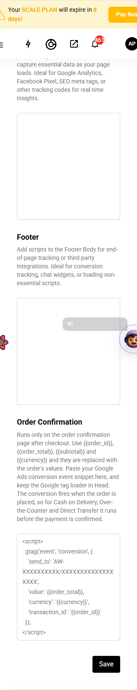
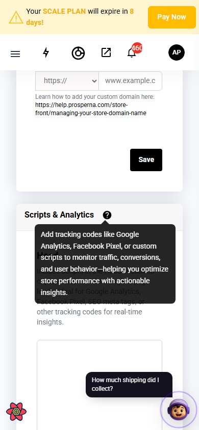
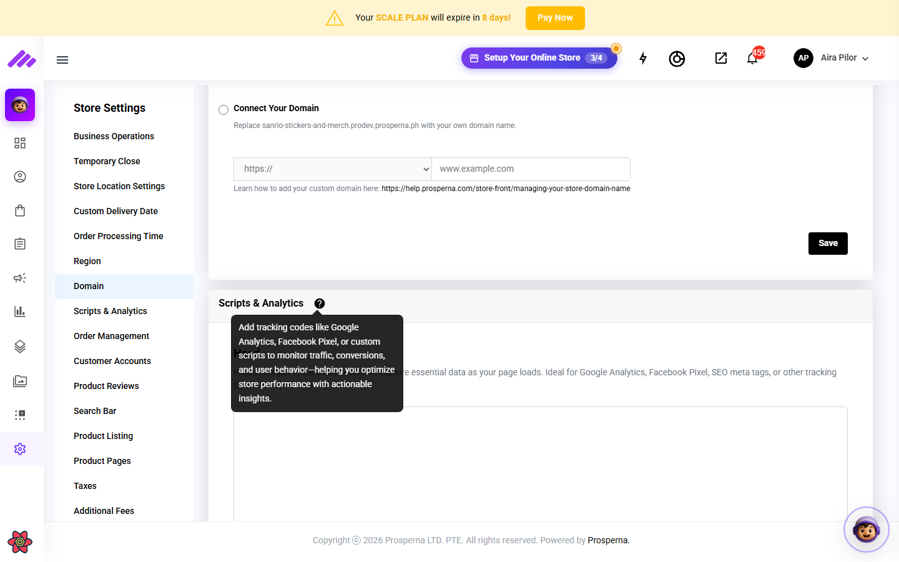
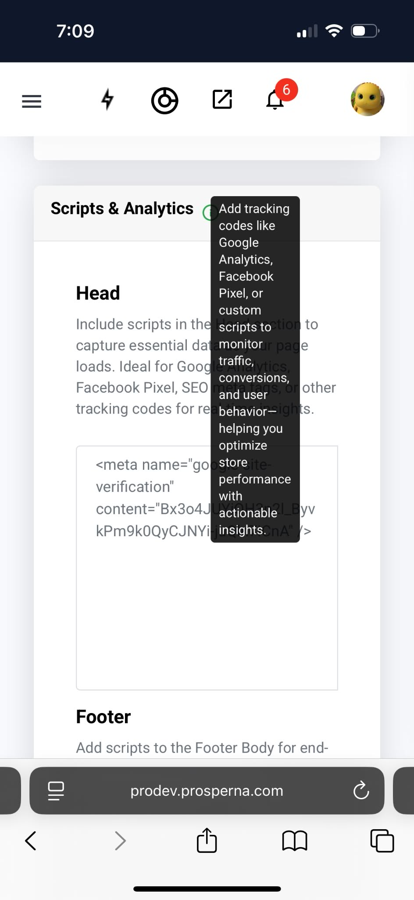
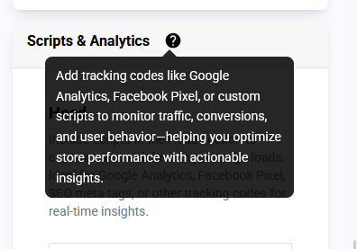
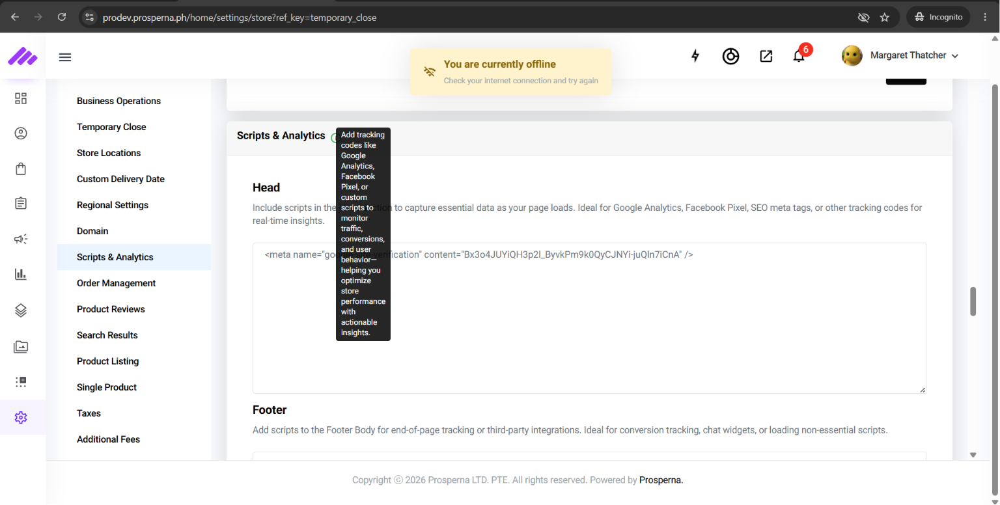

# Scripts & Analytics

- **Task ID**: `86ey5bjty`
- **URL**: https://app.clickup.com/t/86ey5bjty
- **Status**: ready for deployment
- **Assignees**: Angelo Kamachi, Aira Pilor
- **Created**: 2026-07-03T10:20:00.220Z
- **Updated**: 2026-10-07T00:05:31.850Z
- **List**: P1 Delivery
- **Folder**: Shared with me

## Description

_No description_

## Media (9)

- `01_mobile-scripts_analytics.png` (source: attachment, uploader: Aira Pilor)

  

- `02_tc02-scripts_analytics-after-tap.png` (source: attachment, uploader: Aira Pilor)

  

- `03_tc01-scripts_analytics-tooltip-open.png` (source: attachment, uploader: Aira Pilor)

  

- `04_image.png` (source: attachment, uploader: Angelo Kamachi)

  

- `05_image.png` (source: attachment, uploader: Aira Pilor)

  

- `06_image.png` (source: attachment, uploader: Aira Pilor)

  

- `07_image.png` (source: comment, uploader: Angelo Kamachi)

  

- `08_image.png` (source: comment, uploader: Aira Pilor)

  

- `09_image.png` (source: comment, uploader: Aira Pilor)

  

## Comments (5)

### Aira Pilor (2026-10-06T08:01:02.146Z)

Env: DEV-local
Status: PASSED
URL: http://localhost:3000/home/settings/store?ref_key=scripts_analytics

TEST CASE #1: Section title "i" tooltip - desktop (case 1)
STEPS:
Step 1 - Open Settings > Store Settings at desktop width.
Step 2 - Hover the "i" icon beside "Scripts & Analytics".
EXPECTED RESULT: Black icon aligned with the title; tooltip opens without covering the title or being cut off.
EVIDENCE: tc01-scripts_analytics-tooltip-open.png
ACTUAL RESULT: As expected. PASSED.

TEST CASE #2: Section title tooltip on mobile - tap (case 2)
STEPS:
Step 1 - Open Settings > Store Settings on a phone.
Step 2 - Tap the "i" icon beside "Scripts & Analytics" and wait.
EXPECTED RESULT: Opens on tap and does not close itself.
EVIDENCE: tc02-scripts_analytics-after-tap.png
ACTUAL RESULT: Opens on tap and stays open. PASSED.

TEST CASE #3: Mobile view - section layout
STEPS:
Step 1 - Open Settings > Store Settings at 390px wide on a touch device.
Step 2 - Scroll to the Scripts & Analytics card.
EXPECTED RESULT: The card fits the phone screen; nothing runs past the edge.
EVIDENCE: mobile-scripts_analytics.png
ACTUAL RESULT: As expected. PASSED.

### Aira Pilor (2026-09-07T08:31:26.224Z)

Env: DEV (localhost:3000) | URL: /home/settings/store (Scripts & Analytics section)
Status: 1/1 PASSED
undefined
Case 1/2 — Header info tooltip: desktop hover and mobile tap.
Steps: Hover the "?" icon next to the "Scripts & Analytics" section title (desktop); tap it on a 375px viewport (mobile).
Expected: Tooltip opens on hover (desktop) and on tap (mobile), stays open until dismissed.
Actual: As expected. PASSED.

### Angelo Kamachi (2026-08-18T06:33:39.471Z)

image.png
tooltip fixed

### Aira Pilor (2026-07-03T11:12:26.936Z)

env: DEV
Status: FAILED

The following are the issues under Scripts and Analytics:
------Tooltip Icon and Layout DESKTOP:
image.png
Tooltip Icon and Layout MOBILE:
image.png

Kindly fix all the returns:

Moving this subtask to "Ready Priority"
cc @Angelo Kamachi

### ClickBot (2026-07-03T10:20:01.804Z)

This task Scripts & Analytics has been created 
Date: Jul 3 2026, 6:20PM (Asia/Shanghai)
By Aira Pilor

