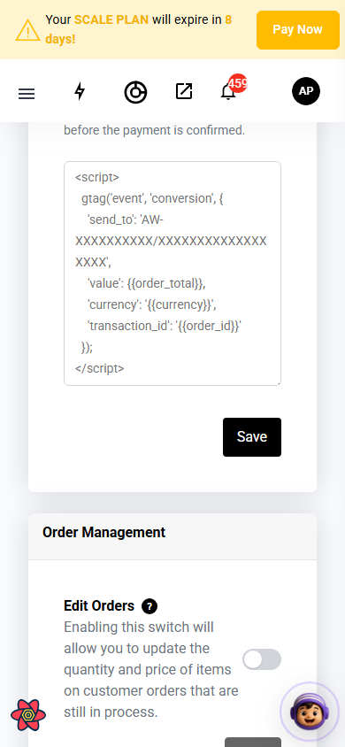
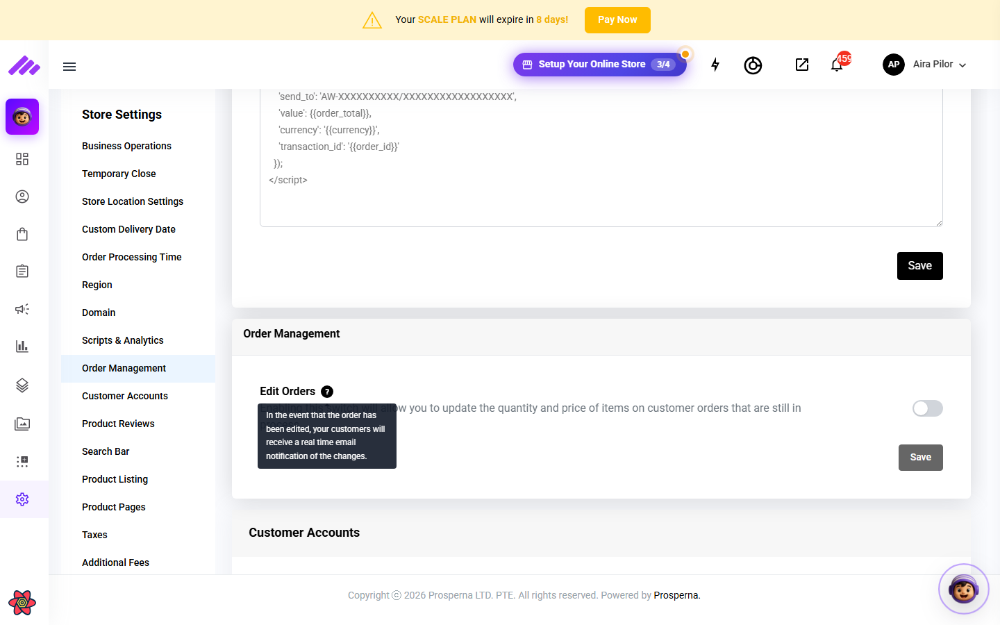
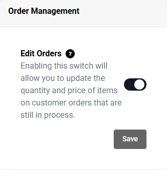
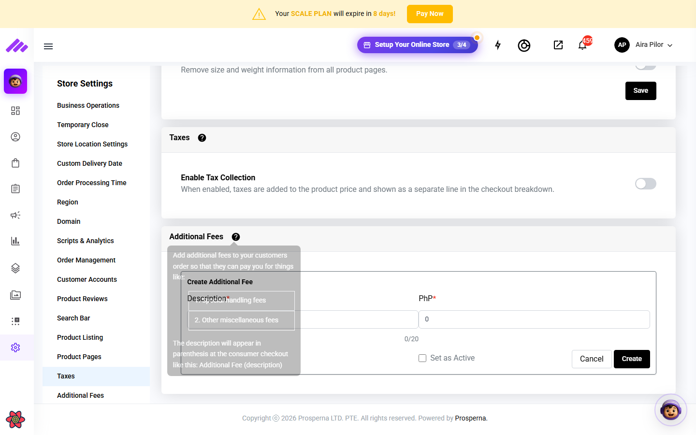
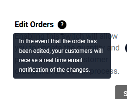
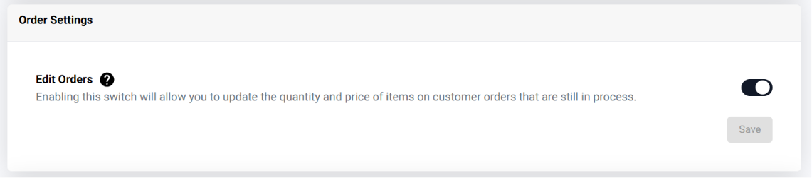

# Order Management

- **Task ID**: `86ey5bkzz`
- **URL**: https://app.clickup.com/t/86ey5bkzz
- **Status**: in testing
- **Assignees**: Angelo Kamachi, Aira Pilor
- **Created**: 2026-07-03T10:22:19.970Z
- **Updated**: 2026-11-03T01:23:11.001Z
- **List**: P1 Delivery
- **Folder**: Shared with me

## Description

_No description_

## Media (8)

- `01_tc03-edit-orders-tooltip-after-tap.png` (source: attachment, uploader: Aira Pilor)

  

- `02_tc03-edit-orders-tooltip-hover.png` (source: attachment, uploader: Aira Pilor)

  

- `03_mobile-order_management.png` (source: attachment, uploader: Aira Pilor)

  

- `04_tc01-store-settings-desktop.png` (source: attachment, uploader: Aira Pilor)

  

- `05_image.png` (source: attachment, uploader: Angelo Kamachi)

  

- `06_image.png` (source: attachment, uploader: Aira Pilor)

  

- `07_image.png` (source: comment, uploader: Angelo Kamachi)

  

- `08_image.png` (source: comment, uploader: Aira Pilor)

  

## Comments (7)

### ClickBot (2026-11-03T01:23:11.001Z)

This task Order Management hss been move to IN TESTING 
Updated: Nov 3 2026, 9:23AM (Asia/Manila)
Triggered by: Aira Pilor

### ClickBot (2026-10-12T00:58:38.690Z)

This Order Management has been move to READY FOR TESTING
Date updated: Oct 12 2026, 8:58AM (Asia/Singapore)
Triggered by: Angelo Kamachi

### Angelo Kamachi (2026-10-12T00:35:05.148Z)

QA RETURN FIX: Order Management title tooltip (defect 1) and "Edit Orders" "?" on touch (defect 2)

WHAT WAS FIXED
1. The Order Management title had no "i" tooltip. It now has one, using the same black "i" as the other sections, with the text "Control what you can change on an order after it has been placed." The title also now reads "Order Management" (the branch still had the old "Order Settings" label), matching the side menu and production.
2. Tapping the "?" beside "Edit Orders" on a phone did not show the tooltip.

BRANCH: refactor/tw-settings-standard-v3-dev8 (into dev). Feature branch: refactor/tw-settings-standard-v3.

HOW IT WAS TESTED
- ESLint on the changed files
- Vitest: TooltipIcon, LalamoveConnect and all Store Settings tests (432 passed)
- New tests cover the tap sequence on the "?" tooltip: a tap opens it, a second tap closes it

NEW QA TEST CASES (title tooltip)
WHERE: Settings > Store Settings > Order Management.
A. Title and icon
STEPS: Open at desktop width.
EXPECTED: The title reads "Order Management" with a black "i" beside it, aligned with the title (crown icon still shown on non-upgraded plans).
B. Desktop hover
STEPS: Hover the "i".
EXPECTED: The tooltip opens below it, fully on screen, without covering the title.
C. Phone tap
STEPS: On a phone, tap the "i" and wait.
EXPECTED: The tooltip opens and stays open.

NEW QA TEST CASES ("Edit Orders" "?")
WHY IT FAILED
The "?" tooltip opened on the emulated hover and the tap's click closed it again in the same gesture. The fix (the "?" now remembers a touch tap and lets the tap alone open/close it) was already merged to dev in commits 377c6f4e3 and c192d9bff, after this QA round was run. This round adds automated tests for the tap so it cannot regress.

NEW QA TEST CASES
1. Tap opens the tooltip
STEPS: On a phone (or touch emulation), open Settings > Store Settings > Order Management. Tap the "?" beside "Edit Orders".
EXPECTED: The tooltip appears and stays open.
2. Tap elsewhere closes it
STEPS: With the tooltip open, tap anywhere outside the "?".
EXPECTED: The tooltip closes.
3. Second tap closes it
STEPS: Tap the same "?" again.
EXPECTED: The tooltip closes.
4. Only one tooltip at a time
STEPS: Open one "?" tooltip, then tap a different "?" on the page.
EXPECTED: The first one closes and the second one opens.
5. Desktop unchanged (control)
STEPS: At desktop width, hover the "?", then click it, then move the mouse away.
EXPECTED: Hover opens it, the click keeps it open, moving away closes it.

### Aira Pilor (2026-10-06T08:01:03.213Z)

Env: DEV-local
Status: FAILED
URL: http://localhost:3000/home/settings/store?ref_key=order_management

TEST CASE #1: Section title "i" tooltip - desktop (case 1)
STEPS:
Step 1 - Open Settings > Store Settings at desktop width.
Step 2 - Look for the black "i" icon beside "Order Management".
EXPECTED RESULT: The title carries a black "i" tooltip like the other sections.
EVIDENCE: tc01-store-settings-desktop.png
ACTUAL RESULT: No "i" icon is rendered beside the Order Management title.

TEST CASE #2: Section title tooltip on mobile - tap (case 2)
STEPS:
Step 1 - Open Settings > Store Settings on a phone.
Step 2 - Tap the "i" icon beside "Order Management".
EXPECTED RESULT: Opens on tap and does not close itself.
EVIDENCE: mobile-order_management.png
ACTUAL RESULT: Not possible - there is no "i" icon to tap.

TEST CASE #3: Mobile view - section layout
STEPS:
Step 1 - Open Settings > Store Settings at 390px wide on a touch device.
Step 2 - Scroll to the Order Management card.
EXPECTED RESULT: The card fits the phone screen; nothing runs past the edge.
EVIDENCE: mobile-order_management.png
ACTUAL RESULT: As expected. PASSED.

TEST CASE #4: "?" beside "Edit Orders" (case 3)
STEPS:
Step 1 - Hover the "?" beside "Edit Orders" on desktop.
Step 2 - Tap the same "?" on a phone.
EXPECTED RESULT: The email-notification tooltip appears on both hover and tap.
EVIDENCE: tc03-edit-orders-tooltip-hover.png, tc03-edit-orders-tooltip-after-tap.png
ACTUAL RESULT: Hover works on desktop. On a phone the tap leaves the tooltip fully transparent - it never appears.

DEFECT 1: No title tooltip on Order Management

WHERE: Settings > Store Settings > Order Management title.

STEPS TO RECREATE:
Step 1 - Open Settings > Store Settings.
Step 2 - Look beside the "Order Management" title.

EXPECTED RESULT: A black "i" tooltip, as on the other sections.

ACTUAL RESULT: None is rendered. OrderSettings/index.jsx renders the Card.Title with no PopContent and does not import it.

DEFECT 2: "Edit Orders" "?" tooltip cannot be opened on a touch device

WHERE: Settings > Store Settings > Order Management, "?" beside "Edit Orders", phone/tablet.

STEPS TO RECREATE:
Step 1 - Open Settings > Store Settings on a phone.
Step 2 - Tap the "?" beside "Edit Orders".

EXPECTED RESULT: The tooltip opens and stays open.

ACTUAL RESULT: Nothing appears. The icon uses components/TooltipIcon/TooltipIcon.jsx, which has no touch handling; the touch fix exists only in components/ui/TooltipIcon.jsx.

### Angelo Kamachi (2026-08-18T06:34:16.930Z)

image.png
tooltip fixed

### Aira Pilor (2026-07-03T11:15:27.508Z)

env: DEV
status: FAILED

The following are the issues under Order Management:
------Tooltip not working on both mobile and desktop view:
image.png

Kindly fix all the returns.

Moving this subtask to "Ready Priority"
cc @Angelo Kamachi

### ClickBot (2026-07-03T10:22:23.615Z)

This task Order Management has been created 
Date: Jul 3 2026, 6:22PM (Asia/Shanghai)
By Aira Pilor

