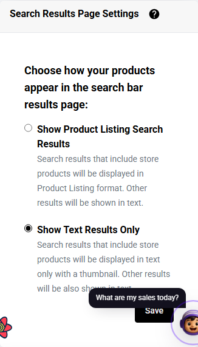
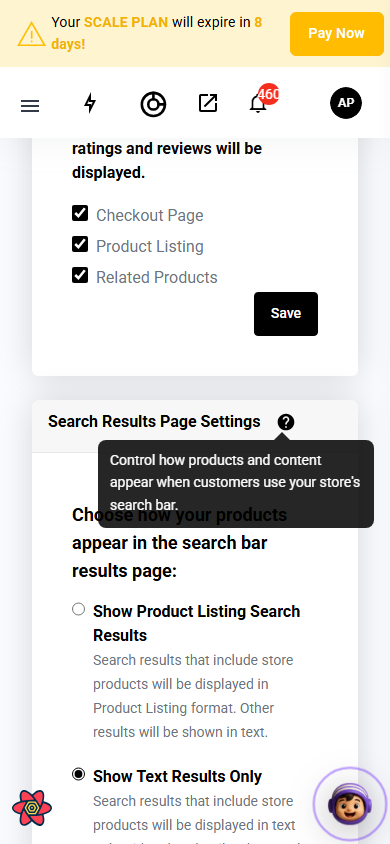
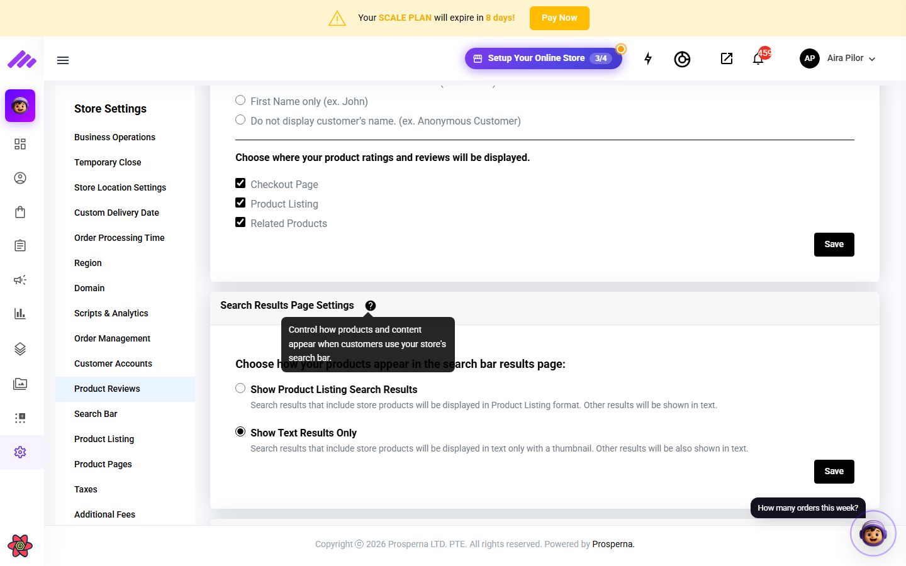
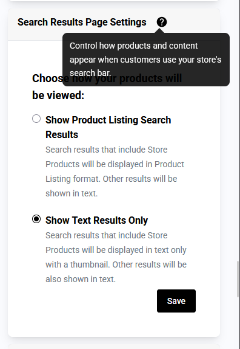
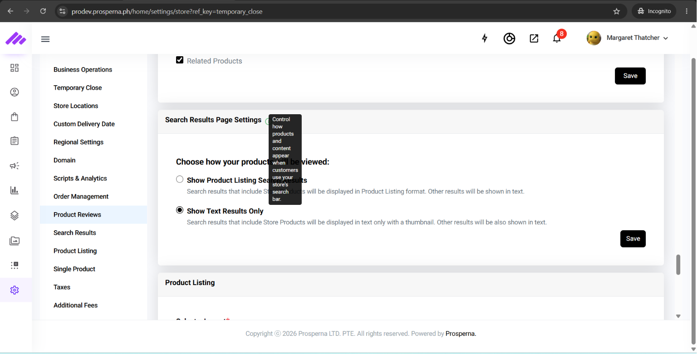

# Search Results

- **Task ID**: `86ey5cbf9`
- **URL**: https://app.clickup.com/t/86ey5cbf9
- **Status**: ready for deployment
- **Assignees**: Angelo Kamachi, Aira Pilor
- **Created**: 2026-07-03T11:27:59.306Z
- **Updated**: 2026-10-07T00:05:58.197Z
- **List**: P1 Delivery
- **Folder**: Shared with me

## Description

_No description_

## Media (7)

- `01_mobile-search.png` (source: attachment, uploader: Aira Pilor)

  

- `02_tc02-search-after-tap.png` (source: attachment, uploader: Aira Pilor)

  

- `03_tc01-search-tooltip-open.png` (source: attachment, uploader: Aira Pilor)

  

- `04_image.png` (source: attachment, uploader: Angelo Kamachi)

  

- `05_image.png` (source: attachment, uploader: Aira Pilor)

  

- `06_image.png` (source: comment, uploader: Angelo Kamachi)

  

- `07_image.png` (source: comment, uploader: Aira Pilor)

  

## Comments (4)

### Aira Pilor (2026-10-06T08:02:56.036Z)

Env: DEV-local
Status: PASSED
URL: http://localhost:3000/home/settings/store?ref_key=search

TEST CASE #1: Section title "i" tooltip - desktop (case 1)
STEPS:
Step 1 - Open Settings > Store Settings at desktop width.
Step 2 - Hover the "i" icon beside "Search Results Page Settings".
EXPECTED RESULT: Black icon aligned with the title; tooltip opens without covering the title or being cut off.
EVIDENCE: tc01-search-tooltip-open.png
ACTUAL RESULT: As expected. PASSED.

TEST CASE #2: Section title tooltip on mobile - tap (case 2)
STEPS:
Step 1 - Open Settings > Store Settings on a phone.
Step 2 - Tap the "i" icon beside "Search Results Page Settings" and wait.
EXPECTED RESULT: Opens on tap and does not close itself.
EVIDENCE: tc02-search-after-tap.png
ACTUAL RESULT: Opens on tap and stays open. PASSED.

TEST CASE #3: Mobile view - section layout
STEPS:
Step 1 - Open Settings > Store Settings at 390px wide on a touch device.
Step 2 - Scroll to the Search Results Page Settings card.
EXPECTED RESULT: The card fits the phone screen; nothing runs past the edge.
EVIDENCE: mobile-search.png
ACTUAL RESULT: As expected. PASSED.

### Angelo Kamachi (2026-08-18T06:34:53.812Z)

image.png
tooltip fixed

### Aira Pilor (2026-07-03T11:33:40.512Z)

env: DEV
Status: FAILED

The following are the issues under Search Results:
------Tooltip Icon & Layout on both MOBILE and DESKTOP view:
image.png

Kindly fix all the returns.

Moving this subtask to "Ready Priority"
cc @Angelo Kamachi

### ClickBot (2026-07-03T11:28:00.059Z)

This task Search Results has been created 
Date: Jul 3 2026, 7:27PM (Asia/Shanghai)
By Aira Pilor

