# Product Listing

- **Task ID**: `86ey5cbm6`
- **URL**: https://app.clickup.com/t/86ey5cbm6
- **Status**: in testing
- **Assignees**: Angelo Kamachi, Aira Pilor
- **Created**: 2026-07-03T11:28:18.810Z
- **Updated**: 2026-11-03T01:23:12.257Z
- **List**: P1 Delivery
- **Folder**: Shared with me

## Description

_No description_

## Media (25)

- `01_pl12-grid-view-.png` (source: attachment, uploader: Aira Pilor)

  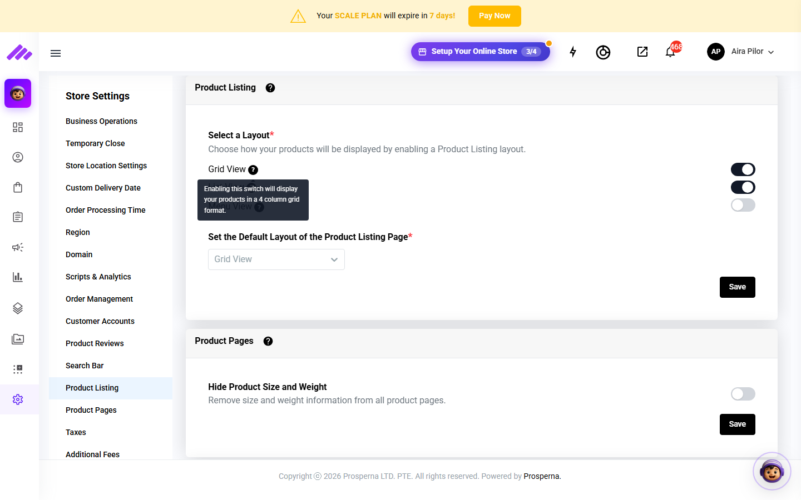

- `02_pl12-product-listing-title-i-.png` (source: attachment, uploader: Aira Pilor)

  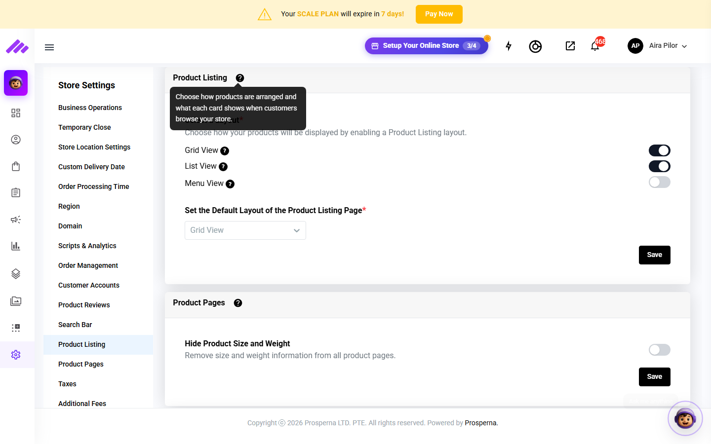

- `03_pl11-analytics-cards-after-tap.png` (source: attachment, uploader: Aira Pilor)

  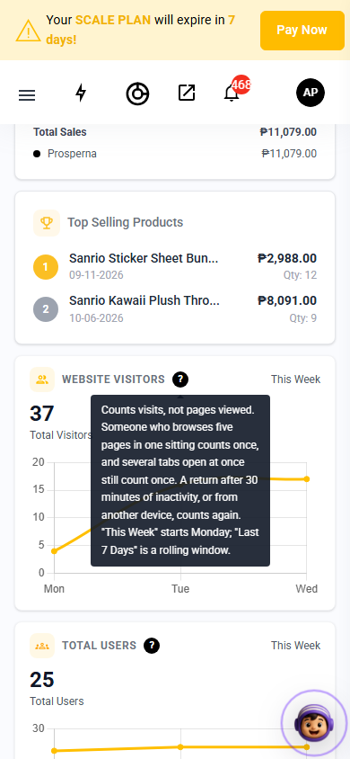

- `04_pl11-email-templates-after-tap.png` (source: attachment, uploader: Aira Pilor)

  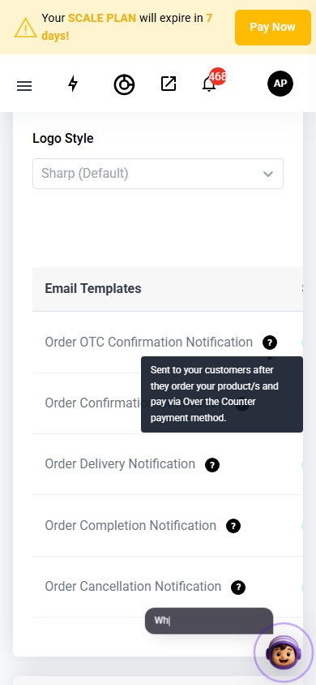

- `05_pl10-after-second-click.png` (source: attachment, uploader: Aira Pilor)

  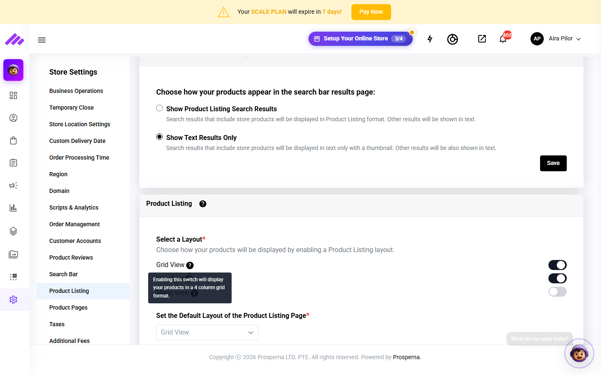

- `06_pl10-after-first-click.png` (source: attachment, uploader: Aira Pilor)

  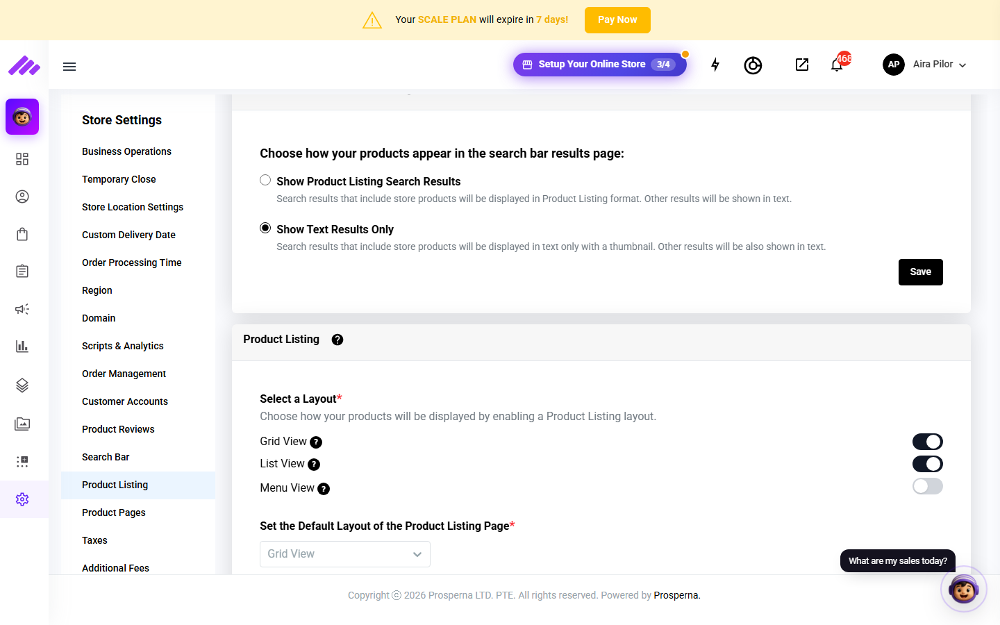

- `07_pl09-hover-menu-view.png` (source: attachment, uploader: Aira Pilor)

  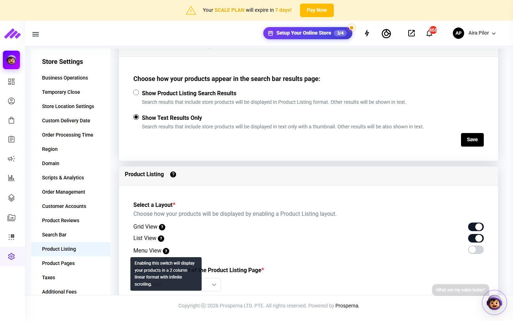

- `08_pl09-hover-list-view.png` (source: attachment, uploader: Aira Pilor)

  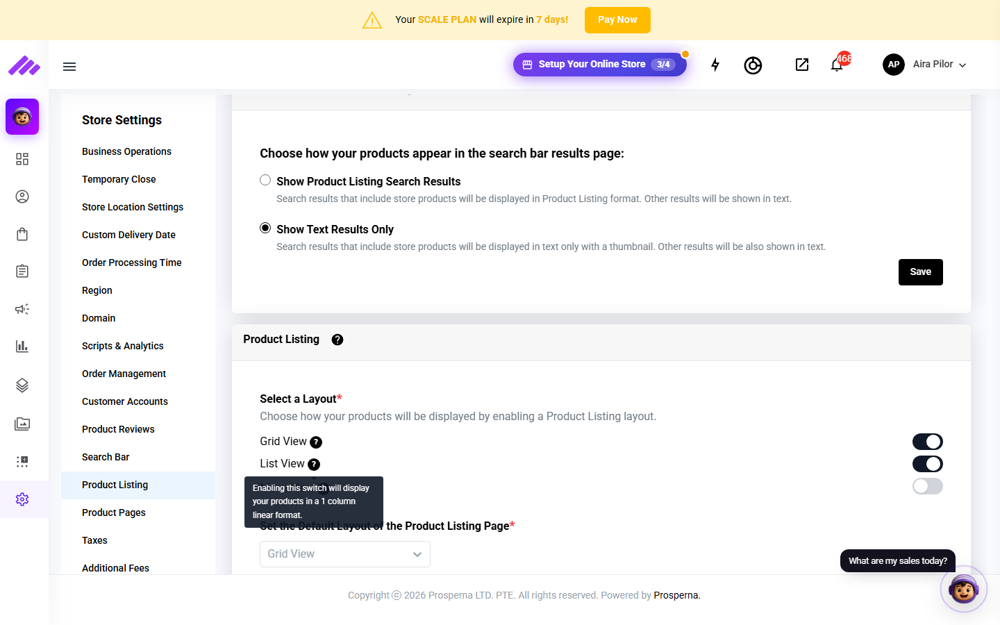

- `09_pl09-hover-grid-view.png` (source: attachment, uploader: Aira Pilor)

  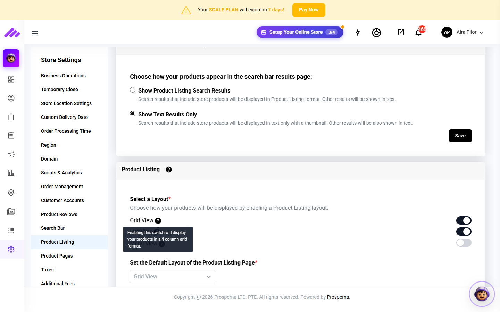

- `10_pl08-grid-then-list.png` (source: attachment, uploader: Aira Pilor)

  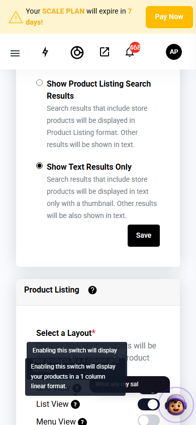

- `11_pl07-after-tap-away.png` (source: attachment, uploader: Aira Pilor)

  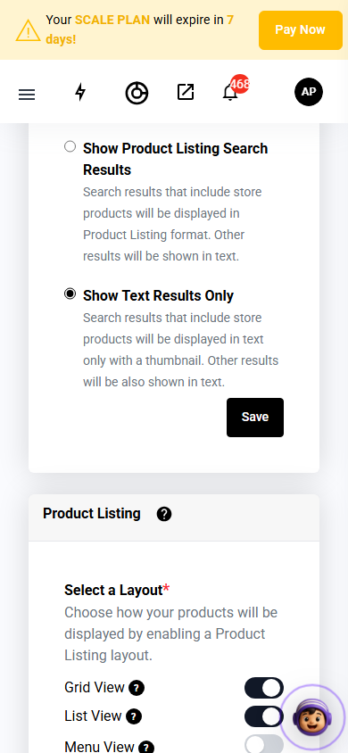

- `12_pl05-menu-view-after-tap-2500ms.png` (source: attachment, uploader: Aira Pilor)

  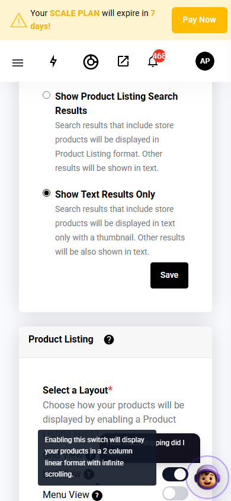

- `13_pl05-list-view-after-tap-2500ms.png` (source: attachment, uploader: Aira Pilor)

  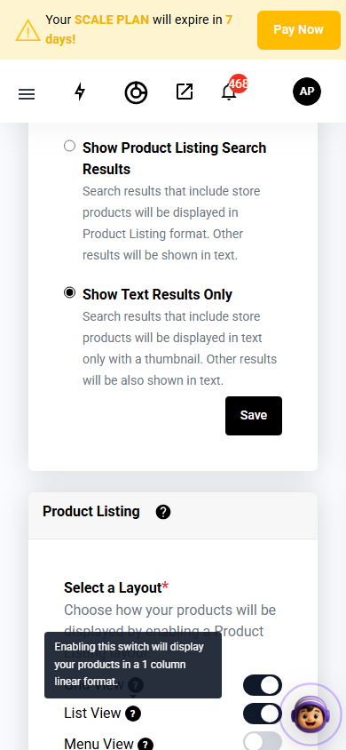

- `14_pl05-grid-view-after-tap-2500ms.png` (source: attachment, uploader: Aira Pilor)

  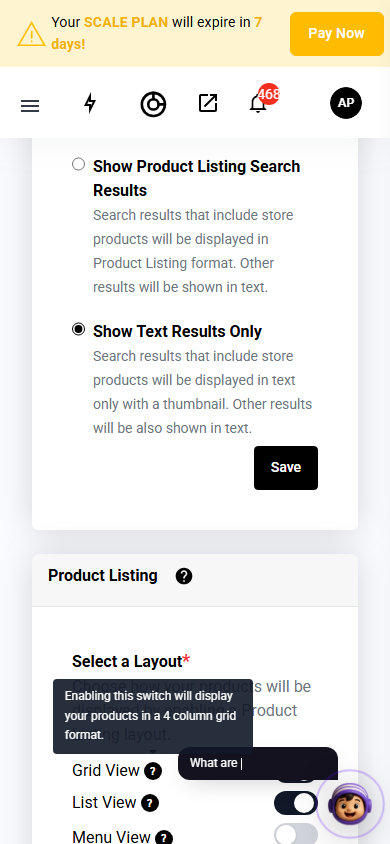

- `15_pl03-title-tooltip-after-tap-away.png` (source: attachment, uploader: Aira Pilor)

  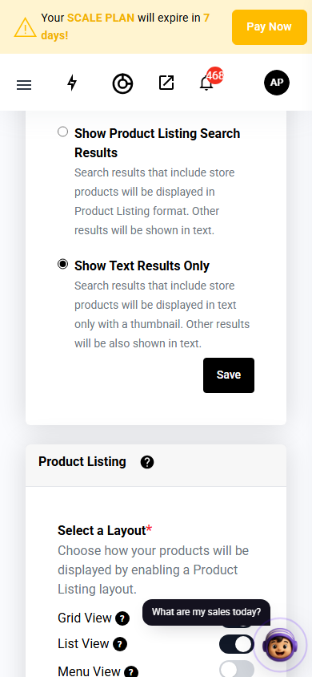

- `16_pl03-title-tooltip-after-tap-2s.png` (source: attachment, uploader: Aira Pilor)

  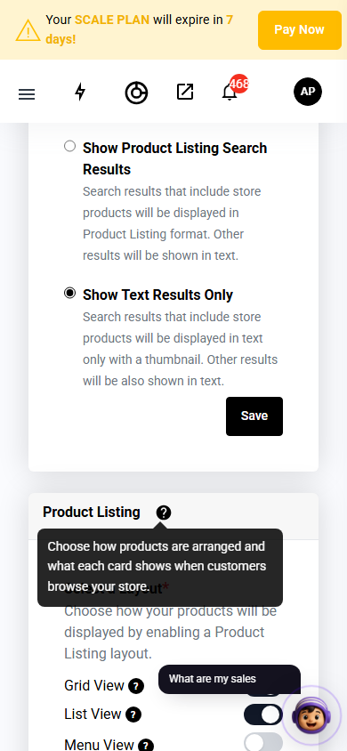

- `17_pl02-title-tooltip-hover.png` (source: attachment, uploader: Aira Pilor)

  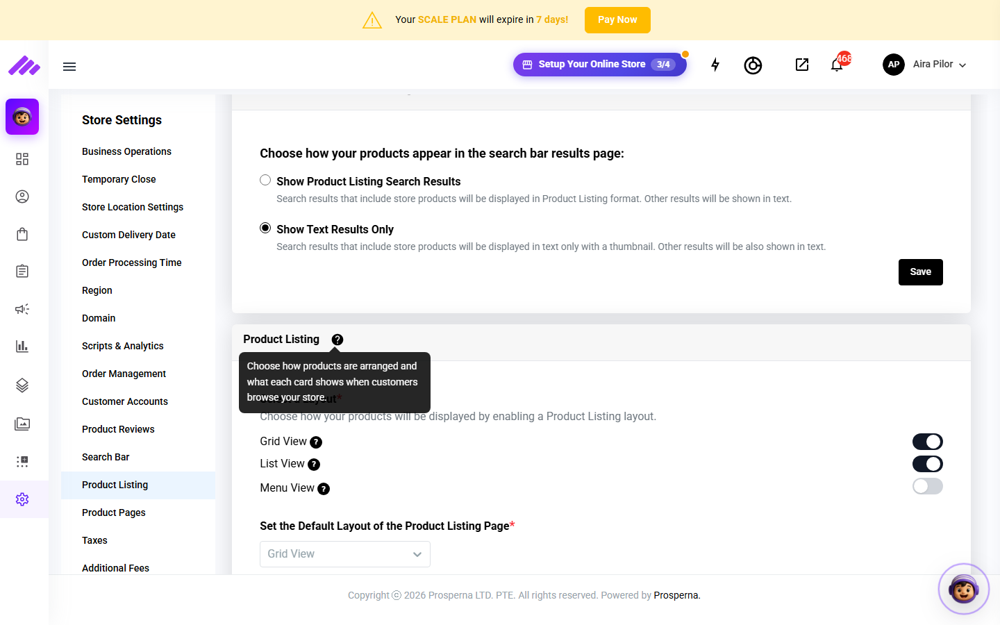

- `18_pl01-product-listing-title-icon.png` (source: attachment, uploader: Aira Pilor)

  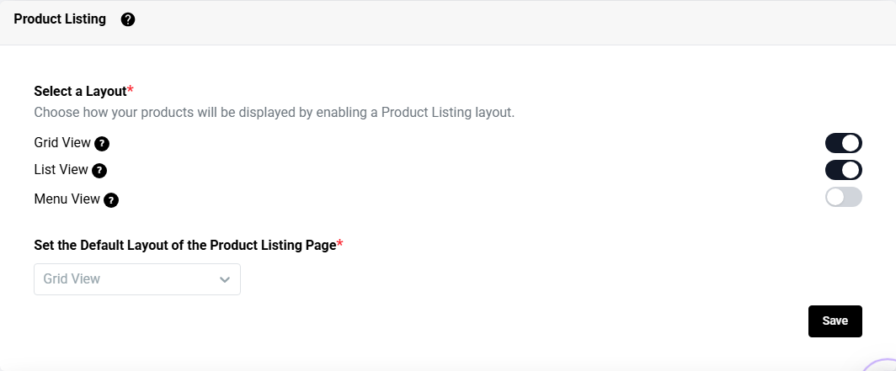

- `19_tc04-product-listing-tooltip-after-tap.png` (source: attachment, uploader: Aira Pilor)

  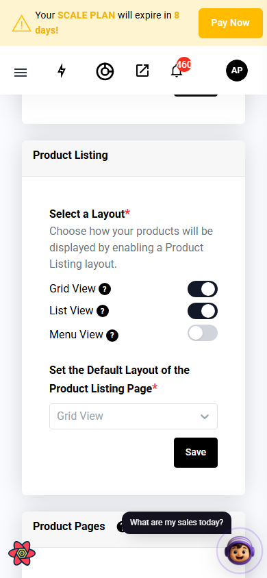

- `20_mobile-product_listing_ref.png` (source: attachment, uploader: Aira Pilor)

  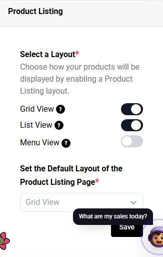

- `21_tc01-store-settings-desktop.png` (source: attachment, uploader: Aira Pilor)

  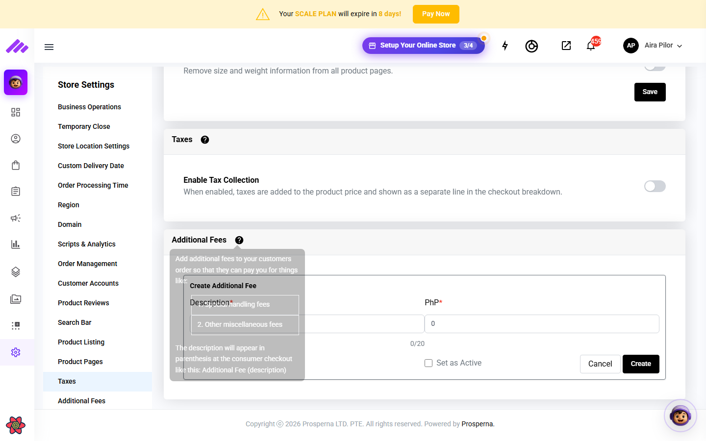

- `22_image.png` (source: attachment, uploader: Angelo Kamachi)

  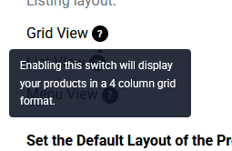

- `23_image.png` (source: attachment, uploader: Aira Pilor)

  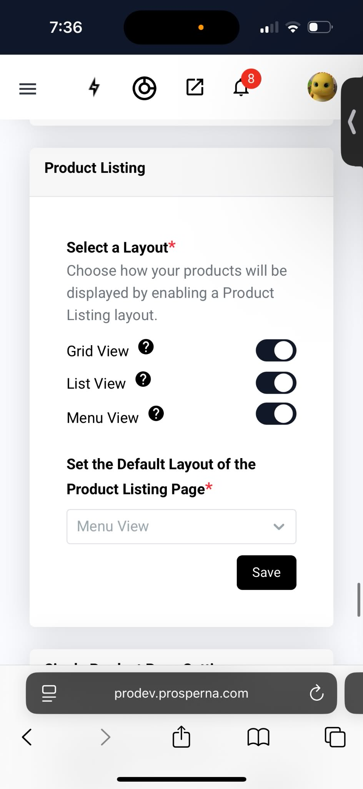

- `24_image.png` (source: comment, uploader: Angelo Kamachi)

  

- `25_image.png` (source: comment, uploader: Aira Pilor)

  

## Comments (10)

### ClickBot (2026-11-03T01:23:12.257Z)

This task Product Listing hss been move to IN TESTING 
Updated: Nov 3 2026, 9:23AM (Asia/Manila)
Triggered by: Aira Pilor

### Angelo Kamachi (2026-10-08T01:15:49.213Z)

## Fixes for the 7 Oct return — Product Listing tooltips

**Commit:** `5c4fab6a0` on `refactor/tw-settings-standard-v3`
**Not on dev yet** — please hold the retest until it lands; we will comment here when it does.

All three defects are fixed. Two of them were caused by the previous round's touch fix, so thank you for catching them.

### Defect 1 — tapping a second "?" left the first one open

Each tooltip closes itself when you tap anywhere else on the page. The tap on a "?" was being held back from the rest of the page, so an already-open tooltip never learned that you had tapped elsewhere and simply stayed up. The tap now reaches the page as a normal tap does, so opening one closes the other.

### Defect 2 — clicking a "?" with a mouse closed it instead of opening it

On a mouse, hovering already opens the tooltip. The click was then treated as "swap to the other state", which meant the first click closed what the hover had just opened.

A tap and a click now behave differently, which is what you would expect:
- **Finger:** the tap opens it, and tapping it again closes it. There is no hover involved.
- **Mouse:** hovering opens it and a click keeps it open — the same as the information icon beside the section titles, which is the behaviour you compared it against.

### Defect 3 — the "?" tooltips looked different from the title tooltip

They came from a different component with its own styling: a dark blue-grey bubble, smaller text and tighter corners, against the title tooltip's black bubble, larger text and rounder corners. The "?" tooltips now use the same black, the same text size and the same corners. The little arrow pointing at the icon was also still the old colour and has been matched, which would otherwise have shown as a visible seam against the new bubble.

### Worth knowing

This is the shared "?" icon, used in 13 places. So the same fixes land on Business Operations' URL field, Custom Delivery Date, the Email Templates list under Messaging Settings, and the Analytics cards.

---

## QA TEST CASES

### Where to test
- **Environment:** dev, once this is promoted.
- **Page:** Settings → Store Settings → Product Listing.
- **Devices:** a real phone or tablet is required for the tap cases. A narrow desktop window still uses a mouse and will not reproduce the original fault.

### Defect 1 — one tooltip at a time

**1.** On a phone, tap the "?" beside Grid View, then tap the "?" beside List View.
**Expected:** only the List View tooltip is open. The Grid View one has closed.

**2.** Tap through all three in turn — Grid View, List View, Menu View.
**Expected:** exactly one tooltip is ever open; they never stack or overlap.

**3.** Tap a "?" open, then tap any plain text on the page.
**Expected:** the tooltip closes.

### Defect 2 — mouse behaviour

**4.** On a desktop, hover the "?" beside Grid View, then click it without moving away.
**Expected:** it stays open. It must not close on that click.

**5.** Still hovering, click it a second time.
**Expected:** it is still open. The click only ever opens.

**6.** Move the mouse away from the icon.
**Expected:** the tooltip closes.

**7.** Compare against the information icon beside the "Product Listing" title — hover it, then click it.
**Expected:** the "?" and the title icon now behave identically on a mouse.

### Defect 3 — appearance

**8.** On a desktop, hover the icon beside the "Product Listing" title, then hover the "?" beside Grid View.
**Expected:** both tooltips are the same black, the same text size and the same corner rounding.

**9.** Look closely at the small arrow where each tooltip points at its icon.
**Expected:** the arrow is the same colour as the bubble it belongs to, with no visible seam or lighter patch.

### Touch behaviour still works (from the previous round)

**10.** On a phone, tap each of the three "?" icons and wait a couple of seconds after each.
**Expected:** each opens on the tap and is still open afterwards — no flicker, no closing by itself.

**11.** Tap the information icon beside the "Product Listing" title.
**Expected:** it opens and stays open; tapping elsewhere closes it.

### The same icon elsewhere — worth a spot check

**12.** On a phone, check the "?" on Business Operations' URL field, the "?" icons in Custom Delivery Date, the "?" in the Email Templates list under Messaging Settings, and the information icons on the Analytics cards.
**Expected:** each opens on a tap, stays open, closes when you tap away, and opening one closes another.

### Out of scope / known behaviour
- Tooltip wording is unchanged.
- Cases 1 to 6 of the 7 Oct run already passed and were not touched.
- Information icons that open on the section titles use a different component and were only matched in appearance, not rebuilt.

### Aira Pilor (2026-10-07T06:17:10.853Z)

Env: DEV
Status: FAILED
URL: https://prodev.prosperna.ph/home/settings/store?ref_key=product_listing_ref

TEST CASE #1: Title tooltip icon exists (desktop)
STEPS:
Step 1 - Open Settings > Store Settings on a desktop.
Step 2 - Look beside the Product Listing title.
EXPECTED RESULT: A black information icon, the same size and position as the one beside Product Pages.
EVIDENCE: pl01-title-icon-desktop.mp4, pl01-product-listing-title-icon.png
ACTUAL RESULT: The black icon is shown, same size, gap and vertical alignment as Product Pages. PASSED.

TEST CASE #2: Title tooltip opens on hover
STEPS:
Step 1 - Open Store Settings on a desktop.
Step 2 - Hover the icon beside Product Listing.
EXPECTED RESULT: A tooltip describing the section appears, does not cover the title and is not cut off.
EVIDENCE: pl02-title-tooltip-hover.mp4, pl02-title-tooltip-hover.png
ACTUAL RESULT: The tooltip opens below the icon, clear of the title and fully on screen. PASSED.

TEST CASE #3: Title tooltip opens on a tap (phone)
STEPS:
Step 1 - Open Store Settings on a phone.
Step 2 - Tap the icon beside Product Listing, wait 2 seconds.
Step 3 - Tap elsewhere.
EXPECTED RESULT: The tooltip appears and stays visible; tapping elsewhere closes it.
EVIDENCE: pl03-title-tooltip-tap-phone.mp4, pl03-title-tooltip-after-tap-2s.png, pl03-title-tooltip-after-tap-away.png
ACTUAL RESULT: It opens, is still open after 2 seconds, and closes on the tap away. PASSED.

TEST CASE #4: Title tooltip matches Product Pages
STEPS:
Step 1 - Hover, then tap, the icon beside Product Listing.
Step 2 - Do the same for Product Pages.
EXPECTED RESULT: Same look and same behaviour.
EVIDENCE: pl04-compare-product-pages-hover.mp4, pl04-compare-product-pages-tap.mp4
ACTUAL RESULT: Both icons look the same and both open on hover and on tap. PASSED.

TEST CASE #5: Grid / List / Menu View "?" open on a tap (phone)
STEPS:
Step 1 - Open Product Listing on a phone.
Step 2 - Tap the "?" beside Grid View, then List View, then Menu View.
EXPECTED RESULT: Each tooltip appears and stays on screen.
EVIDENCE: pl05-06-grid-list-menu-tap-stays-open.mp4, pl05-grid-view-after-tap-2500ms.png, pl05-list-view-after-tap-2500ms.png, pl05-menu-view-after-tap-2500ms.png
ACTUAL RESULT: All three open on the tap. PASSED.

TEST CASE #6: The tooltip stays put
STEPS:
Step 1 - On a phone, tap a "?" open.
Step 2 - Wait a couple of seconds without touching anything.
EXPECTED RESULT: It is still open; no flicker or self-closing.
EVIDENCE: pl05-06-grid-list-menu-tap-stays-open.mp4
ACTUAL RESULT: All three are still fully open 2.5 seconds after the tap. PASSED.

TEST CASE #7: Tapping away closes it
STEPS:
Step 1 - On a phone, tap Grid View's "?" open.
Step 2 - Tap somewhere else on the page.
EXPECTED RESULT: It closes.
EVIDENCE: pl07-tap-away-closes.mp4, pl07-after-tap-away.png
ACTUAL RESULT: It closes. PASSED.

TEST CASE #8: One at a time
STEPS:
Step 1 - On a phone, tap Grid View's "?".
Step 2 - Tap List View's "?".
EXPECTED RESULT: Only the List View tooltip is open.
EVIDENCE: pl08-grid-then-list-both-open.mp4, pl08-grid-then-list.png
ACTUAL RESULT: Both tooltips stay open, stacked on top of each other. FAILED.

TEST CASE #9: Mouse hover still works (desktop)
STEPS:
Step 1 - On a desktop, hover each of the three "?" icons.
Step 2 - Move the pointer away.
EXPECTED RESULT: Opens on hover, closes when the pointer leaves.
EVIDENCE: pl09-mouse-hover.mp4, pl09-hover-grid-view.png, pl09-hover-list-view.png, pl09-hover-menu-view.png
ACTUAL RESULT: All three open on hover and close on leave. PASSED.

TEST CASE #10: Clicking with a mouse (desktop)
STEPS:
Step 1 - On a desktop, click Grid View's "?".
Step 2 - Click it again.
EXPECTED RESULT: The first click opens it and it stays; the second click closes it.
EVIDENCE: pl10-mouse-click-closes.mp4, pl10-after-first-click.png, pl10-after-second-click.png
ACTUAL RESULT: The first click closes the tooltip that the hover had just opened; the second click opens it again. FAILED.

TEST CASE #11: The same icon elsewhere (phone)
STEPS:
Step 1 - On a phone, tap the "?" on the Business Operations URL field.
Step 2 - Tap the "?" icons in Custom Delivery Date.
Step 3 - Tap a "?" in the Email Templates list under Messaging Settings.
Step 4 - Tap the information icons on the Analytics cards.
EXPECTED RESULT: Each opens on a tap and stays open.
EVIDENCE: pl11-business-ops-url-tap.mp4, pl11-custom-delivery-date-tap.mp4, pl11-email-templates-analytics-tap.mp4, pl11-email-templates-after-tap.png, pl11-analytics-cards-after-tap.png
ACTUAL RESULT: All four open on a tap and stay open. PASSED.

TEST CASE #12: Tooltip colour and style are consistent in the Product Listing card
STEPS:
Step 1 - Open Settings > Store Settings on a desktop.
Step 2 - Hover the icon beside the Product Listing title.
Step 3 - Hover the "?" beside Grid View, List View and Menu View.
Step 4 - Hover the icon beside the Product Pages title (control).
EXPECTED RESULT: Every tooltip in the section has the same background colour, text size and corner style.
EVIDENCE: pl12-tooltip-colours-differ.mp4, pl12-product-listing-title-i-.png, pl12-grid-view-.png
ACTUAL RESULT: The title tooltip is black with 14px text and rounder corners; the Grid, List and Menu View tooltips are dark blue-grey with smaller 12px text and squarer corners. FAILED.

DEFECT 1: Tapping a second "?" leaves the first one open

WHERE: Settings > Store Settings > Product Listing, Grid / List / Menu View "?" icons (shared "?" icon component, phone/tablet).

STEPS TO RECREATE:
Step 1 - Open Store Settings on a phone.
Step 2 - Tap the "?" beside Grid View.
Step 3 - Tap the "?" beside List View.

EXPECTED RESULT: Grid View's tooltip closes and only List View's is open.

ACTUAL RESULT: Both stay open, overlapping. The icon's click handler stops the click from reaching the page, so the open tooltip never hears it and does not close. Tapping plain text does close it.

DEFECT 2: Clicking a "?" with a mouse closes it instead of opening it

WHERE: Settings > Store Settings > Product Listing, Grid / List / Menu View "?" icons (shared "?" icon component, desktop).

STEPS TO RECREATE:
Step 1 - Open Store Settings on a desktop.
Step 2 - Move the mouse onto the "?" beside Grid View; the tooltip opens.
Step 3 - Click the "?".

EXPECTED RESULT: The tooltip stays open, and a second click or a click away closes it.

ACTUAL RESULT: The click closes it; a second click opens it again. The hover opens it and the click then toggles it shut. The title "i" icon does not have this problem: on a mouse its click only opens.

DEFECT 3: Tooltip colours differ within the Product Listing section

WHERE: Settings > Store Settings > Product Listing, the title tooltip vs the Grid / List / Menu View "?" tooltips.

STEPS TO RECREATE:
Step 1 - Open Settings > Store Settings on a desktop.
Step 2 - Hover the icon beside "Product Listing", then hover the "?" beside "Grid View".

EXPECTED RESULT: Both tooltips use the same colour and style.

ACTUAL RESULT: The title tooltip is black (14px text, rounded corners); the "?" tooltip is dark blue-grey (#111827, 12px text, smaller corners). The "?" icons use a different tooltip component from the section titles.

### ClickBot (2026-10-07T01:43:58.216Z)

This task Product Listing hss been move to IN TESTING 
Updated: Oct 7 2026, 9:43AM (Asia/Shanghai)
Triggered by: Aira Pilor

### Angelo Kamachi (2026-10-07T00:24:47.692Z)

TEST CASES FOR THE OCT 7 FIX - Product Listing tooltips

WHERE TO TEST
Environment: dev, once commits 661bee5ae and 41eaaed3b are promoted. Do not run these before then - the fix is not on dev yet.
Page: Settings > Store Settings, the Product Listing section.
Devices: a real phone or tablet is required for the tap cases. A desktop browser's phone-sized window is not enough, because it still uses a mouse and will not reproduce the original fault.

TITLE TOOLTIP

1. The icon exists. Open Store Settings on a desktop and look beside the Product Listing title. EXPECTED: a black information icon, the same size and position as the one beside Product Pages and the other sections.

2. It opens on hover. Hover that icon. EXPECTED: a tooltip appears describing what the section is for, it does not cover the title, and it is not cut off at the edge of the screen.

3. It opens on a tap. On a phone, tap the same icon. EXPECTED: the tooltip appears and stays visible. Tap elsewhere to close it.

4. It matches the others. Compare it with the icon beside Product Pages. EXPECTED: same look and same behaviour. Product Listing should no longer be the odd one out.

GRID / LIST / MENU VIEW "?" ICONS - the main fix

5. Tap each one on a phone. Open Product Listing on a phone. Tap the "?" beside Grid View. EXPECTED: the tooltip appears and stays on screen. Repeat for List View and Menu View - all three behave the same. Last round all three stayed invisible.

6. It stays put. After tapping one open, wait a couple of seconds without touching anything. EXPECTED: it is still open. It must not flicker or close by itself.

7. Tapping away closes it. With a tooltip open, tap somewhere else on the page. EXPECTED: it closes.

8. One at a time. Tap Grid View's "?", then tap List View's "?". EXPECTED: you end up reading the List View tooltip, not two at once.

9. Mouse still works (control). On a desktop, hover each of the three "?" icons. EXPECTED: the tooltip appears on hover and disappears when you move away, exactly as before. The touch fix must not have changed mouse behaviour.

10. Clicking with a mouse. On a desktop, click one of the "?" icons. EXPECTED: it opens and stays; clicking again or clicking away closes it.

THE SAME ICON ELSEWHERE - worth a quick check

11. The same shared icon was failing on tap everywhere, so please spot-check on a phone: the "?" on the Business Operations URL field, the "?" icons in Custom Delivery Date, the "?" in the Email Templates list under Messaging Settings, and the information icons on the Analytics cards. EXPECTED: each opens on a tap and stays open.

TEST DATA
No special data. Any store that can open Store Settings works. A paid plan is only needed where the section is otherwise locked.

OUT OF SCOPE / KNOWN BEHAVIOR
- Case 3 of the Oct 6 run, the Product Listing card fitting a phone screen, already passed and was not touched.
- The tooltip wording is new copy. If it reads wrong for the section, say so and it can be reworded - that is a content change, not a defect.

### Angelo Kamachi (2026-10-07T00:24:22.612Z)

WHAT WAS FIXED - Oct 7

Both defects from the Oct 6 return are fixed. Commits 661bee5ae and 41eaaed3b on refactor/tw-settings-standard-v3.

DEFECT 1: NO TITLE TOOLTIP ON PRODUCT LISTING

Confirmed exactly as reported. Every other section on Store Settings carries an information tooltip beside its title; this one never had the piece that draws it. It has been added, with the same wording style and placement as the neighbouring sections, so it now matches Product Pages, Taxes and the rest.

DEFECT 2: GRID / LIST / MENU VIEW "?" DO NOT OPEN ON A TAP

Fixed, though the cause is not quite what the report says, and the difference matters for anyone picking this up later.

The report says the touch fix exists only in components/ui/TooltipIcon.jsx. Neither file has touch handling, and the one these icons use already had a tap handler. Swapping to the other component would not have fixed it.

What actually happens: a tap on a touch screen does not just send a tap. The browser also pretends a mouse moved onto the icon first. So the pretend hover opened the tooltip, and the real tap that followed toggled it straight back shut. The tooltip was opening and closing within the same tap, which is why it looked permanently transparent.

The icon now notices whether you are using a finger or a mouse. On a finger, the tap alone opens and closes it and the pretend hover is ignored. On a mouse, hovering still works exactly as before.

WHERE ELSE THIS SHOWS UP

This is the shared tooltip icon, used in 13 places. So the same tap failure was present on the Business Operations URL field, Custom Delivery Date, the Email Templates list and the Analytics cards, and all of them are fixed by the same change. Worth a quick look at those too.

HOW IT WAS TESTED

ESLint clean. 27 test files and 357 tests pass across Store Settings, the tooltip icon and Analytics.

The limit, stated plainly: whether a tooltip is visible after a tap is a visual result on a real touch screen, which the test environment cannot reproduce. The tests prove nothing else broke. The cases in the next comment are what actually confirms it.

WHERE IT IS

On refactor/tw-settings-standard-v3. NOT on dev yet, so please do not retest until it is promoted - we will comment when it lands.

### Aira Pilor (2026-10-06T08:02:57.050Z)

Env: DEV-local
Status: FAILED
URL: http://localhost:3000/home/settings/store?ref_key=product_listing_ref

TEST CASE #1: Section title "i" tooltip - desktop (case 1)
STEPS:
Step 1 - Open Settings > Store Settings at desktop width.
Step 2 - Look for the black "i" icon beside "Product Listing".
EXPECTED RESULT: The title carries a black "i" tooltip like the other sections.
EVIDENCE: tc01-store-settings-desktop.png
ACTUAL RESULT: No "i" icon is rendered beside the Product Listing title.

TEST CASE #2: Section title tooltip on mobile - tap (case 2)
STEPS:
Step 1 - Open Settings > Store Settings on a phone.
Step 2 - Tap the "i" icon beside "Product Listing".
EXPECTED RESULT: Opens on tap and does not close itself.
EVIDENCE: mobile-product_listing_ref.png
ACTUAL RESULT: Not possible - there is no "i" icon to tap.

TEST CASE #3: Mobile view - section layout
STEPS:
Step 1 - Open Settings > Store Settings at 390px wide on a touch device.
Step 2 - Scroll to the Product Listing card.
EXPECTED RESULT: The card fits the phone screen; nothing runs past the edge.
EVIDENCE: mobile-product_listing_ref.png
ACTUAL RESULT: As expected. PASSED.

TEST CASE #4: Grid / List / Menu View "?" on mobile (case 4)
STEPS:
Step 1 - Open the Product Listing section on a phone.
Step 2 - Tap the "?" beside Grid View, then List View, then Menu View.
EXPECTED RESULT: Each tooltip opens and stays open.
EVIDENCE: tc04-product-listing-tooltip-after-tap.png
ACTUAL RESULT: All three stay fully transparent after the tap - none appears.

DEFECT 1: No title tooltip on Product Listing

WHERE: Settings > Store Settings > Product Listing title.

STEPS TO RECREATE:
Step 1 - Open Settings > Store Settings.
Step 2 - Look beside the "Product Listing" title.

EXPECTED RESULT: A black "i" tooltip, as on the other sections.

ACTUAL RESULT: None is rendered. ProductListingSettings/index.jsx renders the Card.Title with no PopContent and does not import it.

DEFECT 2: Grid / List / Menu View "?" tooltips cannot be opened on a touch device

WHERE: Settings > Store Settings > Product Listing, the three "?" icons, phone/tablet.

STEPS TO RECREATE:
Step 1 - Open Settings > Store Settings on a phone.
Step 2 - Tap the "?" beside "Grid View".

EXPECTED RESULT: The tooltip opens and stays open.

ACTUAL RESULT: Nothing appears. These icons use components/TooltipIcon/TooltipIcon.jsx, which has no touch handling; the touch fix exists only in components/ui/TooltipIcon.jsx.

### Angelo Kamachi (2026-08-18T06:36:10.060Z)

image.png
tooltip fixed

### Aira Pilor (2026-07-03T11:38:13.706Z)

env: DEV
Status: FAILED

The following are the issues under Product Listing:
------Tooltip is not working on MOBILE view:
image.png
Kindly fix all the returns.

Moving this subtask to "Ready Priority".
cc @Angelo Kamachi

### ClickBot (2026-07-03T11:28:19.661Z)

This task Product Listing has been created 
Date: Jul 3 2026, 7:28PM (Asia/Shanghai)
By Aira Pilor

