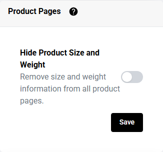
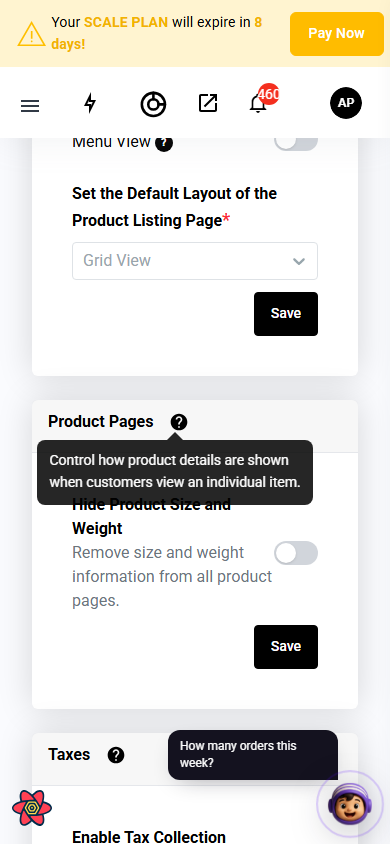
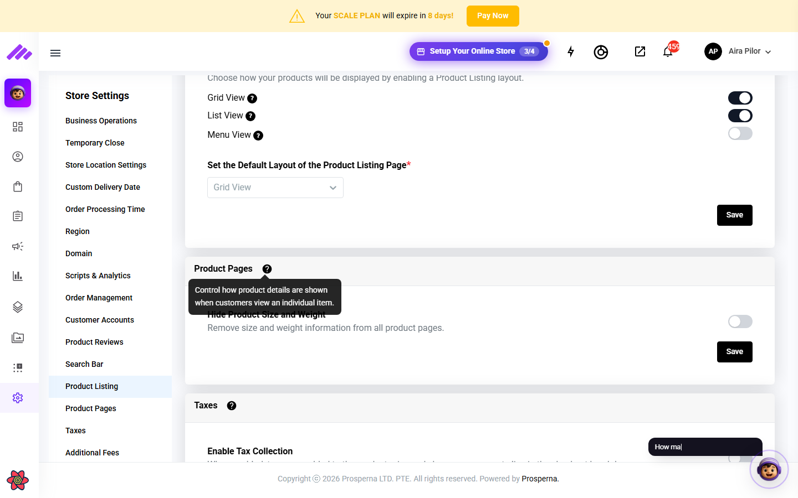
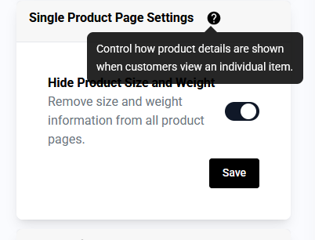
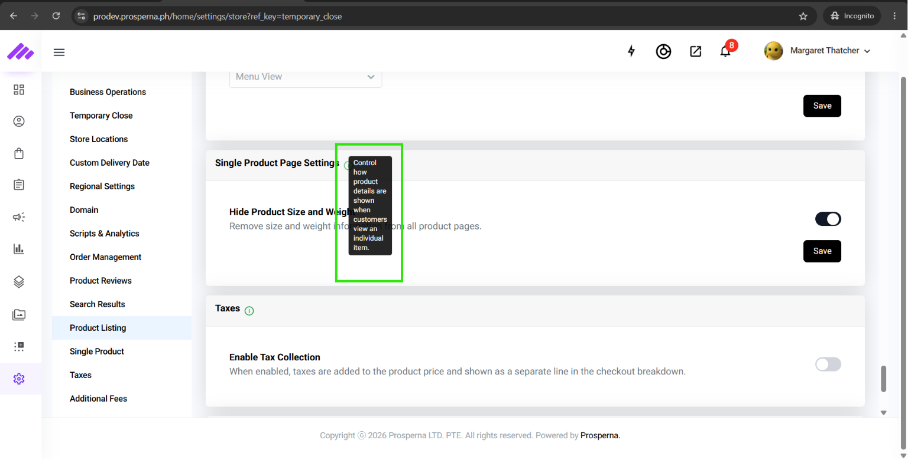

# Single Product

- **Task ID**: `86ey5cbtz`
- **URL**: https://app.clickup.com/t/86ey5cbtz
- **Status**: ready for deployment
- **Assignees**: Angelo Kamachi, Aira Pilor
- **Created**: 2026-07-03T11:28:40.869Z
- **Updated**: 2026-10-07T00:06:13.231Z
- **List**: P1 Delivery
- **Folder**: Shared with me

## Description

_No description_

## Media (7)

- `01_mobile-single_product_ref.png` (source: attachment, uploader: Aira Pilor)

  

- `02_tc02-single_product_ref-after-tap.png` (source: attachment, uploader: Aira Pilor)

  

- `03_tc01-single_product_ref-tooltip-open.png` (source: attachment, uploader: Aira Pilor)

  

- `04_image.png` (source: attachment, uploader: Angelo Kamachi)

  

- `05_image.png` (source: attachment, uploader: Aira Pilor)

  

- `06_image.png` (source: comment, uploader: Angelo Kamachi)

  

- `07_image.png` (source: comment, uploader: Aira Pilor)

  

## Comments (4)

### Aira Pilor (2026-10-06T08:02:58.147Z)

Env: DEV-local
Status: PASSED
URL: http://localhost:3000/home/settings/store?ref_key=single_product_ref

TEST CASE #1: Section title "i" tooltip - desktop (case 1)
STEPS:
Step 1 - Open Settings > Store Settings at desktop width.
Step 2 - Hover the "i" icon beside "Product Pages".
EXPECTED RESULT: Black icon aligned with the title; tooltip opens without covering the title or being cut off.
EVIDENCE: tc01-single_product_ref-tooltip-open.png
ACTUAL RESULT: As expected. PASSED.

TEST CASE #2: Section title tooltip on mobile - tap (case 2)
STEPS:
Step 1 - Open Settings > Store Settings on a phone.
Step 2 - Tap the "i" icon beside "Product Pages" and wait.
EXPECTED RESULT: Opens on tap and does not close itself.
EVIDENCE: tc02-single_product_ref-after-tap.png
ACTUAL RESULT: Opens on tap and stays open. PASSED.

TEST CASE #3: Mobile view - section layout
STEPS:
Step 1 - Open Settings > Store Settings at 390px wide on a touch device.
Step 2 - Scroll to the Product Pages card.
EXPECTED RESULT: The card fits the phone screen; nothing runs past the edge.
EVIDENCE: mobile-single_product_ref.png
ACTUAL RESULT: As expected. PASSED.

### Angelo Kamachi (2026-08-18T06:36:26.507Z)

image.png
tooltip fixed

### Aira Pilor (2026-07-03T11:40:51.079Z)

env: DEV
Status: FAILED

The following are the issues under Single Product:
------Tooltip Icon and Layout on both MOBILE and DESKTOP view:
image.png
Kindly fix all the returns.

Moving this subtask to "Ready Priority".
cc @Angelo Kamachi

### ClickBot (2026-07-03T11:28:41.447Z)

This task Single Product has been created 
Date: Jul 3 2026, 7:28PM (Asia/Shanghai)
By Aira Pilor

