# Taxes

- **Task ID**: `86ey5cbxt`
- **URL**: https://app.clickup.com/t/86ey5cbxt
- **Status**: ready for deployment
- **Assignees**: Angelo Kamachi, Aira Pilor
- **Created**: 2026-07-03T11:28:55.957Z
- **Updated**: 2026-11-09T08:53:31.690Z
- **List**: P1 Delivery
- **Folder**: Shared with me

## Description

_No description_

## Media (64)

- `01_tx-r9-01-360-saved-row.png` (source: attachment, uploader: Aira Pilor)

  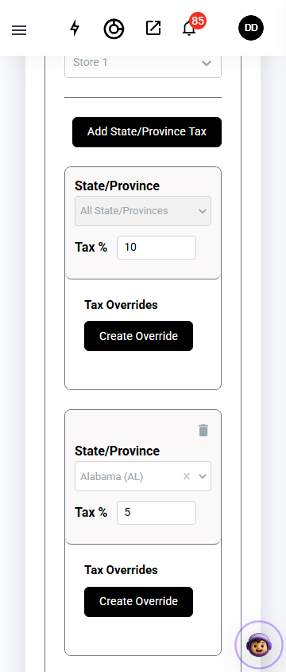

- `02_tx-r9-01-320-unsaved-row.png` (source: attachment, uploader: Aira Pilor)

  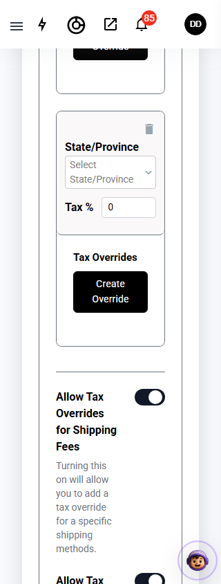

- `03_tx-r9-01-320-saved-row.png` (source: attachment, uploader: Aira Pilor)

  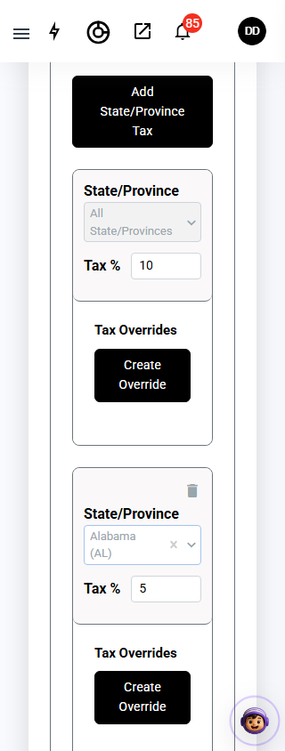

- `04_r23-tax-390-unsaved-longest.png` (source: attachment, uploader: Aira Pilor)

  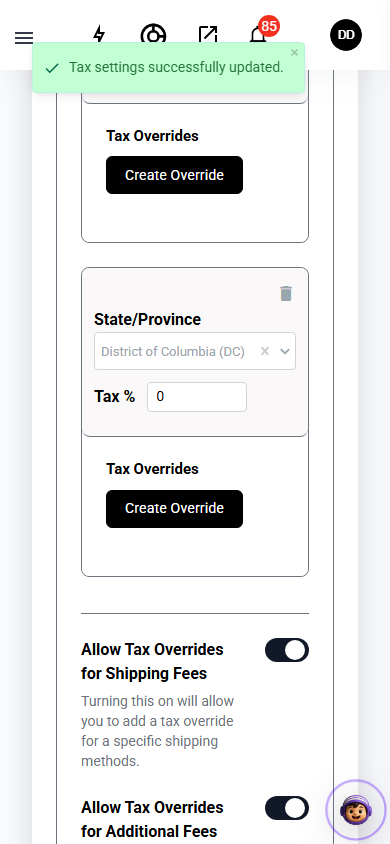

- `05_r23-tax-390-saved-row.png` (source: attachment, uploader: Aira Pilor)

  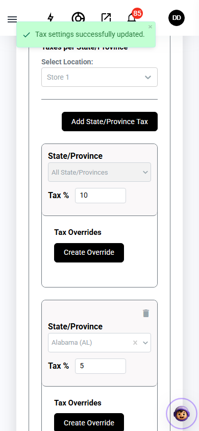

- `06_r23-tax-360-unsaved-longest.png` (source: attachment, uploader: Aira Pilor)

  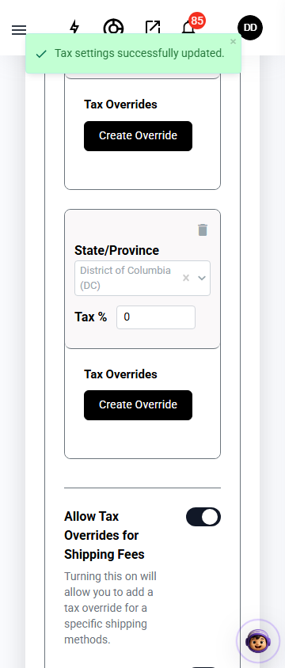

- `07_r23-tax-360-saved-row.png` (source: attachment, uploader: Aira Pilor)

  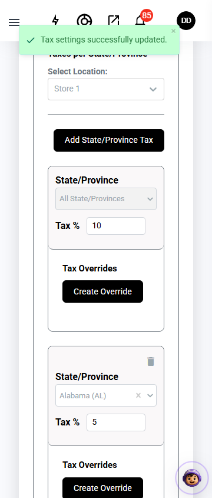

- `08_r23-tax-320-unsaved-longest.png` (source: attachment, uploader: Aira Pilor)

  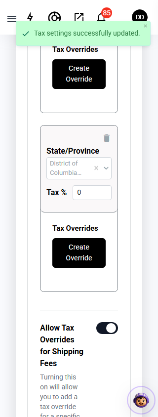

- `09_r23-tax-320-saved-row.png` (source: attachment, uploader: Aira Pilor)

  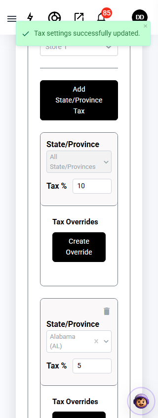

- `10_tx-r9-01-360-saved-row.png` (source: attachment, uploader: Aira Pilor)

  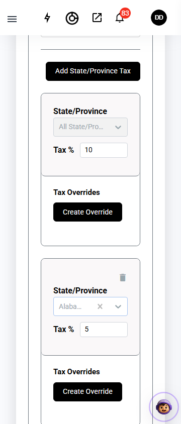

- `11_tx-r9-01-320-unsaved-row.png` (source: attachment, uploader: Aira Pilor)

  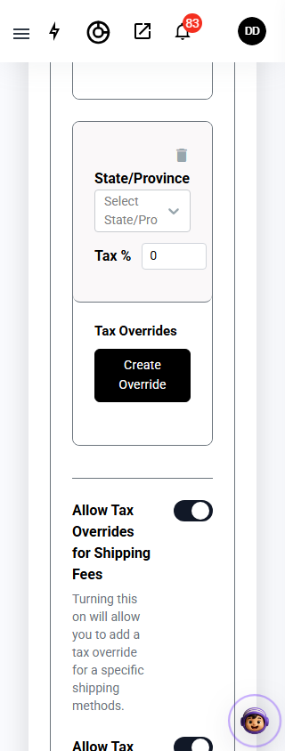

- `12_tx-r9-01-320-select-location.png` (source: attachment, uploader: Aira Pilor)

  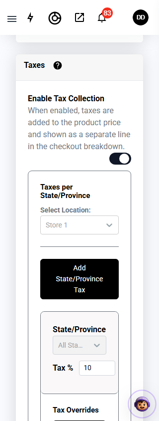

- `13_tx-r9-01-320-saved-row.png` (source: attachment, uploader: Aira Pilor)

  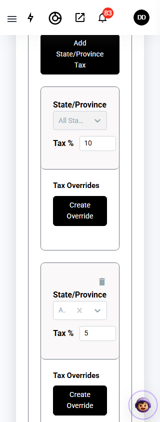

- `14_tc20-taxes-toggles-mobile.png` (source: attachment, uploader: Aira Pilor)

  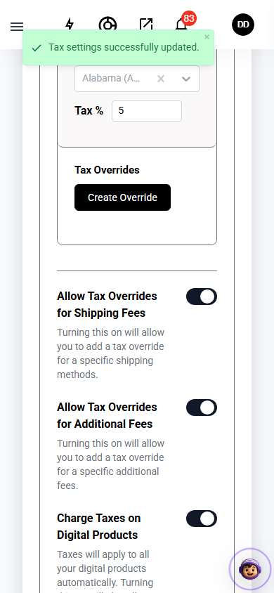

- `15_tc19-create-override-tooltip-hover.png` (source: attachment, uploader: Aira Pilor)

  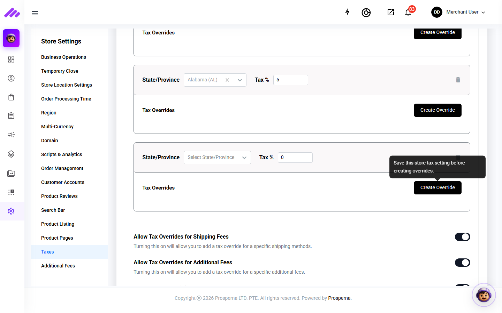

- `16_tc19-create-override-tooltip-after-tap.png` (source: attachment, uploader: Aira Pilor)

  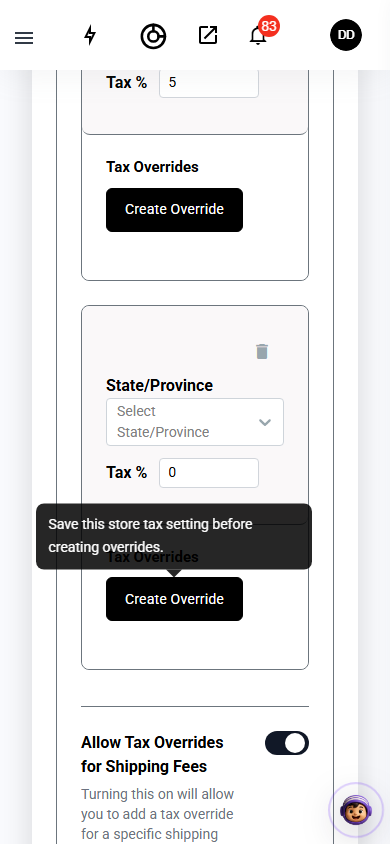

- `17_audit-320-inert-vs-saved.png` (source: attachment, uploader: Aira Pilor)

  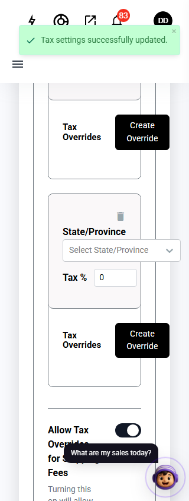

- `18_audit-360-inert-vs-saved.png` (source: attachment, uploader: Aira Pilor)

  

- `19_audit-375-inert-vs-saved.png` (source: attachment, uploader: Aira Pilor)

  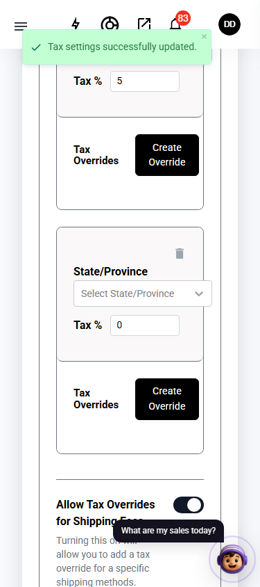

- `20_audit-390-inert-vs-saved.png` (source: attachment, uploader: Aira Pilor)

  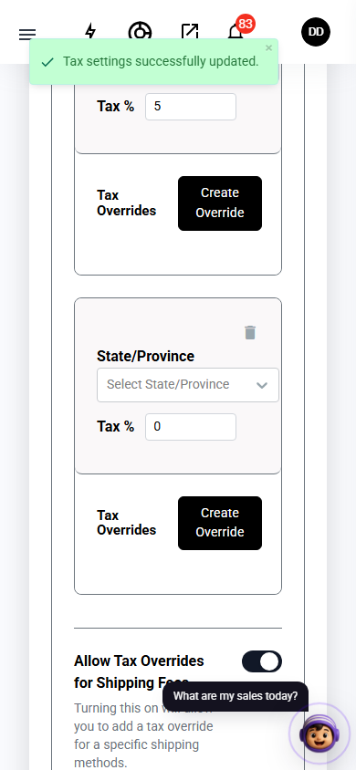

- `21_image.png` (source: attachment, uploader: Angelo Kamachi)

  

- `22_image.png` (source: attachment, uploader: Angelo Kamachi)

  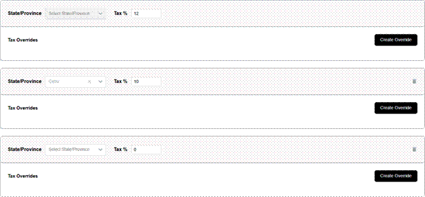

- `23_image.png` (source: attachment, uploader: Angelo Kamachi)

  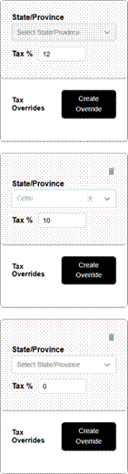

- `24_image.png` (source: attachment, uploader: Angelo Kamachi)

  

- `25_image.png` (source: attachment, uploader: Angelo Kamachi)

  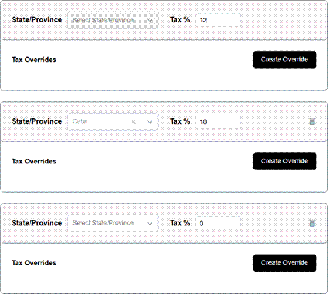

- `26_image.png` (source: attachment, uploader: Angelo Kamachi)

  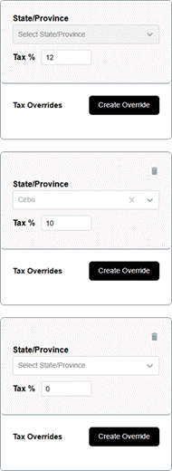

- `27_image.png` (source: attachment, uploader: Angelo Kamachi)

  

- `28_image.png` (source: attachment, uploader: Angelo Kamachi)

  

- `29_image.png` (source: attachment, uploader: Angelo Kamachi)

  

- `30_image.png` (source: attachment, uploader: Angelo Kamachi)

  

- `31_create-override-375.png` (source: attachment, uploader: Aira Pilor)

  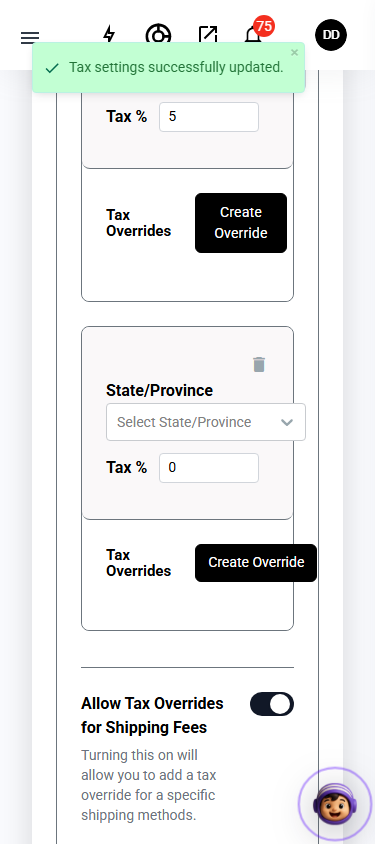

- `32_create-override-390.png` (source: attachment, uploader: Aira Pilor)

  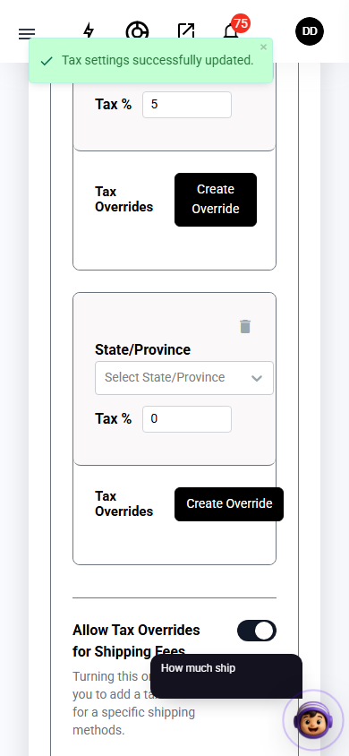

- `33_tc20-taxes-switches-mobile.png` (source: attachment, uploader: Aira Pilor)

  

- `34_tc19-create-override-desktop.png` (source: attachment, uploader: Aira Pilor)

  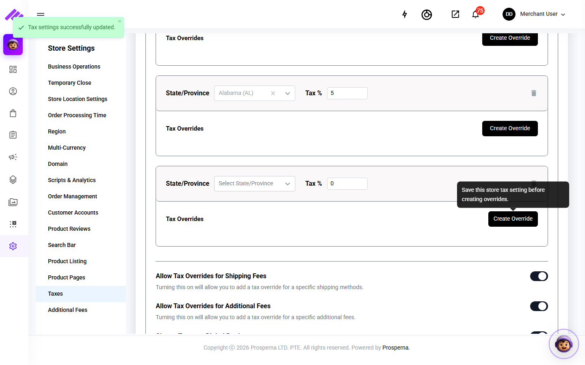

- `35_tc20-taxes-toggles-mobile.png` (source: attachment, uploader: Aira Pilor)

  

- `36_tc19-create-override-tooltip-after-tap.png` (source: attachment, uploader: Aira Pilor)

  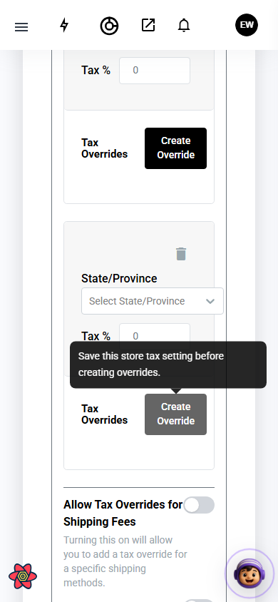

- `37_tc19-create-override-tooltip-hover.png` (source: attachment, uploader: Aira Pilor)

  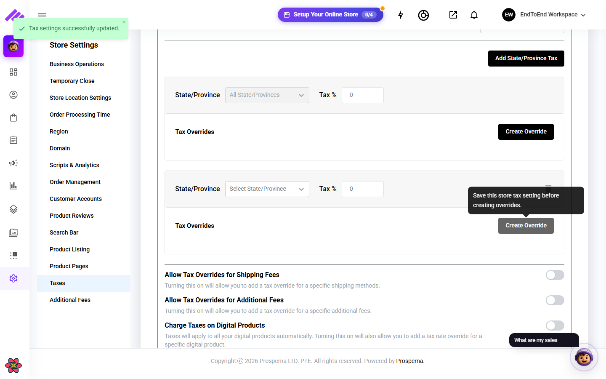

- `38_mobile-taxes.png` (source: attachment, uploader: Aira Pilor)

  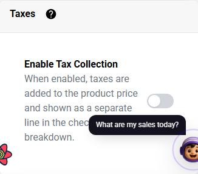

- `39_tc02-taxes-after-tap.png` (source: attachment, uploader: Aira Pilor)

  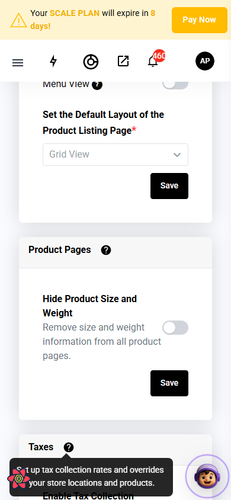

- `40_tc01-taxes-tooltip-open.png` (source: attachment, uploader: Aira Pilor)

  

- `41_image.png` (source: attachment, uploader: Angelo Kamachi)

  

- `42_image.png` (source: attachment, uploader: Angelo Kamachi)

  

- `43_image.png` (source: attachment, uploader: Angelo Kamachi)

  

- `44_image.png` (source: attachment, uploader: Aira Pilor)

  

- `45_image.png` (source: attachment, uploader: Aira Pilor)

  

- `46_image.png` (source: attachment, uploader: Aira Pilor)

  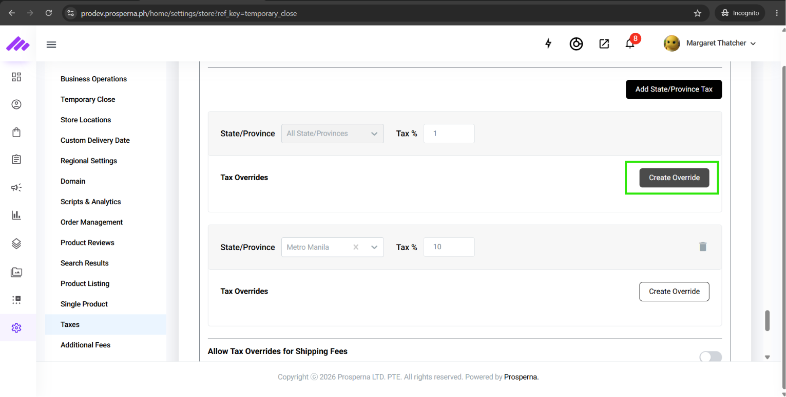

- `47_image.png` (source: attachment, uploader: Aira Pilor)

  

- `48_image.png` (source: comment, uploader: Angelo Kamachi)

  

- `49_image.png` (source: comment, uploader: Angelo Kamachi)

  

- `50_image.png` (source: comment, uploader: Angelo Kamachi)

  

- `51_image.png` (source: comment, uploader: Angelo Kamachi)

  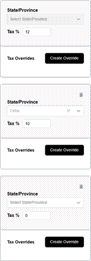

- `52_image.png` (source: comment, uploader: Angelo Kamachi)

  

- `53_image.png` (source: comment, uploader: Angelo Kamachi)

  

- `54_image.png` (source: comment, uploader: Angelo Kamachi)

  

- `55_image.png` (source: comment, uploader: Angelo Kamachi)

  

- `56_image.png` (source: comment, uploader: Angelo Kamachi)

  

- `57_image.png` (source: comment, uploader: Angelo Kamachi)

  

- `58_image.png` (source: comment, uploader: Angelo Kamachi)

  

- `59_image.png` (source: comment, uploader: Angelo Kamachi)

  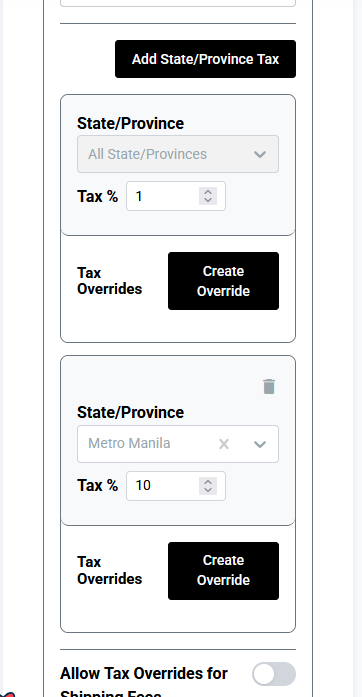

- `60_image.png` (source: comment, uploader: Angelo Kamachi)

  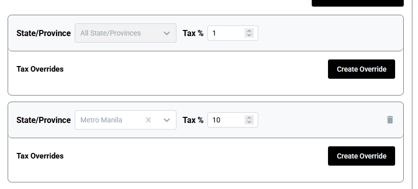

- `61_image.png` (source: comment, uploader: Aira Pilor)

  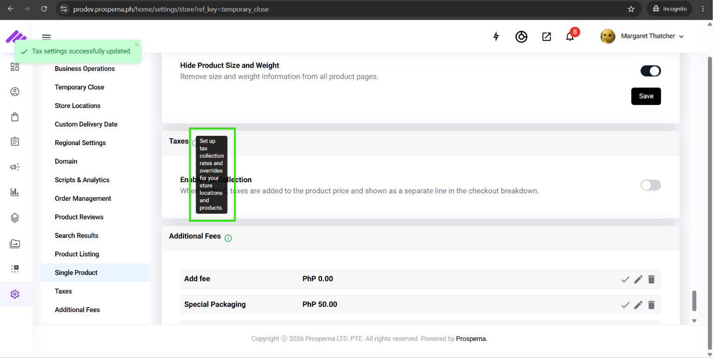

- `62_image.png` (source: comment, uploader: Aira Pilor)

  

- `63_image.png` (source: comment, uploader: Aira Pilor)

  

- `64_image.png` (source: comment, uploader: Aira Pilor)

  

## Comments (12)

### Aira Pilor (2026-11-09T08:49:05.711Z)

Env: DEV
Status: PASSED
URL: https://prodev.prosperna.com/home/settings/store?ref_key=taxes

TEST CASE #1: A saved State/Province can be read on small phones
STEPS:
Open Store Settings > Taxes on a US store with a saved Alabama tax, and turn on tax collection.
Look at the saved row's State/Province at 390px, 360px and 320px.
EXPECTED RESULT: The state name stays readable at every width.
EVIDENCE: r23-tax-390-saved-row.png, r23-tax-360-saved-row.png, r23-tax-320-saved-row.png
ACTUAL RESULT: PASSED. "Alabama (AL)" shows in full: on 1 line at 390px and 360px, and on 2 lines at 320px (before, "Alab…" at 360px and only a sliver at 320px).

TEST CASE #2: The longest state name on a new row
STEPS:
On the same page, click "Add State/Province Tax".
Pick the longest name in the list, "District of Columbia (DC)". Do not save.
Look at it at 390px, 360px and 320px.
EXPECTED RESULT: A long name wraps to 2 lines and then ends in "…", so you can still tell which state it is.
EVIDENCE: r23-tax-390-unsaved-longest.png, r23-tax-360-unsaved-longest.png, r23-tax-320-unsaved-longest.png
ACTUAL RESULT: PASSED. 1 line at 390px, 2 lines at 360px, and "District of / Columbia…" at 320px.

TEST CASE #3: The Taxes rows still fit their box
STEPS:
Open Taxes with tax collection on and add an unsaved row.
Check the dropdowns, Create Override and "Add State/Province Tax" at 1440px, 768px, 390px, 375px, 360px and 320px.
EXPECTED RESULT: Nothing goes past its row's box, and the page does not scroll sideways.
EVIDENCE: tx-r9-01-320-saved-row.png, tx-r9-01-320-unsaved-row.png, tx-r9-01-360-saved-row.png
ACTUAL RESULT: PASSED.

Tax collection was turned back off afterwards.

Task link: https://app.clickup.com/t/86ey5cbxt

### Aira Pilor (2026-11-06T05:20:21.964Z)

Env: DEV
Status: PASSED
URL: https://prodev.prosperna.com/home/settings/store?ref_key=taxes
TEST CASE #1: Tax rows fit their box on small phones
STEPS:
Open Settings > Store > Taxes on a US store and turn on tax collection.
Click Add State/Province Tax so there are saved rows and a new, unsaved row.
View the Taxes section at 1440px, 768px, 390px, 375px, 360px and 320px wide, in Chromium and WebKit (Safari's engine).
EXPECTED RESULT: The Select Location and State/Province dropdowns, both kinds of "Create Override" button and "Add State/Province Tax" stay inside their box at every width, the page does not scroll sideways, and "Tax Overrides" stays on one row with its button at 1440px and 768px.
EVIDENCE: tx-r9-01-360-saved-row.png, tx-r9-01-320-saved-row.png, tx-r9-01-320-unsaved-row.png, tx-r9-01-320-select-location.png
ACTUAL RESULT: PASSED. Everything is inside its box at all six widths in both browsers (closest is 25px inside), nothing scrolls sideways, and the title row only wraps below 768px.

TEST CASE #2: Disabled Create Override (regression)
STEPS:
Open Taxes with tax collection on and click Add State/Province Tax.
Hover, then tap, the disabled "Create Override" on the new row.
EXPECTED RESULT: The button is solid black, does nothing when clicked, and explains itself on hover and tap.
EVIDENCE: tc19-create-override-tooltip-hover.png, tc19-create-override-tooltip-after-tap.png
ACTUAL RESULT: PASSED.

TEST CASE #3: Override switches line up with their titles on a phone (regression)
STEPS:
Open Taxes at 390px with tax collection on.
Look at the three "Allow Tax Overrides / Charge Taxes" switches.
EXPECTED RESULT: Each switch sits level with its row title.
EVIDENCE: tc20-taxes-toggles-mobile.png
ACTUAL RESULT: PASSED.

Task link: https://app.clickup.com/t/86ey5cbxt

### Aira Pilor (2026-11-06T02:47:06.478Z)

Env: DEV
Status: FAILED
URL: https://prodev.prosperna.com/home/settings/store?ref_key=taxes
TEST CASE #1: Tax rows fit their box on small phones
STEPS:
Open Settings > Store > Taxes on a US store and turn on tax collection.
Click Add Tax so there is a saved row and a new, unsaved row.
View the Taxes section at 390px, 375px, 360px and 320px wide.
EXPECTED RESULT: The State/Province dropdown and both "Create Override" buttons stay inside their row's box at every width.
EVIDENCE: audit-390-inert-vs-saved.png, audit-375-inert-vs-saved.png, audit-360-inert-vs-saved.png, audit-320-inert-vs-saved.png
ACTUAL RESULT: FAILED. At 390px and 375px everything fits. At 360px the State/Province dropdown and both "Create Override" buttons run 8px past the right edge of the row's box, and at 320px 48px past it.

Task link: https://app.clickup.com/t/86ey5cbxt

### Angelo Kamachi (2026-11-03T07:52:08.354Z)

Browser check (Playwright)

The real TaxCollectionItem and ToggleSwitch components were rendered with the app's real SCSS and Tailwind CSS in a temporary page (no login or backend needed) and measured in Chromium. The temporary page was deleted afterwards and nothing from this check is in the repository.

Case Check Result
19 Unsaved row button colour; click does nothing Pass. Black (rgb 0,0,0) with white text, same as the saved rows. Clicking fired 0 override events at every width; a saved row fired 1.
20 Each switch beside its row title Pass. All three switches on the same line as their titles at 1440, 768, 390, 375 and 320px, right-aligned, no sideways scroll.
21 Unsaved button matches the saved rows and fits its box Pass. Identical size, font (14.4px), padding and wrapping to the saved rows, no overflow. At 320px both wrap onto two lines.

Limit of this check: the test page is not nested as deeply as the real Taxes card, so it does not reproduce the exact 8px and 23px overflow. It shows the unsaved and saved buttons now render identically, which was the cause. Confirm on the real dev page after the build is deployed.

Screenshots

Each "rows" image shows three tax rows: two saved rows, then the unsaved row at the bottom. The unsaved row's "Create Override" should look the same as the saved rows'.

Tax rows and Create Override

image.png

Rows at 1440px wide

image.png

Rows at 768px wide

image.png

Rows at 390px wide

image.png

Rows at 375px wide

image.png

Rows at 320px wide (both buttons wrap onto two lines)

Override switches

image.png

Switches at 1440px wide

image.png

Switches at 768px wide

image.png

Switches at 390px wide, each beside its title

image.png

Switches at 375px wide

image.png

Switches at 320px wide

### Aira Pilor (2026-11-03T07:23:27.920Z)

Env: DEV
Status: FAILED
URL: https://prodev.prosperna.com/home/settings/store?ref_key=taxes

TEST CASE #1: Unsaved row's "Create Override" color (case 19)
STEPS:
Step 1 - With tax collection on, add a second state/province tax row without saving it.
Step 2 - Compare its "Create Override" with the saved rows' "Create Override".
EXPECTED RESULT: Same solid black as the other buttons in the section, and clicking it does nothing until the row is saved.
EVIDENCE: tc19-create-override-desktop.png
ACTUAL RESULT: Solid black, the same as the saved rows' buttons. Clicking it does nothing. A saved row's "Create Override" still opens the Tax Override window. PASSED.

TEST CASE #2: Override switch alignment on mobile (case 20)
STEPS:
Step 1 - With tax collection on, view the three override switches on a phone.
EXPECTED RESULT: Each switch lines up with its row title, not under the description.
EVIDENCE: tc20-taxes-switches-mobile.png
ACTUAL RESULT: All three switches sit beside their titles, from 320px phones up to desktop. PASSED.

TEST CASE #3: Unsaved row's "Create Override" fits its box on mobile
STEPS:
Step 1 - With tax collection on, add a second state/province tax row without saving it.
Step 2 - View the Taxes section on a phone (390px and 375px wide).
EXPECTED RESULT: The button stays inside its box, like the saved rows' "Create Override".
EVIDENCE: create-override-390.png, create-override-375.png
ACTUAL RESULT: The unsaved row's button runs past the right edge of its box: 8px at 390px and 23px at 375px. The saved rows' button wraps its text onto two lines and stays inside. The unsaved row's button is also smaller, with a smaller font and less padding, so the two "Create Override" buttons don't match. FAILED.

Task link: https://app.clickup.com/t/86ey5cbxt

### Aira Pilor (2026-10-06T08:04:35.439Z)

Env: DEV-local
Status: PASSED
URL: http://localhost:3000/home/settings/store?ref_key=taxes

TEST CASE #1: Section title "i" tooltip - desktop (case 1)
STEPS:
Step 1 - Open Settings > Store Settings at desktop width.
Step 2 - Hover the "i" icon beside "Taxes".
EXPECTED RESULT: Black icon aligned with the title; tooltip opens without covering the title or being cut off.
EVIDENCE: tc01-taxes-tooltip-open.png
ACTUAL RESULT: As expected. PASSED.

TEST CASE #2: Section title tooltip on mobile - tap (case 2)
STEPS:
Step 1 - Open Settings > Store Settings on a phone.
Step 2 - Tap the "i" icon beside "Taxes" and wait.
EXPECTED RESULT: Opens on tap and does not close itself.
EVIDENCE: tc02-taxes-after-tap.png
ACTUAL RESULT: Opens on tap and stays open. PASSED.

TEST CASE #3: Mobile view - section layout
STEPS:
Step 1 - Open Settings > Store Settings at 390px wide on a touch device.
Step 2 - Scroll to the Taxes card.
EXPECTED RESULT: The card fits the phone screen; nothing runs past the edge.
EVIDENCE: mobile-taxes.png
ACTUAL RESULT: As expected. PASSED.

TEST CASE #4: Disabled "Create Override" (case 19)
STEPS:
Step 1 - With tax collection on, add a second state/province tax row without saving it.
Step 2 - Hover the greyed-out "Create Override" on desktop, then tap it on a phone.
EXPECTED RESULT: The button is the same solid black as "Add Tax", and a tooltip explains it must be saved first.
EVIDENCE: tc19-create-override-tooltip-hover.png, tc19-create-override-tooltip-after-tap.png
ACTUAL RESULT: Same shade as "Add Tax"; the tooltip opens on both hover and tap. PASSED.

TEST CASE #5: Override toggle alignment on mobile (case 20)
STEPS:
Step 1 - With tax collection on, view the three override toggles at phone width.
EXPECTED RESULT: Each toggle lines up with its row title, not the middle of the description.
EVIDENCE: tc20-taxes-toggles-mobile.png
ACTUAL RESULT: All three toggles sit level with their titles. PASSED.

### Angelo Kamachi (2026-08-18T06:40:48.385Z)

image.png
non clipping buttons

### Angelo Kamachi (2026-08-18T06:40:33.427Z)

image.png
better mobile responsiveness

### Angelo Kamachi (2026-08-18T06:40:05.619Z)

image.png
button color changes

### Angelo Kamachi (2026-08-18T06:36:41.990Z)

tooltip fixed

### Aira Pilor (2026-07-03T11:51:50.376Z)

env: DEV
Status: FAILED

The following are the issues under Taxes:
------Tooltip Icon & Layout:
image.png
Hover Effect:
image.png
Layout:
image.png
image.png

Kindly fix all the returns.

Moving this subtask to "Ready Priority"
cc @Angelo Kamachi

### ClickBot (2026-07-03T11:28:56.744Z)

This task Taxes has been created 
Date: Jul 3 2026, 7:28PM (Asia/Shanghai)
By Aira Pilor

