# Additional Fees

- **Task ID**: `86ey5cc25`
- **URL**: https://app.clickup.com/t/86ey5cc25
- **Status**: ready for deployment
- **Assignees**: Angelo Kamachi, Aira Pilor
- **Created**: 2026-07-03T11:29:14.119Z
- **Updated**: 2026-10-07T00:06:29.924Z
- **List**: P1 Delivery
- **Folder**: Shared with me

## Description

_No description_

## Media (21)

- `01_tc18-additional-fee-form-mobile.png` (source: attachment, uploader: Aira Pilor)

  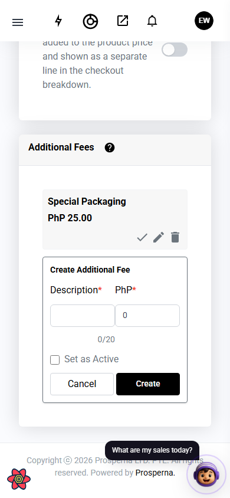

- `02_tc17-additional-fees-mobile.png` (source: attachment, uploader: Aira Pilor)

  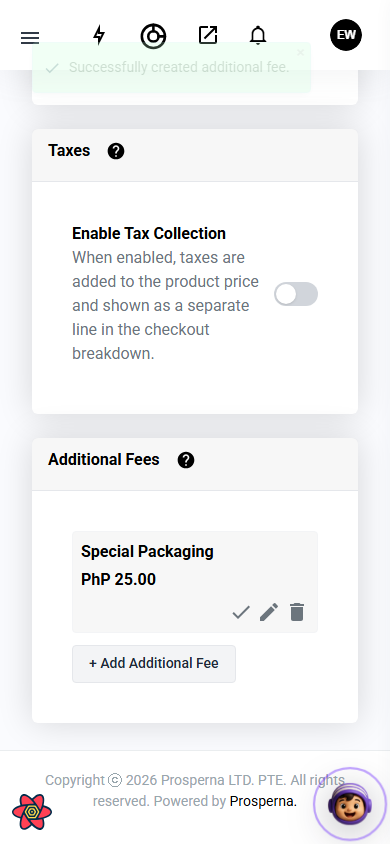

- `03_mobile-additional_fee.png` (source: attachment, uploader: Aira Pilor)

  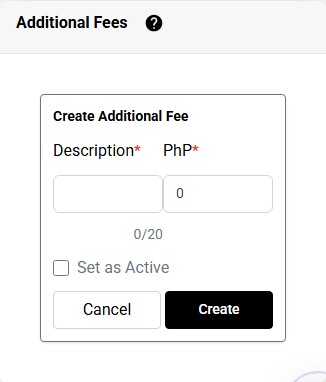

- `04_tc02-additional_fee-after-tap.png` (source: attachment, uploader: Aira Pilor)

  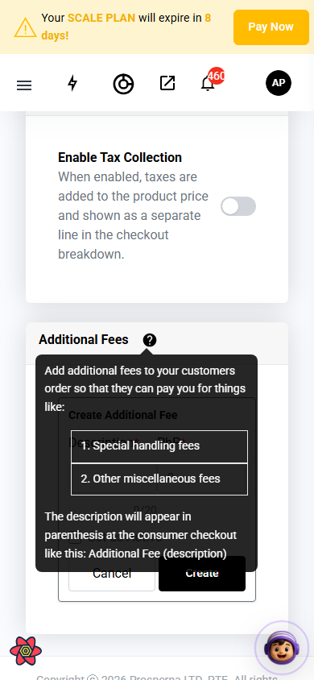

- `05_tc01-additional_fee-tooltip-open.png` (source: attachment, uploader: Aira Pilor)

  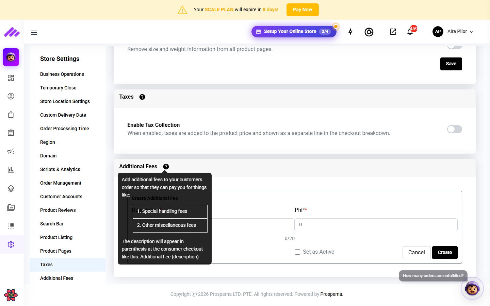

- `06_image.png` (source: attachment, uploader: Angelo Kamachi)

  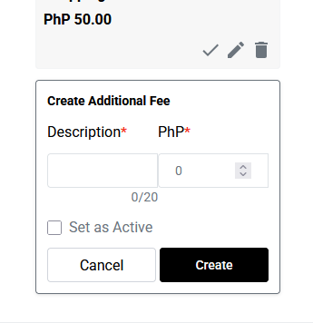

- `07_image.png` (source: attachment, uploader: Angelo Kamachi)

  

- `08_image.png` (source: attachment, uploader: Angelo Kamachi)

  

- `09_image.png` (source: attachment, uploader: Angelo Kamachi)

  

- `10_image.png` (source: attachment, uploader: Aira Pilor)

  

- `11_image.png` (source: attachment, uploader: Aira Pilor)

  

- `12_image.png` (source: attachment, uploader: Aira Pilor)

  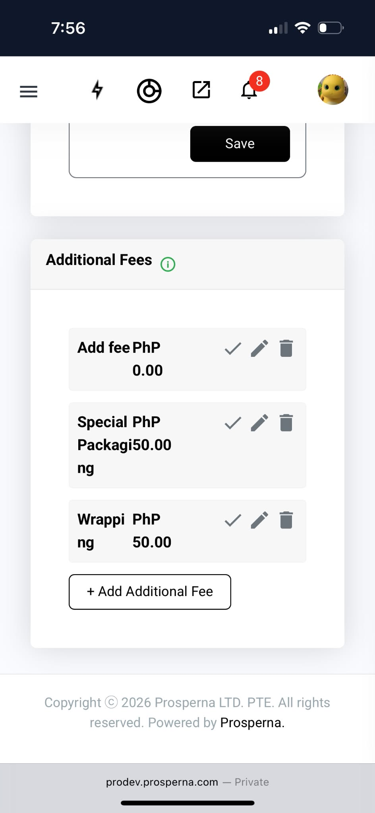

- `13_image.png` (source: attachment, uploader: Aira Pilor)

  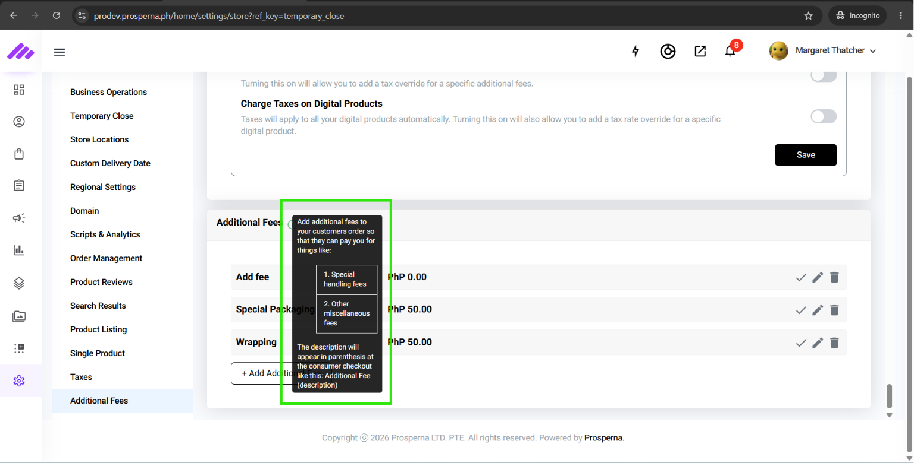

- `14_image.png` (source: comment, uploader: Angelo Kamachi)

  

- `15_image.png` (source: comment, uploader: Angelo Kamachi)

  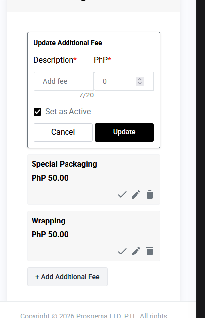

- `16_image.png` (source: comment, uploader: Angelo Kamachi)

  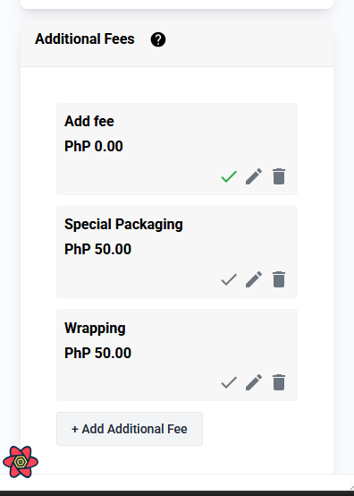

- `17_image.png` (source: comment, uploader: Angelo Kamachi)

  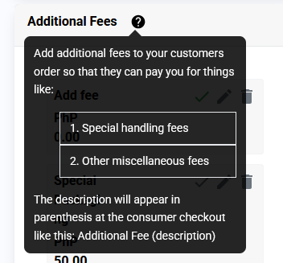

- `18_image.png` (source: comment, uploader: Aira Pilor)

  

- `19_image.png` (source: comment, uploader: Aira Pilor)

  

- `20_image.png` (source: comment, uploader: Aira Pilor)

  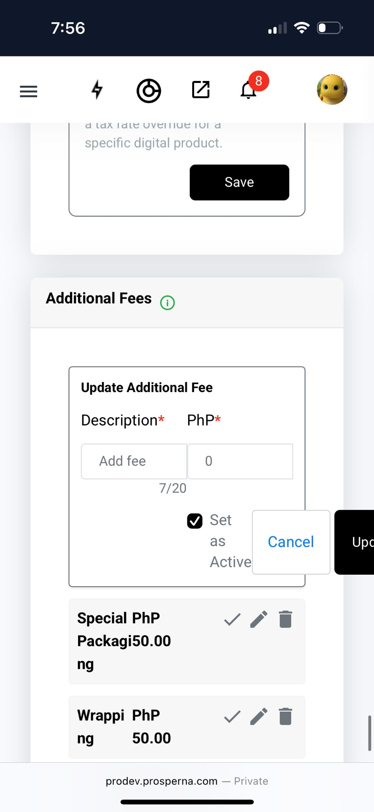

- `21_image.png` (source: comment, uploader: Aira Pilor)

  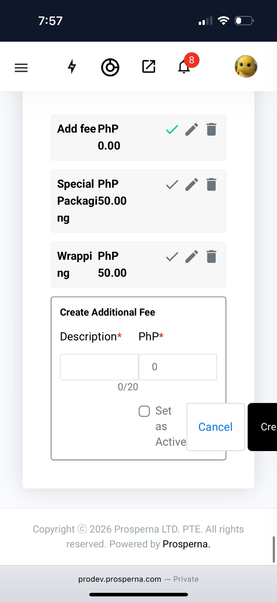

## Comments (7)

### Aira Pilor (2026-10-06T08:04:36.586Z)

Env: DEV-local
Status: PASSED
URL: http://localhost:3000/home/settings/store?ref_key=additional_fee

TEST CASE #1: Section title "i" tooltip - desktop (case 1)
STEPS:
Step 1 - Open Settings > Store Settings at desktop width.
Step 2 - Hover the "i" icon beside "Additional Fees".
EXPECTED RESULT: Black icon aligned with the title; tooltip opens without covering the title or being cut off.
EVIDENCE: tc01-additional_fee-tooltip-open.png
ACTUAL RESULT: As expected. PASSED.

TEST CASE #2: Section title tooltip on mobile - tap (case 2)
STEPS:
Step 1 - Open Settings > Store Settings on a phone.
Step 2 - Tap the "i" icon beside "Additional Fees" and wait.
EXPECTED RESULT: Opens on tap and does not close itself.
EVIDENCE: tc02-additional_fee-after-tap.png
ACTUAL RESULT: Opens on tap and stays open. PASSED.

TEST CASE #3: Mobile view - section layout
STEPS:
Step 1 - Open Settings > Store Settings at 390px wide on a touch device.
Step 2 - Scroll to the Additional Fees card.
EXPECTED RESULT: The card fits the phone screen; nothing runs past the edge.
EVIDENCE: mobile-additional_fee.png
ACTUAL RESULT: As expected. PASSED.

TEST CASE #4: Fee list on mobile (case 17)
STEPS:
Step 1 - Add a fee "Special Packaging".
Step 2 - View the fee list at phone width.
EXPECTED RESULT: The description sits above the price and wraps at word boundaries.
EVIDENCE: tc17-additional-fees-mobile.png
ACTUAL RESULT: Price sits below the description, wrapping at word boundaries, no overflow. PASSED.

TEST CASE #5: Add/Edit fee form on mobile (case 18)
STEPS:
Step 1 - Open the Create Additional Fee form at phone width.
EXPECTED RESULT: "Set as Active" sits above Cancel/Create, not overlapping; each button takes about half the row.
EVIDENCE: tc18-additional-fee-form-mobile.png
ACTUAL RESULT: As expected. PASSED.

### Angelo Kamachi (2026-08-18T06:46:25.597Z)

image.png
same situation in creating fees

### Angelo Kamachi (2026-08-18T06:45:56.021Z)

image.png
revised mobile buttons

### Angelo Kamachi (2026-08-18T06:44:23.756Z)

image.png
revised mobile layouting of fees

### Angelo Kamachi (2026-08-18T06:41:21.110Z)

image.png
tooltip fixed, I like the table inside the tooltip

### Aira Pilor (2026-07-03T11:59:04.399Z)

env: DEV
Status: FAILED

The following are the issues under Additional Fees:
------Tooltip Icon & Layout on both MOBILE and DESKTOP view:
image.png
Layout:
image.png
Edit:
image.png
Add Additional Fees:
image.png

Kindly fix all the returns.

Moving this subtask to "Ready Priority"
cc @Angelo Kamachi

### ClickBot (2026-07-03T11:29:14.935Z)

This task Additional Fees has been created 
Date: Jul 3 2026, 7:29PM (Asia/Shanghai)
By Aira Pilor

