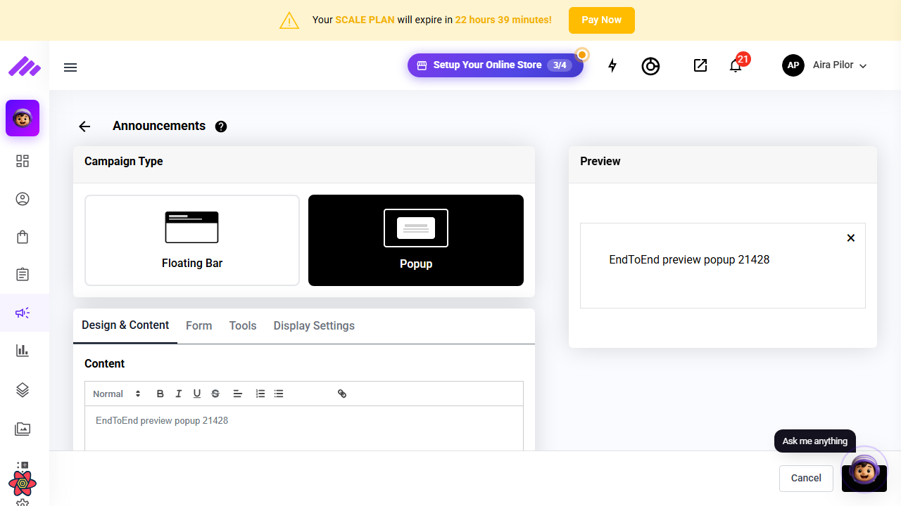
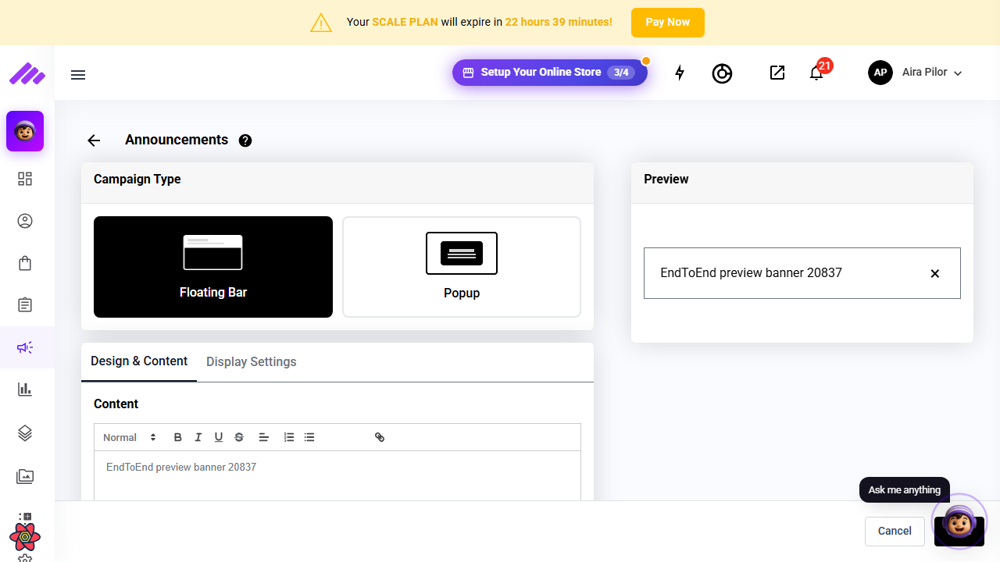
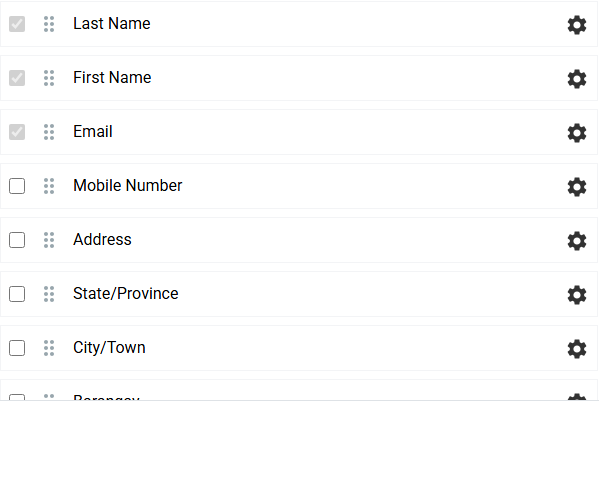
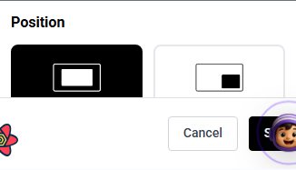
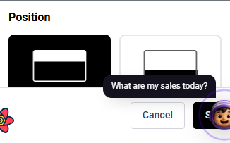
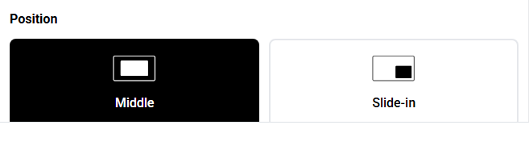
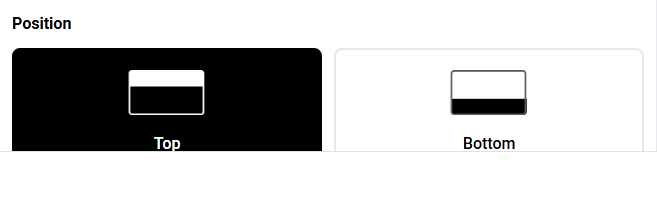
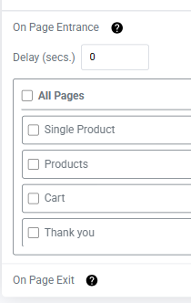
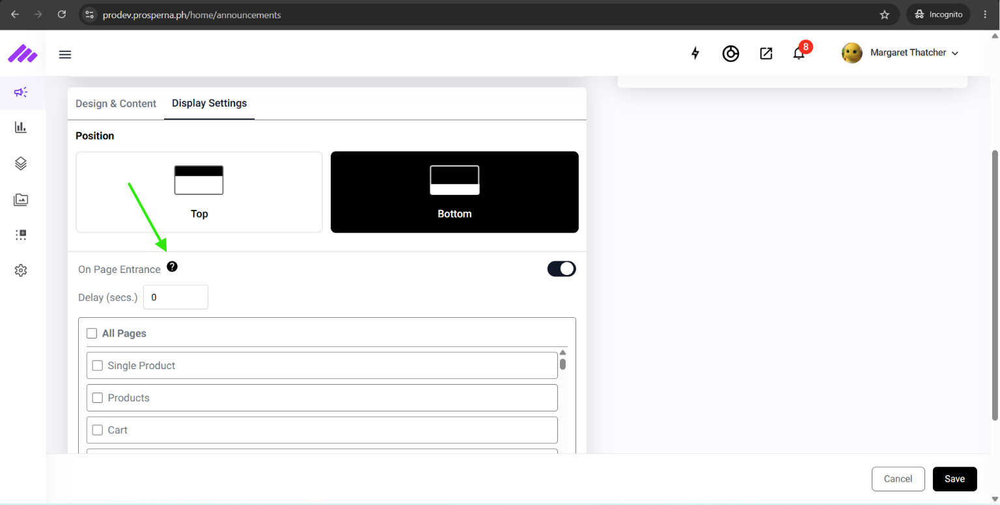

# Announcements

- **Task ID**: `86ey5dncz`
- **URL**: https://app.clickup.com/t/86ey5dncz
- **Status**: deployed to prod
- **Assignees**: Angelo Kamachi, Aira Pilor
- **Created**: 2026-07-03T13:09:59.411Z
- **Updated**: 2026-11-06T05:10:10.780Z
- **List**: P1 Delivery
- **Folder**: Shared with me

## Description

_No description_

## Media (13)

- `01_r9-ann-field-cancel-hover.png` (source: attachment, uploader: Aira Pilor)

  

- `02_r8-ann-preview-popup.png` (source: attachment, uploader: Aira Pilor)

  

- `03_r8-ann-preview-banner.png` (source: attachment, uploader: Aira Pilor)

  

- `04_r8-ann-fields-after-drag.png` (source: attachment, uploader: Aira Pilor)

  

- `05_r8-ann-handle-pressed.png` (source: attachment, uploader: Aira Pilor)

  

- `06_r8-ann-position-popup-390.png` (source: attachment, uploader: Aira Pilor)

  

- `07_r8-ann-position-banner-390.png` (source: attachment, uploader: Aira Pilor)

  

- `08_r8-ann-position-popup-1280.png` (source: attachment, uploader: Aira Pilor)

  

- `09_r8-ann-position-banner-1280.png` (source: attachment, uploader: Aira Pilor)

  

- `10_image.png` (source: attachment, uploader: Angelo Kamachi)

  

- `11_image.png` (source: attachment, uploader: Aira Pilor)

  

- `12_image.png` (source: comment, uploader: Angelo Kamachi)

  

- `13_image.png` (source: comment, uploader: Aira Pilor)

  

## Comments (14)

### ClickBot (2026-11-06T05:10:10.780Z)

This Announcements has been move to DEPLOYED TO PROD
Date updated: Nov 6 2026, 1:10PM (Asia/Manila)
Triggered by: Angelo Kamachi

### Angelo Kamachi (2026-10-14T07:37:16.740Z)

10/14 QA Return (Announcements): No Change in PR #8934

Dev PR: https://github.com/Prosperna/prosperna1/pull/8934 (refactor/tw-marketing-standard-dev13 to dev)
Reference: main. This task is a Bootstrap to Tailwind migration, so the goal is to look and behave like main.
Scope: Announcements PASSED. PR #8934 only changes the Blogs editor's left menu, so nothing on Announcements changes.

QA retest after PR #8934 is merged

TC1: Regression
Steps: Spot-check the PASSED cases (floating position cards, drag cursor, field settings Cancel hover).
Expected: Still pass as before.

### Aira Pilor (2026-10-14T06:24:18.229Z)

Env: DEV-local
Status: PASSED
URL: http://localhost:3000 (prosperna1 dev @ 6a7509965, includes PR #8921)

TEST CASE #1: Popup form field Cancel
STEPS:
Step 1 - Announcements > Popup > Form tab, with Fields switched on.
Step 2 - Click the gear on a field and change its label.
Step 3 - Hover Cancel, then click it.
EXPECTED RESULT: Black background, white text; Cancel returns to the field list without keeping the change.
EVIDENCE: r9-ann-field-cancel-hover.png
ACTUAL RESULT: Cancel turns black with white text on hover, and clicking it returns to the field list with the original label. PASSED

### Angelo Kamachi (2026-10-14T02:24:18.289Z)

10/13 QA Return (Announcements): Change in PR #8921

Dev PR: https://github.com/Prosperna/prosperna1/pull/8921 (refactor/tw-marketing-standard-dev12 to dev)
Reference: main. This task is a Bootstrap to Tailwind migration, so the goal is to look and behave like main.
Scope: Announcements only. 10/13 result: PASSED, no failed test cases.

What changed
Cancel in the popup form field settings
Before: a faint grey hover with the text unchanged, so no hover was visible.
Why: the same hover issue QA found on Discounts and Blogs; on main this Cancel uses the cancel button style.
Now: black background with white text on hover, as on main. Nothing else on Announcements changed.

How it was tested
ESLint / Stylelint on the changed files: clean.
Announcements tests: passing.
Conflicts with current dev: none.

QA retest after PR #8921 is merged

TC1: Field settings Cancel hover
Steps: On a popup announcement with form fields, edit a field and hover Cancel.
Expected: Black background, white text.

TC2: Regression
Steps: Repeat the 10/13 test cases (floating position cards, drag cursor, create/edit/preview).
Expected: Still pass as on 10/13.

### Aira Pilor (2026-10-13T12:32:12.575Z)

Env: DEV-local
Status: PASSED
URL: http://localhost:3000 (prosperna1 dev @ 1839ffc2a, includes PR #8854)

TEST CASE #1: Floating position cards spacing
STEPS:
Step 1 - Open Announcements > Display Settings for Floating Bar and Popup, at 1280x720 then 390x844.
EXPECTED RESULT: The position cards have comfortable side padding on desktop and tighter padding on mobile; labels are not cramped against the card edges.
EVIDENCE: r8-ann-position-banner-1280.png, r8-ann-position-popup-1280.png, r8-ann-position-banner-390.png, r8-ann-position-popup-390.png
ACTUAL RESULT: The cards have 36px side padding on desktop and 16px on mobile, with every label inside its card. PASSED

TEST CASE #2: Drag cursor on popup form fields
STEPS:
Step 1 - On a Popup with form fields, hover a field's drag handle, then press and drag it below the next field.
EXPECTED RESULT: Grab hand on hover, grabbing hand while dragging; the field reorders as before.
EVIDENCE: r8-ann-handle-pressed.png, r8-ann-fields-after-drag.png
ACTUAL RESULT: The cursor is a grab hand on hover and a grabbing hand while pressed; First Name moved below Last Name. PASSED

TEST CASE #3: Regression check
STEPS:
Step 1 - Create, edit and preview an announcement (Floating Bar and Popup), then save a banner change.
EXPECTED RESULT: Everything behaves as in the 07/07 PASSED run.
EVIDENCE: r8-ann-preview-banner.png, r8-ann-preview-popup.png
ACTUAL RESULT: Typed content shows in the live preview for both types, the help icons and tooltips line up, and a banner change saves. PASSED

### Angelo Kamachi (2026-10-12T00:46:20.345Z)

PULL REQUEST
prosperna1 dev PR: https://github.com/Prosperna/prosperna1/pull/8854 (branch refactor/tw-marketing-standard-dev11)

NEXT STEPS
QA to retest on dev once merged, using the test cases in the comment above.

### Angelo Kamachi (2026-10-12T00:45:48.051Z)

ACCOMPLISHED
No open QA returns on this subtask (PASSED 07/07). One small migration fix was made while fixing the same issue on Blogs:

- Cause: two Announcements styles were written in a format the Tailwind setup does not compile: the extra side padding on the floating-position cards at larger screen sizes, and the "grabbing" cursor while dragging a popup form field.
- Fix: both are written in the correct format, so they now apply as originally intended. Nothing else on Announcements changed.

HOW IT WAS TESTED
- Lint on the changed files: clean
- Announcements tests: passing

BRANCH
refactor/tw-marketing-standard-dev11 (dev PR link to follow in a separate comment)

QA TEST CASES
WHERE TO TEST: dev, Home > Announcements.

TEST CASE #1: Floating position cards spacing
1. Create or edit an announcement with a floating position, at 1280x720 then 390x844.
EXPECTED: The position cards have comfortable side padding on desktop and tighter padding on mobile; labels are not cramped against the card edges.

TEST CASE #2: Drag cursor on popup form fields
1. On a popup announcement with form fields, hover over a field's drag handle, then press and drag it.
EXPECTED: The cursor shows a grab hand on hover and a grabbing hand while dragging; the field reorders as before.

TEST CASE #3: Regression check
1. Create, edit and preview an announcement.
EXPECTED: Everything behaves as in the 07/07 PASSED run.

### Angelo Kamachi (2026-10-05T04:32:50.685Z)

UPDATE: PR #8703 (Discounts End Date / Active Dates fix)
https://github.com/Prosperna/prosperna1/pull/8703

This PR only changes the Discounts create and edit forms. It does not touch Announcements, so nothing on this subtask changes with it.

QA TEST CASES (for PR #8703)
TEST CASE #1: Announcements unaffected
1. After PR #8703 is merged to dev, open Home > Announcements at 1280x720 and 390x844, then create and edit an announcement.
EXPECTED: Everything behaves exactly as it did before this PR.

### Aira Pilor (2026-07-07T03:11:27.871Z)

env: DEV
url: https://prodev.prosperna.ph/home/announcements
Status: PASSED

DESKTOP VIEW:
https://t7537039.p.clickup-attachments.com/t7537039/c0219f26-7712-4e1a-9ea7-698bf266ed66/20260707-0246-54.8833939.mp4?view=openMOBILE VIEW:
https://t7537039.p.clickup-attachments.com/t7537039/e1779b37-9178-455f-aed8-099cd2b6963e/f0bddf90-c1a5-4723-b508-081e8656a3de.mp4?view=openThe whole Announcement Page is now functioning well.

We can now deploy these changes to production.
cc @Angelo Kamachi

### ClickBot (2026-07-07T03:11:25.131Z)

This task Announcements has been move to PASSED TESTING 
Date updated: Jul 7 2026, 11:11AM (Asia/Shanghai)
Triggered by: Aira Pilor

### ClickBot (2026-07-07T02:35:42.189Z)

This task Announcements hss been move to IN TESTING 
Updated: Jul 7 2026, 10:35AM (Asia/Shanghai)
Triggered by: Aira Pilor

### Angelo Kamachi (2026-07-06T01:06:25.619Z)

image.png
realigned tooltips

### Aira Pilor (2026-07-03T13:18:00.821Z)

env: DEV
Status: FAILED

DESKTOP View:
https://t7537039.p.clickup-attachments.com/t7537039/a4d0553f-4a41-4d84-b143-8ed059c609b5/20260703-1314-33.5131272.mp4?view=openMobile View:
https://t7537039.p.clickup-attachments.com/t7537039/0fc92490-2d41-4290-af36-66cc813b778a/f5e8e669-c457-4a47-9053-548f7d952d3e.mp4?view=open
Only issue:
image.png
The tooltip is not aligned.

Moving this subtask to "Ready Priority"
cc @Angelo Kamachi

### ClickBot (2026-07-03T13:10:00.473Z)

This task Announcements has been created 
Date: Jul 3 2026, 9:09PM (Asia/Shanghai)
By Aira Pilor

