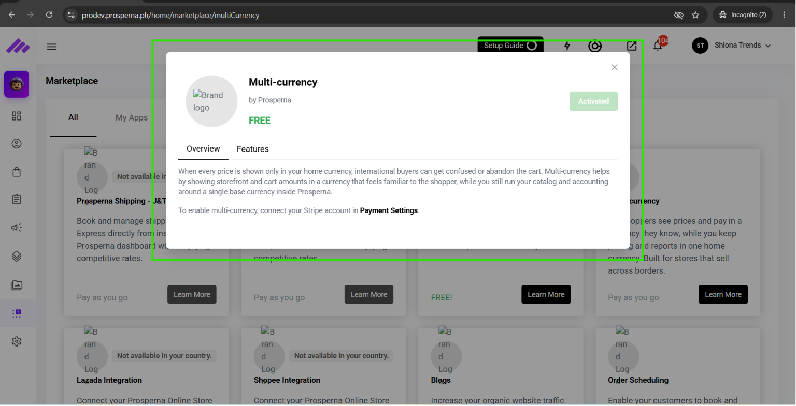
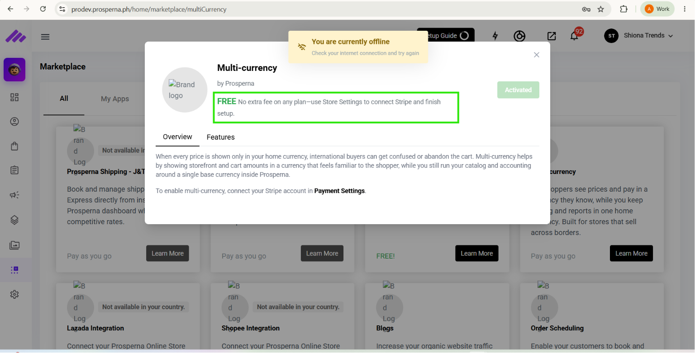

# Merchant Side | Marketplace | Multicurrency

- **Task ID**: `86eyf2apr`
- **URL**: https://app.clickup.com/t/86eyf2apr
- **Status**: deployed to prod
- **Assignees**: Aira Pilor, Angelo Kamachi
- **Created**: 2026-07-29T14:49:00.427Z
- **Updated**: 2026-10-16T06:57:18.540Z
- **List**: P1 Delivery
- **Folder**: Shared with me

## Description

Remove these " No extra fee on any plan-use Store Setting to connect Stripe and finish setup."

## Media (4)

- `01_image.png` (source: attachment, uploader: Aira Pilor)

  

- `02_image.png` (source: attachment, uploader: Aira Pilor)

  

- `03_image.png` (source: comment, uploader: Aira Pilor)

  

- `04_image.png` (source: description, uploader: description)

  

## Comments (12)

### ClickBot (2026-10-16T06:57:18.540Z)

This Merchant Side | Marketplace | Multicurrency has been move to DEPLOYED TO PROD
Date updated: Oct 16 2026, 2:57PM (Asia/Manila)
Triggered by: Angelo Kamachi

### Angelo Kamachi (2026-09-23T01:07:39.780Z)

This Task was fixed as a return from 86ey1p7bp , the status will be swapped to deployed to Prod once the tailwind has been pushed to prod

### Dennis Velasco (2026-09-21T00:00:00.820Z)

@Aira Pilor Should the status of this task be "DEPLOYED TO PROD"?

### Angelo Kamachi (2026-08-11T00:08:47.700Z)

I will target finishing staging it by today boss

### Dennis Velasco (2026-08-10T22:57:27.279Z)

@Ian Pelea When will this get pushed to prod?
cc: @Aira Pilor and @Raineir John Serinas

### Aira Pilor (2026-07-31T04:15:48.420Z)

env: DEV
url: https://prodev.prosperna.ph/home/marketplace/multiCurrency
Status: PASSED

image.png
Verified that the said text have been removed.

We can now deploy these changes to production.
cc @Kurt Alan Pasajol

### ClickBot (2026-07-31T04:15:45.093Z)

This task Merchant Side | Marketplace | Multicurrency has been move to PASSED TESTING 
Date updated: Jul 31 2026, 12:15PM (Asia/Shanghai)
Triggered by: Aira Pilor

### ClickBot (2026-07-31T04:15:43.646Z)

This task Merchant Side | Marketplace | Multicurrency hss been move to IN TESTING 
Updated: Jul 31 2026, 12:15PM (Asia/Shanghai)
Triggered by: Aira Pilor

### ClickBot (2026-07-30T06:25:31.984Z)

This Merchant Side | Marketplace | Multicurrency has been move to READY FOR TESTING
Date updated: Jul 30 2026, 2:25PM (Asia/Singapore)
Triggered by: Kurt Alan Pasajol

### Angelo Kamachi (2026-07-30T06:19:46.278Z)

QA TEST CASES SUMMARY
LAST UPDATED: Jul 30 2026 - dev PR https://github.com/Prosperna/prosperna1/pull/7597

WHERE TO TEST
Environment: dev
Path: Merchant dashboard > Marketplace > Multi-currency app tile > open the detail modal
Preconditions: none special - any merchant account with access to the Marketplace page

TEST CASES
Setup: log in as a merchant, go to Marketplace, click on the Multi-currency app tile to open its detail modal.
Steps: read the modal header area right under the green FREE label.
EXPECTED: the sentence "No extra fee on any plan-use Store Settings to connect Stripe and finish setup." is NOT shown. The line under FREE is blank/removed.
Setup: same modal as above.
Steps: check the rest of the modal content (overview text, "What you get" features list, Stripe requirement line).
EXPECTED: everything else in the modal still displays normally - overview text, feature list, and the Stripe connection requirement line are all unaffected by this change.
Setup: Stripe not yet connected for the store.
Steps: open the modal, look at the "connect Stripe" call-to-action area.
EXPECTED: existing separate Stripe/Payment Settings link still works as before (this was not touched by this fix).

TEST DATA
No special test data needed - any merchant/store account works.

OUT OF SCOPE / KNOWN BEHAVIOR
This change only removes the one caption line. It does not change Stripe connection logic, currency selection, or any other multi-currency behavior - those should look exactly as they did before this PR.

### Angelo Kamachi (2026-07-30T06:19:33.054Z)

ACCOMPLISHED
Removed the "No extra fee on any plan-use Store Settings to connect Stripe and finish setup." copy from the Multi-currency marketplace modal, as requested. MULTI_CURRENCY_MODAL_FREE_CAPTION is now blank so the line no longer renders under the green FREE label.

PULL REQUESTS
prosperna1 / fix/multicurrency-text-remove -> dev: https://github.com/Prosperna/prosperna1/pull/7597

HOW IT WAS TESTED
npx eslint --fix on the 3 changed files - clean
npx vitest run on the 2 affected test files (marketplace.test.js, MultiCurrencyApp.test.jsx) - 16/16 passing

NEXT STEPS
QA to validate on dev (see QA TEST CASES SUMMARY comment below)
After QA approval, promote to staging and main

QA TEST CASES
Posted the QA TEST CASES SUMMARY comment for this task - see below.

### ClickBot (2026-07-29T14:49:01.444Z)

This task Merchant Side | Marketplace | Multicurrency has been created 
Date: Jul 29 2026, 10:49PM (Asia/Shanghai)
By Aira Pilor

