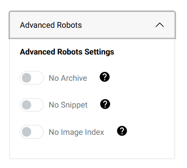
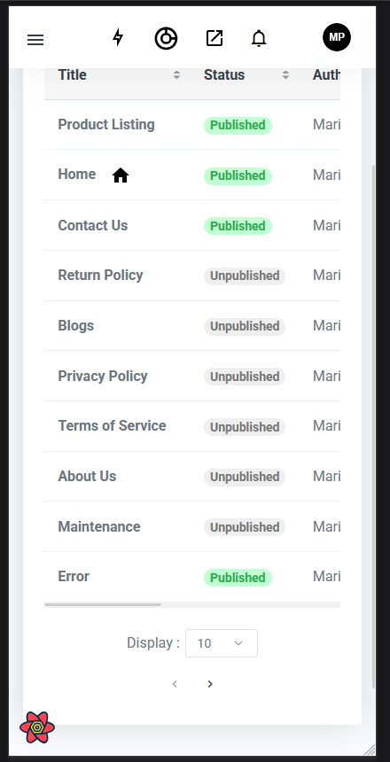
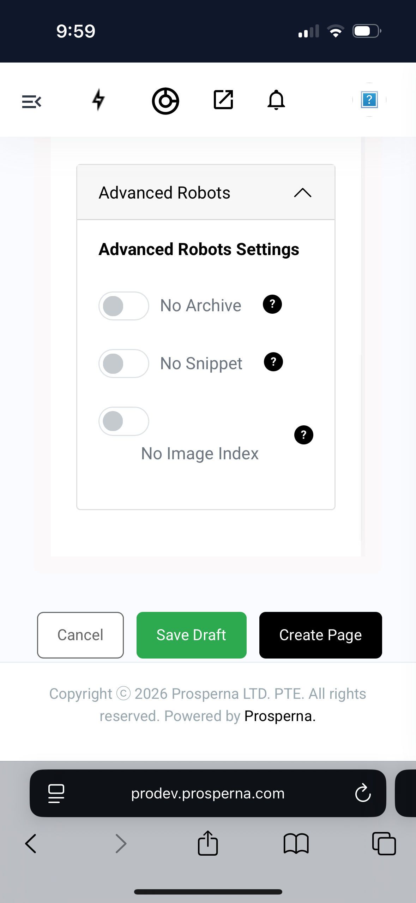
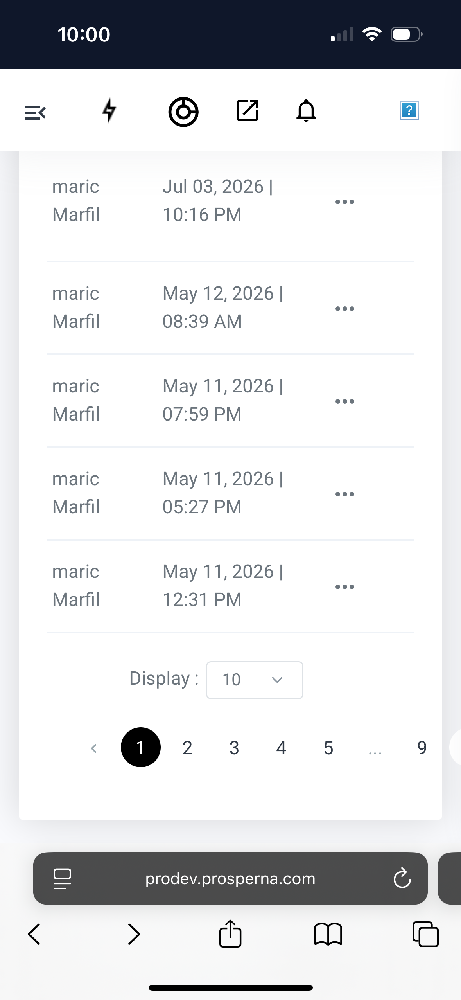
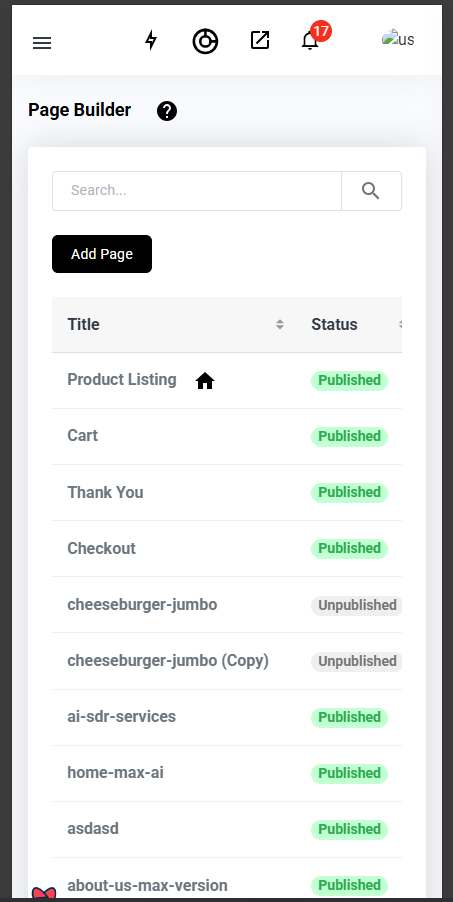
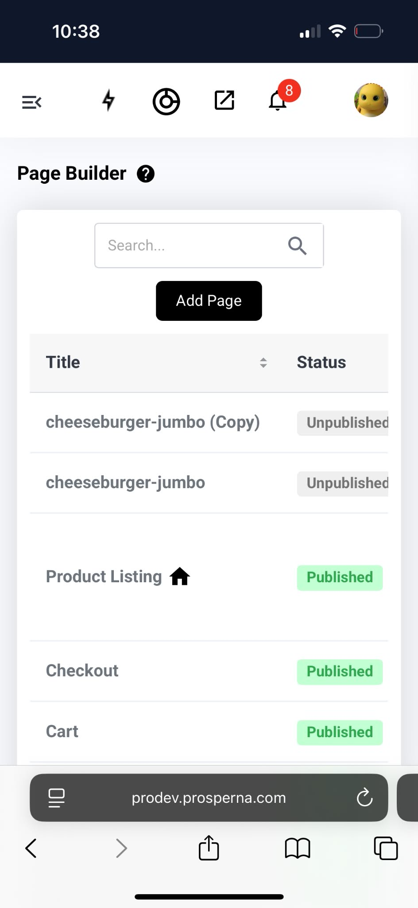
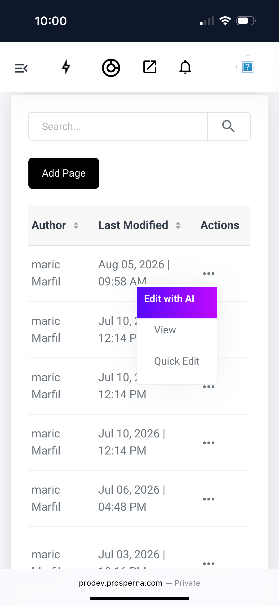
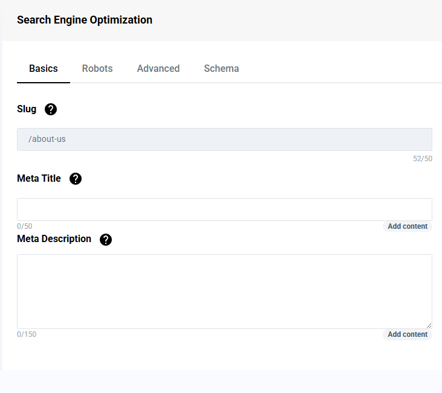
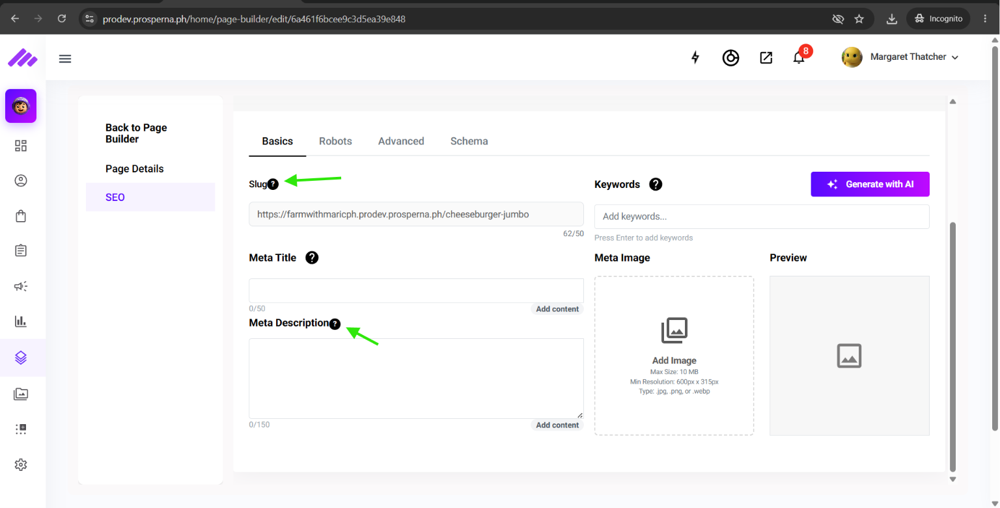

# All Pages

- **Task ID**: `86ey5e892`
- **URL**: https://app.clickup.com/t/86ey5e892
- **Status**: deployed to prod
- **Assignees**: Angelo Kamachi, Aira Pilor
- **Created**: 2026-07-03T14:13:17.858Z
- **Updated**: 2026-10-31T05:39:29.839Z
- **List**: P1 Delivery
- **Folder**: Shared with me

## Description

_No description_

## Media (20)

- `01_image.png` (source: attachment, uploader: Angelo Kamachi)

  

- `02_image.png` (source: attachment, uploader: Angelo Kamachi)

  

- `03_image.png` (source: attachment, uploader: Angelo Kamachi)

  

- `04_image.png` (source: attachment, uploader: Aira Pilor)

  

- `05_image.png` (source: attachment, uploader: Aira Pilor)

  

- `06_image.png` (source: attachment, uploader: Aira Pilor)

  

- `07_image.png` (source: attachment, uploader: Angelo Kamachi)

  

- `08_image.png` (source: attachment, uploader: Angelo Kamachi)

  

- `09_image.png` (source: attachment, uploader: Aira Pilor)

  

- `10_image.png` (source: attachment, uploader: Aira Pilor)

  

- `11_image.png` (source: comment, uploader: Angelo Kamachi)

  

- `12_image.png` (source: comment, uploader: Angelo Kamachi)

  

- `13_image.png` (source: comment, uploader: Angelo Kamachi)

  

- `14_image.png` (source: comment, uploader: Aira Pilor)

  

- `15_image.png` (source: comment, uploader: Aira Pilor)

  

- `16_image.png` (source: comment, uploader: Aira Pilor)

  

- `17_image.png` (source: comment, uploader: Angelo Kamachi)

  

- `18_image.png` (source: comment, uploader: Angelo Kamachi)

  

- `19_image.png` (source: comment, uploader: Aira Pilor)

  

- `20_image.png` (source: comment, uploader: Aira Pilor)

  

## Comments (13)

### ClickBot (2026-10-31T05:39:29.839Z)

This All Pages has been move to DEPLOYED TO PROD
Date updated: Oct 31 2026, 1:39PM (Asia/Manila)
Triggered by: Angelo Kamachi

### Aira Pilor (2026-08-13T00:45:52.345Z)

env: DEV
url: https://prodev.prosperna.com/home/page-builder
Status: PASSED

Endorsing these changes to "Code Review"
cc @Angelo Kamachi @Ian Pelea

### Angelo Kamachi (2026-08-08T08:06:42.642Z)

image.png
position fixed

### Angelo Kamachi (2026-08-08T08:04:41.782Z)

image.png
text aligned

### Angelo Kamachi (2026-08-08T08:00:38.536Z)

image.png
pagination looks fine,  bug could be someone else's work

### Aira Pilor (2026-08-05T02:03:21.961Z)

env: DEV
url: https://prodev.prosperna.ph/home/page-builder
Status: FAILED

DESKTOP VIEW:
https://t7537039.p.clickup-attachments.com/t7537039/12ef07f2-d897-436e-aac8-ac5503d52256/20260805-0157-28.0210811.mp4?view=open
ISSUE:
PAGINATION
image.png
Put the text at the center
image.png
Fix the position
image.png

Moving this task to "Ready Priority"
cc @Angelo Kamachi

### ClickBot (2026-08-05T02:03:18.963Z)

This task All Pages hss been move to IN TESTING 
Updated: Aug 5 2026, 10:03AM (Asia/Shanghai)
Triggered by: Aira Pilor

### Angelo Kamachi (2026-07-30T08:12:30.213Z)

Last comment with the video
Actual p1 Page Builder is a different repository, the scope of Tailwind only falls in Prosperna1 repository, disregarding

### Angelo Kamachi (2026-07-30T08:11:19.221Z)

image.png
Fixed search bar and add button formatting. Was instead set to column to make more space for search bar to expand

### Angelo Kamachi (2026-07-30T08:06:32.072Z)

image.png
fixed tooltip spacing

### Angelo Kamachi (2026-07-30T08:06:18.019Z)

First QA, Actual p1 Page Builder is a different repository, the scope of Tailwind only falls in Prosperna1 repository, disregarding

### Aira Pilor (2026-07-03T14:43:21.616Z)

env: DEV
Status: FAILED

The "Exit View Only" Button looks too small.
https://t7537039.p.clickup-attachments.com/t7537039/b61973cb-c486-4810-b65a-e39d4030c07c/20260703-1418-16.0111768.mp4?view=openTooltip is too close to the text.
image.png
It should be "Search" on the upper left and "Add Page" on the upper right:
image.png
The edit page is so messy especially the layout.
https://t7537039.p.clickup-attachments.com/t7537039/64e64f76-ec48-4ad3-84c4-cc0cde7ef83a/9f819209-bdfa-428a-aecc-3288741c5edc%20(1).mp4?view=openKindly fix all the returns

Moving this subtask to "Ready Priority".
cc @Angelo Kamachi

### ClickBot (2026-07-03T14:13:19.102Z)

This task All Pages has been created 
Date: Jul 3 2026, 10:13PM (Asia/Shanghai)
By Aira Pilor

