# Menu Builder

- **Task ID**: `86ey5e8bx`
- **URL**: https://app.clickup.com/t/86ey5e8bx
- **Status**: deployed to prod
- **Assignees**: Angelo Kamachi, Aira Pilor
- **Created**: 2026-07-03T14:14:00.595Z
- **Updated**: 2026-10-31T05:39:29.829Z
- **List**: P1 Delivery
- **Folder**: Shared with me

## Description

_No description_

## Media (36)

- `01_image.png` (source: attachment, uploader: Angelo Kamachi)

  

- `02_image.png` (source: attachment, uploader: Angelo Kamachi)

  

- `03_image.png` (source: attachment, uploader: Angelo Kamachi)

  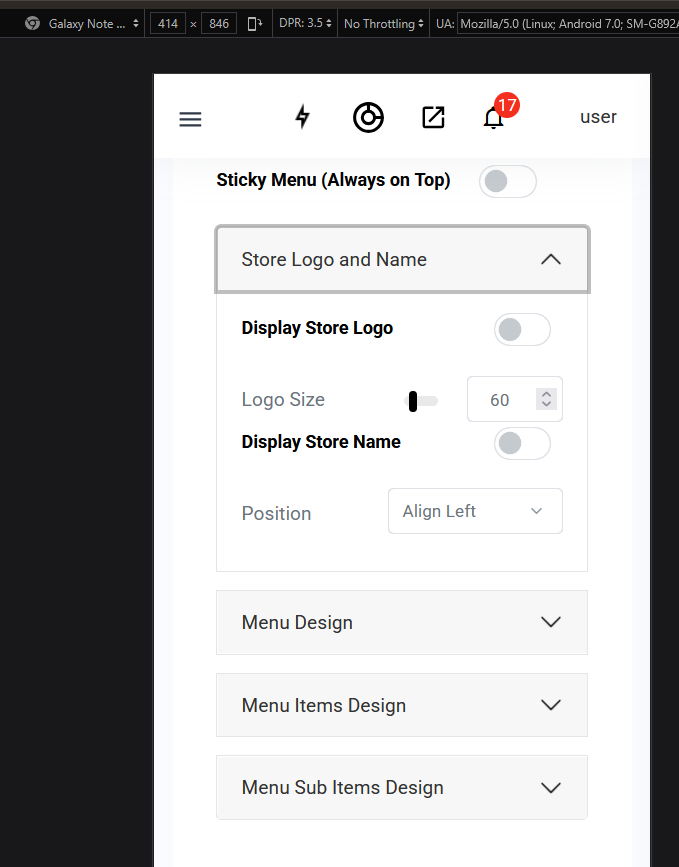

- `04_image.png` (source: attachment, uploader: Angelo Kamachi)

  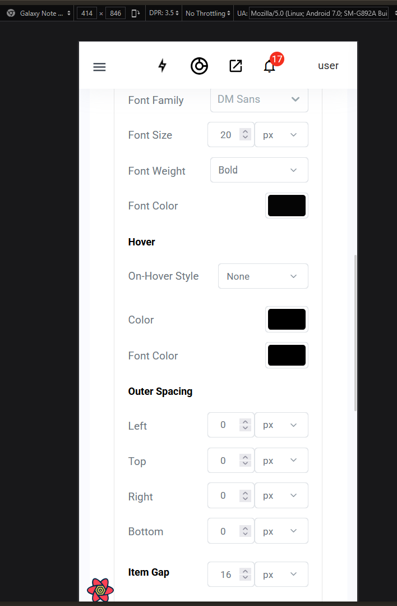

- `05_image.png` (source: attachment, uploader: Angelo Kamachi)

  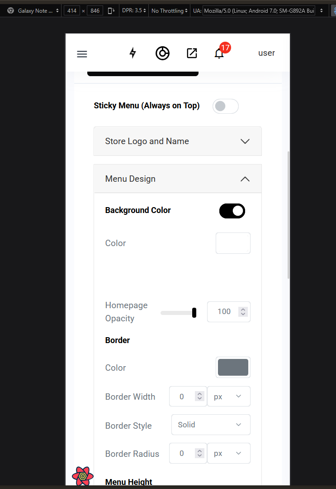

- `06_image.png` (source: attachment, uploader: Aira Pilor)

  

- `07_image.png` (source: attachment, uploader: Aira Pilor)

  

- `08_image.png` (source: attachment, uploader: Aira Pilor)

  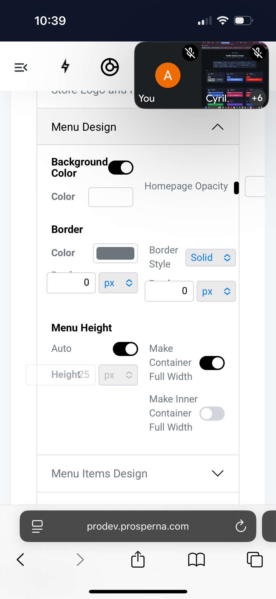

- `09_image.png` (source: attachment, uploader: Aira Pilor)

  

- `10_image.png` (source: attachment, uploader: Angelo Kamachi)

  

- `11_image.png` (source: attachment, uploader: Angelo Kamachi)

  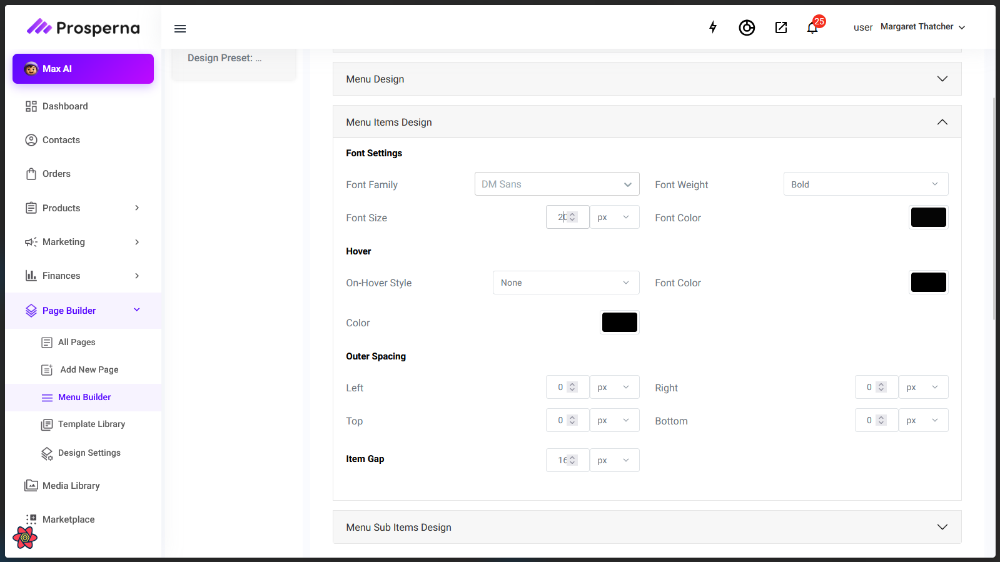

- `12_image.png` (source: attachment, uploader: Angelo Kamachi)

  

- `13_image.png` (source: attachment, uploader: Angelo Kamachi)

  

- `14_image.png` (source: attachment, uploader: Angelo Kamachi)

  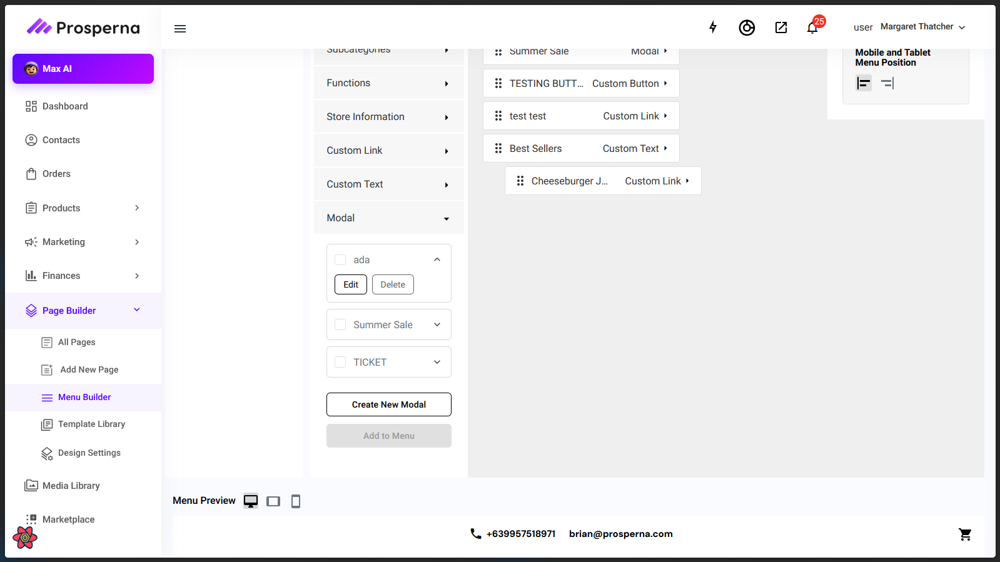

- `15_image.png` (source: attachment, uploader: Aira Pilor)

  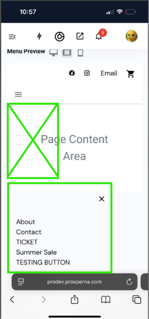

- `16_image.png` (source: attachment, uploader: Aira Pilor)

  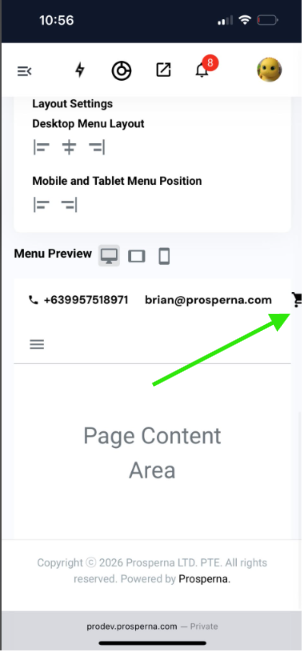

- `17_image.png` (source: attachment, uploader: Aira Pilor)

  

- `18_image.png` (source: attachment, uploader: Aira Pilor)

  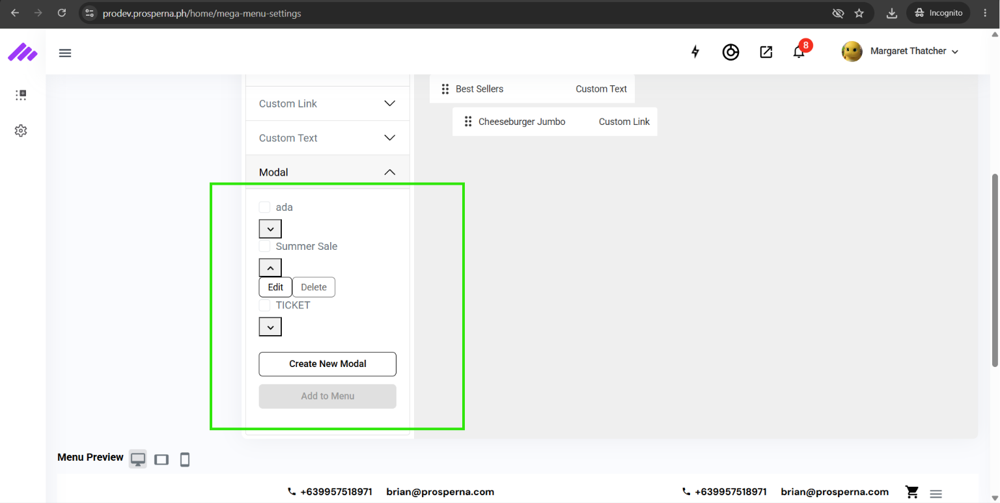

- `19_image.png` (source: comment, uploader: Angelo Kamachi)

  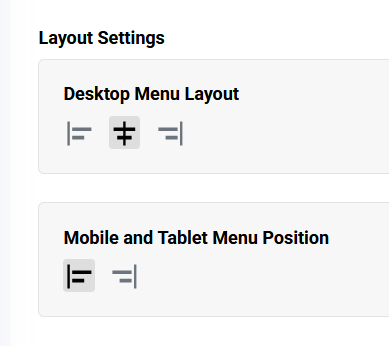

- `20_image.png` (source: comment, uploader: Angelo Kamachi)

  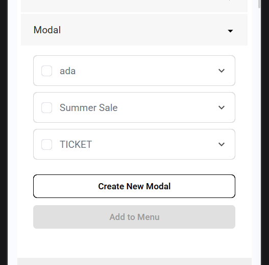

- `21_image.png` (source: comment, uploader: Angelo Kamachi)

  

- `22_image.png` (source: comment, uploader: Angelo Kamachi)

  

- `23_image.png` (source: comment, uploader: Angelo Kamachi)

  

- `24_image.png` (source: comment, uploader: Aira Pilor)

  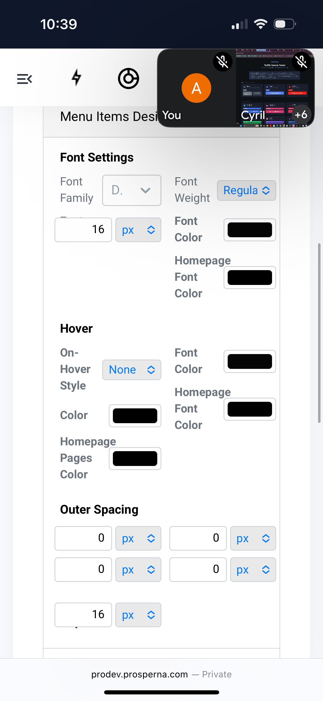

- `25_image.png` (source: comment, uploader: Aira Pilor)

  

- `26_image.png` (source: comment, uploader: Aira Pilor)

  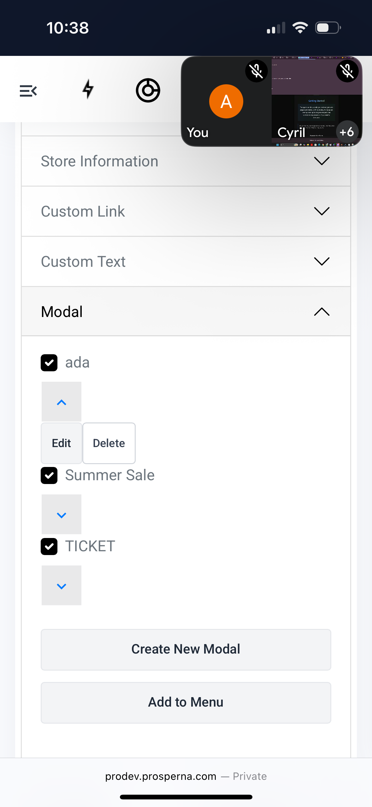

- `27_image.png` (source: comment, uploader: Aira Pilor)

  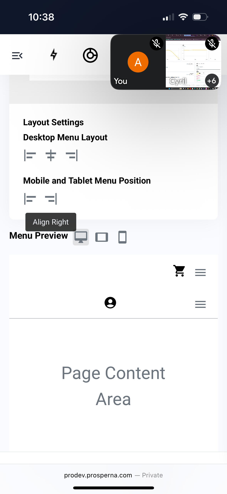

- `28_image.png` (source: comment, uploader: Angelo Kamachi)

  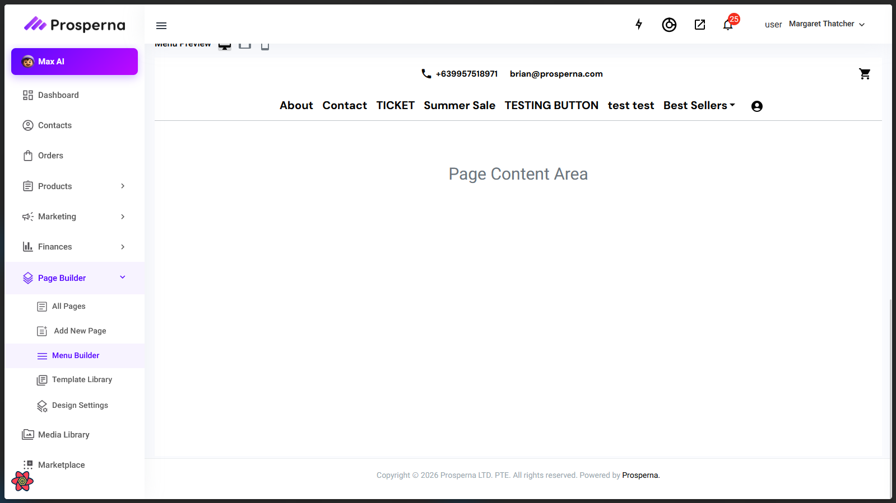

- `29_image.png` (source: comment, uploader: Angelo Kamachi)

  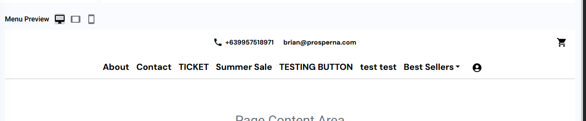

- `30_image.png` (source: comment, uploader: Angelo Kamachi)

  

- `31_image.png` (source: comment, uploader: Angelo Kamachi)

  

- `32_image.png` (source: comment, uploader: Angelo Kamachi)

  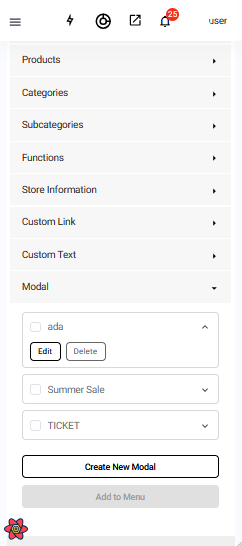

- `33_image.png` (source: comment, uploader: Aira Pilor)

  

- `34_image.png` (source: comment, uploader: Aira Pilor)

  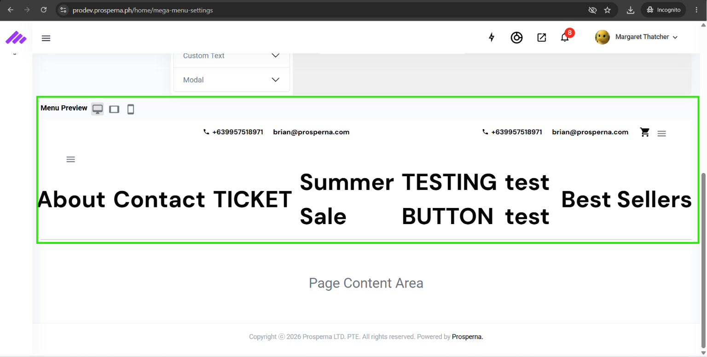

- `35_image.png` (source: comment, uploader: Aira Pilor)

  

- `36_image.png` (source: comment, uploader: Aira Pilor)

  

## Comments (13)

### ClickBot (2026-10-31T05:39:29.829Z)

This Menu Builder has been move to DEPLOYED TO PROD
Date updated: Oct 31 2026, 1:39PM (Asia/Manila)
Triggered by: Angelo Kamachi

### Aira Pilor (2026-10-07T05:50:20.037Z)

Planning to close this section since the legacy menu builder is now migrating to Max AI Menu Builder.

### Angelo Kamachi (2026-08-12T06:47:51.879Z)

image.png
menu position / layout now properly darkens based on active state

### Angelo Kamachi (2026-08-12T06:45:38.312Z)

image.png
modal fixed

### Angelo Kamachi (2026-08-12T06:45:01.040Z)

image.png
image.png
image.png
fixed mobile menu

### Aira Pilor (2026-08-05T02:42:06.549Z)

env: DEV
url: https://prodev.prosperna.ph/home/mega-menu-settings
Status: FAILED

ISSUE:
Layout issues
image.png
image.png
image.png
The Menu position/Layout should be dark.
image.png

Moving this subtask to "Ready Priority"
cc @Angelo Kamachi

### ClickBot (2026-08-05T02:42:01.047Z)

This task Menu Builder hss been move to IN TESTING 
Updated: Aug 5 2026, 10:42AM (Asia/Shanghai)
Triggered by: Aira Pilor

### Angelo Kamachi (2026-08-01T14:41:59.882Z)

all comments regarding the preview is out of scope, since the preview is just a showcase of the p1-customer repo which this task does not touch. Disregarding

### Angelo Kamachi (2026-07-31T05:10:39.006Z)

image.png
no doubling of menu found anymore

### Angelo Kamachi (2026-07-31T05:09:11.409Z)

image.png
image.png
large nav bar text was not a dev issue, Mico simply set the font size to 50px in the menu builder. Reverting to 20px

### Angelo Kamachi (2026-07-31T05:06:17.618Z)

image.png
image.png
modal dropdown fixed

### Aira Pilor (2026-07-03T15:00:04.839Z)

env: DEV
Status: FAILED

Layout Issue on Modal:
image.png
Page Name Font Size become BIGGER than ever.
image.png
Why is there 2 Menu?
https://t7537039.p.clickup-attachments.com/t7537039/dd411679-7f3b-4ff7-9fd0-aac910e9ed88/20260703-1455-23.4466570.mp4?view=openDesktop View on Mobile View:
image.png
Menu Lists is not below the Menu Icon:
image.png

Kindly fix all the returns.

Moving this task to "Ready Priority".
cc @Angelo Kamachi

### ClickBot (2026-07-03T14:14:02.934Z)

This task Menu Builder has been created 
Date: Jul 3 2026, 10:14PM (Asia/Shanghai)
By Aira Pilor

