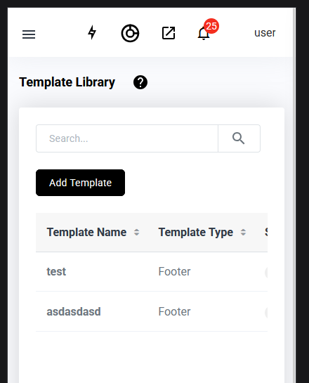
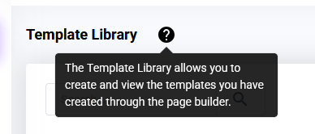
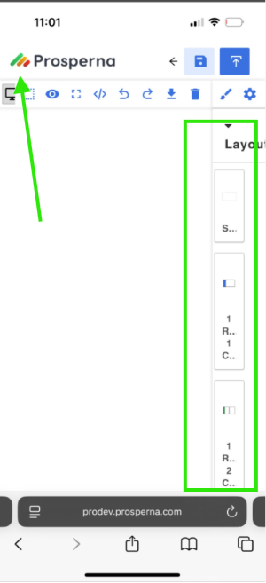
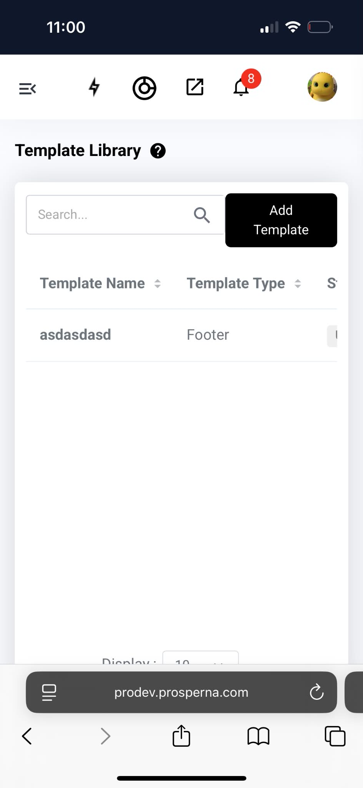

# Template Library

- **Task ID**: `86ey5e8kb`
- **URL**: https://app.clickup.com/t/86ey5e8kb
- **Status**: deployed to prod
- **Assignees**: Angelo Kamachi, Aira Pilor
- **Created**: 2026-07-03T14:15:44.563Z
- **Updated**: 2026-10-31T05:39:29.937Z
- **List**: P1 Delivery
- **Folder**: Shared with me

## Description

_No description_

## Media (8)

- `01_image.png` (source: attachment, uploader: Angelo Kamachi)

  

- `02_image.png` (source: attachment, uploader: Angelo Kamachi)

  

- `03_image.png` (source: attachment, uploader: Aira Pilor)

  

- `04_image.png` (source: attachment, uploader: Aira Pilor)

  

- `05_image.png` (source: comment, uploader: Angelo Kamachi)

  

- `06_image.png` (source: comment, uploader: Angelo Kamachi)

  

- `07_image.png` (source: comment, uploader: Aira Pilor)

  

- `08_image.png` (source: comment, uploader: Aira Pilor)

  

## Comments (8)

### ClickBot (2026-10-31T05:39:29.937Z)

This Template Library has been move to DEPLOYED TO PROD
Date updated: Oct 31 2026, 1:39PM (Asia/Manila)
Triggered by: Angelo Kamachi

### ClickBot (2026-08-21T02:18:49.363Z)

This Template Library has been move to READY FOR TESTING
Date updated: Aug 21 2026, 10:18AM (Asia/Singapore)
Triggered by: Angelo Kamachi

### Aira Pilor (2026-08-05T02:52:24.451Z)

env: DEV
url: https://prodev.prosperna.ph/home/template-library
Status: PASSED

DESKTOP VIEW:
https://t7537039.p.clickup-attachments.com/t7537039/9af678b8-022e-44e1-bc26-0d491633ca98/20260805-0243-15.9814280.mp4?view=open
MOBILE VIEW:
https://t7537039.p.clickup-attachments.com/t7537039/37617405-d567-4f19-810c-4608d6d11ec3/image_picker_321874C2-9225-4268-BE0C-4115813BC41E-7825-0000054314BFEAE6ScreenRecording_08-05-2026%2010-50-10_1.mp4?open=true

We can now close this subtask.
cc @Angelo Kamachi

### Angelo Kamachi (2026-08-01T14:46:10.788Z)

actual p1 page builder is not from p1 repository and is therefore out of task scope, disregarding

### Angelo Kamachi (2026-08-01T14:45:12.386Z)

image.png
tool tip no loner overlapping with search bar

### Angelo Kamachi (2026-08-01T14:44:55.585Z)

image.png
tool tip now working

### Aira Pilor (2026-07-03T15:05:45.499Z)

env: DEV
Status: FAILED

Issues:

On the Edit → Template:
image.png
The logo is not updates, and the layout is breaking.
Tooltip & Button:
image.png
Tooltip is not working and the "Add Template" button overlaps with the search bar.

Kindly fix all the returns.

Moving this task to "Ready Priority"
cc @Angelo Kamachi

### ClickBot (2026-07-03T14:15:45.524Z)

This task Template Library has been created 
Date: Jul 3 2026, 10:15PM (Asia/Shanghai)
By Aira Pilor

