# Design Settings

- **Task ID**: `86ey5e8m7`
- **URL**: https://app.clickup.com/t/86ey5e8m7
- **Status**: deployed to prod
- **Assignees**: Angelo Kamachi, Aira Pilor
- **Created**: 2026-07-03T14:16:03.175Z
- **Updated**: 2026-10-31T05:39:30.026Z
- **List**: P1 Delivery
- **Folder**: Shared with me

## Description

_No description_

## Media (50)

- `01_image.png` (source: attachment, uploader: Angelo Kamachi)

  

- `02_image.png` (source: attachment, uploader: Angelo Kamachi)

  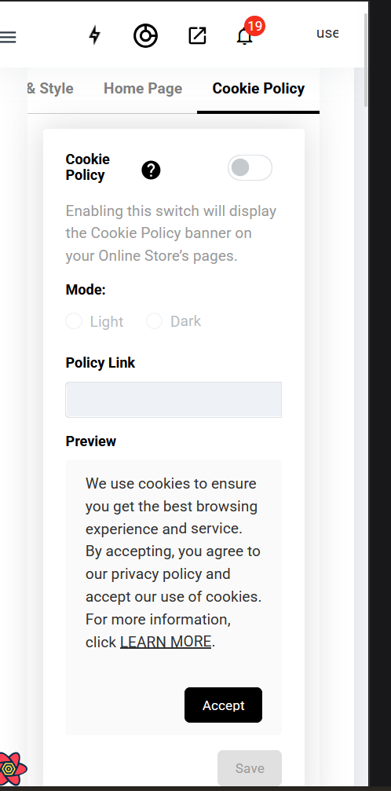

- `03_image.png` (source: attachment, uploader: Angelo Kamachi)

  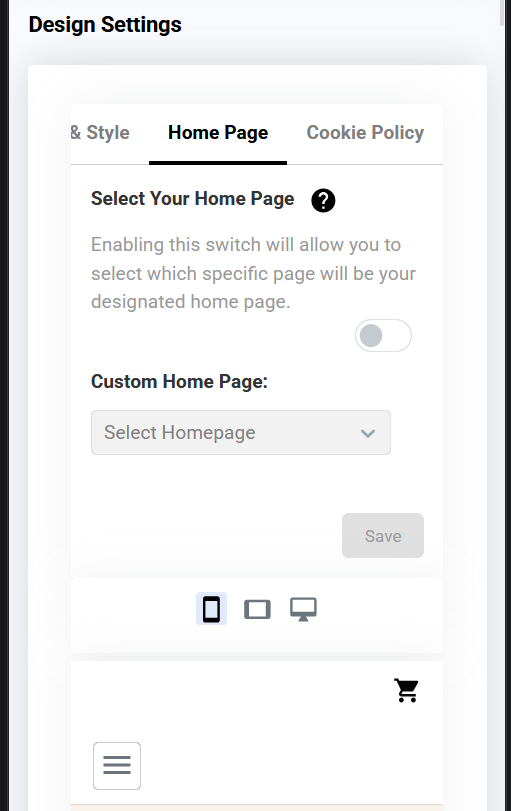

- `04_image.png` (source: attachment, uploader: Angelo Kamachi)

  

- `05_image.png` (source: attachment, uploader: Angelo Kamachi)

  

- `06_image.png` (source: attachment, uploader: Angelo Kamachi)

  

- `07_image.png` (source: attachment, uploader: Angelo Kamachi)

  

- `08_image.png` (source: attachment, uploader: Angelo Kamachi)

  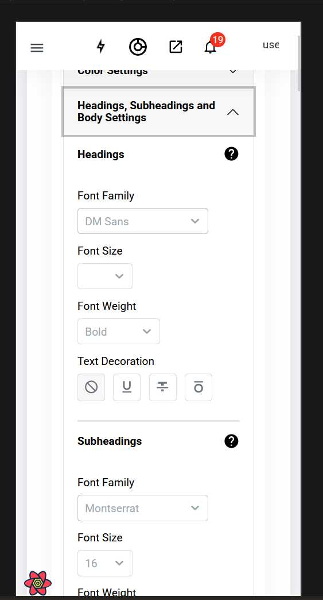

- `09_image.png` (source: attachment, uploader: Angelo Kamachi)

  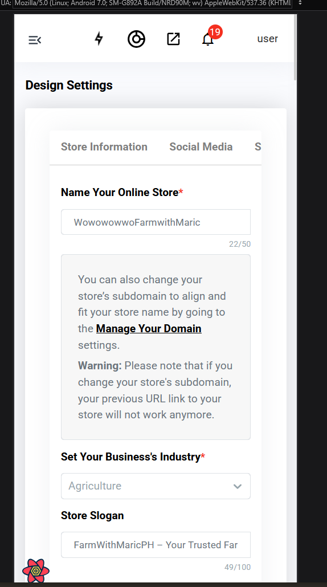

- `10_image.png` (source: attachment, uploader: Angelo Kamachi)

  

- `11_image.png` (source: attachment, uploader: Angelo Kamachi)

  

- `12_image.png` (source: attachment, uploader: Angelo Kamachi)

  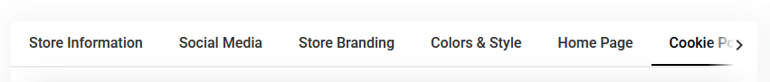

- `13_image.png` (source: attachment, uploader: Angelo Kamachi)

  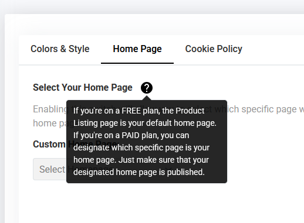

- `14_image.png` (source: attachment, uploader: Angelo Kamachi)

  

- `15_image.png` (source: attachment, uploader: Angelo Kamachi)

  

- `16_image.png` (source: attachment, uploader: Angelo Kamachi)

  

- `17_image.png` (source: attachment, uploader: Angelo Kamachi)

  

- `18_image.png` (source: attachment, uploader: Angelo Kamachi)

  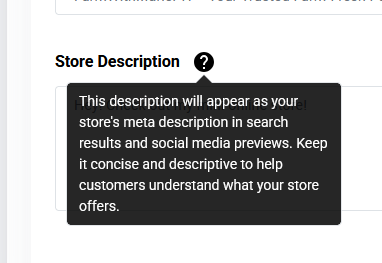

- `19_image.png` (source: attachment, uploader: Aira Pilor)

  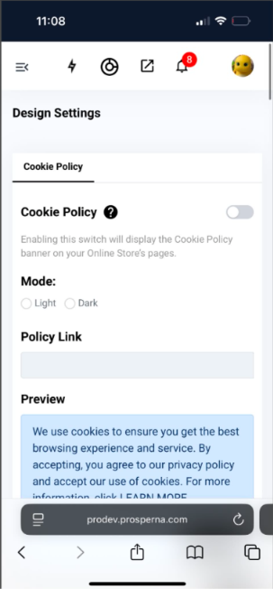

- `20_image.png` (source: attachment, uploader: Aira Pilor)

  

- `21_image.png` (source: attachment, uploader: Aira Pilor)

  

- `22_image.png` (source: attachment, uploader: Aira Pilor)

  

- `23_image.png` (source: attachment, uploader: Aira Pilor)

  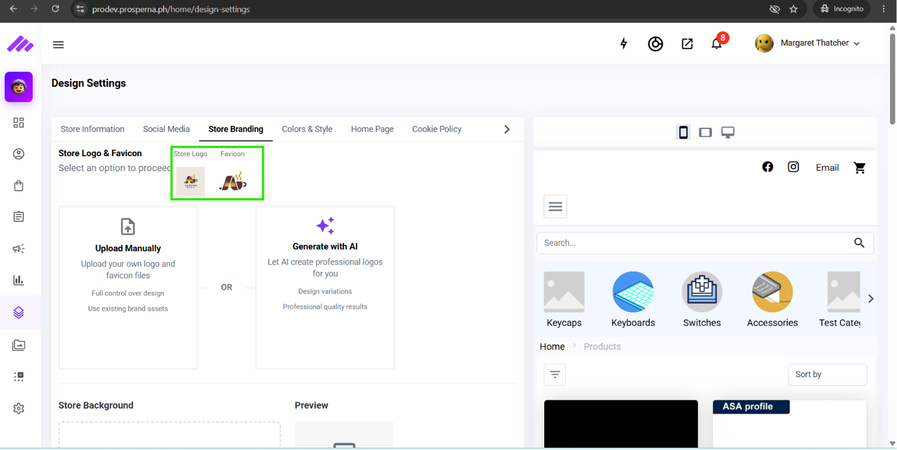

- `24_image.png` (source: attachment, uploader: Aira Pilor)

  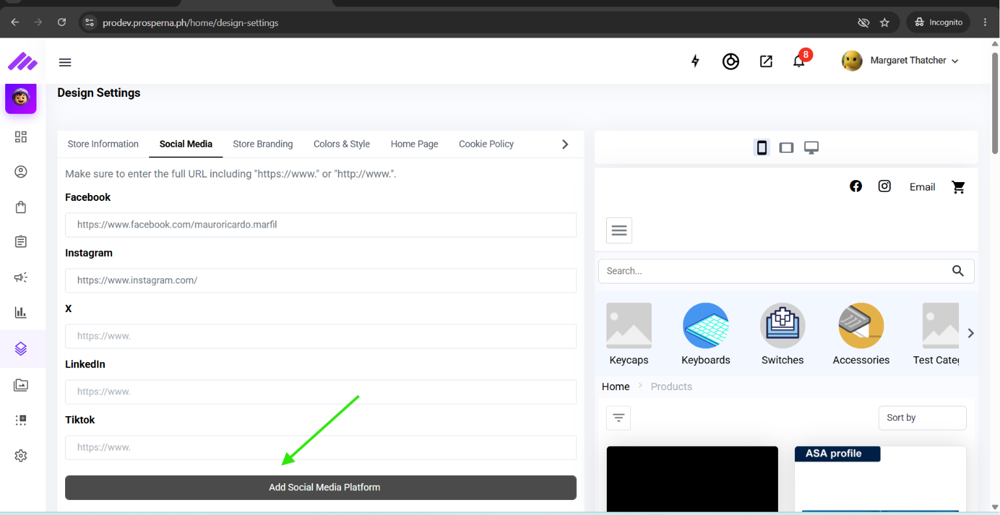

- `25_image.png` (source: attachment, uploader: Aira Pilor)

  

- `26_image.png` (source: comment, uploader: Angelo Kamachi)

  

- `27_image.png` (source: comment, uploader: Angelo Kamachi)

  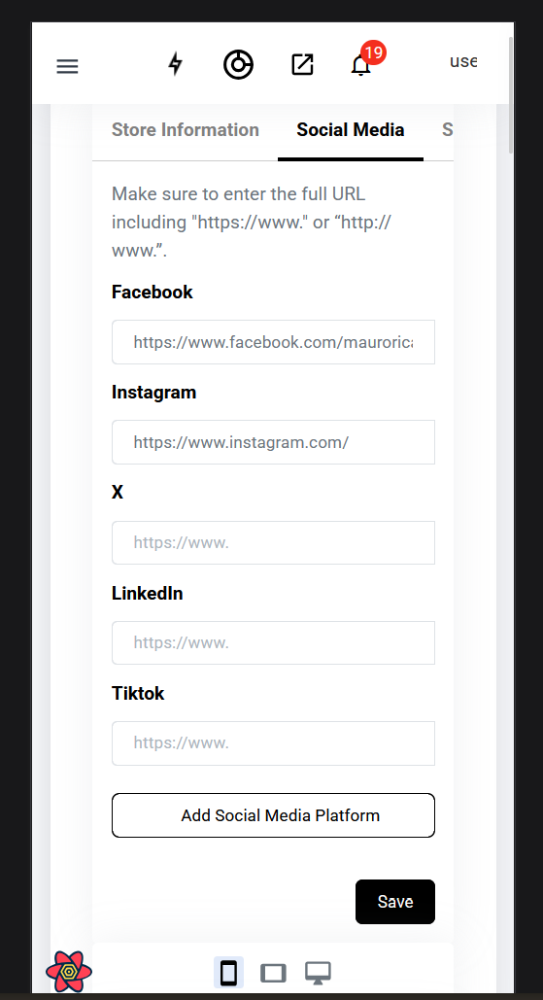

- `28_image.png` (source: comment, uploader: Angelo Kamachi)

  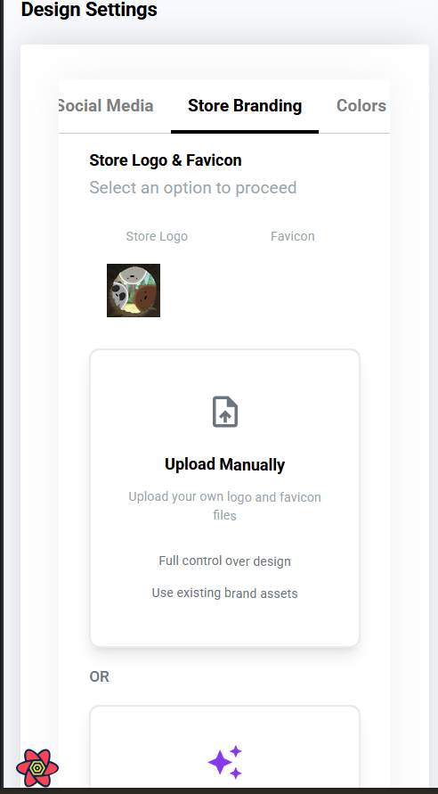

- `29_image.png` (source: comment, uploader: Angelo Kamachi)

  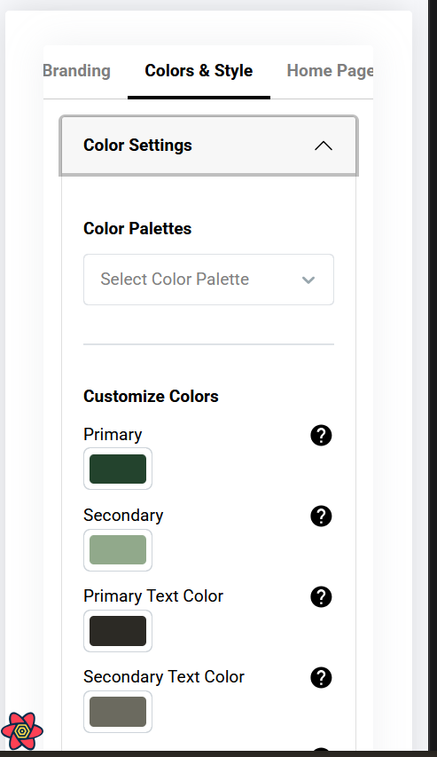

- `30_image.png` (source: comment, uploader: Angelo Kamachi)

  

- `31_image.png` (source: comment, uploader: Angelo Kamachi)

  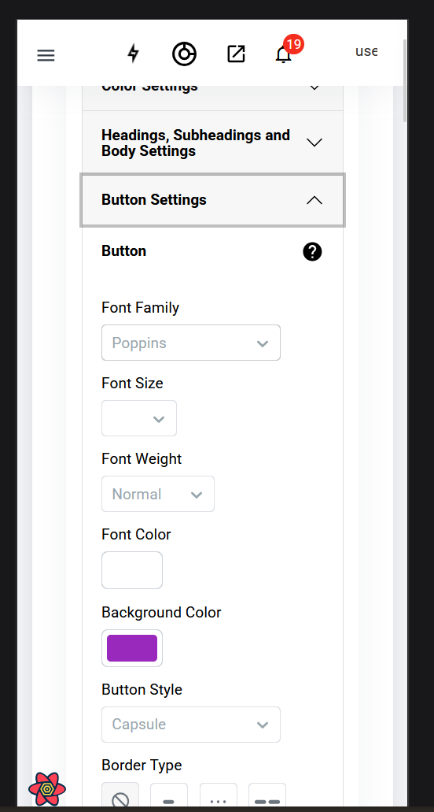

- `32_image.png` (source: comment, uploader: Angelo Kamachi)

  

- `33_image.png` (source: comment, uploader: Angelo Kamachi)

  

- `34_image.png` (source: comment, uploader: Angelo Kamachi)

  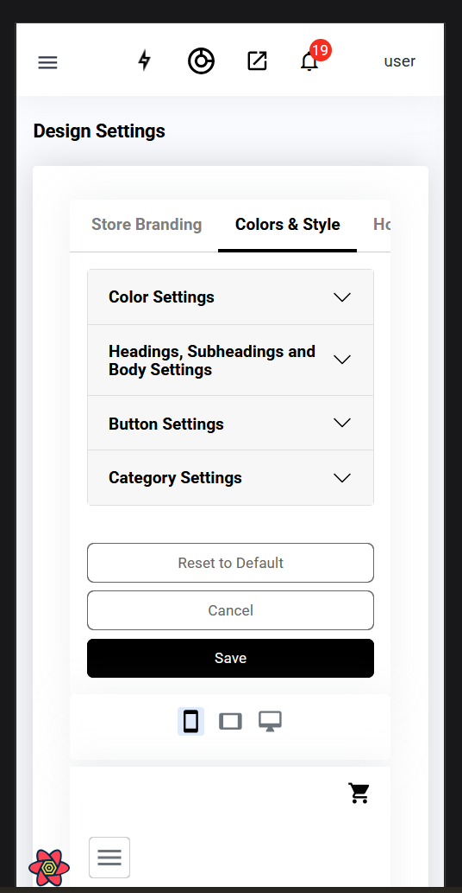

- `35_image.png` (source: comment, uploader: Angelo Kamachi)

  

- `36_image.png` (source: comment, uploader: Angelo Kamachi)

  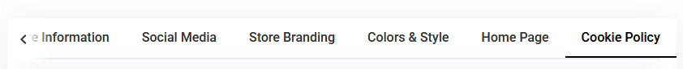

- `37_image.png` (source: comment, uploader: Angelo Kamachi)

  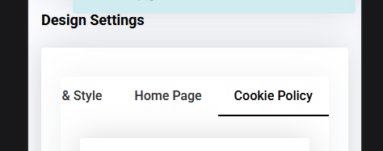

- `38_image.png` (source: comment, uploader: Angelo Kamachi)

  

- `39_image.png` (source: comment, uploader: Angelo Kamachi)

  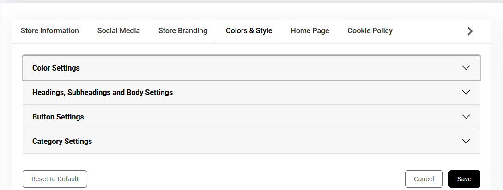

- `40_image.png` (source: comment, uploader: Angelo Kamachi)

  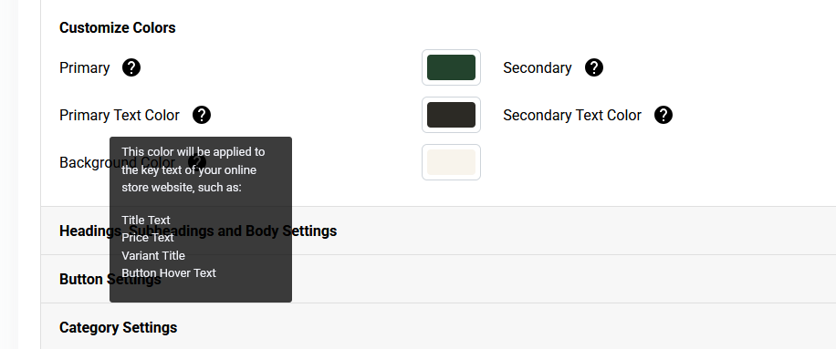

- `41_image.png` (source: comment, uploader: Angelo Kamachi)

  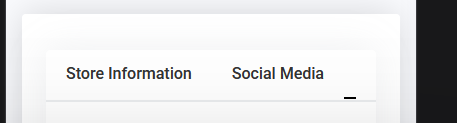

- `42_image.png` (source: comment, uploader: Angelo Kamachi)

  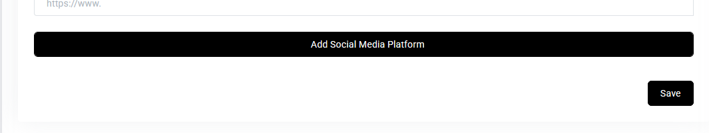

- `43_image.png` (source: comment, uploader: Angelo Kamachi)

  

- `44_image.png` (source: comment, uploader: Aira Pilor)

  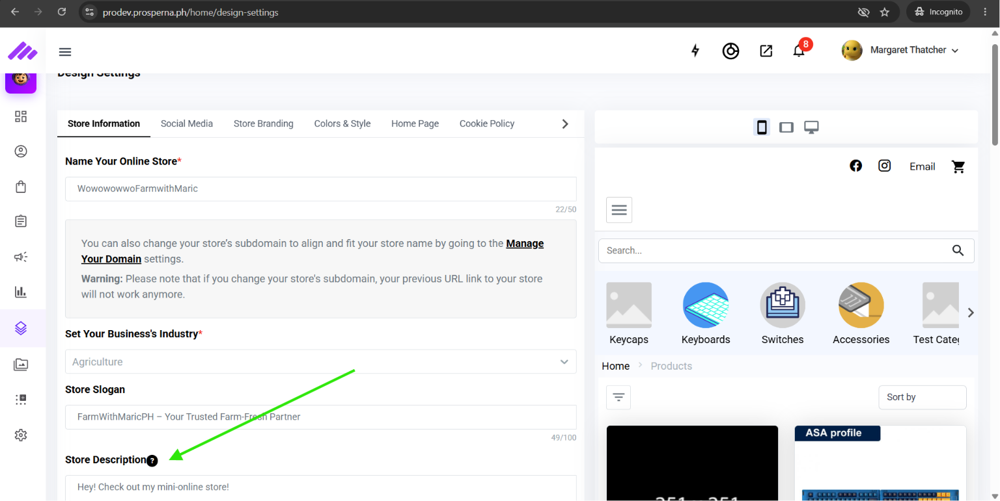

- `45_image.png` (source: comment, uploader: Aira Pilor)

  

- `46_image.png` (source: comment, uploader: Aira Pilor)

  

- `47_image.png` (source: comment, uploader: Aira Pilor)

  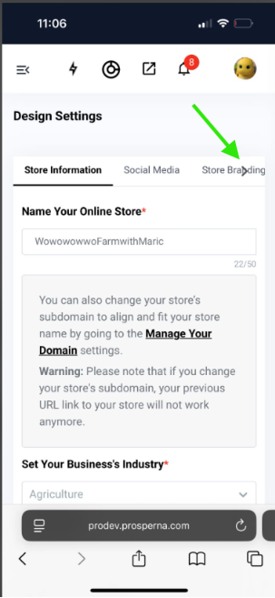

- `48_image.png` (source: comment, uploader: Aira Pilor)

  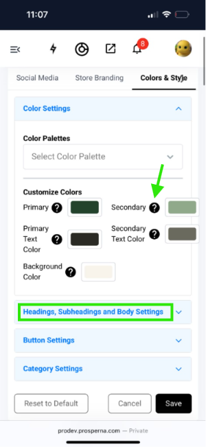

- `49_image.png` (source: comment, uploader: Aira Pilor)

  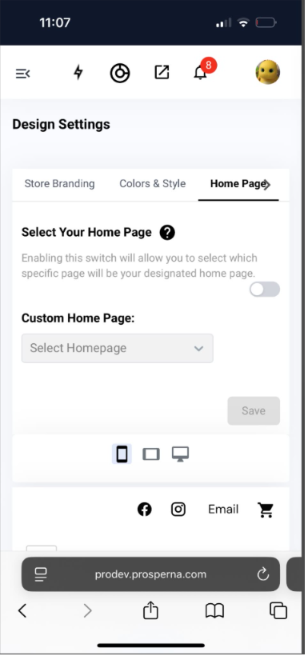

- `50_image.png` (source: comment, uploader: Aira Pilor)

  

## Comments (18)

### ClickBot (2026-10-31T05:39:30.026Z)

This Design Settings has been move to DEPLOYED TO PROD
Date updated: Oct 31 2026, 1:39PM (Asia/Manila)
Triggered by: Angelo Kamachi

### ClickBot (2026-10-09T06:17:13.604Z)

This Design Settings has been move to READY FOR TESTING
Date updated: Oct 9 2026, 2:17PM (Asia/Singapore)
Triggered by: Angelo Kamachi

### Angelo Kamachi (2026-10-08T01:45:09.757Z)

QA Returns Fix: PR #8779

PR: https://github.com/Prosperna/prosperna1/pull/8779 (refactor/tw-page-builder-standard-dev8 to dev)
Fixes returns from: comment 1100740000136788 (TC5, TC7, TC9)

What was changed
Tab-bar arrow (TC5): the ">" arrow now updates as soon as the sidebar is expanded or collapsed. Before, it only updated when the browser window was resized.
Home Page tooltip (TC7): the "?" next to "Select Your Home Page" now opens on a phone tap. It uses the same tooltip as Store Description (black bubble, white text).
Colors & Styles on a phone (TC9): the form now fits the screen width, so all "?" icons can be reached. The store preview scrolls sideways inside its own area instead of pushing the form off the screen.

Where to test
Environment: dev, after PR #8779 is merged
Pages: Design Settings (tab bar, Home Page tab) and AI Studio > Colors & Styles
Account: any store with Design Settings access

Test cases

TC1: Arrow appears when the sidebar expands
Setup: desktop at 1440px, sidebar collapsed, Design Settings open. All five tabs fit and no arrow shows.
Steps: click the top-left menu icon to expand the sidebar.
Expected: "Cookie Policy" no longer fits and the ">" arrow appears right away, without resizing the window. Clicking it scrolls the tab bar.

TC2: Arrow disappears when the sidebar collapses
Setup: continue from TC1.
Steps: click the menu icon again.
Expected: all tabs fit and the arrow goes away right away.

TC3: Arrow on phone and window resize (regression)
Steps: open Design Settings at 390px. Then, on desktop, resize the window across widths where the tabs do and don't fit.
Expected: no arrow on the phone. On desktop the arrow shows only when the tabs overflow.

TC4: Home Page tooltip on a phone tap
Setup: phone at 390px, Design Settings > Home Page.
Steps: tap the "?" next to "Select Your Home Page". Tap it again, then tap elsewhere on the page.
Expected: the first tap opens the tooltip. The second tap, or a tap elsewhere, closes it.

TC5: Home Page tooltip on desktop (regression)
Steps: hover the same "?", then click it.
Expected: hovering opens it and clicking keeps it open. It looks the same as the Store Description tooltip.

TC6: Colors & Styles fits a phone
Setup: Design Settings > "Open in AI Studio", at 390px (also try 360px).
Steps: expand Color Settings, Headings/Subheadings/Body, Button Settings and Category Settings. Tap every "?".
Expected: nothing is cut off on the right. All 19 "?" icons can be reached and each one opens its tooltip.

TC7: Store preview on a phone
Setup: same as TC6, then scroll down to the store preview.
Steps: swipe the preview sideways.
Expected: if the preview is wider than the screen, it scrolls on its own. The rest of the page doesn't move sideways.

TC8: Colors & Styles on desktop (regression)
Steps: view the page at 1440px and hover every "?".
Expected: the layout is the same as before and all tooltips open.

Out of scope
The purple open-section headings in Colors & Styles are a deliberate AI Studio restyle and aren't part of this task.

### Angelo Kamachi (2026-10-08T01:40:58.431Z)

QA TEST CASES - PR #8779

WHERE TO TEST
Environment: dev
Pages: Design Settings (tab bar, Home Page tab), AI Studio > Colors & Styles
Preconditions: a store account with Design Settings access

TEST CASES

1. Tab-bar arrow appears when the sidebar expands (re-test of TC5)
Setup: desktop, 1440px wide, left sidebar collapsed, Design Settings open. All five tabs fit and no arrow shows.
Steps: click the top-left menu icon to expand the sidebar.
Expected: "Cookie Policy" no longer fits and the ">" arrow appears right away, without resizing the window. Clicking it scrolls the tab bar.

2. Tab-bar arrow disappears when the sidebar collapses (re-test of TC5)
Setup: continue from case 1.
Steps: click the menu icon again to collapse the sidebar.
Expected: all tabs fit and the ">" arrow goes away right away.

3. Tab-bar arrow on phone and window resize (regression check)
Steps: view Design Settings at 390px, then resize a desktop window across widths where the tabs do and do not fit.
Expected: no arrow on the phone. On desktop the arrow shows only when tabs overflow.

4. Home Page tooltip on a phone tap (re-test of TC7)
Setup: phone, 390px, Design Settings > Home Page.
Steps: tap the "?" next to "Select Your Home Page". Tap it again, then tap elsewhere on the page.
Expected: the first tap opens the tooltip. The second tap or a tap elsewhere closes it.

5. Home Page tooltip on desktop (regression check)
Steps: on desktop, hover the same "?", then click it.
Expected: hover opens it, and clicking keeps it open. It now looks like the Store Description tooltip: black bubble, white text.

6. Colors & Styles fits a phone (re-test of TC9)
Setup: open Design Settings, click "Open in AI Studio", phone width 390px (also try 360px).
Steps: expand Color Settings, Headings/Subheadings/Body, Button and Category Settings. Tap every "?".
Expected: the form fits the screen width, nothing is cut off on the right, and all 19 "?" icons can be reached and open their tooltip.

7. Colors & Styles store preview on a phone
Setup: same as case 6, scroll down to the store preview.
Steps: swipe the preview sideways.
Expected: the preview stays inside its own area. If it's wider than the screen it scrolls on its own, and the rest of the page doesn't move sideways.

8. Colors & Styles on desktop (regression check)
Steps: view the same page at 1440px and hover every "?".
Expected: layout is the same as before, and all tooltips open.

TEST DATA
No special data or IDs needed.

OUT OF SCOPE / KNOWN BEHAVIOR
The purple open-section headings in Colors & Styles are a deliberate AI Studio restyle and not part of this task.

### Aira Pilor (2026-10-07T08:09:55.489Z)

Env: DEV
Status: FAILED
URL: https://prodev.prosperna.ph/home/design-settings

TEST CASE #1: Store Description help icon spacing and tooltip
STEPS:
Step 1 - On desktop (1440px), open Design Settings > Store Information.
Step 2 - Look at the "?" next to "Store Description", then hover it.
EXPECTED RESULT: The "?" is clearly spaced from the label text, and hovering it opens the tooltip without covering the icon.
EVIDENCE: TC1-store-description-tooltip.mp4
ACTUAL RESULT: The "?" is spaced from the label, and the tooltip opens 8px clear of the icon.

TEST CASE #2: "Add Social Media Platform" hover colour
STEPS:
Step 1 - On desktop, open Design Settings > Social Media.
Step 2 - Hover the "Add Social Media Platform" button.
EXPECTED RESULT: On hover the button turns fully black (black background and border, white text).
EVIDENCE: TC2-add-social-hover.mp4
ACTUAL RESULT: On hover the background and border turn black and the text turns white.

TEST CASE #3: Store Logo and Favicon position
STEPS:
Step 1 - On desktop (1440px), open Design Settings > Store Branding.
Step 2 - Look at the Store Logo / Favicon previews next to "Store Logo & Favicon".
Step 3 - Narrow the window to phone width (390px).
EXPECTED RESULT: Same position as the main branch: the previews sit beside the title on desktop without covering "Select an option to proceed", and move below it on a phone.
EVIDENCE: TC3-logo-favicon-position.mp4
ACTUAL RESULT: The previews sit beside the title at 1440px and below it at 390px; the subtitle is not covered at either width.

TEST CASE #4: Tab-bar arrow on phone and desktop
STEPS:
Step 1 - On a phone (390px), open Design Settings and swipe the tab bar.
Step 2 - On desktop, view Design Settings at widths where the tabs do and do not fit, and click the ">" arrow when it shows.
EXPECTED RESULT: No arrow on a phone (the tab bar scrolls by swipe). On desktop the arrow shows only when the tabs do not fit, and clicking it scrolls the tab bar.
EVIDENCE: TC4-arrow-phone.mp4, TC4-arrow-desktop.mp4
ACTUAL RESULT: No arrow on the phone. On desktop the arrow shows only at widths where the tabs overflow, and clicking it scrolls the tab bar.

TEST CASE #5: Tab-bar arrow after expanding or collapsing the sidebar
STEPS:
Step 1 - On desktop (1440px), open Design Settings with the left sidebar collapsed. All five tabs fit and no arrow shows.
Step 2 - Click the top-left menu icon to expand the sidebar.
Step 3 - Click it again to collapse the sidebar.
EXPECTED RESULT: When the sidebar expands and "Cookie Policy" no longer fits, the ">" arrow appears. When it collapses and all tabs fit, the arrow goes away.
EVIDENCE: TC4b-arrow-sidebar-toggle.mp4
ACTUAL RESULT: After expanding, "Cookie Policy" is cut off ("Cookie Poli") and no arrow appears. After collapsing, all tabs fit but the ">" arrow stays and does nothing. The arrow only corrects itself after the browser window is resized.

TEST CASE #6: Last tab sits at the right edge of the tab bar
STEPS:
Step 1 - On a phone (390px), open Design Settings and scroll the tab bar to the end.
Step 2 - On desktop with the sidebar expanded, scroll the tab bar to the end.
EXPECTED RESULT: The last tab ("Cookie Policy") sits flush against the right edge of the tab bar, with no empty space after it.
EVIDENCE: TC5-last-tab-phone.mp4, TC5-last-tab-desktop.mp4
ACTUAL RESULT: "Cookie Policy" sits flush with the right edge at both sizes.

TEST CASE #7: Home Page tooltip
STEPS:
Step 1 - On desktop, open Design Settings > Home Page and hover the "?" next to "Select Your Home Page".
Step 2 - On a phone (390px), open the same tab and tap that "?".
EXPECTED RESULT: The tooltip opens on desktop hover and on a phone tap.
EVIDENCE: TC6-home-tooltip-desktop.mp4, TC6-home-tooltip-phone.mp4
ACTUAL RESULT: Desktop hover opens the tooltip. On a phone, tapping the "?" shows nothing (0 of 6 taps), while the Store Description "?" on the same page opens on the same tap.

TEST CASE #8: Design Settings layout on mobile
STEPS:
Step 1 - On a phone (390px and 360px), open Design Settings.
Step 2 - Open each tab: Store Information, Social Media, Store Branding, Home Page, Cookie Policy.
Step 3 - Open the same page on desktop (1440px).
EXPECTED RESULT: On a phone the settings form is full width with the store preview below it, and no tab's content runs off the side of the screen. On desktop the form and preview sit side by side.
EVIDENCE: TC7-mobile-layout-390.mp4, TC7-mobile-layout-360.mp4, TC7-desktop-control.mp4
ACTUAL RESULT: On both phone widths the form is full width with the preview below it, and all five tabs fit the screen. On desktop the form and preview sit side by side.

TEST CASE #9: Colors & Style tooltips (now in AI Studio)
STEPS:
Step 1 - Open Design Settings and click "Open in AI Studio" on the "Colors & Style has moved" notice.
Step 2 - On desktop, expand Color Settings, Headings/Subheadings/Body, Button and Category Settings, and hover every "?".
Step 3 - Repeat on a phone (390px), tapping every "?".
EXPECTED RESULT: Every "?" opens its tooltip, on desktop and on a phone.
EVIDENCE: TC8-colors-tooltips-desktop.mp4, TC8-colors-tooltips-phone.mp4
ACTUAL RESULT: On desktop all 19 tooltips open. On a phone the Colors & Style form is wider than the screen and cut off on the right: 12 of the 19 "?" icons are off-screen and cannot be reached, because the page does not scroll sideways.

TEST CASE #10: Colors & Style section heading colour
STEPS:
Step 1 - Open AI Studio > Colors & Styles and expand a section.
EXPECTED RESULT: Not tested on this task.
EVIDENCE: N/A
ACTUAL RESULT: Not tested — the open-section heading colour in AI Studio is a deliberate restyle and is out of scope for this task.

### Angelo Kamachi (2026-08-12T07:02:13.523Z)

image.png
image.png
image.png
image.png
image.png
image.png
image.png
image.png
image.png
design settings mobile view fixed and improved

### Aira Pilor (2026-08-05T03:02:12.254Z)

env: DEV
url: https://prodev.prosperna.ph/home/design-settings
Status: FAILED

DESKTOP VIEW:
https://t7537039.p.clickup-attachments.com/t7537039/d4acd8db-c083-4cab-9ac0-faa8b070a16a/20260805-0253-21.8801172.mp4?view=open
ISSUE:
Layout on Mobile View:
https://t7537039.p.clickup-attachments.com/t7537039/9fb76390-6e29-4948-9298-3ecef13849ee/image_picker_155BA0C9-FA59-450A-B090-DD2AB3F43ED0-7825-00000545875AE7AFScreenRecording_08-05-2026%2010-58-07_1.mp4?open=true
Moving this task to "Ready Priority"
cc @Angelo Kamachi

### ClickBot (2026-08-05T03:02:06.664Z)

This task Design Settings hss been move to IN TESTING 
Updated: Aug 5 2026, 11:02AM (Asia/Shanghai)
Triggered by: Aira Pilor

### Angelo Kamachi (2026-08-03T01:08:06.298Z)

image.png
image.png
reworked the navigation arrow in the nav bar (desktop mode)
image.png
the last item in the nav bar list now properly snaps to the rightmost edge of the navbar

### Angelo Kamachi (2026-08-01T15:00:18.358Z)

image.png
home page tooltip now working

### Angelo Kamachi (2026-08-01T14:59:12.131Z)

image.png
dropdown colors now black

### Angelo Kamachi (2026-08-01T14:57:39.754Z)

image.png
all tooltips now working under Colors and Style

### Angelo Kamachi (2026-08-01T14:57:11.636Z)

image.png
navigation arrow has been removed in mobile

### Angelo Kamachi (2026-08-01T14:55:34.578Z)

store logo and favicon position matching main branch, was the intended outcome

### Angelo Kamachi (2026-08-01T14:52:17.187Z)

image.png
hover now fully black

### Angelo Kamachi (2026-08-01T14:50:09.859Z)

image.png
tool tip now has spacing

### Aira Pilor (2026-07-03T15:15:23.483Z)

env: DEV
Status: FAILED

ISSUES:

Tooltip is too close to the text.
image.png
Hover Effects is not "Black"
image.png
Fix the Position:
image.png
Why do we need this "  >  " when we can scroll the list.
image.png
All the tooltips under "Color and Styles" are not working. Additionally, Text SubHeadings are "Blue"
image.png
This tooltip is not working.
image.png
Can we make the last section on the list be at the right?
image.png

Kindly fix all the returns.

Moving this subtask to "Ready Priority"
cc @Angelo Kamachi

### ClickBot (2026-07-03T14:16:04.120Z)

This task Design Settings has been created 
Date: Jul 3 2026, 10:16PM (Asia/Shanghai)
By Aira Pilor

