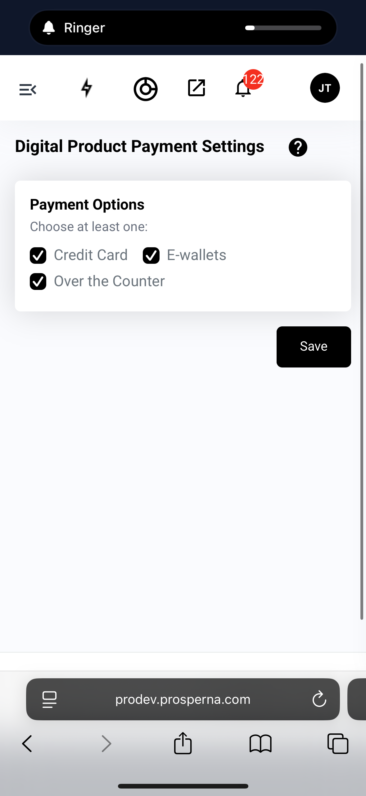
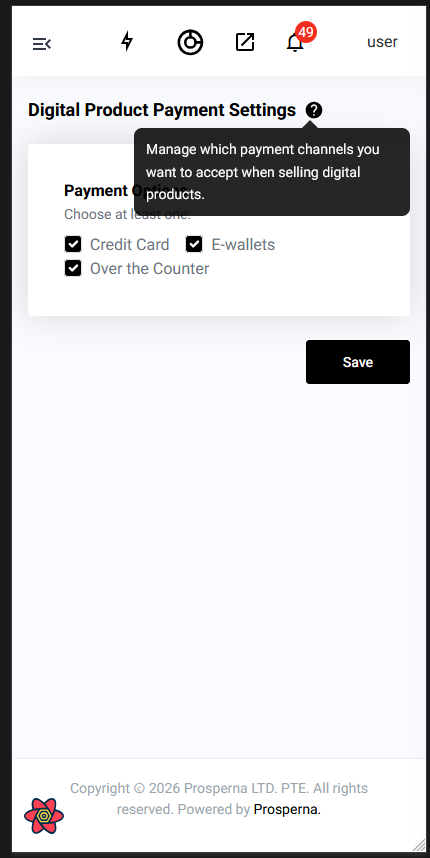
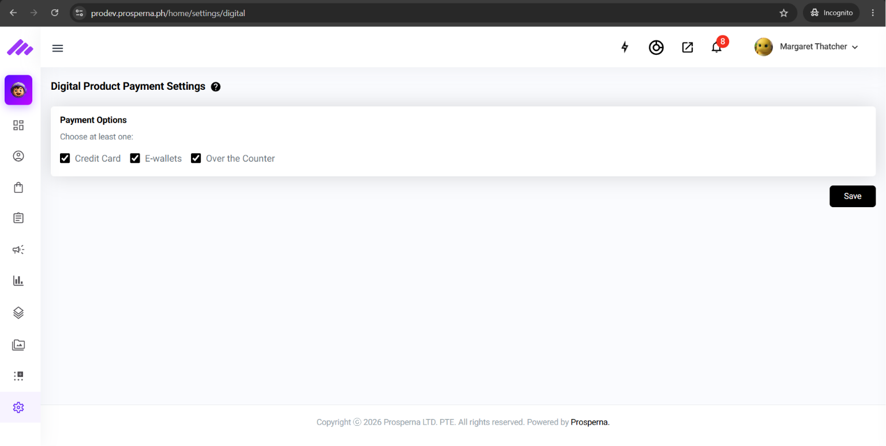

# Digital Product Payment Settings

- **Task ID**: `86ey5cvxk`
- **URL**: https://app.clickup.com/t/86ey5cvxk
- **Status**: ready for deployment
- **Assignees**: Angelo Kamachi, Aira Pilor
- **Created**: 2026-07-03T12:04:54.938Z
- **Updated**: 2026-10-12T00:05:10.767Z
- **List**: P1 Delivery
- **Folder**: Shared with me

## Description

_No description_

## Media (7)

- `01_paste_3651cc84-e80e-44f8-b0b4-cfd269d08b99.png` (source: attachment, uploader: Aira Pilor)

  

- `02_image.png` (source: attachment, uploader: Angelo Kamachi)

  

- `03_image.png` (source: attachment, uploader: Aira Pilor)

  

- `04_image.png` (source: attachment, uploader: Aira Pilor)

  

- `05_image.png` (source: comment, uploader: Angelo Kamachi)

  

- `06_image.png` (source: comment, uploader: Aira Pilor)

  

- `07_image.png` (source: comment, uploader: Aira Pilor)

  

## Comments (5)

### Aira Pilor (2026-09-10T02:24:47.415Z)

env: DEV
Status: PASSED

paste_3651cc84-e80e-44f8-b0b4-cfd269d08b99.png

### Angelo Kamachi (2026-08-20T02:21:38.508Z)

image.png
tooltip mobile view fixed

### Angelo Kamachi (2026-07-28T08:33:07.538Z)

Projected End Date 8/3
No subtasks found

### Aira Pilor (2026-07-03T12:20:32.814Z)

env: DEV
Status: FAILED

DESKTOP View:
image.png
MOBILE View:
image.png

Note:
Only the tooltip in Mobile View is the issue.

Moving this subtask to "ready Priority"
cc @Angelo Kamachi

### ClickBot (2026-07-03T12:04:56.397Z)

This task Digital Product Payment Settings has been created 
Date: Jul 3 2026, 8:04PM (Asia/Shanghai)
By Aira Pilor

