# Users

- **Task ID**: `86ey5cw0b`
- **URL**: https://app.clickup.com/t/86ey5cw0b
- **Status**: ready for deployment
- **Assignees**: Angelo Kamachi, Aira Pilor
- **Created**: 2026-07-03T12:05:20.703Z
- **Updated**: 2026-10-12T00:05:12.875Z
- **List**: P1 Delivery
- **Folder**: Shared with me

## Description

_No description_

## Media (37)

- `01_tc19-store-column-phone-390-scrolled.png` (source: attachment, uploader: Aira Pilor)

  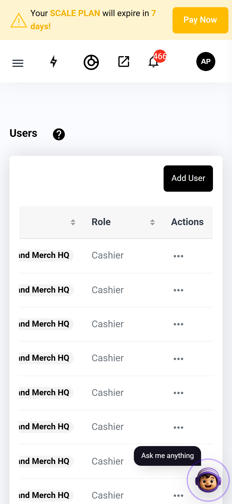

- `02_tc12-last-row-menu-phone.png` (source: attachment, uploader: Aira Pilor)

  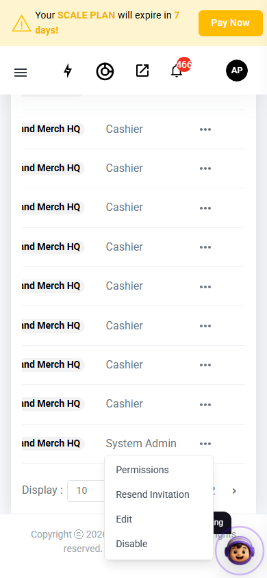

- `03_tc09-tooltip-after-tap.png` (source: attachment, uploader: Aira Pilor)

  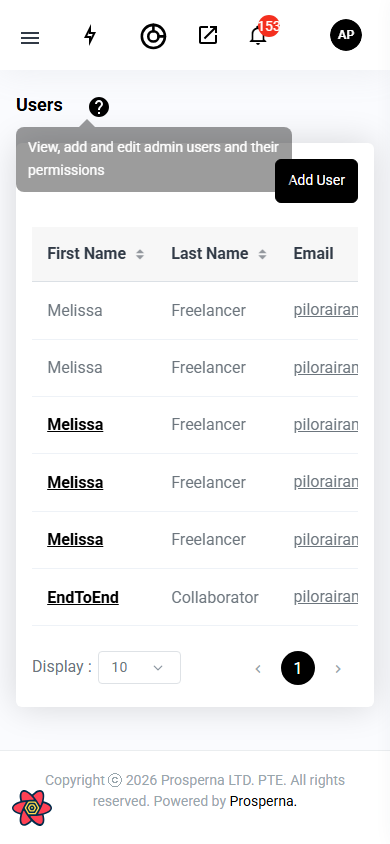

- `04_tc08-control-menu-desktop.png` (source: attachment, uploader: Aira Pilor)

  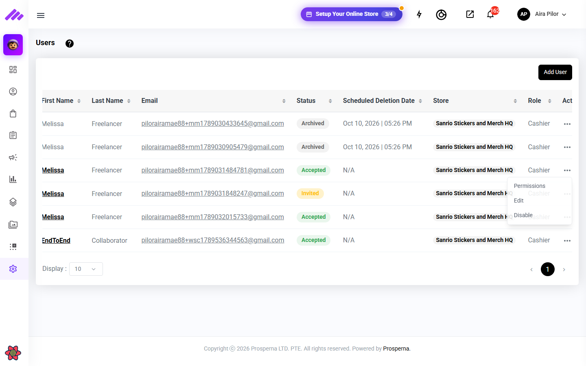

- `05_tc08-menu-open-phone.png` (source: attachment, uploader: Aira Pilor)

  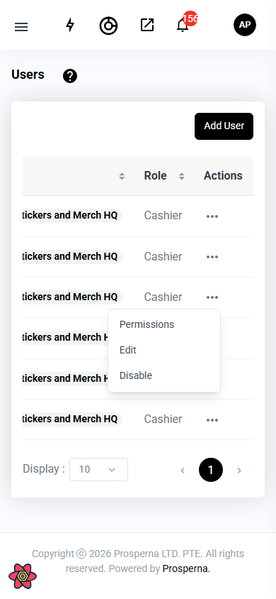

- `06_tc07-pagination-phone.png` (source: attachment, uploader: Aira Pilor)

  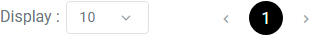

- `07_tc06-add-user-phone.png` (source: attachment, uploader: Aira Pilor)

  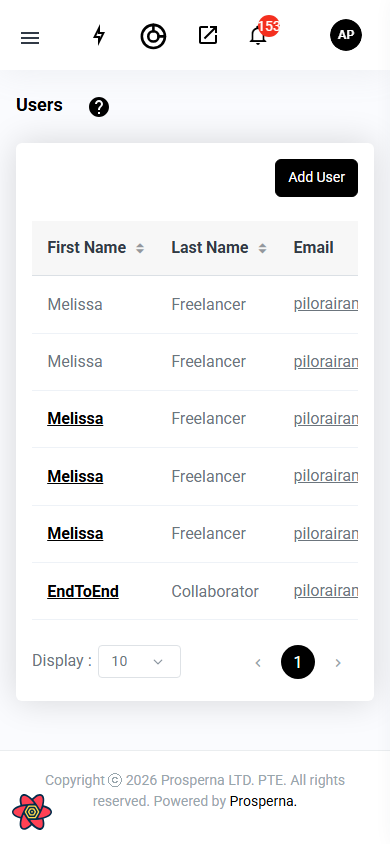

- `08_tc05-tooltip-hover.png` (source: attachment, uploader: Aira Pilor)

  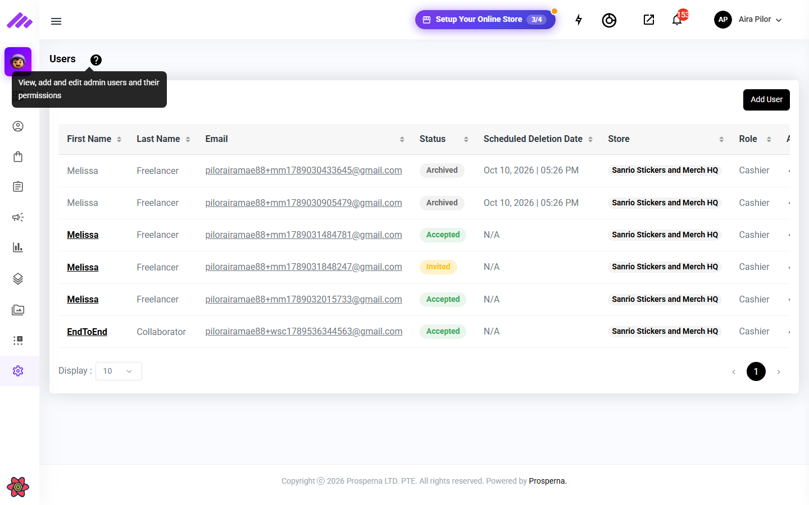

- `09_tc04-actions-toggle.png` (source: attachment, uploader: Aira Pilor)

  

- `10_tc03-menu-open-desktop.png` (source: attachment, uploader: Aira Pilor)

  

- `11_tc02-modal-reopened.png` (source: attachment, uploader: Aira Pilor)

  

- `12_tc01-modal-closed.png` (source: attachment, uploader: Aira Pilor)

  

- `13_tc01-modal-open.png` (source: attachment, uploader: Aira Pilor)

  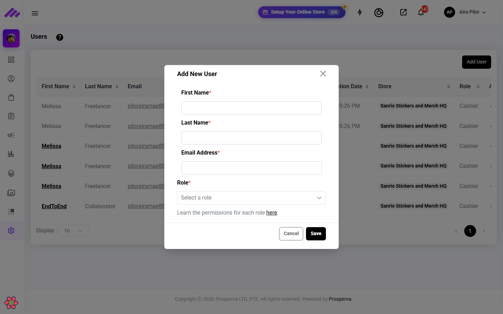

- `14_image.png` (source: attachment, uploader: Angelo Kamachi)

  

- `15_image.png` (source: attachment, uploader: Angelo Kamachi)

  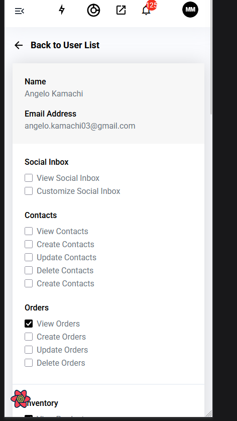

- `16_image.png` (source: attachment, uploader: Angelo Kamachi)

  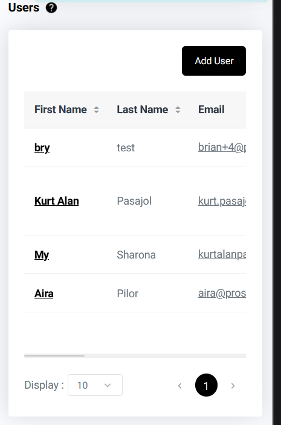

- `17_image.png` (source: attachment, uploader: Angelo Kamachi)

  

- `18_image.png` (source: attachment, uploader: Angelo Kamachi)

  

- `19_image.png` (source: attachment, uploader: Angelo Kamachi)

  

- `20_image.png` (source: attachment, uploader: Angelo Kamachi)

  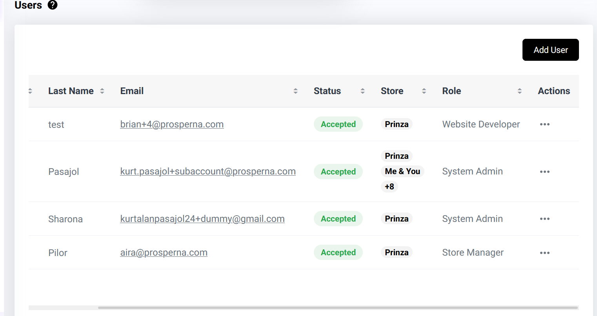

- `21_image.png` (source: attachment, uploader: Angelo Kamachi)

  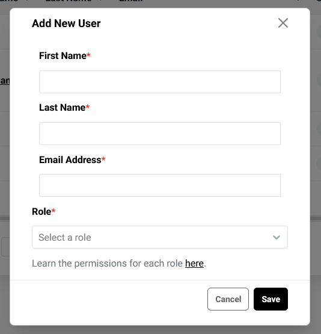

- `22_image.png` (source: attachment, uploader: Aira Pilor)

  

- `23_image.png` (source: attachment, uploader: Aira Pilor)

  

- `24_image.png` (source: attachment, uploader: Aira Pilor)

  

- `25_image.png` (source: attachment, uploader: Aira Pilor)

  

- `26_image.png` (source: comment, uploader: Angelo Kamachi)

  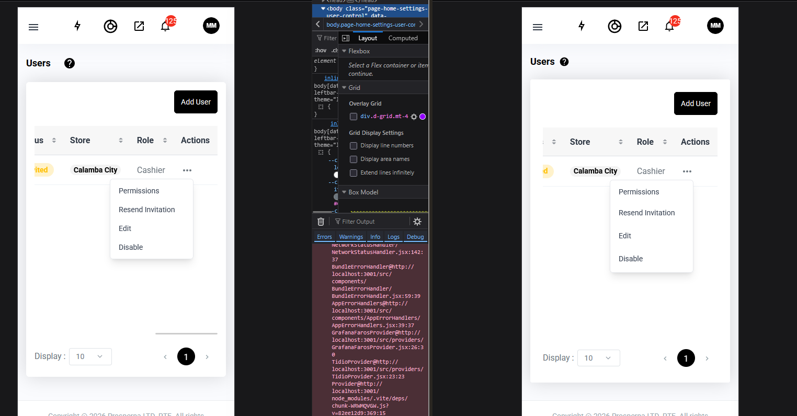

- `27_image.png` (source: comment, uploader: Angelo Kamachi)

  

- `28_image.png` (source: comment, uploader: Angelo Kamachi)

  

- `29_image.png` (source: comment, uploader: Angelo Kamachi)

  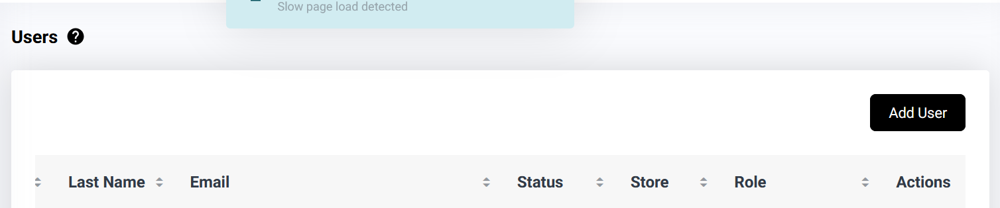

- `30_image.png` (source: comment, uploader: Angelo Kamachi)

  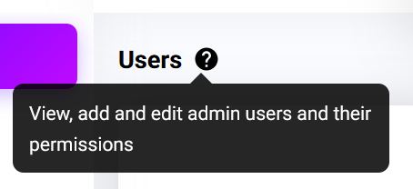

- `31_image.png` (source: comment, uploader: Angelo Kamachi)

  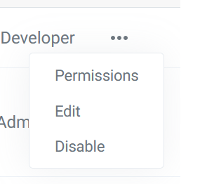

- `32_image.png` (source: comment, uploader: Angelo Kamachi)

  

- `33_image.png` (source: comment, uploader: Angelo Kamachi)

  

- `34_image.png` (source: comment, uploader: Aira Pilor)

  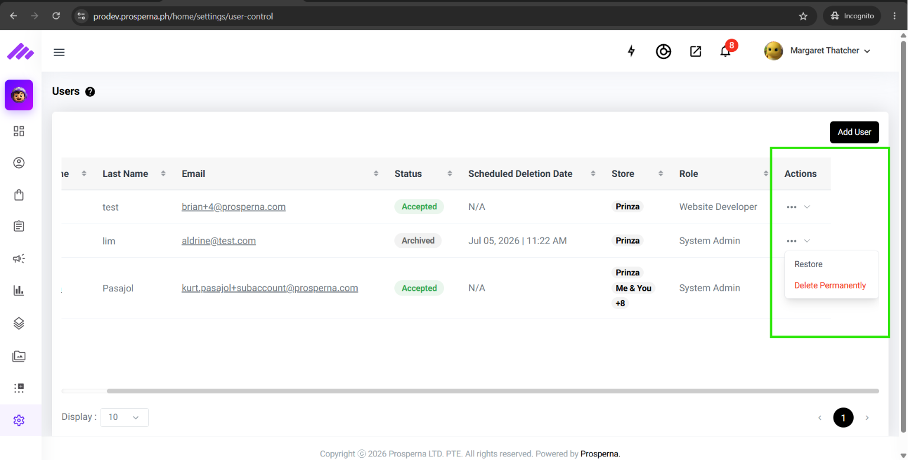

- `35_image.png` (source: comment, uploader: Aira Pilor)

  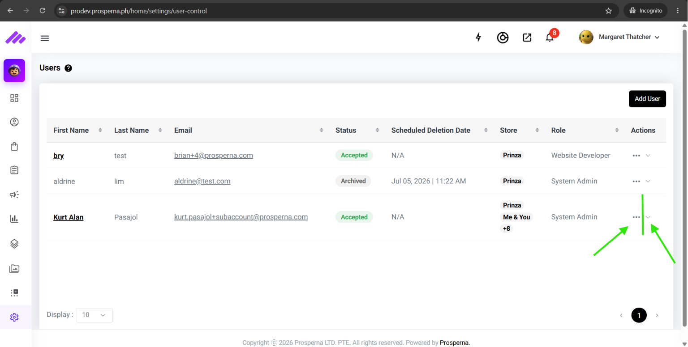

- `36_image.png` (source: comment, uploader: Aira Pilor)

  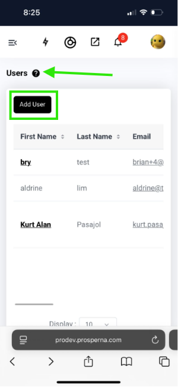

- `37_image.png` (source: comment, uploader: Aira Pilor)

  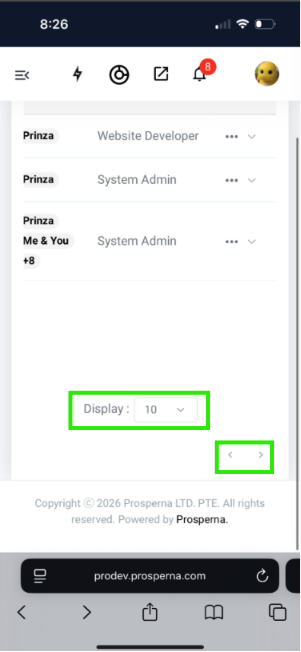

## Comments (21)

### ClickBot (2026-10-06T14:27:07.376Z)

This task Users has been move to PASSED TESTING 
Date updated: Oct 6 2026, 10:27PM (Asia/Shanghai)
Triggered by: Aira Pilor

### Aira Pilor (2026-10-06T14:21:30.878Z)

Env: DEV (deployed)
Status: PASSED
URL: https://prodev.prosperna.com/home/settings/user-control

TEST CASE #1: Permissions opens the permission page at phone width (390x844)
STEPS:
Step 1 - Set the viewport to 390x844 and open Settings > Users.
Step 2 - Open the ••• row menu on a non-archived user.
Step 3 - Click "Permissions".
EXPECTED RESULT: The permission page for that user opens and the URL ends with that user's id.
EVIDENCE: tc08-menu-open-phone.png, tc08-permissions-page.png
ACTUAL RESULT: The menu opened fully on screen, and clicking "Permissions" opened the user's permission page with the URL ending in the user's id. PASSED.

TEST CASE #2: Permissions opens the permission page at desktop width (1440x900)
STEPS:
Step 1 - Open Settings > Users at 1440x900.
Step 2 - Open the ••• row menu on a non-archived user.
Step 3 - Click "Permissions".
EXPECTED RESULT: The permission page for that user opens.
EVIDENCE: tc08-control-menu-desktop.png, tc08-control-permissions-page.png
ACTUAL RESULT: The permission page opened and the URL changed to the user's id. PASSED.

TEST CASE #3: Browser Back returns to the Users list with the menu closed
STEPS:
Step 1 - Open a user's permission page through ••• > Permissions.
Step 2 - Press the browser Back button.
EXPECTED RESULT: The Users list is shown again and the row menu is closed.
EVIDENCE: tc10-back-to-list.png
ACTUAL RESULT: Back returned to the Users list with no row menu open. PASSED.

TEST CASE #4: Permissions opens in a new tab
STEPS:
Step 1 - Open the ••• row menu on a non-archived user.
Step 2 - Open "Permissions" in a new tab (Ctrl+click).
EXPECTED RESULT: The permission page opens in the new tab.
EVIDENCE: tc11-new-tab-permissions.png
ACTUAL RESULT: A new tab opened on the user's permission page. PASSED.

TEST CASE #5: The other row-menu entries still work
STEPS:
Step 1 - On a newly invited user, click ••• > Resend Invitation.
Step 2 - On an invited user whose 24-hour link has expired, click ••• > Resend Invitation.
Step 3 - On any non-archived user, click ••• > Edit.
Step 4 - Click ••• > Disable and confirm.
Step 5 - On the now-archived user, click ••• > Restore.
Step 6 - Disable the user again, then click ••• > Delete Permanently and confirm.
EXPECTED RESULT: Each entry does what it says. Resend on a fresh invite is refused while the link is still valid. Resend on an expired invite sends a new link. Edit opens the Edit User modal without leaving the page. Disable archives the user. Restore returns the user to its previous status. Delete Permanently removes the user.
EVIDENCE: tc13-resend-fresh-invite.png, tc13b-resend-expired-invite.png, tc08b-edit-modal.png, tc14-disable-dialog.png, tc14-archived.png, tc16-restored.png, tc17-delete-dialog.png, tc17-deleted.png
ACTUAL RESULT: Resend on a fresh invite reported that the registration link is still valid. Resend on an expired invite resent the verification link. Edit opened the modal on the same page. Disable archived the user, Restore returned it to Invited, and Delete Permanently removed it from the list. PASSED.

TEST CASE #6: The row menu on the last row is not clipped at phone width
STEPS:
Step 1 - Set the viewport to 390x844 and open Settings > Users.
Step 2 - Scroll to the last row and open its ••• menu.
EXPECTED RESULT: The menu is fully on screen and not cut off by the table or the screen edge.
EVIDENCE: tc12-last-row-menu-phone.png
ACTUAL RESULT: All menu entries rendered fully inside the screen. PASSED.

TEST CASE #7: Archived users are not offered Permissions
STEPS:
Step 1 - Open Settings > Users.
Step 2 - Open the ••• menu on an archived user.
EXPECTED RESULT: "Permissions" is not offered.
EVIDENCE: tc15-archived-menu.png
ACTUAL RESULT: The menu offered only "Restore" and "Delete Permanently". PASSED.

TEST CASE #8: Store column chips do not overlap the Role column (desktop)
STEPS:
Step 1 - Open Settings > Users and set Display to 100.
Step 2 - Wait for the Store chips to show the location names.
Step 3 - At 1280, 1366, 1440, 1536 and 1920px wide, scroll the table fully right and compare each Store chip with its cell and the Role text beside it. Repeated in Microsoft Edge at 150% zoom.
EXPECTED RESULT: Every chip stays inside its Store cell and ends before the Role text.
EVIDENCE: demo-1280.png, demo-1920.png
ACTUAL RESULT: All 21 chips stayed inside their cells at every width; the location chip ends about 15px before the Role text. PASSED.

TEST CASE #9: Store column chips do not overlap the Role column (mobile)
STEPS:
Step 1 - Open Settings > Users on a touch phone at 360, 375, 390, 414 and 430px wide, Display set to 100.
Step 2 - Scroll the table right to the Store and Role columns.
EXPECTED RESULT: Every chip stays inside its Store cell and ends before the Role text.
EVIDENCE: tc19-store-column-phone-390.png, tc19-store-column-phone-390-scrolled.png
ACTUAL RESULT: The table scrolls sideways at every phone width and all 21 chips stayed inside their cells, clear of the Role column. PASSED.

### Aira Pilor (2026-10-06T13:39:08.422Z)

Env: DEV-local
Status: PASSED
URL: http://localhost:3000/home/settings/user-control

TEST CASE #1: Permissions opens the permission page at phone width (390x844)
STEPS:
Step 1 - Set the viewport to 390x844 and open Settings > Users.
Step 2 - Open the ••• row menu on a non-archived user.
Step 3 - Click "Permissions".
EXPECTED RESULT: The permission page for that user opens and the URL ends with that user's id.
EVIDENCE: tc08-menu-open-phone.png, tc08-permissions-page.png
ACTUAL RESULT: The menu opened fully on screen, and clicking "Permissions" opened the user's "Access for …" permission page with the URL ending in the user's id. PASSED.

TEST CASE #2: Permissions opens the permission page at desktop width (1440x900)
STEPS:
Step 1 - Open Settings > Users at 1440x900.
Step 2 - Open the ••• row menu on a non-archived user.
Step 3 - Click "Permissions".
EXPECTED RESULT: The permission page for that user opens.
EVIDENCE: tc08-control-menu-desktop.png, tc08-control-permissions-page.png
ACTUAL RESULT: The permission page opened and the URL changed to the user's id. PASSED.

TEST CASE #3: Browser Back returns to the Users list with the menu closed
STEPS:
Step 1 - Open a user's permission page through ••• > Permissions.
Step 2 - Press the browser Back button.
EXPECTED RESULT: The Users list is shown again and the row menu is closed.
EVIDENCE: tc10-back-to-list.png
ACTUAL RESULT: Back returned to the Users list with no row menu open. PASSED.

TEST CASE #4: Permissions opens in a new tab
STEPS:
Step 1 - Open the ••• row menu on a non-archived user.
Step 2 - Open "Permissions" in a new tab (Ctrl+click).
EXPECTED RESULT: The permission page opens in the new tab.
EVIDENCE: tc11-new-tab-permissions.png
ACTUAL RESULT: A new tab opened on the user's permission page. PASSED.

TEST CASE #5: The other row-menu entries still work
STEPS:
Step 1 - On a newly invited user, click ••• > Resend Invitation.
Step 2 - On an invited user whose 24-hour link has expired, click ••• > Resend Invitation.
Step 3 - On any non-archived user, click ••• > Edit.
Step 4 - Click ••• > Disable and confirm.
Step 5 - On the now-archived user, click ••• > Restore.
Step 6 - Disable the user again, then click ••• > Delete Permanently and confirm.
EXPECTED RESULT: Each entry does what it says. Resend on a fresh invite is refused while the link is still valid. Resend on an expired invite sends a new link. Edit opens the Edit User modal without leaving the page. Disable archives the user. Restore returns the user to its previous status. Delete Permanently removes the user.
EVIDENCE: tc13-resend-fresh-invite-frame.png, tc13b-resend-expired-invite-frame.png, tc08b-edit-modal.png, tc14-disable-dialog.png, tc14-archived.png, tc16-restored.png, tc17-delete-dialog.png, tc17-deleted.png
ACTUAL RESULT: Resend on a fresh invite showed "Registration link is still valid and was sent to the user via email." Resend on an expired invite showed "Successfully resent verification link." Edit opened the modal on the same page. Disable archived the user, Restore returned it to Invited, and Delete Permanently removed it from the list. PASSED.

TEST CASE #6: The row menu on the last row is not clipped at phone width
STEPS:
Step 1 - Set the viewport to 390x844 and open Settings > Users.
Step 2 - Scroll to the last row and open its ••• menu.
EXPECTED RESULT: The menu is fully on screen and not cut off by the table or the screen edge.
EVIDENCE: tc12-last-row-menu-phone.png
ACTUAL RESULT: All four entries rendered fully inside the screen, over the pagination row. PASSED.

TEST CASE #7: Archived users are not offered Permissions
STEPS:
Step 1 - Open Settings > Users.
Step 2 - Open the ••• menu on an archived user.
EXPECTED RESULT: "Permissions" is not offered.
EVIDENCE: tc15-archived-menu.png
ACTUAL RESULT: The menu offered only "Restore" and "Delete Permanently". PASSED.

### ClickBot (2026-10-06T11:37:49.965Z)

This task Users hss been move to IN TESTING 
Updated: Oct 6 2026, 7:37PM (Asia/Shanghai)
Triggered by: Aira Pilor

### Angelo Kamachi (2026-10-06T01:10:38.662Z)

QA TEST CASES SUMMARY
LAST UPDATED: 2026-10-06 - branch refactor/tw-settings-standard-v3, commit a44b226fa (test only; the fault itself was corrected on dev by PR #8484)

WHERE TO TEST
Environment: dev.
Page: Settings > Users (/home/settings/user-control).
Preconditions: a store on a plan that allows extra users, with at least one team member listed who is not archived, so the row menu offers "Permissions". Test at both phone width (about 390px) and desktop (1440x900) - the Sep 18 failure happened at both.

TEST CASES

1. Permissions opens the page, phone. At about 390px, open Settings > Users. Open the row menu on a user who is not archived and click "Permissions". EXPECTED: the permission page for that user opens and the web address changes to end with that user's id. The menu closing on its own, with the list still on screen, is the failure.

2. Permissions opens the page, desktop. Repeat case 1 at 1440x900. EXPECTED: the same, the permission page opens.

3. Back returns to the list. After case 1 or 2, use the browser Back button. EXPECTED: you return to the Users list, and the row menu is closed.

4. Open in a new tab still works. Right-click "Permissions" and choose Open link in new tab. EXPECTED: the permission page opens in the new tab. This was the only way through while the fault was present, so it should keep working.

5. The other menu entries still work. On an invited user, open the row menu and use "Resend Invitation". On any user, try the remaining entries. EXPECTED: each one does what it says. These are buttons rather than navigation and must not have been affected.

6. The menu is not clipped, phone. At about 390px, open the row menu on the last row of the table. EXPECTED: the menu is fully on screen and not cut off by the table or the edge of the screen.

7. Archived users. Find an archived user and open the row menu. EXPECTED: "Permissions" is not offered, as before.

TEST DATA
Any non-archived team member on a store that allows extra users. No special data needed.

OUT OF SCOPE / KNOWN BEHAVIOR
- Cases 1 to 7 of the Sep 18 run (modal close, modal reset on reopen, menu not clipped on desktop, no extra arrow on the menu button, title tooltip, Add User alignment, pagination) all passed then and were not changed.
- The permission page content itself is covered by the Store Settings task, not here.

### Angelo Kamachi (2026-10-06T01:10:21.004Z)

ACCOMPLISHED

QA return of Sep 18, cases 8 and 9 (clicking "Permissions" in the row menu only closed the menu, the page never changed) has been investigated.

WHAT WAS WRONG
The shared dropdown used to cancel the click on any menu entry that had no web address attached. "Permissions" is not a plain link, it is an in-app navigation entry, so it has no address of that kind, and the cancel stopped it from going anywhere. The menu closed and nothing else happened. This is why it failed at desktop width too, with nothing being clipped.

WHY NOTHING NEEDED FIXING ON THIS BRANCH
That cancel was introduced on the dev branch on Aug 4 and was still there when this was tested on Sep 18. The settings branch has never carried it: it has always limited the cancel to real links only, so "Permissions" has worked here throughout. On dev itself the fault was corrected separately on Sep 23 in PR #8484.

So there is no behaviour change to make here. What was missing was anything stopping it coming back.

EXTRA WORK

Added a test that opens the row menu, clicks "Permissions" and requires the permission page to actually load. The shared dropdown had no test covering in-app navigation at all, so this failure could have returned unnoticed. The test fails if the old cancel is reintroduced.

PULL REQUESTS

No dev PR needed for the fault itself; dev was already corrected by PR #8484. The new test is committed on refactor/tw-settings-standard-v3 (commit a44b226fa).

HOW IT WAS TESTED

ESLint clean. The shared dropdown suite passes at 31 tests including the new one, and 12 test files and 204 tests pass across Users, Payment Settings, Shipping and the dropdown. The new test was confirmed to fail against the old behaviour, so it genuinely guards the case.

Cases 1 to 7 of the Sep 18 run were already passing and were not touched.

NEXT STEPS

Please retest cases 8 and 9 on dev, at both phone and desktop width. Clicking "Permissions" should open the permission page for that user.

QA TEST CASES

A QA TEST CASES SUMMARY comment has been added to this task.

### Aira Pilor (2026-09-18T01:50:54.088Z)

Env: DEV-local
Status: FAILED
URL: http://localhost:3000/home/settings/user-control

TEST CASE #1: Add New User modal closes from its X (exit) button
STEPS:
Open Settings > Users.
Click "Add User".
Click the X in the modal header.
EXPECTED RESULT: The modal closes.
EVIDENCE: tc01-modal-open.png, tc01-modal-closed.png
ACTUAL RESULT: The modal closed. PASSED.

TEST CASE #2: Reopening the modal after closing with X shows empty fields
STEPS:
Open "Add User", type a First Name.
Close the modal with the X.
Click "Add User" again.
EXPECTED RESULT: First Name is empty; the form does not retain the previous entry.
EVIDENCE: tc02-modal-reopened.png
ACTUAL RESULT: First Name was empty on reopen. PASSED.

TEST CASE #3: Row actions menu is not clipped by the table (desktop, 1440x900)
STEPS:
Open Settings > Users.
Click the ••• menu on the first row.
EXPECTED RESULT: The menu renders outside the horizontally scrolling table wrapper and sits fully inside the viewport.
EVIDENCE: tc03-menu-open-desktop.png
ACTUAL RESULT: The menu rendered outside the scrolling wrapper and was fully within the viewport. PASSED.

TEST CASE #4: The ••• toggle no longer renders a redundant caret
STEPS:
Open Settings > Users.
Inspect the Actions cell of the first row.
EXPECTED RESULT: Only the ••• icon renders; no separate chevron beside it.
EVIDENCE: tc04-actions-toggle.png
ACTUAL RESULT: Only the ••• icon rendered. PASSED.

TEST CASE #5: Page-title (?) tooltip opens on hover
STEPS:
Open Settings > Users.
Hover the (?) icon beside the "Users" title.
EXPECTED RESULT: The tooltip becomes fully opaque and reads "View, add and edit admin users and their permissions".
EVIDENCE: tc05-tooltip-hover.png
ACTUAL RESULT: The tooltip went from opacity 0 to opacity 1 on hover. PASSED.

TEST CASE #6: "Add User" is right-aligned at phone width (390x844)
STEPS:
Set the viewport to 390x844 before loading the page.
Open Settings > Users.
EXPECTED RESULT: The Add User button sits at the right edge of its row, not the left.
EVIDENCE: tc06-add-user-phone.png
ACTUAL RESULT: The button sat in the right half of its row, flush to the right edge. PASSED.

TEST CASE #7: Pagination stays on one row with a numbered pager at phone width
STEPS:
Set the viewport to 390x844 before loading the page.
Open Settings > Users and scroll to the pagination row.
EXPECTED RESULT: "Display :" and the page arrows share one row, and the numbered page button is present between the arrows.
EVIDENCE: tc07-pagination-phone.png
ACTUAL RESULT: Both controls shared one row and the page button "1" rendered between the arrows. PASSED.

TEST CASE #8: Row menu "Permissions" opens the permission page (phone, 390x844)
STEPS:
Set the viewport to 390x844 before loading the page.
Open Settings > Users, click the ••• menu on a non-archived user.
Click "Permissions".
EXPECTED RESULT: The menu is fully on screen, and the app navigates to /home/settings/user-control/<storeMemberId>.
EVIDENCE: tc08-menu-open-phone.png
ACTUAL RESULT: The menu was fully on screen, but clicking "Permissions" only closed the menu. The page stayed on the Users list and the URL never changed. FAILED.

TEST CASE #9: Control - "Permissions" at desktop width (1440x900)
STEPS:
Open Settings > Users at 1440x900.
Click the ••• menu on a non-archived user, then click "Permissions".
EXPECTED RESULT: The app navigates to /home/settings/user-control/<storeMemberId>.
EVIDENCE: tc08-control-menu-desktop.png
ACTUAL RESULT: Identical failure at desktop width with nothing clipped - the menu closed and the URL never changed. FAILED.

TEST CASE #10: Page-title (?) tooltip on a touch device
STEPS:
Open Settings > Users in a touch-enabled 390x844 session.
Tap the (?) icon beside the "Users" title.
EXPECTED RESULT: The tooltip opens.
EVIDENCE: tc09-tooltip-after-tap.png
ACTUAL RESULT: The tooltip opened on tap. PASSED.

DEFECT: "Permissions" menu item never navigates

Where: prosperna1 - src/components/ui/Dropdown.jsx (Dropdown.Item), as used by src/pages/home/users/UserControl/index.jsx:277-287. Route /home/settings/user-control.

Steps to Recreate:
Open Settings > Users as a PARENT user on an upgraded plan.
Click the ••• menu on any non-archived user.
Click "Permissions".

Expected Result: The app navigates to /home/settings/user-control/<storeMemberId>.

Actual Result: The menu closes and nothing else happens. UserControl renders the item as <Dropdown.Item as={Link} to={...}> - it passes to, never href. Dropdown.Item reads its own href prop (undefined here) and runs if (!href || href === '#' || href.startsWith('#')) e.preventDefault();, so it calls preventDefault() on every click at this call site. React Router's Link only navigates if (!event.defaultPrevented), so navigation is suppressed while close() still runs. Link does put a real href on the anchor, so the item looks like a working link and middle-click still works - which is why it reads as "the button is dead". This reproduces at both 390px and 1440px, so it is unrelated to the menu-clipping fix, which is working correctly (cases #3 and #8). Any other Dropdown.Item as={Link} to={...} call site in the app has the same bug.

### ClickBot (2026-09-18T01:18:20.974Z)

This task Users hss been move to IN TESTING 
Updated: Sep 18 2026, 9:18AM (Asia/Shanghai)
Triggered by: Aira Pilor

### Angelo Kamachi (2026-09-15T01:21:49.566Z)

image.png
I also fixed the actions menu from clipping through the screen

### Angelo Kamachi (2026-09-15T01:09:13.908Z)

image.png
permission button function restored

### Aira Pilor (2026-09-10T02:23:42.240Z)

env: DEV
Status: FAILED

Permission button is not working
https://t7537039.p.clickup-attachments.com/t7537039/b31e1d27-2930-4cca-b5b2-56d74047a7fa/paste_5f14e65b-3bb3-408d-91da-c163382e7fba.mp4?view=open

### ClickBot (2026-08-24T01:36:40.043Z)

This Users has been move to READY FOR TESTING
Date updated: Aug 24 2026, 9:36AM (Asia/Singapore)
Triggered by: Angelo Kamachi

### Angelo Kamachi (2026-08-20T02:40:13.318Z)

image.png
image.png
pagination fix

### Angelo Kamachi (2026-08-20T02:32:08.286Z)

image.png
add user is now to the right

### Angelo Kamachi (2026-08-20T02:31:53.691Z)

image.png
tooltip fixed

### Angelo Kamachi (2026-08-20T02:31:39.516Z)

image.png
arrow down buttons removed for redundancy

### Angelo Kamachi (2026-08-20T02:30:56.359Z)

image.png
layout issue fixed

### Angelo Kamachi (2026-08-20T02:28:35.612Z)

image.png
exit button now works

### Angelo Kamachi (2026-07-28T08:33:15.709Z)

Projected End Date 8/3
No subtasks found

### Aira Pilor (2026-07-03T12:29:10.170Z)

env: DEV
Status: FAILED

The following are the issues under Users:
------Exit button is not working:
https://t7537039.p.clickup-attachments.com/t7537039/764d4ef2-2e7e-40a2-999d-8dcdba6dab19/20260703-1221-34.8487662.mp4?view=openLayout Issue:
image.png
Same Function:
image.png
Tooltip is not working, and the "Add User" button is on the left.
image.png
Pagination:
image.png
Is that intended?

Kindly fix all the returns.

Moving this subtask to "Ready Priority"
cc@Angelo Kamachi

### ClickBot (2026-07-03T12:05:21.698Z)

This task Users has been created 
Date: Jul 3 2026, 8:05PM (Asia/Shanghai)
By Aira Pilor

