# Messaging Settings

- **Task ID**: `86ey5cw6c`
- **URL**: https://app.clickup.com/t/86ey5cw6c
- **Status**: ready for deployment
- **Assignees**: Angelo Kamachi, Aira Pilor
- **Created**: 2026-07-03T12:05:38.930Z
- **Updated**: 2026-10-12T00:05:15.685Z
- **List**: P1 Delivery
- **Folder**: Shared with me

## Description

_No description_

## Media (54)

- `01_tc11-preview-open.png` (source: attachment, uploader: Aira Pilor)

  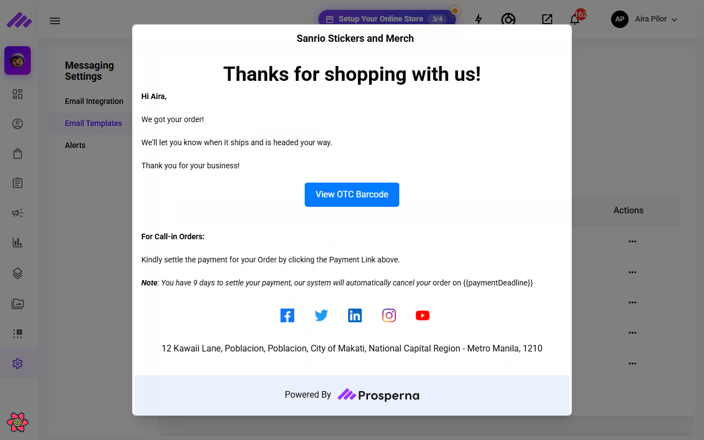

- `02_tc10-recipient-chip-added.png` (source: attachment, uploader: Aira Pilor)

  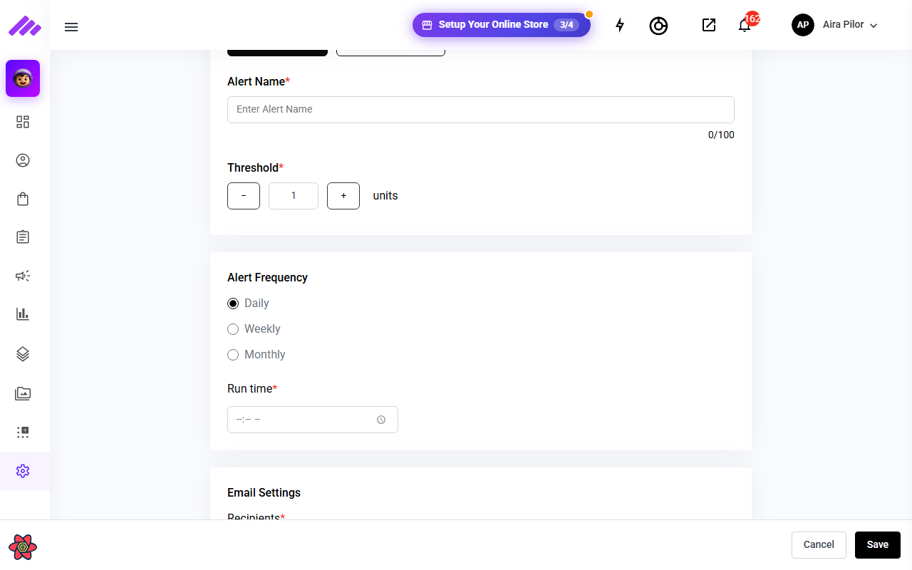

- `03_tc09-row-tooltip-open.png` (source: attachment, uploader: Aira Pilor)

  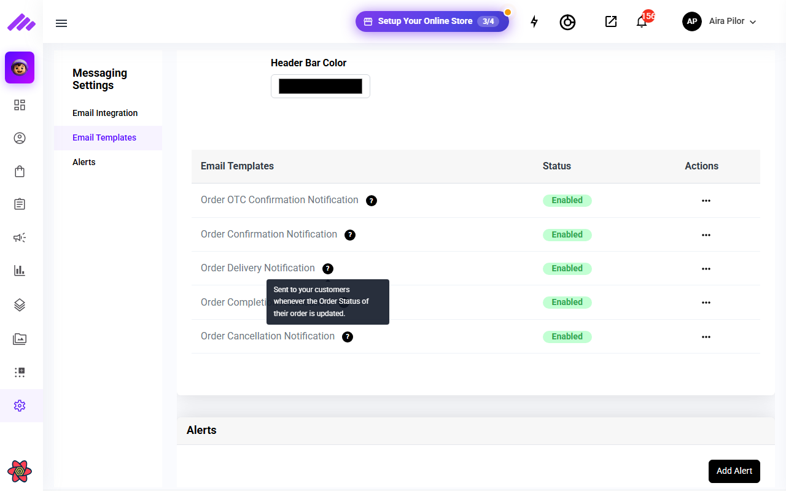

- `04_tc08-email-template-menu-phone.png` (source: attachment, uploader: Aira Pilor)

  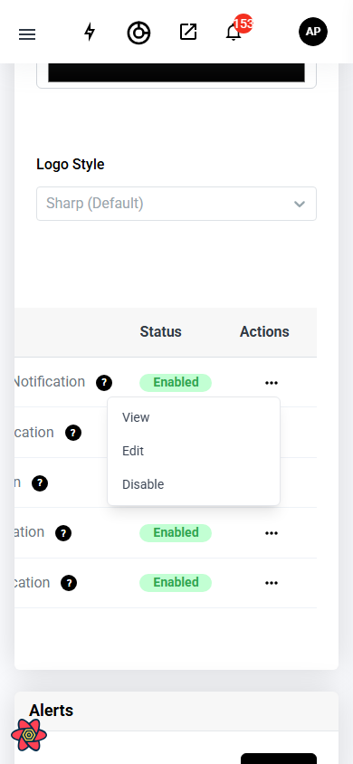

- `05_tc07b-alerts-menu-anchor.png` (source: attachment, uploader: Aira Pilor)

  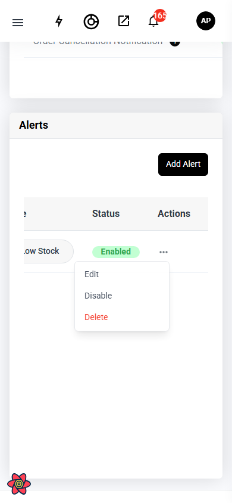

- `06_tc07-alerts-menu-phone.png` (source: attachment, uploader: Aira Pilor)

  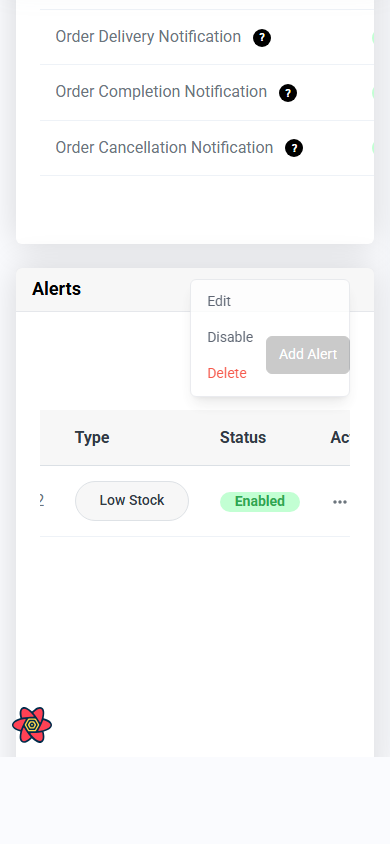

- `07_tc06-alerts-action-trigger.png` (source: attachment, uploader: Aira Pilor)

  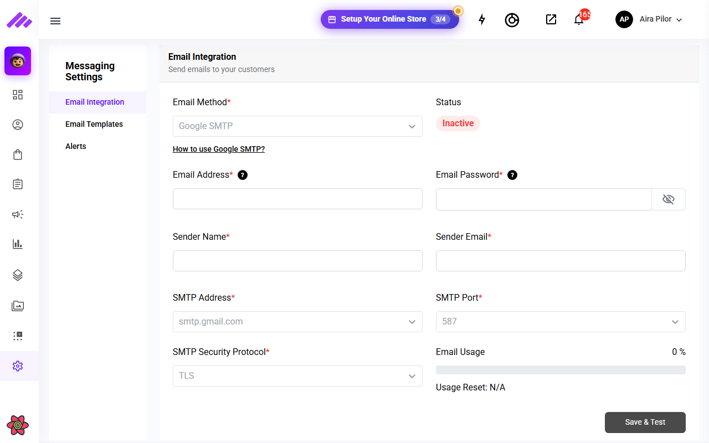

- `08_tc05-email-template-menu-colour.png` (source: attachment, uploader: Aira Pilor)

  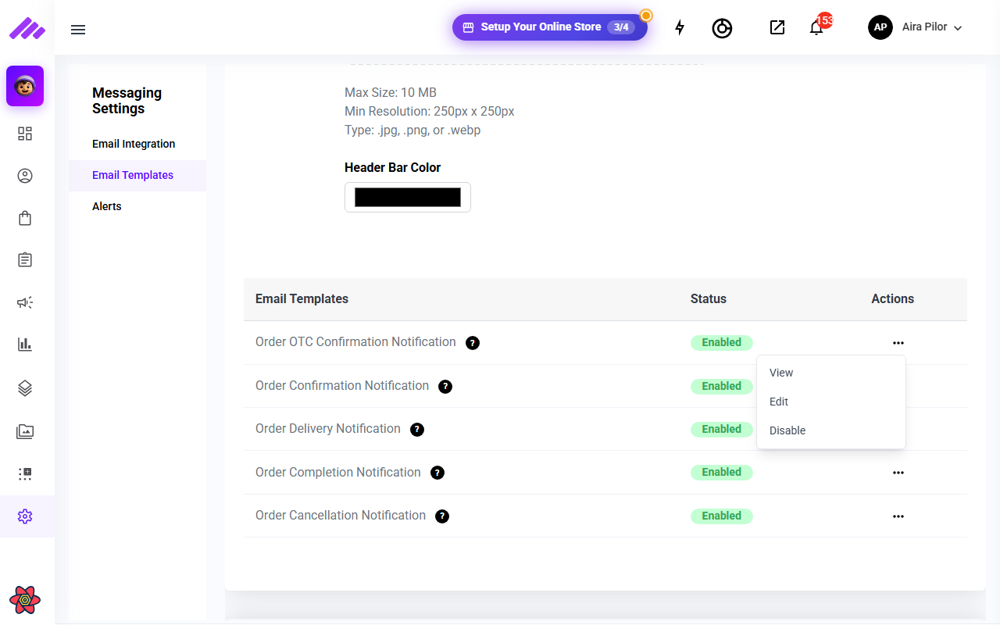

- `09_tc04-editor-actions-desktop.png` (source: attachment, uploader: Aira Pilor)

  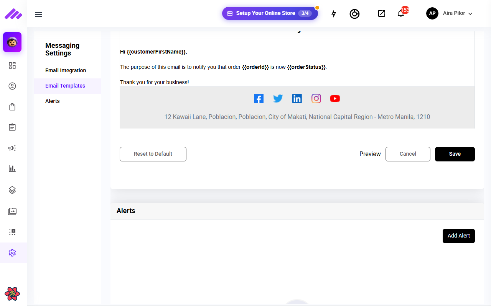

- `10_tc03-editor-actions-phone.png` (source: attachment, uploader: Aira Pilor)

  

- `11_tc02-editor-toolbar-phone.png` (source: attachment, uploader: Aira Pilor)

  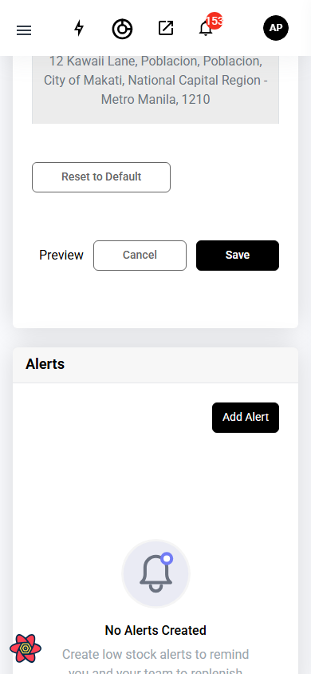

- `12_tc01-preview-oversized-image-phone.png` (source: attachment, uploader: Aira Pilor)

  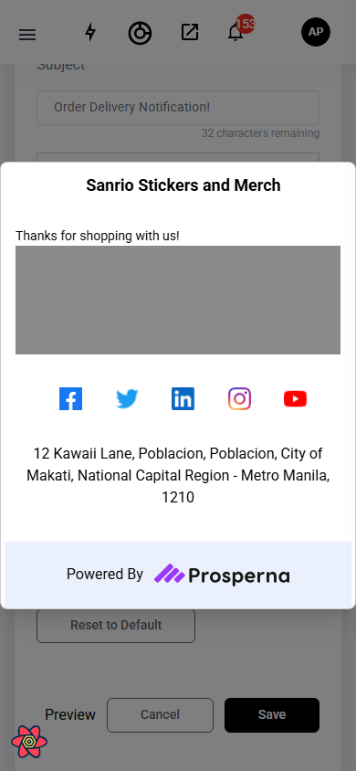

- `13_image.png` (source: attachment, uploader: Angelo Kamachi)

  

- `14_image.png` (source: attachment, uploader: Angelo Kamachi)

  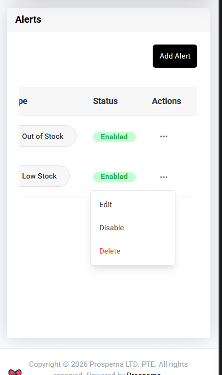

- `15_image.png` (source: attachment, uploader: Angelo Kamachi)

  

- `16_image.png` (source: attachment, uploader: Angelo Kamachi)

  

- `17_image.png` (source: attachment, uploader: Angelo Kamachi)

  

- `18_image.png` (source: attachment, uploader: Angelo Kamachi)

  

- `19_image.png` (source: attachment, uploader: Angelo Kamachi)

  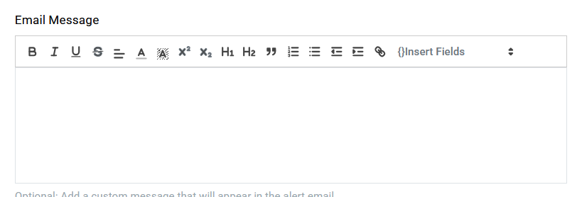

- `20_image.png` (source: attachment, uploader: Angelo Kamachi)

  

- `21_image.png` (source: attachment, uploader: Angelo Kamachi)

  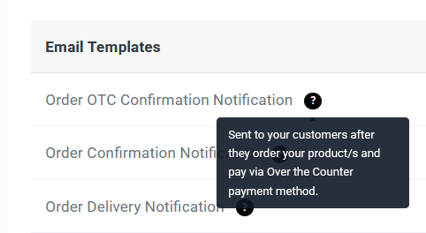

- `22_image.png` (source: attachment, uploader: Angelo Kamachi)

  

- `23_image.png` (source: attachment, uploader: Angelo Kamachi)

  

- `24_image.png` (source: attachment, uploader: Angelo Kamachi)

  

- `25_image.png` (source: attachment, uploader: Angelo Kamachi)

  

- `26_image.png` (source: attachment, uploader: Angelo Kamachi)

  

- `27_image.png` (source: attachment, uploader: Aira Pilor)

  

- `28_image.png` (source: attachment, uploader: Aira Pilor)

  

- `29_image.png` (source: attachment, uploader: Aira Pilor)

  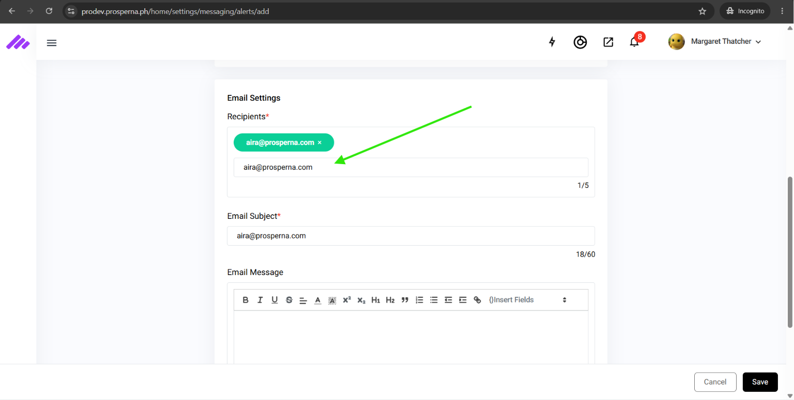

- `30_image.png` (source: attachment, uploader: Aira Pilor)

  

- `31_image.png` (source: attachment, uploader: Aira Pilor)

  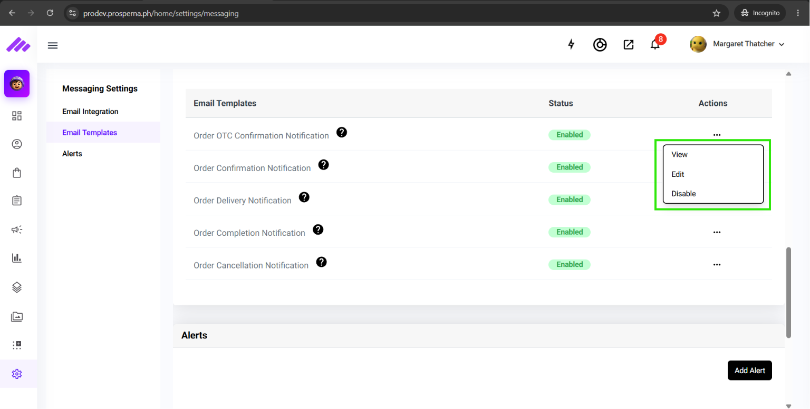

- `32_image.png` (source: attachment, uploader: Aira Pilor)

  

- `33_image.png` (source: attachment, uploader: Aira Pilor)

  

- `34_image.png` (source: comment, uploader: Angelo Kamachi)

  

- `35_image.png` (source: comment, uploader: Angelo Kamachi)

  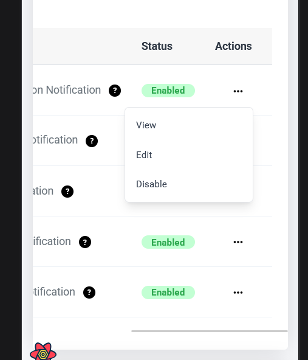

- `36_image.png` (source: comment, uploader: Angelo Kamachi)

  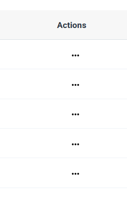

- `37_image.png` (source: comment, uploader: Angelo Kamachi)

  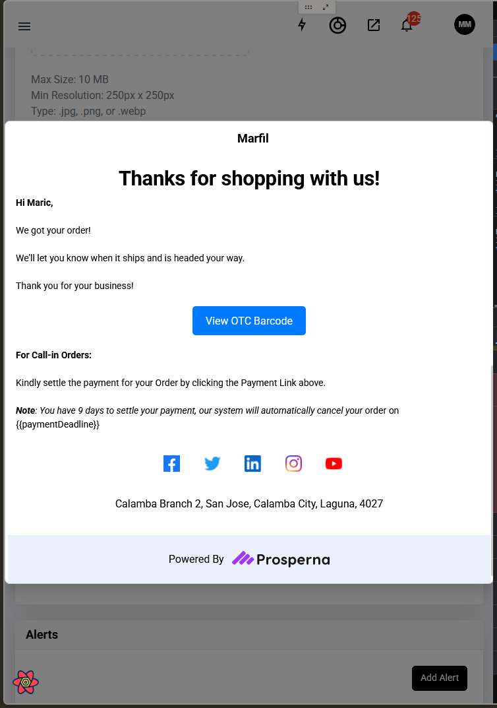

- `38_image.png` (source: comment, uploader: Angelo Kamachi)

  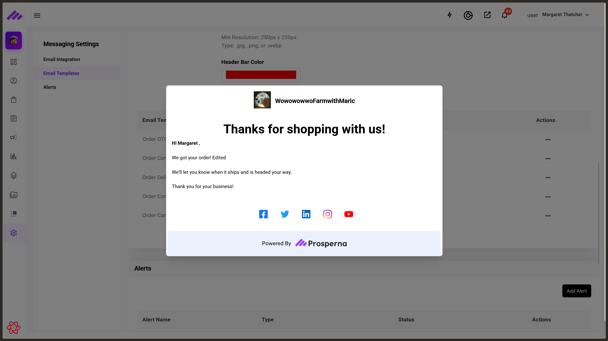

- `39_image.png` (source: comment, uploader: Angelo Kamachi)

  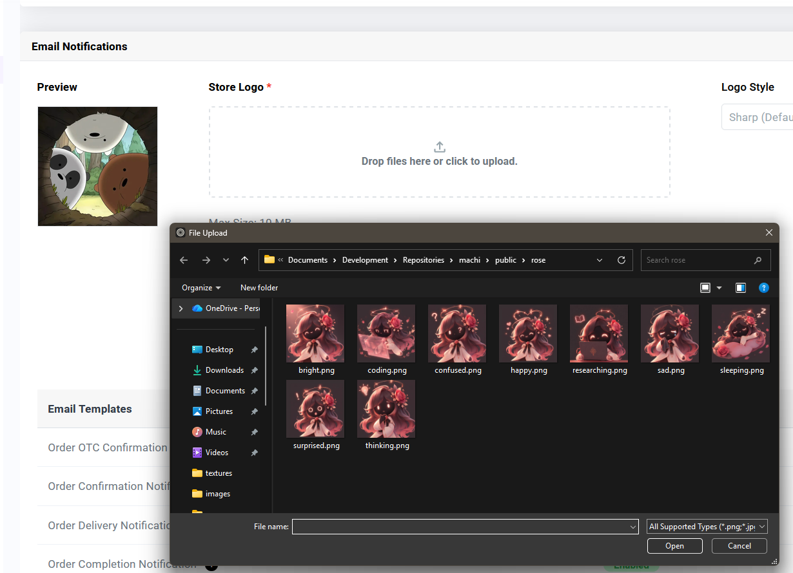

- `40_image.png` (source: comment, uploader: Angelo Kamachi)

  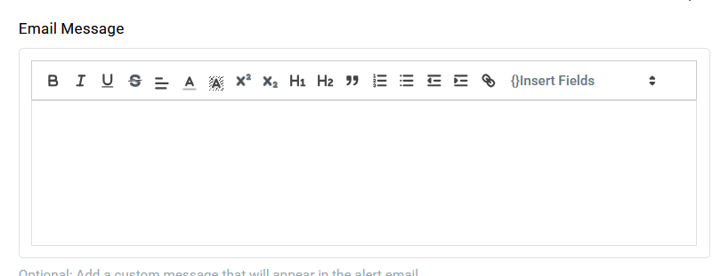

- `41_image.png` (source: comment, uploader: Angelo Kamachi)

  

- `42_image.png` (source: comment, uploader: Angelo Kamachi)

  

- `43_image.png` (source: comment, uploader: Angelo Kamachi)

  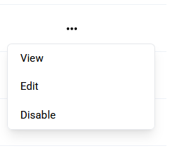

- `44_image.png` (source: comment, uploader: Angelo Kamachi)

  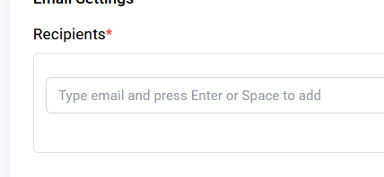

- `45_image.png` (source: comment, uploader: Angelo Kamachi)

  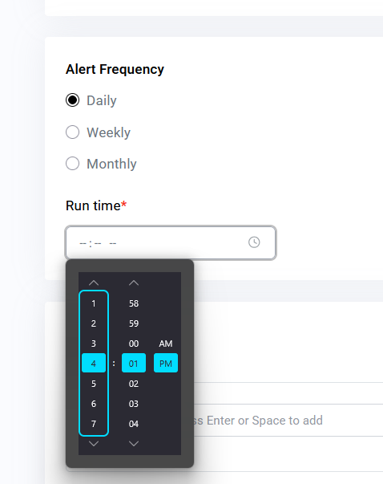

- `46_image.png` (source: comment, uploader: Angelo Kamachi)

  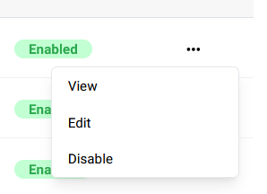

- `47_image.png` (source: comment, uploader: Angelo Kamachi)

  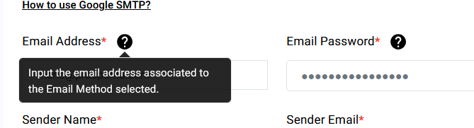

- `48_image.png` (source: comment, uploader: Aira Pilor)

  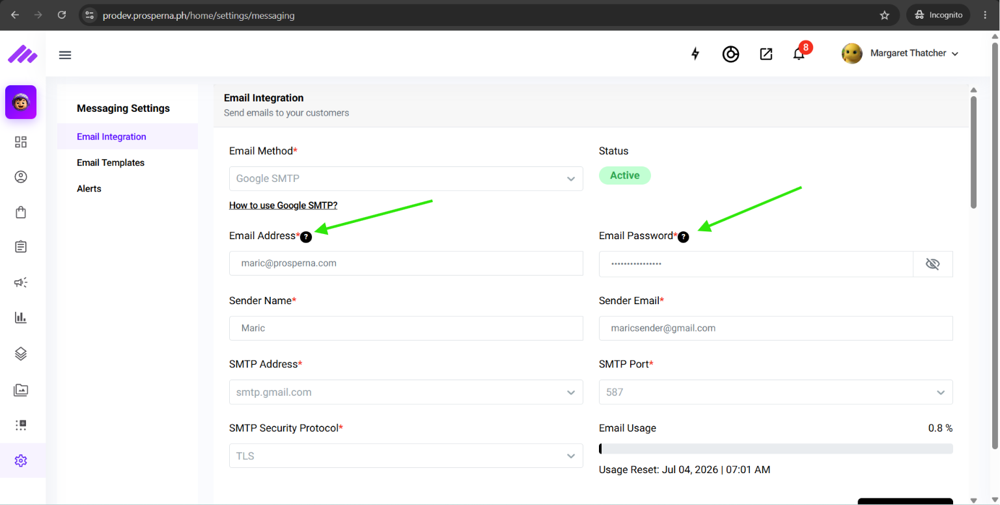

- `49_image.png` (source: comment, uploader: Aira Pilor)

  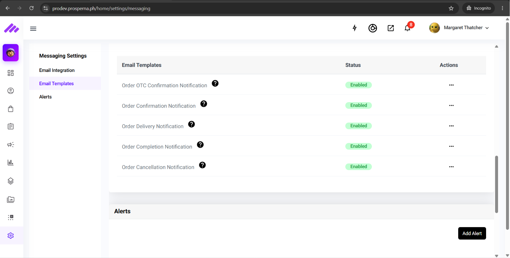

- `50_image.png` (source: comment, uploader: Aira Pilor)

  

- `51_image.png` (source: comment, uploader: Aira Pilor)

  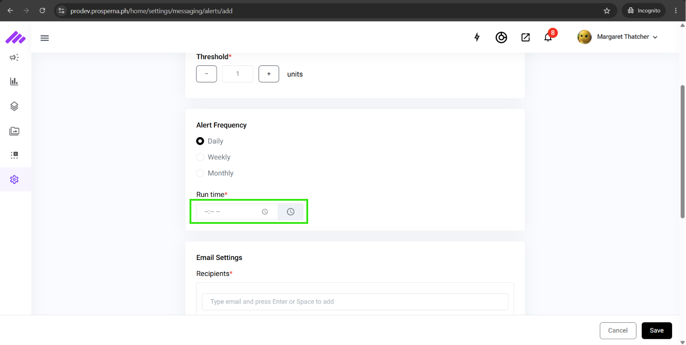

- `52_image.png` (source: comment, uploader: Aira Pilor)

  

- `53_image.png` (source: comment, uploader: Aira Pilor)

  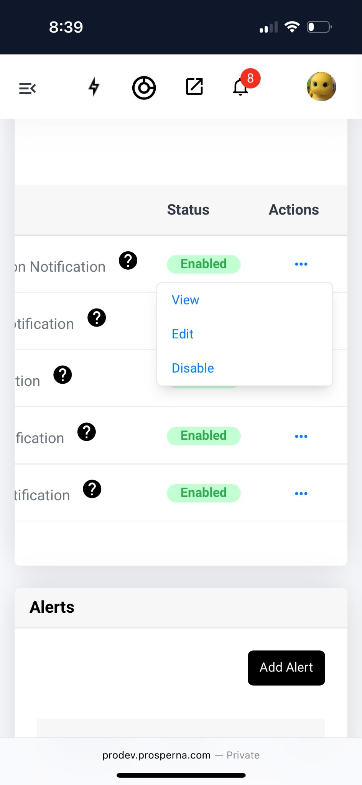

- `54_image.png` (source: comment, uploader: Aira Pilor)

  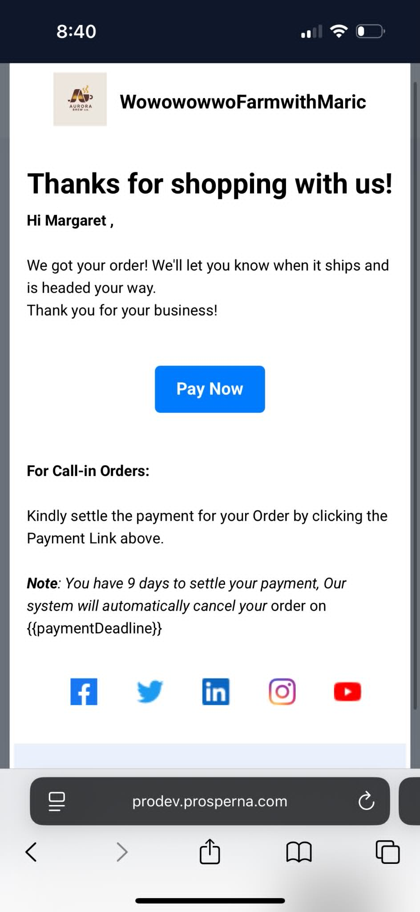

## Comments (19)

### ClickBot (2026-09-18T02:10:15.201Z)

This task Messaging Settings has been move to PASSED TESTING 
Date updated: Sep 18 2026, 10:10AM (Asia/Shanghai)
Triggered by: Aira Pilor

### Aira Pilor (2026-09-18T01:51:18.726Z)

Env: DEV-local
Status: PASSED
URL: http://localhost:3001/home/settings/messaging

TEST CASE #1: Oversized image in the email preview is capped to the modal on a phone
STEPS:
Open Messaging Settings at 390x844 (phone).
Open the Order Delivery template's row action menu and choose Edit.
Put an image 1200px wide into the editor body.
Click Preview.
EXPECTED RESULT: The image is scaled down to the preview container's width and the preview body does not scroll sideways.
EVIDENCE: tc01-preview-oversized-image-phone.png
ACTUAL RESULT: The 1200px image rendered at the container width (358px) and the preview body had no horizontal overflow.

TEST CASE #2: Email editor toolbar renders icon-sized buttons and does not overflow on a phone
STEPS:
Open Messaging Settings at 390x844.
Open the Order Delivery template for editing.
Inspect the rich-text editor's toolbar.
EXPECTED RESULT: Every toolbar icon renders at icon size, and the toolbar does not scroll sideways.
EVIDENCE: tc02-editor-toolbar-phone.png
ACTUAL RESULT: All toolbar icons rendered at icon size and the toolbar fit its width with no horizontal overflow.

TEST CASE #3: "Reset to Default" and "Preview" do not overlap on a phone
STEPS:
Open Messaging Settings at 390x844.
Open the Order Delivery template for editing.
Scroll to the editor's action row.
EXPECTED RESULT: The two controls do not overlap; they stack, with Preview below Reset to Default.
EVIDENCE: tc03-editor-actions-phone.png
ACTUAL RESULT: The two boxes did not intersect and Preview sat below Reset to Default.

TEST CASE #4: "Reset to Default" and "Preview" share one row on desktop without overlapping
STEPS:
Open Messaging Settings at 1280x800.
Open the Order Delivery template for editing.
Scroll to the editor's action row.
EXPECTED RESULT: The two controls sit on a single row and do not overlap.
EVIDENCE: tc04-editor-actions-desktop.png
ACTUAL RESULT: Both controls shared one row with no overlap, so the phone fix did not cost the desktop layout.

TEST CASE #5: Email Templates row-action menu items are not painted blue
STEPS:
Open Messaging Settings at 1280x800.
Open the first Email Templates row's three-dot menu.
Read the colour of each menu item and of the trigger.
EXPECTED RESULT: View, Edit and Disable render in a neutral colour, not link blue; the three-dot trigger is neutral too.
EVIDENCE: tc05-email-template-menu-colour.png
ACTUAL RESULT: Every menu item and the trigger rendered in a neutral grey, none in link blue.

TEST CASE #6: Alerts three-dot trigger is not painted blue
STEPS:
Open Messaging Settings at 1280x800.
Locate an alert row in the Alerts card.
Read the colour of the three-dot trigger and of its icon.
EXPECTED RESULT: The trigger and its icon render in a neutral colour, not link blue.
EVIDENCE: tc06-alerts-action-trigger.png
ACTUAL RESULT: Both the trigger and its icon rendered neutral, not link blue.

TEST CASE #7: Alerts row-action menu opens fully on screen on a phone
STEPS:
Open Messaging Settings at 390x844.
Open an alert row's three-dot menu.
Check the menu's position and each item.
EXPECTED RESULT: The whole menu sits within the screen and Edit, Disable and Delete are each reachable, not clipped at the table edge.
EVIDENCE: tc07-alerts-menu-phone.png
ACTUAL RESULT: The menu rendered entirely within the 390px screen and all three items were reachable; it is no longer inside the table's horizontally scrolling wrapper.

TEST CASE #7b: The open Alerts menu stays anchored to the row it belongs to
STEPS:
Open Messaging Settings at 390x844.
Open an alert row's three-dot menu.
Measure the distance between the menu and its three-dot trigger.
EXPECTED RESULT: The menu opens directly beside its trigger, either just below or just above it.
EVIDENCE: tc07b-alerts-menu-anchor.png
ACTUAL RESULT: The menu opened within 24px of its trigger, so moving it out of the table did not detach it from its row.

TEST CASE #8: Email Templates row-action menu opens fully on screen on a phone
STEPS:
Open Messaging Settings at 390x844.
Open the first Email Templates row's three-dot menu.
Check the menu's position, then click View.
EXPECTED RESULT: The whole menu sits within the screen, is not cropped, and its items can actually be clicked.
EVIDENCE: tc08-email-template-menu-phone.png
ACTUAL RESULT: The menu rendered fully within the 390px screen, every item was reachable, and View opened the preview.

TEST CASE #9: An Email Templates row tooltip opens with its help text
STEPS:
Open Messaging Settings at 1280x800.
Hover the "?" icon on the Order Delivery row.
EXPECTED RESULT: The tooltip becomes visible, shows that row's help text, and stays within the screen.
EVIDENCE: tc09-row-tooltip-open.png
ACTUAL RESULT: The tooltip went from hidden to fully visible on hover, showed the Order Delivery help text, and stayed on screen.

TEST CASE #10: Add Alert recipients field says how to commit an entry, and Enter adds it
STEPS:
Open Messaging Settings and click Add Alert.
Read the Recipients field's placeholder.
Type an email address and press Enter.
EXPECTED RESULT: The placeholder tells the merchant to press Enter, and pressing Enter adds the address as a recipient chip.
EVIDENCE: tc10-recipient-chip-added.png
ACTUAL RESULT: The placeholder reads "Type email and press Enter or Space to add", and pressing Enter added the address as a chip.

TEST CASE #11: The email preview can be dismissed by clicking outside it
STEPS:
Open Messaging Settings at 1280x800.
Open a template's preview via the row menu's View.
Click outside the preview panel.
EXPECTED RESULT: The preview closes.
EVIDENCE: tc11-preview-open.png
ACTUAL RESULT: The preview closed on a click outside it.

TEST CASE #12: Tooltip spacing next to a required field's asterisk (*)
STEPS:
Open Messaging Settings.
Locate a tooltip sitting beside a required field's asterisk.
EXPECTED RESULT: The tooltip icon is not crowded against the asterisk.
EVIDENCE: n/a
ACTUAL RESULT: NOT VERIFIED - the only tooltip on Messaging Settings is the Email Templates row "?" (covered by test case #9); no tooltip sits beside a required asterisk on this screen. Please point to the screen this one refers to.

### ClickBot (2026-09-18T01:11:19.956Z)

This task Messaging Settings hss been move to IN TESTING 
Updated: Sep 18 2026, 9:11AM (Asia/Shanghai)
Triggered by: Aira Pilor

### Angelo Kamachi (2026-09-16T00:59:34.556Z)

image.png
image.png
email and alert options fixed

### Angelo Kamachi (2026-09-16T00:33:05.556Z)

image.png
action ... turned black

### Angelo Kamachi (2026-09-15T01:25:01.170Z)

image.png
email preview scaled

### Aira Pilor (2026-09-10T02:18:08.495Z)

env: DEV
Status: FAILED

Issues:
Email Templates -> the image inside the email preview is too big for mobile view (rendering real image size)
The write function is a little messy
“Reset to Default” and “Preview” text overlaps
Three-dot options are on “Blue”
Three-dot options under Alerts has layout issue
Three-dot options under Email Template are cropped

https://t7537039.p.clickup-attachments.com/t7537039/0f80baf8-969e-439f-ac2e-1f3726df634d/paste_0da064d3-8b77-4ba9-8856-b5ffa753f1a4.mp4?view=open

### Angelo Kamachi (2026-08-20T08:16:43.886Z)

image.png
simply clicking anywhere outside the box allows you to exit

### Angelo Kamachi (2026-08-20T08:15:41.838Z)

image.png
suggestion opportunity found, uploading of images but not be done by folder, but by media library

### Angelo Kamachi (2026-08-20T08:14:16.576Z)

unreported QA, I removed the extra div
image.png
before
image.png
after

### Angelo Kamachi (2026-08-20T08:07:52.165Z)

image.png
tooltips fixed

### Angelo Kamachi (2026-08-20T08:03:26.295Z)

image.png
text are now black

### Angelo Kamachi (2026-08-20T08:02:55.146Z)

image.png
placeholder mentions Enter to add

### Angelo Kamachi (2026-08-20T08:02:12.046Z)

image.png
fixed time setter

### Angelo Kamachi (2026-08-20T02:41:19.104Z)

image.png
dropdown fixed

### Angelo Kamachi (2026-08-20T02:40:57.107Z)

image.png
tooltips fixed

### Angelo Kamachi (2026-07-28T08:33:29.745Z)

Projected End Date 8/3
No subtasks found

### Aira Pilor (2026-07-03T12:44:30.750Z)

env: DEV
Status: FAILED

The following are the issues under Messaging Settings:
------Tooltip is too close to the Required Icon (*):
image.png
Tooltip is not working:
image.png
Too Dark Outline:
image.png
Add Alert:
image.png
How to tell the Customer that they need to tap "Enter" for the email to be successfully added as a "Recipients"
image.png
The options are "blue" and the tooltips are not working.
image.png
There's no escape here.
image.png

Kindly fix all the returns.

Moving this subtask to "Ready Priority"
cc @Angelo Kamachi

### ClickBot (2026-07-03T12:05:39.777Z)

This task Messaging Settings has been created 
Date: Jul 3 2026, 8:05PM (Asia/Shanghai)
By Aira Pilor

