# App Wide Cleanup

- **Task ID**: `86eyrdm4y`
- **URL**: https://app.clickup.com/t/86eyrdm4y
- **Status**: ready for testing
- **Assignees**: Aira Pilor, Cyril Ayson, Angelo Kamachi
- **Created**: 2026-08-27T01:02:08.356Z
- **Updated**: 2026-11-09T02:54:39.257Z
- **List**: P1 Delivery
- **Folder**: Shared with me

## Description

Shared component Cleanup ie. Pagination, Tooltip, etc

## Media (81)

- `01_live-balances-available-active-390-v4.png` (source: attachment, uploader: Angelo Kamachi)

  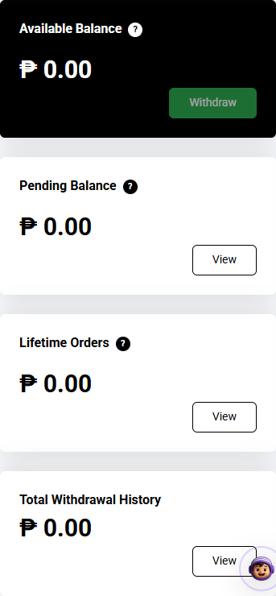

- `02_fix-tablet-picker-700-v4.png` (source: attachment, uploader: Angelo Kamachi)

  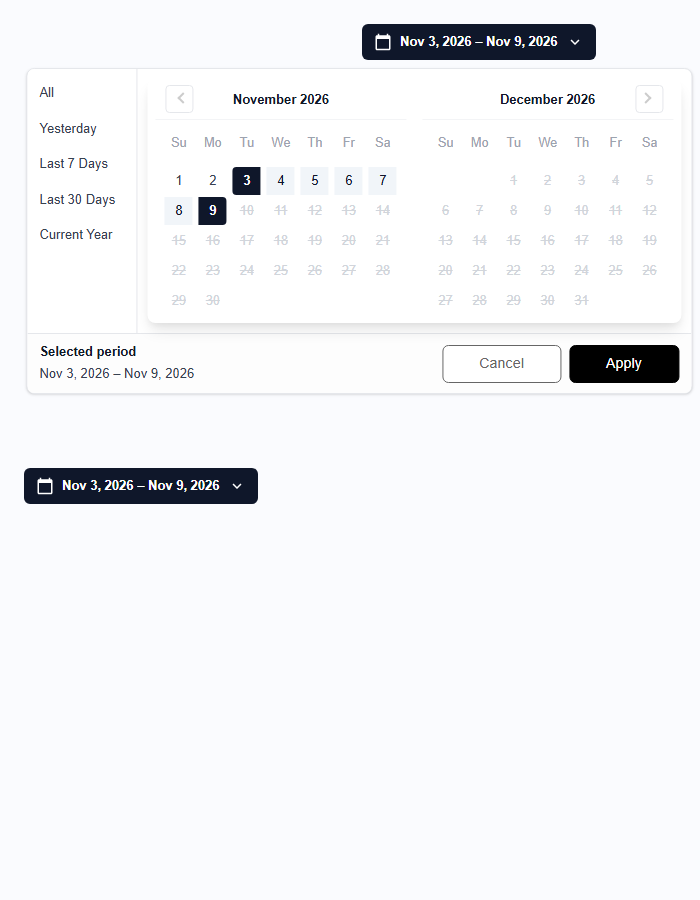

- `03_fix-tablet-picker-768-v4.png` (source: attachment, uploader: Angelo Kamachi)

  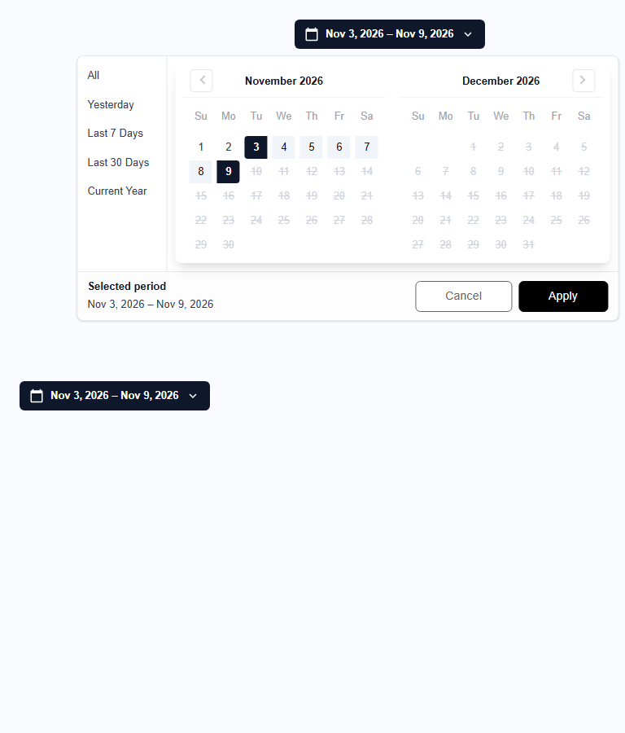

- `04_live-balances-pending-active-1440-v4.png` (source: attachment, uploader: Angelo Kamachi)

  

- `05_live-period-footer-1440-v4.png` (source: attachment, uploader: Angelo Kamachi)

  

- `06_live-period-footer-390-v4.png` (source: attachment, uploader: Angelo Kamachi)

  

- `07_live-leads-create-save-hover-1440-v4.png` (source: attachment, uploader: Angelo Kamachi)

  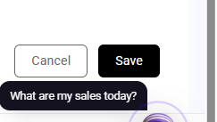

- `08_live-picker-cancel-hover-1440-v4.png` (source: attachment, uploader: Angelo Kamachi)

  

- `09_live-leads-edit-save-hover-1440-v4.png` (source: attachment, uploader: Angelo Kamachi)

  

- `10_live-leads-edit-cancel-hover-1440-v4.png` (source: attachment, uploader: Angelo Kamachi)

  

- `11_live-balances-available-active-1440-v4.png` (source: attachment, uploader: Angelo Kamachi)

  

- `12_live-tablet-bug-768-v4.png` (source: attachment, uploader: Angelo Kamachi)

  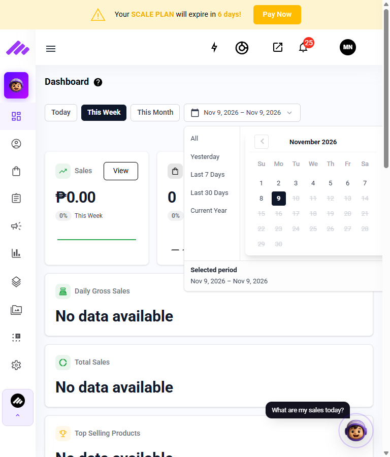

- `13_live-balances-pending-active-390-v4.png` (source: attachment, uploader: Angelo Kamachi)

  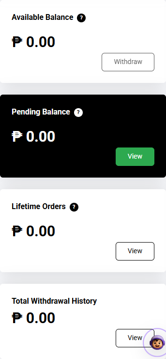

- `14_live-period-footer-320-v4.png` (source: attachment, uploader: Angelo Kamachi)

  

- `15_live-picker-apply-hover-1440-v4.png` (source: attachment, uploader: Angelo Kamachi)

  

- `16_live-leads-create-cancel-hover-1440-v4.png` (source: attachment, uploader: Angelo Kamachi)

  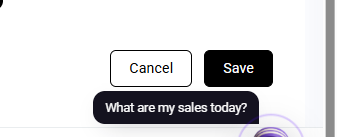

- `17_fix-tablet-picker-820-v4.png` (source: attachment, uploader: Angelo Kamachi)

  

- `18_live-period-footer-375-v4.png` (source: attachment, uploader: Angelo Kamachi)

  

- `19_live-import-hover-1440-v4.png` (source: attachment, uploader: Angelo Kamachi)

  

- `20_balances-pending-active-390-v3.png` (source: attachment, uploader: Angelo Kamachi)

  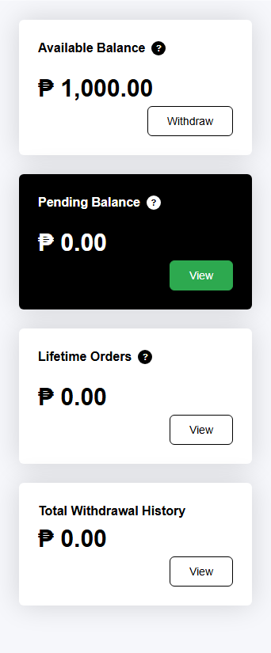

- `21_balances-available-active-390-v3.png` (source: attachment, uploader: Angelo Kamachi)

  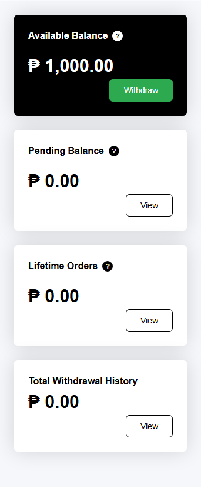

- `22_balances-pending-active-1440-v3.png` (source: attachment, uploader: Angelo Kamachi)

  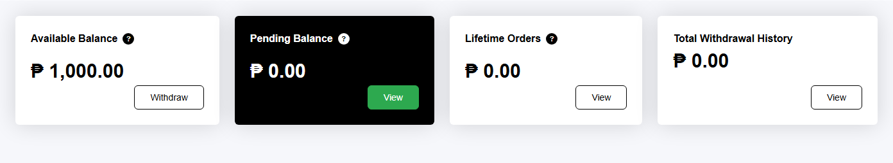

- `23_balances-available-active-1440-v3.png` (source: attachment, uploader: Angelo Kamachi)

  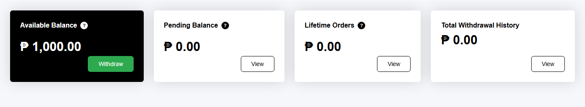

- `24_leads-create-cancel-hover-390-v3.png` (source: attachment, uploader: Angelo Kamachi)

  

- `25_import-hover-1440-v3.png` (source: attachment, uploader: Angelo Kamachi)

  

- `26_leads-edit-save-hover-1440-v3.png` (source: attachment, uploader: Angelo Kamachi)

  

- `27_leads-edit-cancel-hover-1440-v3.png` (source: attachment, uploader: Angelo Kamachi)

  

- `28_leads-create-save-hover-1440-v3.png` (source: attachment, uploader: Angelo Kamachi)

  

- `29_leads-create-cancel-hover-1440-v3.png` (source: attachment, uploader: Angelo Kamachi)

  

- `30_picker-cancel-hover-390-v3.png` (source: attachment, uploader: Angelo Kamachi)

  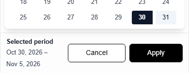

- `31_picker-apply-hover-1440-v3.png` (source: attachment, uploader: Angelo Kamachi)

  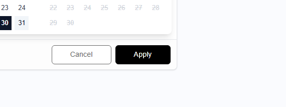

- `32_picker-cancel-hover-1440-v3.png` (source: attachment, uploader: Angelo Kamachi)

  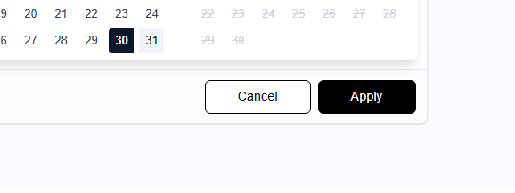

- `33_period-footer-320-v3.png` (source: attachment, uploader: Angelo Kamachi)

  

- `34_period-footer-375-v3.png` (source: attachment, uploader: Angelo Kamachi)

  

- `35_period-footer-390-v3.png` (source: attachment, uploader: Angelo Kamachi)

  

- `36_period-footer-1440-v3.png` (source: attachment, uploader: Angelo Kamachi)

  

- `37_balances-before-prod-p1.png` (source: attachment, uploader: Angelo Kamachi)

  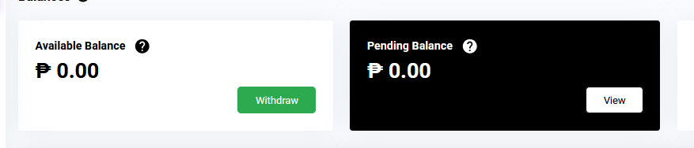

- `38_picker-cancel-hover-390-v2.png` (source: attachment, uploader: Angelo Kamachi)

  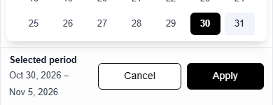

- `39_picker-apply-hover-1440-v2.png` (source: attachment, uploader: Angelo Kamachi)

  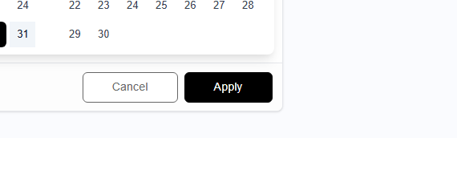

- `40_picker-cancel-hover-1440-v2.png` (source: attachment, uploader: Angelo Kamachi)

  

- `41_period-footer-320-v2.png` (source: attachment, uploader: Angelo Kamachi)

  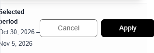

- `42_period-footer-375-v2.png` (source: attachment, uploader: Angelo Kamachi)

  

- `43_period-footer-390-v2.png` (source: attachment, uploader: Angelo Kamachi)

  

- `44_period-footer-1440-v2.png` (source: attachment, uploader: Angelo Kamachi)

  

- `45_picker-cancel-hover-390.png` (source: attachment, uploader: Angelo Kamachi)

  

- `46_leads-create-cancel-hover-390.png` (source: attachment, uploader: Angelo Kamachi)

  

- `47_import-hover-1440.png` (source: attachment, uploader: Angelo Kamachi)

  

- `48_leads-edit-save-hover-1440.png` (source: attachment, uploader: Angelo Kamachi)

  

- `49_leads-edit-cancel-hover-1440.png` (source: attachment, uploader: Angelo Kamachi)

  

- `50_leads-create-save-hover-1440.png` (source: attachment, uploader: Angelo Kamachi)

  

- `51_leads-create-cancel-hover-1440.png` (source: attachment, uploader: Angelo Kamachi)

  

- `52_picker-apply-hover-1440.png` (source: attachment, uploader: Angelo Kamachi)

  

- `53_picker-cancel-hover-1440.png` (source: attachment, uploader: Angelo Kamachi)

  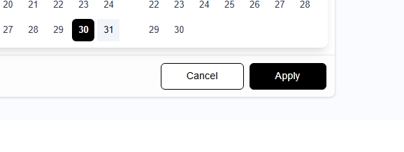

- `54_live-period-footer-1440-v4.png` (source: comment, uploader: Angelo Kamachi)

  

- `55_live-period-footer-390-v4.png` (source: comment, uploader: Angelo Kamachi)

  

- `56_live-period-footer-375-v4.png` (source: comment, uploader: Angelo Kamachi)

  

- `57_live-period-footer-320-v4.png` (source: comment, uploader: Angelo Kamachi)

  

- `58_live-picker-cancel-hover-1440-v4.png` (source: comment, uploader: Angelo Kamachi)

  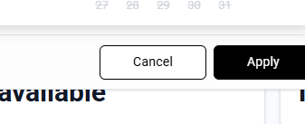

- `59_live-picker-apply-hover-1440-v4.png` (source: comment, uploader: Angelo Kamachi)

  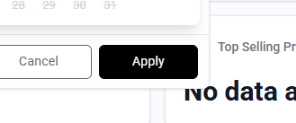

- `60_live-leads-create-cancel-hover-1440-v4.png` (source: comment, uploader: Angelo Kamachi)

  

- `61_live-leads-create-save-hover-1440-v4.png` (source: comment, uploader: Angelo Kamachi)

  

- `62_live-leads-edit-cancel-hover-1440-v4.png` (source: comment, uploader: Angelo Kamachi)

  

- `63_live-leads-edit-save-hover-1440-v4.png` (source: comment, uploader: Angelo Kamachi)

  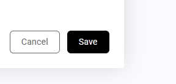

- `64_live-import-hover-1440-v4.png` (source: comment, uploader: Angelo Kamachi)

  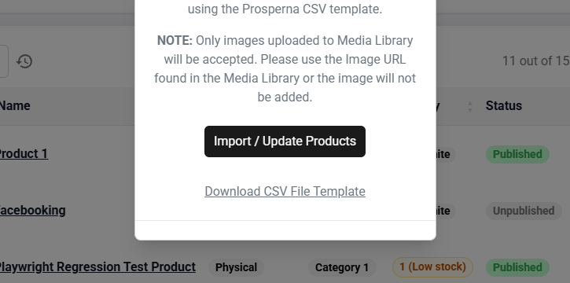

- `65_live-balances-available-active-1440-v4.png` (source: comment, uploader: Angelo Kamachi)

  

- `66_live-balances-pending-active-1440-v4.png` (source: comment, uploader: Angelo Kamachi)

  

- `67_live-balances-available-active-390-v4.png` (source: comment, uploader: Angelo Kamachi)

  

- `68_live-balances-pending-active-390-v4.png` (source: comment, uploader: Angelo Kamachi)

  

- `69_live-tablet-bug-768-v4.png` (source: comment, uploader: Angelo Kamachi)

  

- `70_fix-tablet-picker-768-v4.png` (source: comment, uploader: Angelo Kamachi)

  

- `71_fix-tablet-picker-820-v4.png` (source: comment, uploader: Angelo Kamachi)

  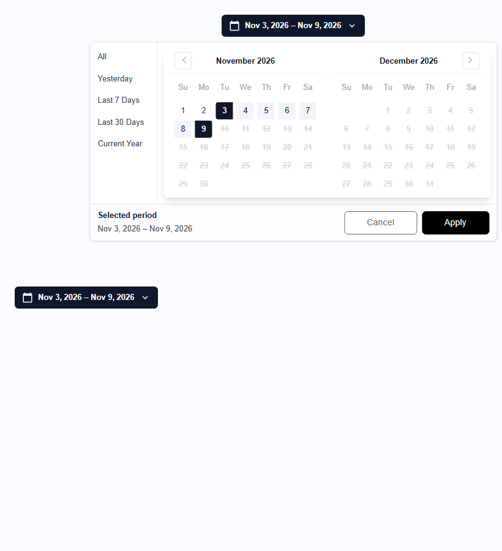

- `72_fix-tablet-picker-700-v4.png` (source: comment, uploader: Angelo Kamachi)

  

- `73_picker-cancel-hover-1440.png` (source: comment, uploader: Angelo Kamachi)

  

- `74_picker-apply-hover-1440.png` (source: comment, uploader: Angelo Kamachi)

  

- `75_leads-create-cancel-hover-1440.png` (source: comment, uploader: Angelo Kamachi)

  

- `76_leads-create-save-hover-1440.png` (source: comment, uploader: Angelo Kamachi)

  

- `77_leads-edit-cancel-hover-1440.png` (source: comment, uploader: Angelo Kamachi)

  

- `78_leads-edit-save-hover-1440.png` (source: comment, uploader: Angelo Kamachi)

  

- `79_import-hover-1440.png` (source: comment, uploader: Angelo Kamachi)

  

- `80_leads-create-cancel-hover-390.png` (source: comment, uploader: Angelo Kamachi)

  

- `81_picker-cancel-hover-390.png` (source: comment, uploader: Angelo Kamachi)

  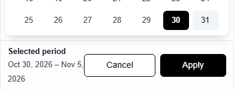

## Comments (13)

### Angelo Kamachi (2026-11-09T02:44:51.159Z)

 QA for the button hover colours, date picker footer, Balances and a tablet bug is posted above (dev, tested live on prodev). Branch fix/kamachi-button-hover-colors; PRs: dev https://github.com/Prosperna/prosperna1/pull/9394 (merged), staging https://github.com/Prosperna/prosperna1/pull/9298, main https://github.com/Prosperna/prosperna1/pull/9299. Everything in scope passes live. Found on dev and not caused by this change: the date picker panel runs off the right edge at 768 and 820px; the fix is checked locally and not deployed yet.@Aira Pilor

### Angelo Kamachi (2026-11-09T02:44:27.656Z)

QA on deployed dev: button hover colours, date picker footer, Balances, and a tablet bug found

ENV: dev (https://prodev.prosperna.com)
BRANCH: fix/kamachi-button-hover-colors

DEV: https://github.com/Prosperna/prosperna1/pull/9394 (merged and live). Earlier PR #9297, merged: https://github.com/Prosperna/prosperna1/pull/9297. The tablet fix has no PR yet.
STAGING: https://github.com/Prosperna/prosperna1/pull/9298
MAIN: https://github.com/Prosperna/prosperna1/pull/9299

What needed changing Why it needed changing How it was changed
Cancel and Save/Apply had different heights and corner radius (date picker, contact create and edit forms) The Tailwind migrations (#7560 dashboard, #7857 contacts) replaced the shared Bootstrap buttons with hand-written ones Shared buttons again (variant cancel / primary): DashboardDatePicker.jsx, LeadFormBody.jsx, edit/index.jsx. Both are 38px tall with a 6px radius. Live on dev (#9297)
Save, Apply and Import / Update Products turned grey on hover Global hover for .btn-primary and .btn-light was grey #4b4b4b Hover uses the $primary token (black): _buttons.scss. Live on dev (#9297)
Cancel hovered grey or black instead of staying white Hard-coded hex hovers in the migrated buttons, and .btn-cancel hovering black .btn-cancel hover is white with $primary text and border: _buttons.scss. Live on dev (#9297)
Contact create and edit forms ignored the new hover colours AppButton is Tailwind based and hard-codes its own hover hex AppButton primary and light hover to bg-primary, cancel stays white with text-primary and border-primary: AppButton.jsx. Live on dev (#9394)
Date picker footer broke a date in the middle on narrow screens (Nov 5, then 2026 on the next line) The selected period was one inline string, so it could wrap at any space, including inside a date Each date is in a no-wrap span (.selected-period-date): DashboardDatePicker.jsx and .css. Live on dev (#9394)
Apply was cut off at 320px after that wrapping fix (found in the earlier local QA) With each date on one line the text could not shrink, and the footer had no way to wrap its buttons Footer wraps (tw:flex-wrap), buttons stay right-aligned (tw:ml-auto), text keeps a small preferred width (tw:flex-[1_1_6.25rem]), plus a footer test: DashboardDatePicker.jsx. Live on dev (#9394)
Balances: Withdraw button was green even on an inactive card (production p1) The old Bootstrap version used the green secondary variant on every card state MAIN ONLY (#9299): Withdraw is secondary only on the active card, light otherwise, in Withdrawals/index.jsx. Dev already behaves this way from its own Finance rewrite (secondary when active, outline when not)
Abandoned Carts Reminder actions menu looked grey on hover Already identical to main: stock Bootstrap menu hover (#f4f6fb), nothing overrides it No code change
FOUND ON LIVE DEV: the date picker panel runs off the right edge at 768 and 820px, so Cancel and Apply cannot be reached From 640px up the picker is a two-month panel (666px wide) anchored to the toggle, which sits about 362px from the left edge, and nothing kept the panel on screen. Not caused by this change; it was already there After the panel opens (and on resize) it is measured and shifted left just enough to fit with an 8px margin (useLayoutEffect + translateX): DashboardDatePicker.jsx plus two tests. NOT DEPLOYED: commit 407a20d1a on the feature branch and a local dev branch, not pushed and no PR yet
SCREENSHOTS, LIVE ON DEV

Date picker footer, 1440px: the period fits on one line, Cancel and Apply on the right

Date picker footer in a 375px wide window: the dates wrap between the dates, beside the buttons

Date picker footer in a 360px wide window: buttons on their own row, all visible

Date picker footer in a 305px wide window: buttons on their own row, Apply fully visible

Date picker, Cancel on hover: stays white, text and border go black

Date picker, Apply on hover: stays black

Contact create form, Cancel on hover: stays white

Contact create form, Save on hover: stays black

Contact edit form, Cancel on hover: stays white

Contact edit form, Save on hover: stays black

Import / Update Products on hover: stays black

Balances, Available active: black card with a green Withdraw (dimmed because this store's balance is 0), 1440px

Balances, Pending active: Available is a white card with an outlined Withdraw, 1440px

Balances, Available active at 390px

Balances, Pending active at 390px

THE TABLET BUG: BEFORE (LIVE ON DEV) AND AFTER (FIX CHECKED LOCALLY)

BEFORE, live on dev at 768px: the panel runs off the right edge, Cancel and Apply are off screen

AFTER (local check on a dev based branch), 768px: whole panel on screen, Cancel and Apply visible

AFTER (local check), 820px

AFTER (local check), 700px: just above the phone sheet cutoff, panel sits next to the left edge

CHECKED
LIVE on deployed dev (prodev.prosperna.com), driven in a Chromium window that was logged in by the user; the deploy of PR #9394 had finished and the page had the new classes. Nothing was saved, applied or withdrawn: hover and measure only. Window widths 1440, 768, 390, 375, 360 and 320 (the page shows 15px less because of the scrollbar, so the narrow layouts measured are 375, 360, 345 and 305). In scope and passing live: Cancel and Apply stay inside the picker at every width; dates wrap between the dates beside the buttons at the 375px layout and the buttons drop to their own row below that; Cancel is white at rest and on hover, Save, Apply and Import are black, all 38px tall with a 6px radius on the contact forms and picker; contact create and edit forms and the Import / Update Products button checked at 1440 and 390; Balances matches the rule in both card states. FOUND: the tablet overflow described in the last table row. It is not part of this change and is not deployed: the fix was checked in a local test page on a dev based branch at 1440, 1280, 1024, 900, 820, 768, 700, 390, 375 and 320px, the same page reproduced the live bug before the fix, and every screenshot was looked at. Tests: 18 picker tests pass, ESLint clean. Limits: the fix is not on dev yet (needs a push and a PR); at about 700px the shifted panel sits close to the left menu; the disabled Withdraw state shows dimmed because the balance is 0; staging was not tested and PR #9298 does not have the footer or Balances fixes.

### Cyril Ayson (2026-11-09T02:39:46.387Z)

READY FOR QA ON DEV (MOBILE PASS 2)

 mobile pass 2 and the Edit Shipping Address error fix are merged to dev (https://github.com/Prosperna/prosperna1/pull/9397). Please retest on dev at phone width (375px) using the QA TEST CASES SUMMARY (MOBILE PASS 2): https://app.clickup.com/t/86eyrdm4y?comment=1100740000255368
Before / after screenshots are under each test case. Give dev about 10 minutes to refresh first.
@Aira Pilor

### Cyril Ayson (2026-11-09T02:26:21.334Z)

QA TEST CASES SUMMARY (MOBILE PASS 2)
LAST UPDATED: 2026-11-09, dev PR https://github.com/Prosperna/prosperna1/pull/9397

WHERE TO TEST
- Environment: dev merchant dashboard, after the dev PR is merged and dev refreshes.
- Device: a phone, or Chrome DevTools device mode at 375 x 812. Desktop checks at 1280px.
- Before / after screenshots are under each test case (before = your Nov 9 screenshot).

TEST CASES (MOBILE, 375px)
1. Edit Shipping Address error
   Steps: Contacts > open a contact whose saved address has no province (the one from your screenshot) > Edit Contact > edit the shipping address.
   Expected: no "provinceAddress must be a string type" message. State/Province is empty with the normal "Required" prompt, and saving works after picking a province, city and barangay.
01-shipping-address-error-before.png

2. Contact profile tabs
   Expected: Contact Details, Order History, Conversations, Senior/PWD stay on one line and the row swipes sideways. Nothing overlaps.
03-contact-tabs-375-before.png
03-contact-tabs-375-after.jpg

3. Discounts
   Expected: the Senior/PWD card text uses the card width, Edit text is centred, and only one Create Discount button shows.
02-discounts-375-before.png
02-discounts-375-after.png

4. Product review detail header
   Expected: product image and name on top, Contact and Unpublish side by side below them.
04-review-header-375-before.png
04-review-header-375-after.jpg

5. Product review replies
   Expected: replies use the screen width; tapping "..." opens a small Edit / Delete menu under the button, not a full-width one.
05-review-replies-375-before.png
05-review-replies-375-after.jpg

6. Product Label chips (product form)
   Expected: each chip (e.g. New, Sale) is one short line with its x next to the label. Applies to other multi-selects too.
06-product-label-chips-375-before.png
06-product-label-chips-375-after-v2.jpg

7. Variant Display Type (product form > Variants)
   Expected: Text, Image and Color Swatch are one per row with their full description visible.
07-variant-display-type-375-before.png
07-variant-display-type-375-after.jpg

8. Related Items Preview (product form)
   Expected: 2 products per row, names wrap normally, "See All >" on one line.
08-related-items-375-before.png
08-related-items-375-after.jpg

9. Product form save bar
   Expected: Duplicate Product full width on top, Cancel and Save side by side below. The Max head sits above the bar and does not cover Save.
09-product-form-actions-375-before.png
09-product-form-actions-375-after.png

10. Blog post editor bar
    Expected: Cancel / Duplicate on the first row, Move to Draft / Update on the second, normal text size. The Max head sits above the bar and does not cover the Update arrow.
10-blog-action-bar-375-before.png
10-blog-action-bar-375-after.jpg

11. Popup builder tabs (Announcements > Popup)
    Expected: Design & Content, Form, Tools, Display Settings stay whole words and the row swipes sideways.
11-popup-tabs-375-before.png
11-popup-tabs-375-after.jpg

12. Create New Add-on popup (product form > Add-ons)
    Expected: the title has space from the left edge; Cancel is black text on white.
12-addon-modal-375-before.png
12-addon-modal-375-after.jpg

13. Order details
    Expected: values (email, status, payment type, tracking link) get more room than the labels, and all rows line up.
13-order-details-375-before.png
13-order-details-375-after.jpg

14. Max head on other bottom bars
    Steps: Announcements, Temporary Close (Store Settings), Inventory with items selected.
    Expected: the Max head always sits above the bottom bar and never covers its buttons.

TEST CASES (DESKTOP, 1280px)
15. Desktop unchanged
    Steps: repeat 2, 4, 9, 10, 13 on desktop.
    Expected: same as before this change, except the Max head now sits above the blog editor bar instead of over Update.

OUT OF SCOPE / KNOWN BEHAVIOR
- Product Reviews list and the Product Description editor were not changed (nothing broken found at 375px).
- The previous QA TEST CASES SUMMARY (pass 1) still applies.

### Cyril Ayson (2026-11-09T02:26:20.872Z)

MOBILE PASS 2 (375px) + SHIPPING ADDRESS ERROR: DEV PR READY

ACCOMPLISHED
Fixed every item from Aira's Nov 9 phone screenshots on dev:
1. Contacts > Edit Shipping Address error ("provinceAddress must be a string type..."): the form filled the province with the whole saved object when it had no name. It now loads as text, the same way city and barangay already did. Traced to commit e5f8cfcd4 (Feb 4); my earlier fix for 86eqqbxed covered city and barangay but missed province. Same code is on prod, so the fix goes up with this task's promotion.
2. Contact profile tabs: stay on one line and scroll sideways (Senior/PWD no longer overlaps Conversations).
3. Product review detail: product name above Contact / Unpublish on phones; replies use the screen width; the Edit / Delete menu no longer stretches across the screen.
4. Product form: variant Display Type cards stack; Related Items show 2 per row; Product Label chips are one line again; the save bar is Duplicate on top, Cancel and Save side by side.
5. Order details: values get more of each row, and all rows line up.
6. Discounts: Senior/PWD card text uses the width, Edit is centred, no second Create Discount button.
7. Blog post editor bar: 2 x 2 buttons at normal size on phones.
8. Popup builder tabs: Form and Tools no longer break mid-word.
9. Create New Add-on popup: padded title, black Cancel.

EXTRA WORK
- Accessibility (WCAG 2.5.8 target size): the floating Max head covered Save / Update on every page with a bottom save bar (product form, blog editor, announcements, temporary close, inventory bulk bar). It now sits above the bar. Also fixed the head stretching after being dragged on a phone.
- The chip "x" fix applies to every multi-select on touch screens, not only Product Labels.
- Moved the touched blog bar and review reply styles from SCSS to Tailwind.

PULL REQUESTS
- DEV: https://github.com/Prosperna/prosperna1/pull/9397 (branch fix/dashboard-mobile-layout-dev-2, cherry-picked from the main-based fix/dashboard-mobile-layout)

HOW IT WAS TESTED
- ESLint and Stylelint on the changed files, tests for every touched screen (1954 passing on dev), production build on both branches.
- Checked each screen in the browser at 375px, plus tablet and desktop to confirm they are unchanged. Every touched button is 44px tall with at least 8px between buttons.

NEXT STEPS
- Merge the dev PR, then QA retests on dev using the QA TEST CASES SUMMARY (MOBILE PASS 2) comment and its screenshots.
- Staging and main promotion after QA approval, together with pass 1.

### ClickBot (2026-11-09T01:50:10.485Z)

This App Wide Cleanup has been move to READY FOR TESTING
Date updated: Nov 9 2026, 9:50AM (Asia/Manila)
Triggered by: Angelo Kamachi

### ClickBot (2026-11-06T05:01:10.009Z)

This App Wide Cleanup has been move to READY FOR TESTING
Date updated: Nov 6 2026, 1:01PM (Asia/Manila)
Triggered by: Cyril Ayson

### Cyril Ayson (2026-11-06T04:59:24.836Z)

READY FOR QA ON DEV

 the mobile layout pass is merged to dev (https://github.com/Prosperna/prosperna1/pull/9381). Please retest on dev at phone width (375px) using the QA TEST CASES SUMMARY: https://app.clickup.com/t/86eyrdm4y?comment=1100740000249257
The expected-result screenshots are attached to this task (file names are listed in each test case).
@Aira Pilor

### Cyril Ayson (2026-11-06T04:53:39.220Z)

MOBILE LAYOUT PASS (375px): DEV PR READY

ACCOMPLISHED
Audited the TO FIX doc pages plus Finance, Settings, Media Library, Marketplace and Storefront on staging at phone width (375px), then fixed every mobile finding:
1. Top bar: on phones it wrapped into two rows (140px) and hid every page title under it. It is now a single 70px row, and the extra mobile padding for pages with the "plan will expire" banner is removed.
2. Floating Max head: smaller on phones and the "Ask me anything" bubble no longer appears there (it covered pagination and bottom buttons).
3. "New version available" message: stacked and raised above the Max head on phones.
4. MaxAI intro popups: compact on phones (shorter video, stacked footer).
5. Empty tables (Discounts, Abandoned Carts, Template Library, User Control, Store Locations, Balances): no more header-only table with a sideways scrollbar on phones.
6. Store Settings and Messaging Settings: the 15+ item sub-menu is now a swipeable chip row on phones.
7. Page-level fixes: Gmail card badge wrapping, Payments / Withdrawal / Marketplace / Shipping padding, Withdrawal label-value gap, Digital Settings options one per row with Save inside the card, Media Library search row and empty-state copy, Design Settings banner contrast and info box, Mega Menu buttons and preset names.

EXTRA WORK
- Moved the styles of every element touched from SCSS to Tailwind (per the repo rule) and deleted three stylesheets.
- Fixed pre-existing lint errors in the touched files (they exist on main and dev too).
- Added the QA screenshots step to our workflow; screenshots for this PR are attached to this task.

PULL REQUESTS
- DEV: https://github.com/Prosperna/prosperna1/pull/9381 (branch fix/dashboard-mobile-layout-dev, cherry-picked from the main-based fix/dashboard-mobile-layout)

HOW IT WAS TESTED
- ESLint and Stylelint on the changed files, targeted unit tests for every touched component (new tests for the empty-table behaviour, the settings chips and Digital Settings), production build.
- Checked every page above in the browser at 375px, plus desktop and tablet to confirm they are unchanged.

NEXT STEPS
- Merge the dev PR, then QA retests on dev using the QA TEST CASES SUMMARY comment and the attached screenshots.
- Staging and main promotion PRs after QA approval. Expect cherry-pick branches: main is behind staging/dev on several of these files (Finance especially).
- Not covered: the desktop styling items in the TO FIX doc (hover colours, Orders close button, Discounts crown icon, cart images, pagination, tooltips) and Mega Menu in the browser (the test account redirects to Max AI).

QA TEST CASES
- Posted a QA TEST CASES SUMMARY comment for this task: https://app.clickup.com/t/86eyrdm4y?comment=1100740000249257

### Cyril Ayson (2026-11-06T04:53:38.643Z)

QA TEST CASES SUMMARY
LAST UPDATED: 2026-11-06, dev PR https://github.com/Prosperna/prosperna1/pull/9381 (merged)

WHERE TO TEST
- Environment: dev merchant dashboard, logged in as a merchant (any plan).
- Device: a phone, or Chrome DevTools device mode at 375 x 812 (iPhone SE / X size). Desktop checks at 1280px wide.
- Screenshots of the expected result are attached to this task (shown under each test case; before = staging today, after = this change).

TEST CASES (MOBILE, 375px)
1. Header and page titles [01-discounts-375-before.jpg / 01-discounts-375-after.jpg]
   Steps: open Discounts, Orders, Contacts, Abandoned Carts, Template Library, Balances, Withdrawal Settings.
   Expected: the top bar is one row (hamburger on the left, icons on the right). The page title (e.g. "Discounts") is fully visible right under it. Nothing is hidden behind the top bar. With the "plan will expire" banner showing, the title still sits right under the bar with no large empty gap.
01-discounts-375-before.jpg
01-discounts-375-after.jpg

2. Hamburger menu
   Steps: tap the hamburger icon.
   Expected: the side menu opens and closes as before.
3. Floating Max head
   Steps: open any listing page and wait 10 seconds.
   Expected: the Max head in the bottom-right is smaller and the "Ask me anything" speech bubble does not appear on phones. Pagination and bottom buttons are not covered.
4. "A new version of Prosperna is available" message (appears after a deploy)
   Expected: the message and its Refresh / Later buttons are stacked, full width, and sit above the Max head.
5. MaxAI intro popups (Orders, Page Builder, Media Library, Mega Menu) [05-page-builder-maxai-modal-375-after.jpg]
   Expected: the popup fits the screen: shorter video, "Don't show this again" above a full-width "Got it" button.
05-page-builder-maxai-modal-375-after.jpg

6. Empty tables
   Steps: open a listing with no results (e.g. search for "zzzz" in Discounts, or a store with no discounts / users / store locations).
   Expected: on phones only the empty-state message shows, with no column header row and no sideways scrollbar. With results, the table header and horizontal scroll work as before.
7. Store Settings sub-menu [02-store-settings-375-before.jpg / 02-store-settings-375-after.jpg]
   Expected: under "Store Settings" the sections show as one row of chips you can swipe sideways (instead of a long list). Tapping a chip scrolls to that section and highlights the chip.
02-store-settings-375-before.jpg
02-store-settings-375-after.jpg

8. Messaging Settings [03-messaging-settings-375-after.jpg]
   Expected: same chip row (Email Integration, Email Templates, Alerts). In the Gmail card the Connected / Not Connected badge sits on its own line and the "Secure OAuth 2.0..." line is not squeezed.
03-messaging-settings-375-after.jpg

9. Digital Product Payment Settings [04-digital-settings-375-after.jpg]
   Expected: Credit Card, E-wallets and Over the Counter are one per line. The Save button is inside the card and full width. Saving still works and still blocks unticking the last option.
04-digital-settings-375-after.jpg

10. Payment Settings [07-payment-settings-375-after.jpg]
    Expected: the provider cards (Xendit etc.) use more of the screen width; text is not cramped.
07-payment-settings-375-after.jpg

11. Marketplace [06-marketplace-375-after.jpg]
    Expected: app cards fill the width with normal side margins (no wide empty gutters).
06-marketplace-375-after.jpg

12. Shipping Settings
    Expected: the "Prosperna Shipping" heading has padding matching the cards below.
13. Withdrawal Settings
    Expected: in Banking Information there is a clear gap between the labels (e.g. "Default Business Bank Account") and the values. The My Banks table uses the full card width.
14. Media Library
    Expected: the Search box and the type filter each take a full row. With an empty library, the message no longer says "on the left column".
15. Design Settings
    Expected: the "Colors & Style has moved" banner text is dark and easy to read. The subdomain info box under "Name Your Online Store" is less padded.
16. Mega Menu (legacy accounts only, newer accounts are redirected to Max AI)
    Expected: Save Changes and Apply Preset to Menu sit side by side at full width; preset names wrap instead of being cut off.

TEST CASES (DESKTOP, 1280px)
17. Desktop unchanged
    Steps: repeat 1, 7, 8, 9 and 6 on desktop.
    Expected: the top bar, Store/Messaging settings side list, tables and Digital Settings look the same as before this change (Save may now sit inside the card).

TEST DATA
- Any merchant account on dev. For empty-table checks use a search term with no matches, or a store with no discounts / users / store locations.
- Mega Menu needs a legacy account (created before the Max AI menu builder); newer accounts are redirected.

OUT OF SCOPE / KNOWN BEHAVIOR
- Tables WITH rows still scroll sideways on phones (intended, the columns need the width).
- Items from the TO FIX doc that are desktop styling (black hover states, Orders close button, Discounts crown icon, Abandoned Carts images, filter hover, pagination style, tooltips) are not part of this PR.
- Calendar and Template Library design are owned by Adrianne.

### Angelo Kamachi (2026-11-05T01:01:32.204Z)

QA: Cancel white and accept buttons black on hover

ENV: dev
BRANCH: fix/kamachi-button-hover-colors

DEV: https://github.com/Prosperna/prosperna1/pull/9297
STAGING: https://github.com/Prosperna/prosperna1/pull/9298
MAIN: https://github.com/Prosperna/prosperna1/pull/9299

WHAT NEEDED CHANGING | WHY IT NEEDED CHANGING | HOW IT WAS CHANGED
Cancel and Save/Apply had different heights and corner radius (dashboard date picker, contact create and edit forms) | The Tailwind migrations (#7560 dashboard, #7857 contacts) replaced the shared Bootstrap buttons with hand-written ones | Date picker and both lead forms use the shared buttons again (variant cancel / primary): DashboardDatePicker.jsx, LeadFormBody.jsx, edit/index.jsx. Both buttons are now 38px tall with a 6px radius
Save, Apply and Import / Update Products turned grey on hover | The global hover for .btn-primary and .btn-light was grey #4b4b4b | Hover now uses the $primary token (black): _buttons.scss
Cancel hovered grey (#999999 / gray-50) or black instead of staying white | Hard-coded hex hovers in the migrated buttons, and .btn-cancel hovering black | .btn-cancel hover is white with $primary text and border: _buttons.scss
Contact create and edit forms ignored the new hover colours | AppButton is Tailwind based and hard-codes its own hover hex (cancel black, primary and light #4b4b4b) | AppButton primary and light hover to bg-primary, cancel stays white with text-primary and border-primary: AppButton.jsx
Abandoned Carts "Reminder actions" menu looked grey on hover | Already identical to main: it uses the stock Bootstrap menu hover (#f4f6fb) and nothing overrides it | No code change

SCREENSHOTS

Date picker, Cancel on hover: stays white, text and border go black

Date picker, Apply on hover: stays black

Contact create form, Cancel on hover: stays white

Contact create form, Save on hover: stays black

Contact edit form, Cancel on hover: stays white

Contact edit form, Save on hover: stays black

Import / Update Products on hover: stays black

Phone width (390px), contact create form Cancel on hover

Phone width (390px), date picker Cancel on hover

CHECKED
Real DashboardDatePicker and AppButton pairs rendered with the app's CSS at 1440px and 390px; hover each control and read the computed style. Cancel is white at rest and on hover (text and border go black). Save, Apply and Import are black at rest and on hover. Cancel and its partner are both 38px tall with a 6px radius. No sideways scroll, no console errors. Tests: 191 passing, ESLint clean. Limit: the lead forms and the Import button were rendered as the same AppButton / btn btn-primary markup, not as the full pages, and this was not run on the deployed dev site. The change is global for .btn-cancel, .btn-primary, .btn-light and AppButton primary, cancel and light.

### Cyril Ayson (2026-08-27T01:12:39.537Z)

Hi, we need to standardize our pagination first for both desktop and mobile, specifically mobile since that is where our work mainly diverges, the desktop pagination seems to be about the same as before.

### ClickBot (2026-08-27T01:02:09.307Z)

This task App Wide Cleanup has been created 
Date: Aug 27 2026, 9:02AM (Asia/Singapore)
By Angelo Kamachi

