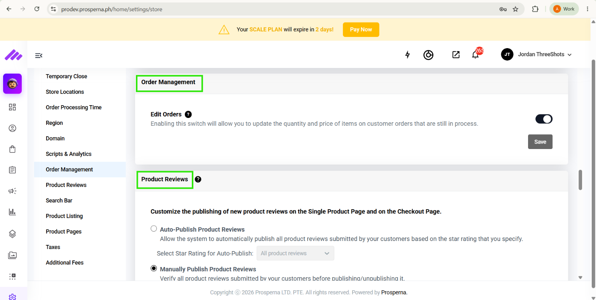
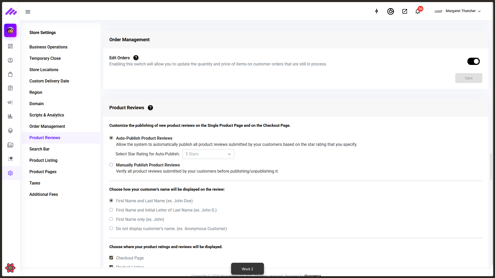

# Merchant Side | Settings | Small Text Fixes to Order Management and Product Review Settings Tab

- **Task ID**: `86ey5tpwr`
- **URL**: https://app.clickup.com/t/86ey5tpwr
- **Status**: deployed to prod
- **Assignees**: Angelo Kamachi, Aira Pilor
- **Created**: 2026-07-05T06:27:06.045Z
- **Updated**: 2026-09-11T03:13:53.555Z
- **List**: P1 Delivery
- **Folder**: Shared with me

## Description

Make these text changes:
1. Change the title from "Order Settings" to "Order Management".
2. Change the title from "Product Review Settings" to "Product Reviews".

See attached screenshot.

## Media (4)

- `01_image.png` (source: attachment, uploader: Aira Pilor)

  

- `02_image.png` (source: attachment, uploader: Angelo Kamachi)

  

- `03_image.png` (source: comment, uploader: Aira Pilor)

  

- `04_image.png` (source: comment, uploader: Angelo Kamachi)

  

## Comments (13)

### ClickBot (2026-09-03T00:34:09.676Z)

This Merchant Side | Settings | Small Text Fixes to Order Management and Product Review Settings Tab has been move to DEPLOYED TO PROD
Date updated: Sep 3 2026, 8:34AM (Asia/Singapore)
Triggered by: Angelo Kamachi

### Angelo Kamachi (2026-09-02T06:00:41.600Z)

PRODUCTION PR READY FOR REVIEW

 the main PR is open and waiting for your review - merging it deploys to production.

MAIN PR: https://github.com/Prosperna/prosperna1/pull/8168
STAGING PR: https://github.com/Prosperna/prosperna1/pull/8154
DEV PR (merged, QA-approved): https://github.com/Prosperna/prosperna1/pull/8143
REPO/BRANCH: prosperna1 / refactor/settings-text

Scope: display text only. Two Store Settings section titles renamed - Order Settings to Order Management, and Product Review Settings to Product Reviews. No behavior, saving, validation, or permission logic touched.
@Ian Pelea

### Angelo Kamachi (2026-09-01T06:55:36.302Z)

PROMOTED TO STAGING

The dev PR was merged, so this change is now promoted to staging.

STAGING PR: https://github.com/Prosperna/prosperna1/pull/8154
DEV PR (merged): https://github.com/Prosperna/prosperna1/pull/8143
REPO/BRANCH: prosperna1 / refactor/settings-text-staging

Note on branching: staging is currently 264 commits behind main, so opening the staging PR from the main-based branch would have pulled 687 unrelated files into staging. A dedicated staging branch was cut from origin/staging instead and only this change's commit was cherry-picked onto it. The diff against staging is exactly the two title lines.

Verification: eslint clean on both changed files. No unit tests to run since neither component has a test file. Diff against staging confirmed to contain only the two renamed titles.

NEXT STEPS

1. Staging PR 8154 needs review and merge.
2. The main PR for the production deploy has NOT been opened yet - it will be raised separately once staging is confirmed.
3. Test cases for verifying this change are in the QA TEST CASES SUMMARY comment: https://app.clickup.com/t/86ey5tpwr?comment=1100740000004435
4. No ops, config, or data work needed - this is display text only.

### ClickBot (2026-09-01T01:57:41.408Z)

This task Merchant Side | Settings | Small Text Fixes to Order Management and Product Review Settings Tab has been move to PASSED TESTING 
Date updated: Sep 1 2026, 9:57AM (Asia/Shanghai)
Triggered by: Aira Pilor

### ClickBot (2026-09-01T01:57:36.828Z)

This task Merchant Side | Settings | Small Text Fixes to Order Management and Product Review Settings Tab hss been move to IN TESTING 
Updated: Sep 1 2026, 9:57AM (Asia/Shanghai)
Triggered by: Aira Pilor

### Aira Pilor (2026-09-01T01:57:33.826Z)

env: DEV
url: https://prodev.prosperna.ph/home/settings/store
Status: PASSED

image.png
Verified that the requested text changes have been implemented.

Moving this task to "Ready for Deployment"
cc @Angelo Kamachi

### Angelo Kamachi (2026-09-01T00:22:43.119Z)

QA TEST CASES SUMMARY
LAST UPDATED: 2026-09-01 - https://github.com/Prosperna/prosperna1/pull/8143

WHERE TO TEST

Environment: dev
Page: Store Settings, reached from the left sidebar gear icon. URL path /home/settings/store
Preconditions: log in as a merchant. Both sections are visible on any plan - on a free plan they show a crown upgrade icon beside the title, which is existing behavior and not part of this change.

TEST CASES

1. Order Management section title
   Setup: log in as a merchant and open Store Settings.
   Steps: scroll to the section containing the "Edit Orders" toggle. You can also click "Order Management" in the settings sidebar to jump to it.
   EXPECTED: the section heading reads exactly "Order Management". It must NOT read "Order Settings" anywhere on the page.

2. Product Reviews section title
   Setup: same as above.
   Steps: scroll to the section containing the "Auto-Publish Product Reviews" and "Manually Publish Product Reviews" radio options.
   EXPECTED: the section heading reads exactly "Product Reviews". It must NOT read "Product Review Settings" anywhere on the page.

3. Titles match the sidebar labels
   Setup: same as above.
   Steps: compare each section heading against its entry in the Store Settings sidebar navigation.
   EXPECTED: the sidebar already reads "Order Management" and "Product Reviews", and the section headings now match them word for word.

4. Nothing else on either section changed
   Setup: same as above.
   Steps: in the Order Management section, toggle "Edit Orders" and click Save. In the Product Reviews section, switch between "Auto-Publish Product Reviews" and "Manually Publish Product Reviews", change the star rating dropdown, and save.
   EXPECTED: every control behaves exactly as it did before. Settings save successfully and persist after a page refresh. Only the two headings changed.

5. Help tooltip beside the Product Reviews title
   Setup: same as above.
   Steps: click or hover the round question-mark icon next to the "Product Reviews" heading.
   EXPECTED: the tooltip still opens and still reads "Manage review approval and display settings to build trust and boost purchase confidence." The tooltip text was not part of this change.

6. Free-plan crown icon still shows
   Setup: log in as a merchant on a free or non-upgraded plan.
   Steps: open Store Settings and look at both section headings.
   EXPECTED: the crown upgrade icon still appears beside both renamed titles, positioned the same as before.

TEST DATA

No special test data needed. Any merchant account on dev with access to Store Settings is enough. To cover test case 6, a non-upgraded or free-plan merchant account is needed - if one is not available on dev, ask a developer to point you to one.

OUT OF SCOPE / KNOWN BEHAVIOR

- Display text only. No behavior, saving, validation, or permission logic was touched.
- The sidebar navigation labels were already correct before this change and were not modified.
- The crown upgrade icon and the upgrade prompt on non-upgraded plans are existing behavior - do not flag them as new.
- The visual styling of these two sections on dev already differs from production because of a separate ongoing Tailwind refactor that landed on dev earlier. That styling difference is not part of this task - do not flag it.
- Other Store Settings sections were not touched and their titles are unchanged.

### Angelo Kamachi (2026-09-01T00:22:21.584Z)

ACCOMPLISHED

Both text changes from the task description and screenshot are done.

1. Changed the section title "Order Settings" to "Order Management".
2. Changed the section title "Product Review Settings" to "Product Reviews".

Both titles now match their corresponding labels in the Store Settings sidebar navigation.

Files changed:
- src/pages/home/StoreSettings/components/OrderSettings/index.jsx
- src/pages/home/StoreSettings/components/ProductReview/index.jsx

EXTRA WORK

None beyond the task scope. One thing worth noting: there is another "Order Settings" occurrence in src/constants/services.js, but it is a code comment labeling an API constant, not text the merchant ever sees. It was intentionally left alone.

PULL REQUESTS

Repo: prosperna1
Dev PR: https://github.com/Prosperna/prosperna1/pull/8143
Branch: refactor/settings-text-dev1 (cherry-pick branch off dev)

Note on branching: dev already carries the Tailwind refactor of these two components while main still has the older Bootstrap version, so the cherry-pick onto dev conflicted. It was resolved in favor of dev's newer structure with only the two title renames re-applied on top. The main-based branch refactor/settings-text is held for the staging and main promotion after QA approval.

HOW IT WAS TESTED

- Ran eslint with autofix on both changed files - clean, no issues.
- No targeted unit tests to run: neither component has a test file, and no test or translation file asserts the old title strings.
- Verified the diff against dev contains only the two title lines and nothing else.

NEXT STEPS

1. QA to validate on dev once PR 8143 is merged - see the QA TEST CASES SUMMARY comment linked below.
2. After QA approval, promotion PRs to staging and main will be opened from the main-based branch.
3. No ops, config, or data work needed - this is display text only.

QA TEST CASES

QA TEST CASES SUMMARY comment created for this PR: https://app.clickup.com/t/86ey5tpwr?comment=1100740000004435

### Angelo Kamachi (2026-09-01T00:18:50.424Z)

image.png

### Angelo Kamachi (2026-08-31T22:53:23.229Z)

Sure boss!

### Dennis Velasco (2026-08-31T22:52:39.764Z)

@Angelo Kamachi Can you please do this small text fix?

### Dyne (2026-08-03T08:26:33.741Z)

Checking on this

### Dyne (2026-07-06T10:31:19.716Z)

@Dennis Velasco  please help assign this task

