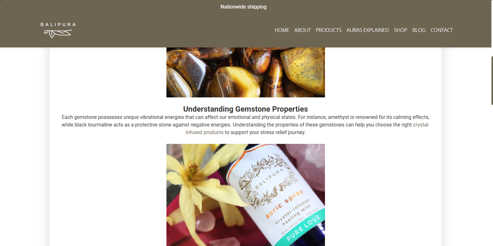
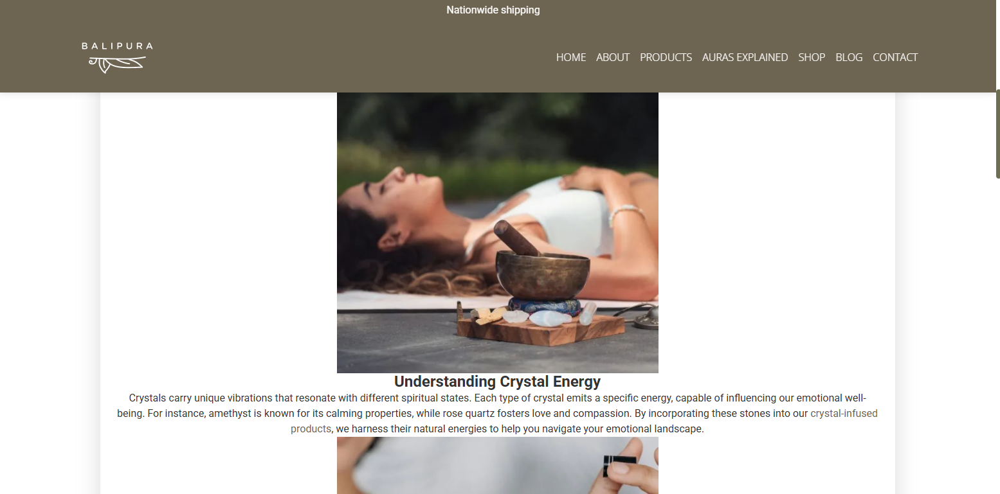
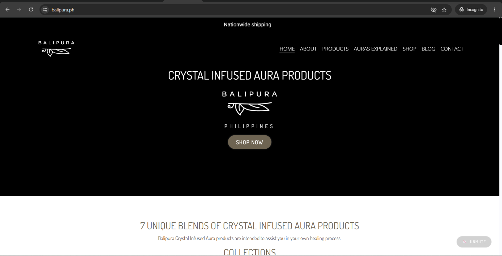
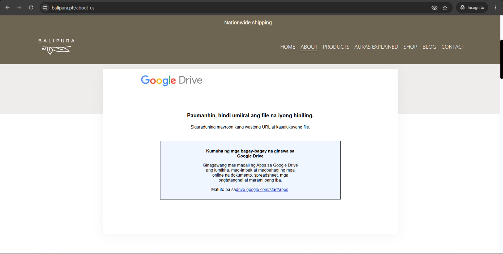
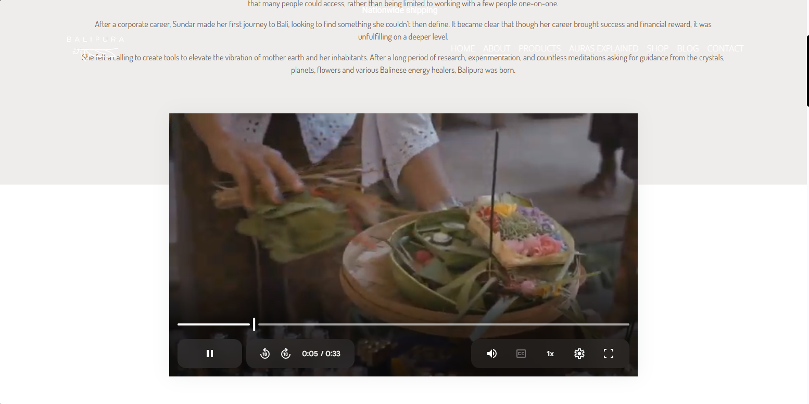
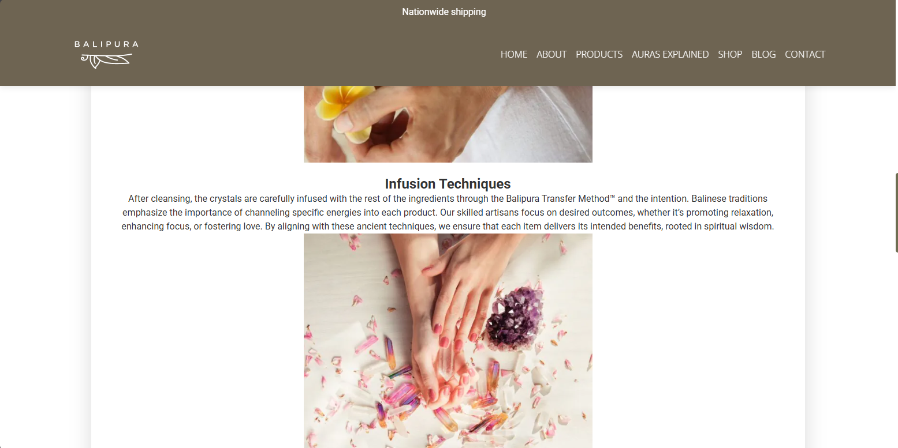
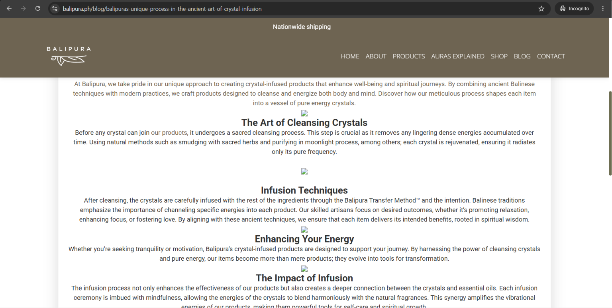
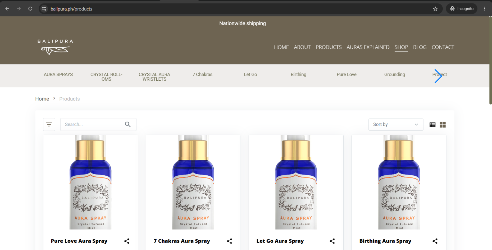
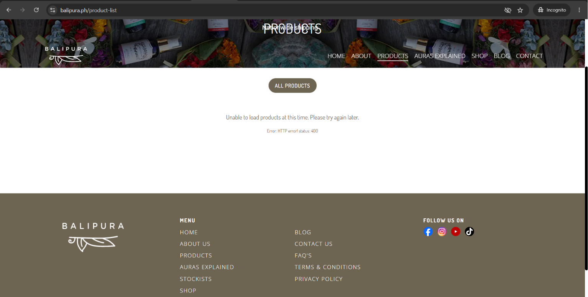

# Website Restore | Balipura

- **Task ID**: `86eyfnygq`
- **URL**: https://app.clickup.com/t/86eyfnygq
- **Status**: deployed to prod
- **Assignees**: Aira Pilor, Angelo Kamachi
- **Created**: 2026-07-31T04:03:55.779Z
- **Updated**: 2026-09-23T02:09:46.899Z
- **List**: P1 Customer Delivery
- **Folder**: Shared with me

## Description

_No description_

## Media (20)

- `01_image.png` (source: attachment, uploader: Angelo Kamachi)

  

- `02_image.png` (source: attachment, uploader: Angelo Kamachi)

  

- `03_image.png` (source: attachment, uploader: Angelo Kamachi)

  

- `04_image.png` (source: attachment, uploader: Angelo Kamachi)

  

- `05_image.png` (source: attachment, uploader: Angelo Kamachi)

  

- `06_image.png` (source: attachment, uploader: Aira Pilor)

  

- `07_image.png` (source: attachment, uploader: Aira Pilor)

  

- `08_image.png` (source: attachment, uploader: Aira Pilor)

  

- `09_image.png` (source: attachment, uploader: Aira Pilor)

  

- `10_image.png` (source: attachment, uploader: Aira Pilor)

  

- `11_image.png` (source: comment, uploader: Angelo Kamachi)

  

- `12_image.png` (source: comment, uploader: Angelo Kamachi)

  

- `13_image.png` (source: comment, uploader: Angelo Kamachi)

  

- `14_image.png` (source: comment, uploader: Angelo Kamachi)

  

- `15_image.png` (source: comment, uploader: Angelo Kamachi)

  

- `16_image.png` (source: comment, uploader: Aira Pilor)

  

- `17_image.png` (source: comment, uploader: Aira Pilor)

  

- `18_image.png` (source: comment, uploader: Aira Pilor)

  

- `19_image.png` (source: comment, uploader: Aira Pilor)

  

- `20_image.png` (source: comment, uploader: Aira Pilor)

  

## Comments (9)

### Dennis Velasco (2026-08-26T23:47:46.398Z)

@Fro Oliva Any feedback from Tam?
Please get her change requests ASAP as the interns are starting to wrap up their tasks.

### Aira Pilor (2026-08-03T09:10:26.030Z)

Store Name: Balipura
url: https://www.balipura.ph/
Status: 100% DONE

GDrive for Images:
Drive for Website: https://drive.google.com/drive/folders/1XMOB21OR9Gb4FoCWGMqL1HEh25OVIcJn?usp=sharing

Moving this task to "Waiting For Client Review"
cc @Angelo Kamachi @Dyne @Fro Oliva @Dennis Velasco

### Angelo Kamachi (2026-08-03T02:29:21.562Z)

@Aira Pilor All returns have been fixed, ready for testing again

### Angelo Kamachi (2026-08-03T02:28:24.501Z)

image.png
PRODUCTS page has been unpublished and removed from nav bar

### Angelo Kamachi (2026-08-03T02:26:21.078Z)

image.png
about page video has been uploaded
warning: to do this, the existing google drive link was replaced with my own google drive link. Meaning the video replies on my prosperna account. It could be that if my prosperna account gets deleted, so would the video

addressing this dependency

### Angelo Kamachi (2026-08-03T02:23:52.265Z)

image.png
image.png
image.png
fixed blog images with the help of Kuya Ian's fix

### Angelo Kamachi (2026-08-03T02:21:52.588Z)

home page already has video banner, it only takes a while to fully load

### Aira Pilor (2026-08-03T01:37:10.278Z)

Store Name: Balipura
url: https://www.balipura.ph/
Status: 89% DONE

TO DO:
Put this video at the home page (banner)
       https://drive.google.com/drive/folders/1waXNVLUgjtrN01nr0Cv2FLl9Upu8rT6A?usp=drive_link
image.png
Replace/Remove these broken images on each blog:
image.png
Put this video at the About Us page (the broken gdrvie link). https://drive.google.com/drive/folders/1waXNVLUgjtrN01nr0Cv2FLl9Upu8rT6A?usp=drive_link
image.png
Either Delete the "PRODUCTS" section or load the same content of "SHOP" section under "PRODUCTS" section.
image.png
image.png

Moving this task to "IN DEVELOPMENT"
cc @Angelo Kamachi @Dyne @Fro Oliva @Dennis Velasco

### Dennis Velasco (2026-08-03T00:59:45.095Z)

@Aira Pilor Can you finish the QA on this today?

