# Merchant Side | Images from S3 Bucket to Repository Based

- **Task ID**: `86eyheppd`
- **URL**: https://app.clickup.com/t/86eyheppd
- **Status**: deployed to prod
- **Assignees**: Angelo Kamachi, Aira Pilor
- **Created**: 2026-08-05T06:26:52.466Z
- **Updated**: 2026-08-07T12:18:44.446Z
- **List**: P1 Delivery
- **Folder**: Shared with me

## Description

This task is to replace all the affected icons on the marketplace page since the 7/11 attack. These icons have been encrypted and shows as broken

## Media (26)

- `01_image.png` (source: attachment, uploader: Aira Pilor)

  

- `02_image.png` (source: attachment, uploader: Angelo Kamachi)

  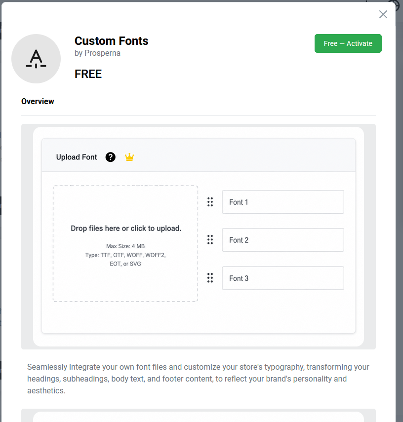

- `03_image.png` (source: attachment, uploader: Angelo Kamachi)

  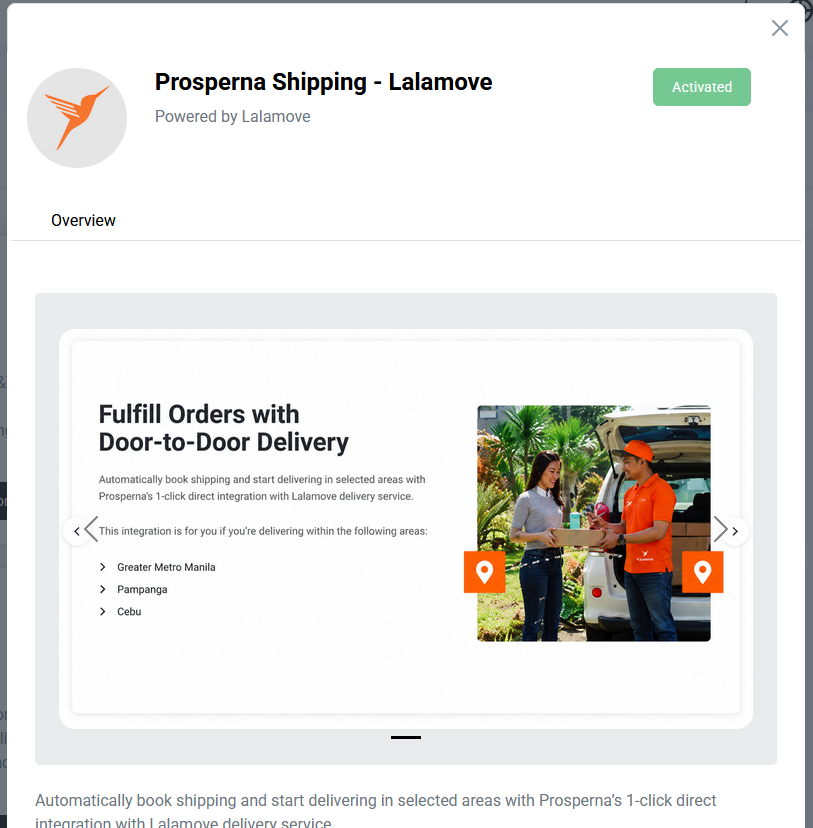

- `04_image.png` (source: attachment, uploader: Angelo Kamachi)

  

- `05_image.png` (source: attachment, uploader: Angelo Kamachi)

  

- `06_image.png` (source: attachment, uploader: Angelo Kamachi)

  

- `07_image.png` (source: attachment, uploader: Angelo Kamachi)

  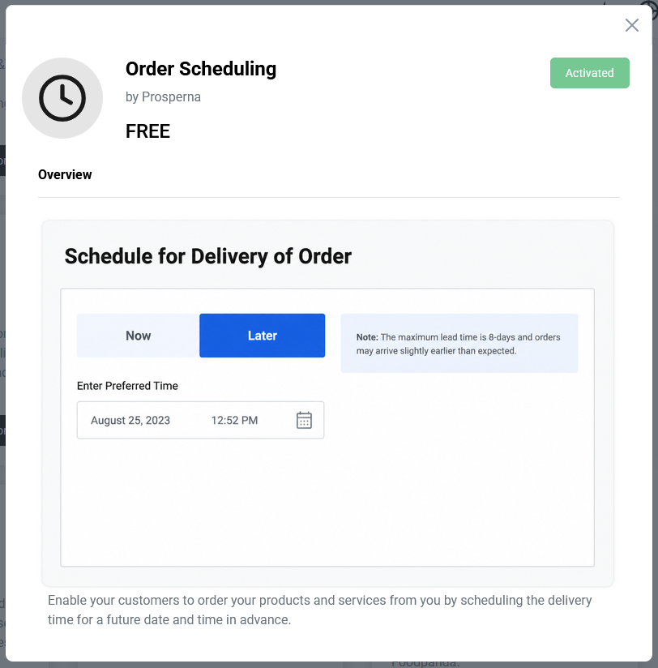

- `08_image.png` (source: attachment, uploader: Angelo Kamachi)

  

- `09_image.png` (source: attachment, uploader: Angelo Kamachi)

  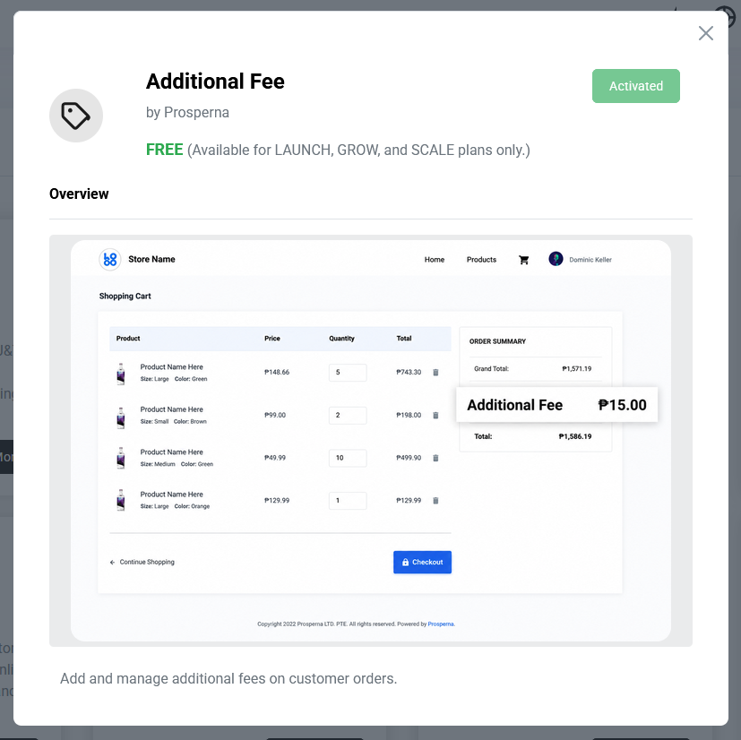

- `10_image.png` (source: attachment, uploader: Angelo Kamachi)

  

- `11_image.png` (source: attachment, uploader: Angelo Kamachi)

  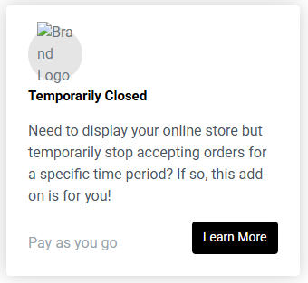

- `12_image.png` (source: attachment, uploader: Angelo Kamachi)

  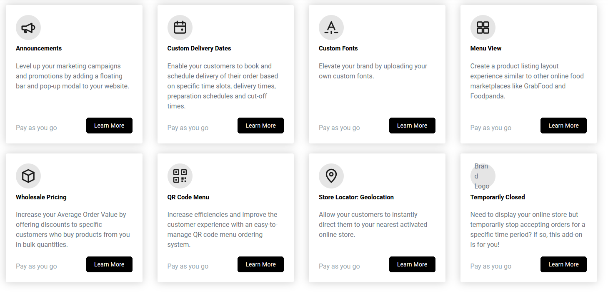

- `13_image.png` (source: attachment, uploader: Angelo Kamachi)

  

- `14_image.png` (source: comment, uploader: Aira Pilor)

  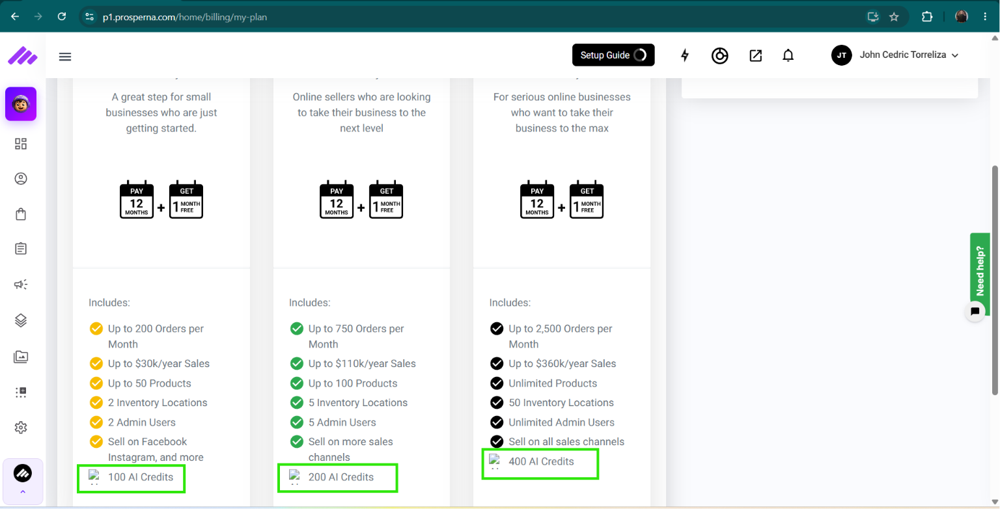

- `15_image.png` (source: comment, uploader: Angelo Kamachi)

  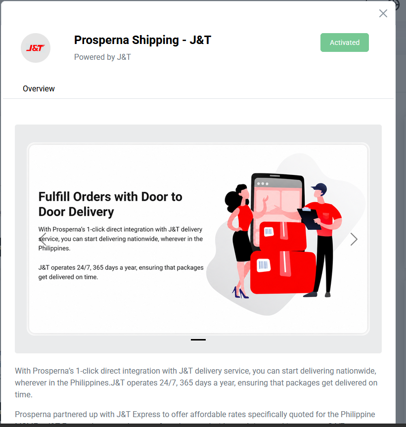

- `16_image.png` (source: comment, uploader: Angelo Kamachi)

  

- `17_image.png` (source: comment, uploader: Angelo Kamachi)

  

- `18_image.png` (source: comment, uploader: Angelo Kamachi)

  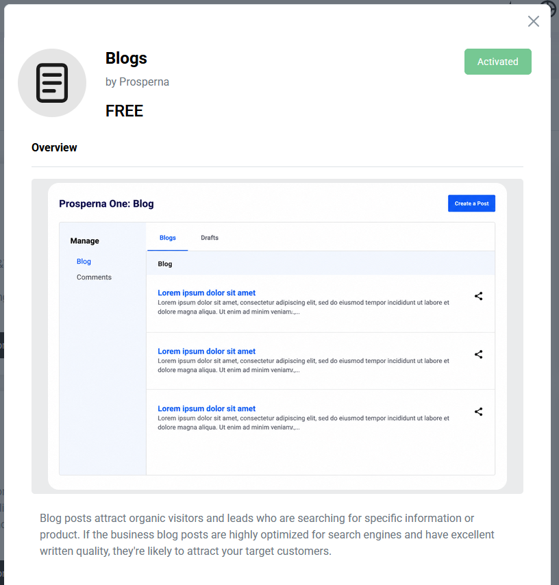

- `19_image.png` (source: comment, uploader: Angelo Kamachi)

  

- `20_image.png` (source: comment, uploader: Angelo Kamachi)

  

- `21_image.png` (source: comment, uploader: Angelo Kamachi)

  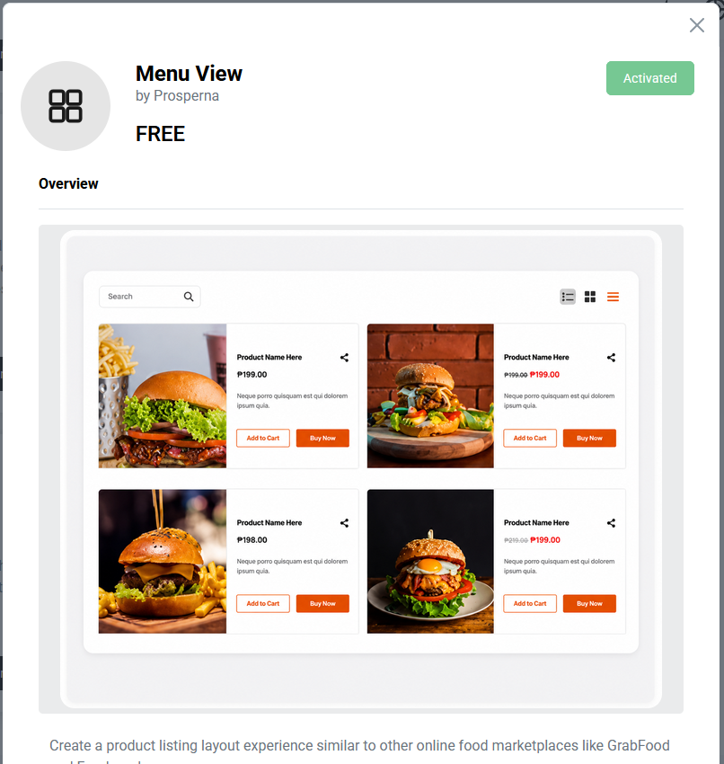

- `22_image.png` (source: comment, uploader: Angelo Kamachi)

  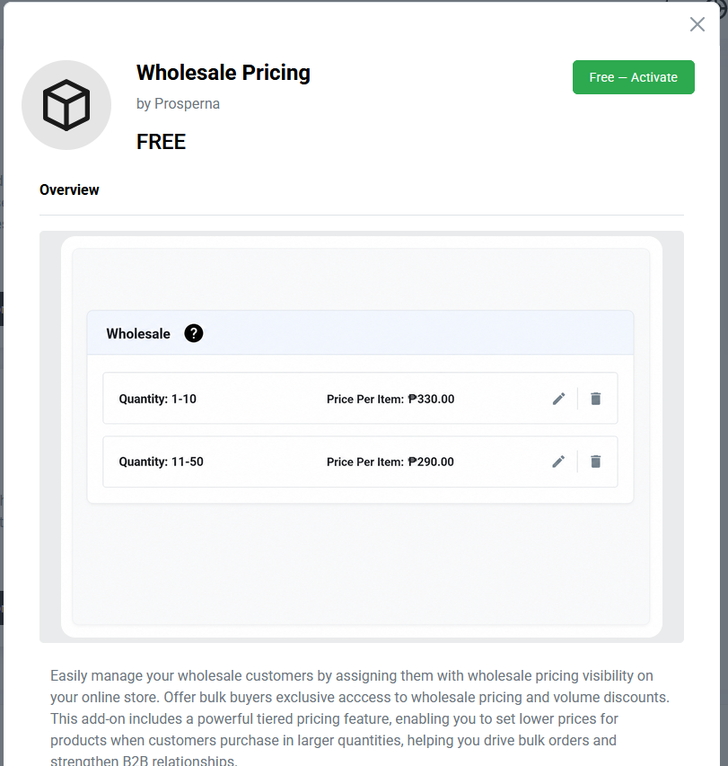

- `23_image.png` (source: comment, uploader: Angelo Kamachi)

  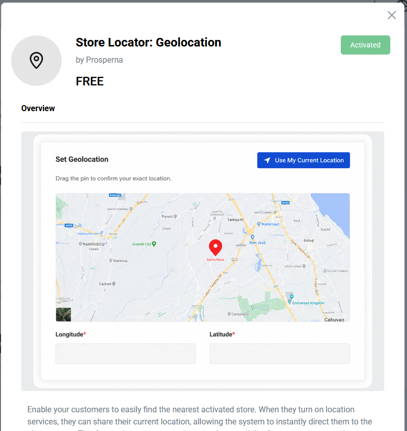

- `24_image.png` (source: comment, uploader: Angelo Kamachi)

  

- `25_image.png` (source: comment, uploader: Angelo Kamachi)

  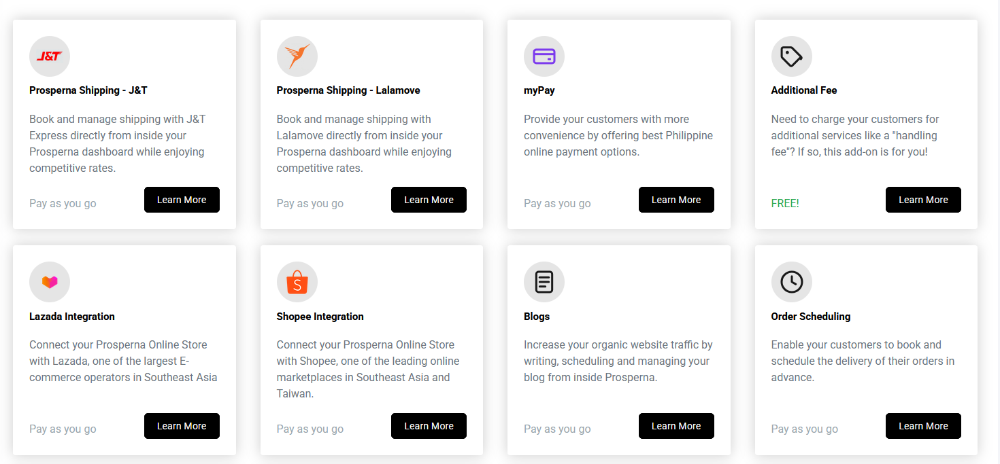

- `26_image.png` (source: comment, uploader: Angelo Kamachi)

  

## Comments (16)

### ClickBot (2026-08-07T12:18:44.446Z)

This Merchant Side | Images from S3 Bucket to Repository Based has been move to DEPLOYED TO PROD
Date updated: Aug 7 2026, 8:18PM (Asia/Singapore)
Triggered by: Angelo Kamachi

### Aira Pilor (2026-08-07T10:44:57.232Z)

env: PRODUCTION
Status: VERIFIED

There's no broken images on the Merchant Side.
https://t7537039.p.clickup-attachments.com/t7537039/cb7596e9-57fc-40e1-93a0-f736ece6ec3f/20260807-1032-24.3698018.mp4?view=open
Note:
The developer is currently fixing the broken Billing icons.
image.png

  2. Since we are now starting to limit the merchants to create a page inside the legacy page builder, I am recommending to skip this issue:
When Creating a selected theme inside the page builder, the images on that theme are broken.

We can now close this task.
cc  @Angelo Kamachi @Ian Pelea @Dennis Velasco

### Aira Pilor (2026-08-07T07:45:50.906Z)

env: DEV
Status: 2/3 FAILED

Fix issued under these subtasks:
86eyhy604
86eyhy744

Moving this task to "IN DEVELOPMENT"
cc @Angelo Kamachi

### ClickBot (2026-08-07T07:45:49.953Z)

This task Merchant Side | Images from S3 Bucket to Repository Based has been move back to IN DEVELOPMENT 
as tag QA return
Date updated: Aug 7 2026, 3:45PM (Asia/Shanghai)
Triggered by: Aira Pilor

### ClickBot (2026-08-07T07:44:34.660Z)

This task Merchant Side | Images from S3 Bucket to Repository Based hss been move to IN TESTING 
Updated: Aug 7 2026, 3:44PM (Asia/Shanghai)
Triggered by: Aira Pilor

### Angelo Kamachi (2026-08-07T05:35:32.677Z)

@Aira Pilor ready for testing, thank you!

### ClickBot (2026-08-07T04:05:45.207Z)

This Merchant Side | Images from S3 Bucket to Repository Based has been move to READY FOR TESTING
Date updated: Aug 7 2026, 12:05PM (Asia/Singapore)
Triggered by: Angelo Kamachi

### Angelo Kamachi (2026-08-06T08:18:47.136Z)

ACCOMPLISHED
- Replaced the broken API-driven carousel images in the marketplace app detail modals (Additional Fee, Blogs, Custom Fonts, JNT, Lalamove, Menu View, Order Scheduling, Geolocation, Wholesale) with local overview screenshots.
- Fixed several modal header icons that were still pulling straight from the API icon field (often broken) instead of the local icon override.
- Fixed a hardcoded dead icon URL in the Geolocation modal.
- Fixed several modals where the logo image had no size constraint and could overflow its circular badge (e.g. J&T logo rendering oversized and off-center) by adding img-fluid and fixing a missing centering class.
- Standardized the circular icon badge size across all modals (some were using a smaller badge than others).

EXTRA WORK
- Investigated a customer-facing Temporarily Closed store banner/modal (separate from marketplace icons) and confirmed its API source is in a different repo entirely (p1-customer + business-profile-api), not something fixable in prosperna1. No code change made for that, informational only.

PULL REQUESTS
- Dev PR: https://github.com/Prosperna/prosperna1/pull/7719 (branch fix/marketplace-icons-dev, repo prosperna1)
- Note: this is a follow-up to the already-merged dev PR #7693 on this same task, since new fixes were made after that one merged.

HOW IT WAS TESTED
- npx eslint clean on all changed files
- Marketplace vitest suite: 12 test files / 196 tests passing
- Manual review of each new modal overview image before wiring in

NEXT STEPS
- QA to re-validate the marketplace app detail modals on dev, focused on: overview images actually loading (not broken), header icons sized correctly and centered, consistent badge size across all modals.
- After QA approval, promote to staging and main together with #7693 if not already promoted.

QA TEST CASES
- QA TEST CASES SUMMARY comment updated for this PR, see https://app.clickup.com/t/86eyheppd?comment=90180244027072

### Angelo Kamachi (2026-08-06T06:36:54.194Z)

image.png
image.png
image.png
image.png
image.png
image.png
image.png
image.png
image.png
attempts to recover as much of the original images

### Angelo Kamachi (2026-08-05T08:00:55.545Z)

image.png
Temporarily closed is a card that does not appear in the p1 repository
GET {businessProfileAPI}/store/temporary-close/store-locations
GET {businessProfileAPI}/store/temporary-close/details
PATCH {businessProfileAPI}/store-locations/{id}/temporary-close
PUT {businessProfileAPI}/store/update/temporary-close/details

all details regarding this has been fetched from another repository

### Angelo Kamachi (2026-08-05T07:55:30.301Z)

@Aira Pilor  ready for first testing, thank you!

### ClickBot (2026-08-05T07:55:03.373Z)

This Merchant Side | Marketplace Icons has been move to READY FOR TESTING
Date updated: Aug 5 2026, 3:55PM (Asia/Singapore)
Triggered by: Angelo Kamachi

### Angelo Kamachi (2026-08-05T06:57:51.289Z)

QA TEST CASES SUMMARY
LAST UPDATED: 2026-08-06, dev PR https://github.com/Prosperna/prosperna1/pull/7719

WHERE TO TEST
- Environment: dev
- Page: /home/marketplace (Marketplace page), both the All tab and My Apps tab
- Also check the Shopee and Lazada connect-account modals (opened from the Shopee/Lazada marketplace cards)
- Also open the detail modal for each of: Additional Fee, Blogs, Custom Fonts, JNT (Prosperna Shipping), Lalamove, Menu View, Order Scheduling, Geolocation, Wholesale (updated for PR #7719)
- No special plan/account precondition needed to view icons

TEST CASES
1. Open /home/marketplace, All tab.
   EXPECTED: every app card shows a clear, non-blank icon (no broken image icon, no stretched/blurry image). Confirm icons for: J&T, Lalamove, LBC, myPay, Additional Fee, Lazada Integration, Shopee Integration, Blogs, Order Scheduling, Custom Delivery Date, Custom Fonts, Wholesale, Menu View, QR Menu, Geolocation, Multi-currency (US stores only).
2. Switch to My Apps tab (any apps already activated on the test store).
   EXPECTED: same icon set renders correctly for activated apps, matching what is shown on the All tab for that same app.
3. Click into the Shopee Integration card to open its connect modal.
   EXPECTED: modal header shows the Shopee bag icon (orange), not a broken image or the old placeholder.
4. Click into the Lazada Integration card to open its connect modal.
   EXPECTED: modal header shows the Lazada logo icon, not a broken image or the old placeholder.
5. Compare icon size to before this change.
   EXPECTED: icons appear noticeably larger inside their circular badge (previously very small/tiny relative to the badge).
6. If the test store is a US store, check the Multi-currency card on the All tab.
   EXPECTED: multi-currency icon loads (no broken image), same visual treatment as other cards.
7. Click into each of these cards to open its detail modal: Additional Fee, Blogs, Custom Fonts, JNT (Prosperna Shipping), Lalamove, Menu View, Order Scheduling, Geolocation, Wholesale. (new, PR #7719)
   EXPECTED: the header logo is a normal size, fully inside the circular badge, and centered (not oversized, not overflowing past the badge, not shifted to a corner). The Overview tab shows a real screenshot of the feature, not a broken image icon.
8. Compare the circular badge size across the different app detail modals from test case 7. (new, PR #7719)
   EXPECTED: all app modals use the same badge size. Before this fix, some modals (e.g. Additional Fee, JNT/Lalamove shipping modals) used a visibly smaller badge than others (e.g. Blogs, Wholesale).

TEST DATA
- No special store/order IDs needed - any dev-environment store account works for viewing the Marketplace page.
- For My Apps tab coverage, use a store that already has at least one add-on activated (e.g. Additional Fee or Blogs) - ask a dev if none is available in the shared QA store.
- For multi-currency card visibility, a store flagged as a US merchant store is needed - ask a dev to point to one if not available.

OUT OF SCOPE / KNOWN BEHAVIOR
- LBC, Wholesale, Menu View, QR Menu, and Geolocation now show a newly-created simple flat icon (not a photo-real brand logo) - this is expected, not a bug, since no branded asset existed for them before.
- Icon artwork/style differences between apps (some are brand-colored logos, some are plain black line icons) are intentional, not inconsistency bugs.
- QR Menu and Shopee/Lazada Learn More modals still use the original API-provided overview content (no local screenshot override yet) - this is expected, not part of this fix.
- Any icon or modal-image issue on staging or main is expected right now - this fix is only on dev until QA approves.

### Angelo Kamachi (2026-08-05T06:57:23.234Z)

ACCOMPLISHED
- Replaced hardcoded S3 bucket icon links with local repo icons across the Marketplace page: multi-currency modal icon, and the Shopee/Lazada connect-account modal icons.
- Marketplace app card icons (All tab and My Apps tab) now prefer a local repo icon over whatever icon URL the backend API returns, whenever one exists for that app.
- Generated a new consistent flat-icon set for apps that previously had no icon at all: LBC, Wholesale, Menu View, QR Menu, Geolocation.
- Swapped in the merchant-provided brand images for JNT, Lalamove, and Lazada, resized down to a reasonable icon footprint.
- Increased the icon display size so logos are not tiny inside their circular badge.

EXTRA WORK
- None beyond task scope.

PULL REQUESTS
- Dev PR: https://github.com/Prosperna/prosperna1/pull/7693 (branch fix/marketplace-icons-dev, single repo: prosperna1)

HOW IT WAS TESTED
- npx eslint clean on all changed JS/JSX files
- npx stylelint clean on marketplace.scss
- Marketplace vitest suite: 14 test files / 193 tests passing
- Manual visual review of every new/replaced icon asset before wiring in

NEXT STEPS
- QA to validate on dev: open /home/marketplace, check icons render correctly on both the All and My Apps tabs, and check the Shopee/Lazada connect modal icons.
- After QA approval, promote to staging and main.

QA TEST CASES
- QA TEST CASES SUMMARY comment posted separately on this task, see next comment.

### Angelo Kamachi (2026-08-05T06:29:54.234Z)

image.png
image.png
all icons have been replaced

### ClickBot (2026-08-05T06:26:53.482Z)

This task Merchant Side | Marketplace Icons has been created 
Date: Aug 5 2026, 2:26PM (Asia/Singapore)
By Angelo Kamachi

