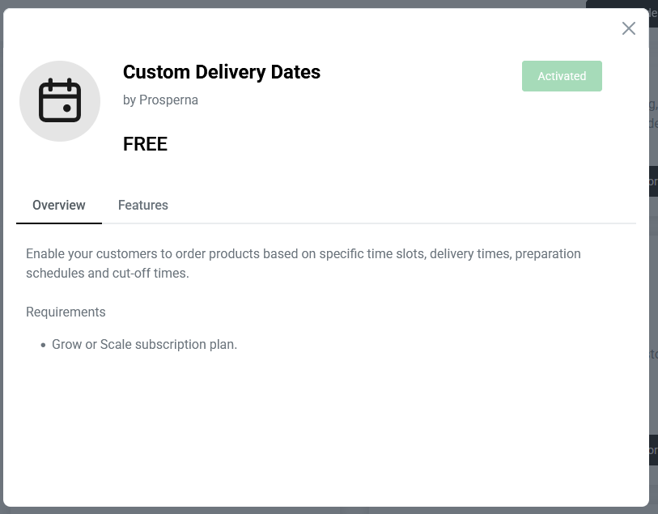
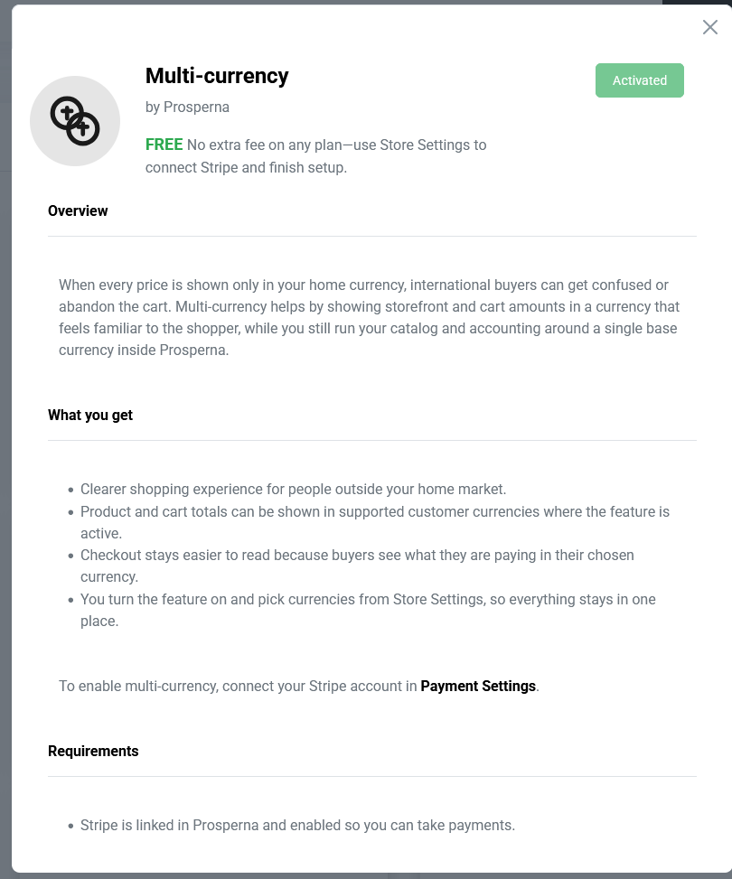
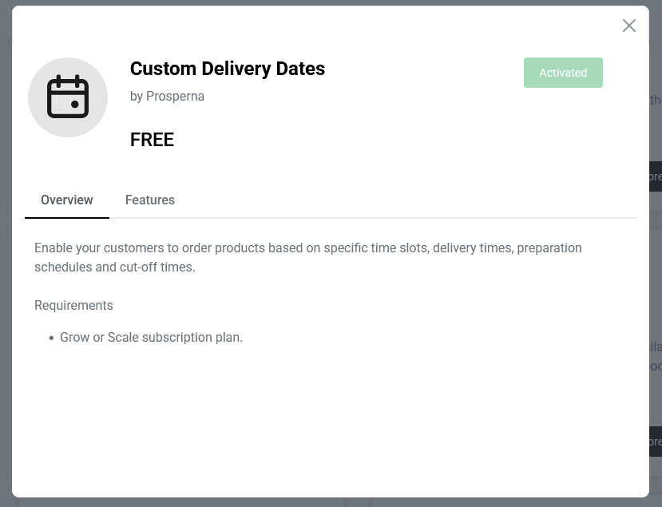
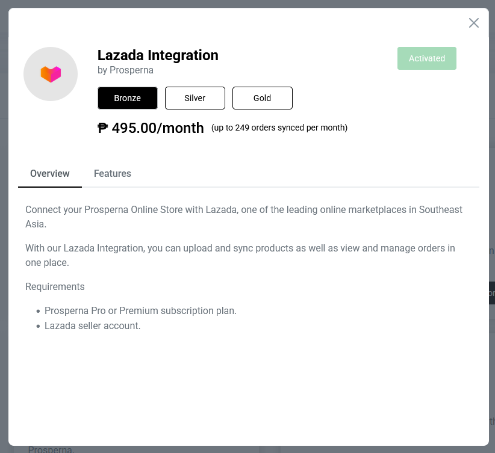
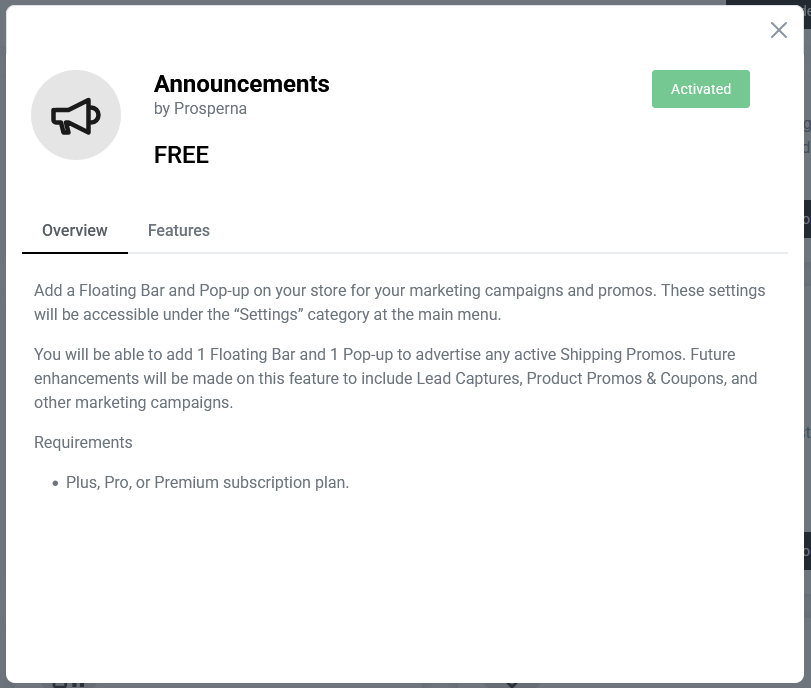
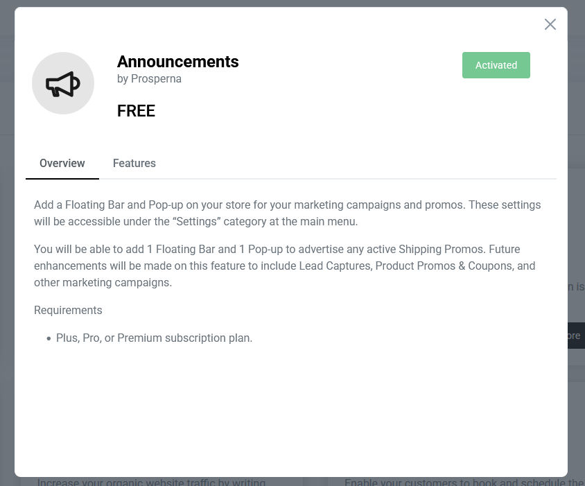
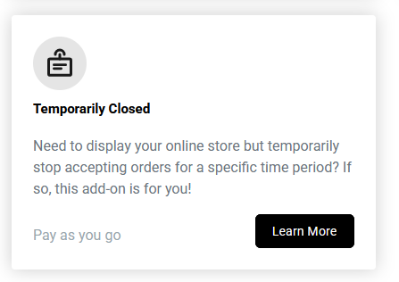
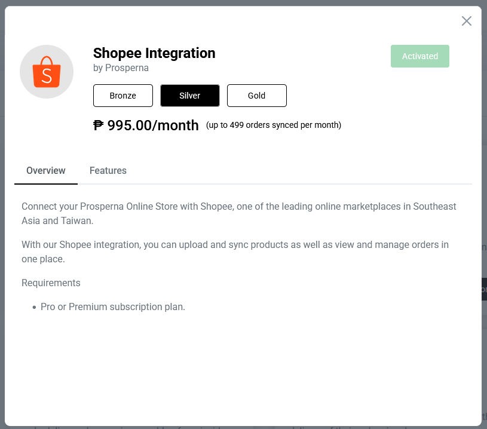

# Marketplace

- **Task ID**: `86eyhy604`
- **URL**: https://app.clickup.com/t/86eyhy604
- **Status**: deployed to prod
- **Assignees**: Angelo Kamachi, Aira Pilor
- **Created**: 2026-08-06T07:53:52.882Z
- **Updated**: 2026-08-07T12:16:39.684Z
- **List**: P1 Delivery
- **Folder**: Shared with me

## Description

_No description_

## Media (16)

- `01_image.png` (source: attachment, uploader: Angelo Kamachi)

  

- `02_image.png` (source: attachment, uploader: Angelo Kamachi)

  

- `03_image.png` (source: attachment, uploader: Angelo Kamachi)

  

- `04_image.png` (source: attachment, uploader: Angelo Kamachi)

  

- `05_image.png` (source: attachment, uploader: Angelo Kamachi)

  

- `06_image.png` (source: attachment, uploader: Angelo Kamachi)

  

- `07_image.png` (source: attachment, uploader: Angelo Kamachi)

  

- `08_image.png` (source: attachment, uploader: Angelo Kamachi)

  

- `09_image.png` (source: comment, uploader: Angelo Kamachi)

  

- `10_image.png` (source: comment, uploader: Angelo Kamachi)

  

- `11_image.png` (source: comment, uploader: Angelo Kamachi)

  

- `12_image.png` (source: comment, uploader: Angelo Kamachi)

  

- `13_image.png` (source: comment, uploader: Angelo Kamachi)

  

- `14_image.png` (source: comment, uploader: Angelo Kamachi)

  

- `15_image.png` (source: comment, uploader: Angelo Kamachi)

  

- `16_image.png` (source: comment, uploader: Angelo Kamachi)

  

## Comments (20)

### ClickBot (2026-08-07T12:16:39.684Z)

This Marketplace has been move to DEPLOYED TO PROD
Date updated: Aug 7 2026, 8:16PM (Asia/Singapore)
Triggered by: Angelo Kamachi

### Angelo Kamachi (2026-08-07T09:31:42.465Z)

PRODUCTION PR READY FOR REVIEW (reopened)

 reopened the main PR fresh after the branch got additional commits (icon redesign) and the dev/staging PRs were also reopened, it is waiting for your review, merging it deploys to production.

MAIN PR: https://github.com/Prosperna/prosperna1/pull/7756 (replaces closed #7750)
STAGING PR: https://github.com/Prosperna/prosperna1/pull/7755 (replaces closed #7753/#7749)
DEV PR: https://github.com/Prosperna/prosperna1/pull/7754 (replaces closed #7752), plus earlier merged/QA-approved dev PRs #7725, #7744, #7748
REPO/BRANCH: prosperna1 / fix/marketplace-icons
@Ian Pelea

### Angelo Kamachi (2026-08-07T09:28:43.667Z)

Reopened fresh PRs after the force-push, to avoid any stale diff/review state on the previous ones.

PULL REQUESTS
prosperna1 / fix/marketplace-icons-dev4 -> dev: https://github.com/Prosperna/prosperna1/pull/7754 (replaces closed #7752)
prosperna1 / fix/marketplace-icons-staging1 -> staging: https://github.com/Prosperna/prosperna1/pull/7755 (replaces closed #7753, which replaced #7749)

Same content as before (full cherry-picked commit history, only the icon redesign actually changes files), verified no merge conflicts against current dev/staging tips before opening.

### Angelo Kamachi (2026-08-07T09:24:40.446Z)

Update: rebuilt PR #7752 (dev) to cherry-pick the full commit history (all 6 marketplace icon commits in order) rather than just the newest one, per standard practice, the first 5 are no-op/empty commits since dev already has that content merged, but the full lineage is now preserved on the branch. Final file diff is unchanged (still just the 2 icon files). No action needed, just flagging the branch was force-updated.

### Angelo Kamachi (2026-08-07T09:13:58.088Z)

Correction to my last comment: the main PR #7750 is still open (not merged yet), but since it tracks the fix/marketplace-icons branch directly, it already picked up the new icon redesign commit automatically, no separate main PR is needed for this. Once dev/staging are approved and #7750 merges, the icon redesign goes to production along with everything else in one shot.

### Angelo Kamachi (2026-08-07T09:13:23.570Z)

ACCOMPLISHED
Redesigned the Additional Fee and Multi-currency marketplace icons. The Additional Fee tag icon had a stray notch from an unclosed path, and its punch-hole dot did not clearly read as additional. The Multi-currency icon used two plus-sign crosses that read as an add icon rather than currency. Replaced with a clean price tag with a plus mark, and a single coin with a dollar sign.

EXTRA WORK
None beyond the reported issue.

PULL REQUESTS
prosperna1 / fix/marketplace-icons-dev4 -> dev: https://github.com/Prosperna/prosperna1/pull/7752
prosperna1 / fix/marketplace-icons-staging1 -> staging: https://github.com/Prosperna/prosperna1/pull/7753 (supersedes and closes the earlier staging PR #7749, which had not been merged yet, so this one just carries everything forward plus the icon redesign)
The main PR (#7750) already merged this branch history up to the previous fix, this icon redesign commit is on top of fix/marketplace-icons and will need a small additional main PR once dev/staging are approved, or can be folded into the next promotion round, your call.

HOW IT WAS TESTED
SVG-only change for the dev PR, nothing to lint or test there. For the staging PR (which also carries the full set of earlier marketplace icon commits since staging had not received them yet), linted all touched JS/JSX files (clean) and ran targeted vitest suites covering Multi-currency, Marketplace, Applications, and Checkout (71/71 passed). Verified no merge conflicts against current origin/dev and origin/staging tips.

NEXT STEPS
QA validation on dev, then staging approval. Let me know if you want the icon redesign promoted to main as its own small PR now, or bundled with a future promotion.

QA TEST CASES
See the updated QA TEST CASES SUMMARY comment on this task, cases 11-12 added for the redesigned icons.

### Angelo Kamachi (2026-08-07T08:47:02.744Z)

PRODUCTION PR READY FOR REVIEW

 the main PR is open and waiting for your review, merging it deploys to production.

MAIN PR: https://github.com/Prosperna/prosperna1/pull/7750
STAGING PR: https://github.com/Prosperna/prosperna1/pull/7749
DEV PRs (merged, QA-approved): https://github.com/Prosperna/prosperna1/pull/7725, https://github.com/Prosperna/prosperna1/pull/7744, https://github.com/Prosperna/prosperna1/pull/7748
REPO/BRANCH: prosperna1 / fix/marketplace-icons
@Ian Pelea

### Angelo Kamachi (2026-08-07T08:40:12.418Z)

Promoted to staging (staging had not received any of this work yet, so this brings across the full set of dev fixes in one PR): https://github.com/Prosperna/prosperna1/pull/7749

Note: a couple of pre-existing, unrelated eslint errors (react-hooks/set-state-in-effect) were found on staging in LazadaApp.jsx and Marketplace.jsx, on old useEffect blocks this change does not touch. Confirmed via diff these predate this fix and are out of scope here.

### Angelo Kamachi (2026-08-07T08:33:51.213Z)

ACCOMPLISHED
Follow-up fix to PR #7744 (already merged to dev). The Customer Delivery Dates detail modal icon was still wrong, it was showing a different blue notification-style icon file (cdd-notification-icon.png) instead of the same repo icon (icons/custom-delivery-dates.svg) used on its own marketplace card and elsewhere, so the modal icon looked inconsistent (blue, smaller circle) versus the card icon (black outline). Fixed to use the same icon source as the card.

EXTRA WORK
None beyond the reported issue.

PULL REQUESTS
prosperna1 / fix/marketplace-icons-dev3 -> dev: https://github.com/Prosperna/prosperna1/pull/7748

HOW IT WAS TESTED
Linted the touched file with eslint (clean). Ran targeted vitest suites covering Multi-currency, Marketplace, Applications, and Checkout (71/71 passed). Verified no merge conflicts against the current origin/dev tip.

NEXT STEPS
QA validation on dev once this PR is merged. After QA approval this and the earlier fixes will be promoted to staging and main together.

QA TEST CASES
See the updated QA TEST CASES SUMMARY comment on this task for step-by-step verification.

### Angelo Kamachi (2026-08-07T08:18:44.743Z)

image.png
image.png
image.png
US

### Angelo Kamachi (2026-08-07T08:17:06.224Z)

image.png
image.png
PH

### Angelo Kamachi (2026-08-07T08:11:02.950Z)

ACCOMPLISHED
Fast-follow fix for the QA return, addressing the 3 apps still showing a broken icon when clicked into: Customer Delivery Dates and Announcement (PH account), plus Multi-currency (US account).
1. Announcements detail modal was using the raw API icon URL with no local fallback at all, now uses the local icon first.
2. Customer Delivery Dates detail modal already had a local fallback icon available but checked the API icon first, so the fallback never actually kicked in when the API icon was broken, priority flipped so the local icon is used first.
3. Multi-currency detail modal had the same backwards priority issue, fixed the same way.

EXTRA WORK
None beyond the reported issue.

PULL REQUESTS
prosperna1 / fix/marketplace-icons-dev2 -> dev: https://github.com/Prosperna/prosperna1/pull/7744

HOW IT WAS TESTED
Linted all 3 touched files with eslint (clean). Ran targeted vitest suites covering Multi-currency, Marketplace, Applications, and Checkout (71/71 passed). Verified no merge conflicts against the current origin/dev tip.

NEXT STEPS
QA validation on dev once this PR is merged. After QA approval this will be promoted to staging and main together with the original fix.

QA TEST CASES
See the updated QA TEST CASES SUMMARY comment on this task for step-by-step verification.

### ClickBot (2026-08-07T07:42:49.776Z)

This task Marketplace has been move back to IN DEVELOPMENT 
as tag QA return
Date updated: Aug 7 2026, 3:42PM (Asia/Shanghai)
Triggered by: Aira Pilor

### Aira Pilor (2026-08-07T07:42:47.197Z)

env: DEV
url: https://prodev.prosperna.ph/home/marketplace
Status: FAILED

PH Account:
https://t7537039.p.clickup-attachments.com/t7537039/b346ce1e-e5ad-405d-91eb-7ebef38fbd8c/20260807-0736-19.4608779.mp4?view=openApps that still has broken image(icon) when clicked:
Customer Delivery Dates
Announcement

US Account:
https://t7537039.p.clickup-attachments.com/t7537039/ac1018cd-84c2-4c58-ae0c-50192ad0f2e8/20260807-0740-10.6346240.mp4?view=openApps that still has broken image(icon) when clicked:
Multi-currency
Customer Delivery Dates
Announcement

Moving this task to "IN DEVELOPMENT"
cc @Angelo Kamachi

### ClickBot (2026-08-07T07:42:45.470Z)

This task Marketplace hss been move to IN TESTING 
Updated: Aug 7 2026, 3:42PM (Asia/Shanghai)
Triggered by: Aira Pilor

### ClickBot (2026-08-07T04:05:54.113Z)

This Marketplace has been move to READY FOR TESTING
Date updated: Aug 7 2026, 12:05PM (Asia/Singapore)
Triggered by: Angelo Kamachi

### Angelo Kamachi (2026-08-07T00:15:58.776Z)

image.png
image.png
image.png
marketplace backend based icons replaced with repo based

### Angelo Kamachi (2026-08-07T00:15:08.737Z)

QA TEST CASES SUMMARY
LAST UPDATED: 2026-08-07, PR https://github.com/Prosperna/prosperna1/pull/7748

WHERE TO TEST
Dev environment, Dashboard > Marketplace page (All Apps and My Apps tabs). Test on both a PH account and a US account, some cases below only apply to one region. No special account/plan preconditions required, though having Lazada or Shopee activated lets you check the My Apps tab too.

TEST CASES
1. Open Marketplace > All Apps tab. Find the Lazada card. EXPECTED: shows the Lazada logo image clearly, not a broken image icon or Brand Logo placeholder text.
2. On the same tab, find the Shopee card. EXPECTED: shows the Shopee logo image clearly.
3. On the same tab, find the Temporarily Closed card. EXPECTED: shows a new closed-sign icon (a hanging CLOSED sign graphic), not a broken image.
4. Click Learn More (or the equivalent action) on the Lazada card. EXPECTED: the Lazada detail modal opens and shows the Lazada logo at the top, not a broken image.
5. Click into the Shopee card the same way. EXPECTED: the Shopee detail modal opens and shows the Shopee logo at the top.
6. If you have Lazada or Shopee already activated, check the My Apps tab. EXPECTED: same correct logos appear there too.
7. Click Learn More on the Temporarily Closed card. EXPECTED (known behavior, not a bug from this PR): nothing happens. This app has no dedicated detail page in this environment yet, so the click being a no-op is expected and outside the scope of this fix, this PR only fixes the broken icon.
8. (PH account) Click Learn More on the Announcement card. EXPECTED: the detail modal opens and shows the Announcements icon at the top, not a broken image.
9. (updated for PR #7748, PH and US accounts) Click Learn More on the Customer Delivery Dates card. EXPECTED: the detail modal opens and shows the same black outline calendar icon as the card itself at the top, not a broken image and not a different blue icon.
10. (US account only) Click Learn More on the Multi-currency card. EXPECTED: the detail modal opens and shows the Multi-currency icon at the top, not a broken image.

TEST DATA
No special test data, store IDs, or seeded accounts needed, this is a static icon display fix, all data comes from the existing Marketplace apps API. Multi-currency only shows for US merchant accounts, use a US account to verify case 10.

OUT OF SCOPE / KNOWN BEHAVIOR
Clicking Learn More on the Temporarily Closed card does not navigate anywhere, this is pre-existing behavior unrelated to this fix and should not be flagged as a bug here. Any other marketplace app whose icon was already displaying correctly before this change should look unchanged.

### Angelo Kamachi (2026-08-07T00:14:52.616Z)

ACCOMPLISHED
Marketplace app cards were showing a broken image (visible as a Brand Logo placeholder) for Lazada, Shopee, and the Temporarily Closed app because their icon came straight from an unreliable API-provided URL. Fixed by resolving icons from local repo assets first and only falling back to the API URL if no local match exists.
1. Lazada and Shopee marketplace cards (All Apps and My Apps tabs) now use local icon files instead of the API icon URL.
2. Temporarily Closed marketplace card now shows a new custom closed-sign icon (hanging CLOSED sign) instead of a broken image, matched by its title since it has no dedicated app key entry.
3. The Lazada/Shopee app detail modal (opened when clicking into either app) now also renders the local icon first, with the API icon URL only as a fallback.

EXTRA WORK
None beyond the reported issue.

PULL REQUESTS
prosperna1 / fix/marketplace-icons-dev1 -> dev: https://github.com/Prosperna/prosperna1/pull/7725

HOW IT WAS TESTED
Linted all touched files with eslint (clean). Ran targeted vitest suites covering the Marketplace page, Applications list, and Checkout flow (59/59 passed). Verified no merge conflicts against the current origin/dev tip.

NEXT STEPS
QA validation on dev once this PR is merged. After QA approval this will be promoted to staging and main.

QA TEST CASES
See the QA TEST CASES SUMMARY comment on this task for step-by-step verification.

### ClickBot (2026-08-06T07:53:53.800Z)

This task Merchant Page has been created 
Date: Aug 6 2026, 3:53PM (Asia/Singapore)
By Angelo Kamachi

