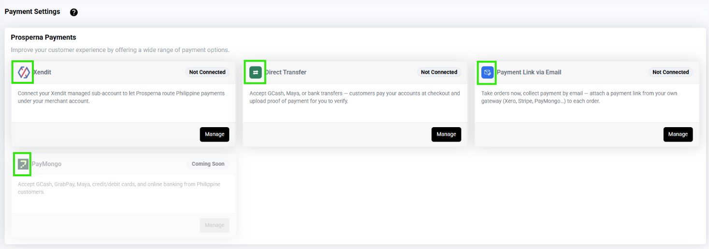
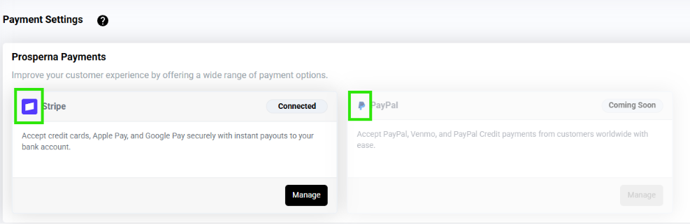
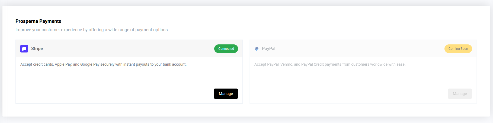
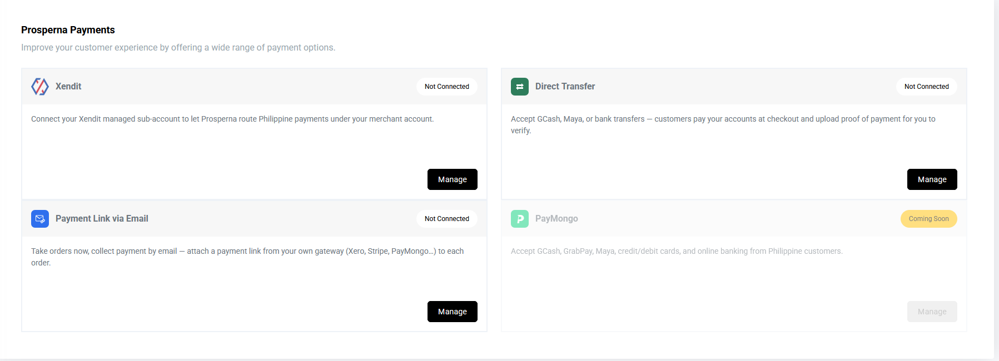

# Payment Settings

- **Task ID**: `86eyhy6p0`
- **URL**: https://app.clickup.com/t/86eyhy6p0
- **Status**: deployed to prod
- **Assignees**: Angelo Kamachi, Aira Pilor
- **Created**: 2026-08-06T07:54:57.602Z
- **Updated**: 2026-08-07T12:16:20.611Z
- **List**: P1 Delivery
- **Folder**: Shared with me

## Description

_No description_

## Media (8)

- `01_image.png` (source: attachment, uploader: Aira Pilor)

  

- `02_image.png` (source: attachment, uploader: Aira Pilor)

  

- `03_image.png` (source: attachment, uploader: Angelo Kamachi)

  

- `04_image.png` (source: attachment, uploader: Angelo Kamachi)

  

- `05_image.png` (source: comment, uploader: Aira Pilor)

  

- `06_image.png` (source: comment, uploader: Aira Pilor)

  

- `07_image.png` (source: comment, uploader: Angelo Kamachi)

  

- `08_image.png` (source: comment, uploader: Angelo Kamachi)

  

## Comments (13)

### ClickBot (2026-08-07T12:16:20.611Z)

This Payment Settings has been move to DEPLOYED TO PROD
Date updated: Aug 7 2026, 8:16PM (Asia/Singapore)
Triggered by: Angelo Kamachi

### Angelo Kamachi (2026-08-07T08:08:06.935Z)

PRODUCTION PR READY FOR REVIEW

 the main PR is open and waiting for your review ? merging it deploys to production.

MAIN PR: https://github.com/Prosperna/prosperna1/pull/7743
STAGING PR: https://github.com/Prosperna/prosperna1/pull/7742
DEV PRs (merged, QA-approved): https://github.com/Prosperna/prosperna1/pull/7726, https://github.com/Prosperna/prosperna1/pull/7737
REPO/BRANCH: prosperna1 / fix/payment-settings-image
@Ian Pelea

### Angelo Kamachi (2026-08-07T07:44:26.731Z)

PROMOTED TO STAGING
Per QA approval on dev, opened a staging promotion PR bundling everything from dev PRs #7726 and #7737: https://github.com/Prosperna/prosperna1/pull/7742 (branch fix/payment-settings-image-staging, targeting staging).

Cherry-picked from the original fix/payment-settings-image branch onto current origin/staging - clean, no conflicts. Lint clean, all 14 targeted tests pass.

NEXT STEPS: staging PR review/merge, then main promotion PR after that.

### Aira Pilor (2026-08-07T07:38:50.571Z)

env: DEV
url: https://prodev.prosperna.ph/home/settings/payments
Status: PASSED

US Account:
image.png

PH Account:
image.png

Endorsing this now to code review.
|cc @Angelo Kamachi

### ClickBot (2026-08-07T07:38:48.073Z)

This task Payment Settings has been move to PASSED TESTING 
Date updated: Aug 7 2026, 3:38PM (Asia/Shanghai)
Triggered by: Aira Pilor

### ClickBot (2026-08-07T07:38:47.050Z)

This task Payment Settings hss been move to IN TESTING 
Updated: Aug 7 2026, 3:38PM (Asia/Shanghai)
Triggered by: Aira Pilor

### ClickBot (2026-08-07T04:21:37.032Z)

This Payment Settings has been move to READY FOR TESTING
Date updated: Aug 7 2026, 12:21PM (Asia/Singapore)
Triggered by: Angelo Kamachi

### Angelo Kamachi (2026-08-07T04:01:58.908Z)

CORRECTION: PR #7726 was actually merged into dev BEFORE the two follow-up commits (PayMongo PNG swap, Manage-view logo fix) were pushed to that same branch - pushing to a branch after its PR is merged does not retroactively include those commits. So those two fixes never made it into dev.

Opened a new PR to carry them over: https://github.com/Prosperna/prosperna1/pull/7737 (branch fix/payment-settings-image-dev2, targeting dev).

HOW IT WAS TESTED
- npx eslint --fix on all touched files - clean.
- All 14 tests across ItemCard and PaymentProviderSettings test files pass.

The QA TEST CASES SUMMARY comment already covers cases 8 and 9 for the Manage-view fix, so no further QA doc changes needed - just noting the fix now lives in a separate PR (#7737) rather than #7726.

### Angelo Kamachi (2026-08-07T03:33:43.076Z)

UPDATE ON PR #7726
Found the same broken-image issue also happens in the expanded Manage/detail view (PaymentProviderSettings) when you click Manage on a gateway card - it was rendering the API logo directly instead of the local one. Fixed the same way and pushed to the same PR.

Also swapped the PayMongo icon from a generated SVG to a provided real brand PNG.

Extracted the gateway id -> logo mapping into a shared gatewayLogos.js so both the card list and the detail view stay in sync going forward.

HOW IT WAS TESTED
- npx eslint --fix on all touched files - clean.
- Added a second test file for PaymentProviderSettings mirroring the ItemCard coverage. All 14 tests across both files pass.

QA TEST CASES line updated with cases 8 and 9 covering the Manage/detail view.

### Angelo Kamachi (2026-08-07T00:26:19.101Z)

QA TEST CASES SUMMARY
LAST UPDATED: Aug 7 2026 - https://github.com/Prosperna/prosperna1/pull/7726

WHERE TO TEST
Dev environment, Payment Settings page (Settings > Payments), AND the expanded Manage view you reach by clicking Manage on any gateway card. Applies to both US and PH merchant stores since gateway cards differ by market.

TEST CASES
1. PH store - Direct Transfer card
   Setup: log into a PH-market store, go to Payment Settings.
   Steps: locate the Direct Transfer card.
   EXPECTED: a real icon shows in the top-left of the card (no broken-image icon).

2. PH store - Payment Link via Email card
   Setup: same PH store, Payment Settings page.
   Steps: locate the Payment Link via Email card.
   EXPECTED: a real icon shows in the top-left of the card (no broken-image icon).

3. PH store - PayMongo card
   Steps: locate the PayMongo card (marked Coming Soon).
   EXPECTED: shows the real PayMongo icon (provided brand asset), not the old placeholder glyph.

4. PH store - Xendit card
   Steps: locate the Xendit card.
   EXPECTED: unchanged - still shows its existing icon correctly.

5. US store - Stripe card
   Setup: log into a US-market store, go to Payment Settings.
   Steps: locate the Stripe card.
   EXPECTED: shows the real Stripe logo (not the old placeholder glyph).

6. US store - PayPal card
   Steps: locate the PayPal card (marked Coming Soon).
   EXPECTED: shows the real PayPal logo (not the old placeholder glyph).

7. Card interactions unaffected
   Steps: click Manage on any connected/connectable gateway card.
   EXPECTED: navigates to the provider settings page as before - this change only touches the logo shown on the card, not card behavior.

8. (updated for PR #7726) Manage/detail view logo - Direct Transfer and Payment Link via Email
   Setup: PH store, Payment Settings page.
   Steps: click Manage on the Direct Transfer card, then go back and click Manage on the Payment Link via Email card.
   EXPECTED: the large logo at the top of the expanded detail view shows a real icon, not a broken-image icon (this was broken before this fix - the API-provided logo URL 404s for these two).

9. (updated for PR #7726) Manage/detail view logo - Xendit and Stripe
   Setup: PH store for Xendit, US store for Stripe.
   Steps: click Manage on the Xendit card (PH) and on the Stripe card (US).
   EXPECTED: the large logo at the top of the expanded detail view shows the correct icon for each, matching the icon shown on the card in the list.

TEST DATA
No special test data needed - any PH-market store and any US-market store account will show all the relevant cards. No specific store/order IDs required.

OUT OF SCOPE / KNOWN BEHAVIOR
- The new icons are simplified/generated brand-style icons, not pixel-perfect reproductions of the official logos (except Stripe, PayPal, and PayMongo, which use the real provided brand assets) - flag only if an icon looks visually broken or wrong, not if it is a simplified version of a brand mark.
- The Accepted Payment Methods row (Visa/Mastercard/Amex/etc icons) shown on the Stripe detail view is unchanged and out of scope for this fix.
- Connect/disconnect flows, statuses, and descriptions for each gateway are unchanged and out of scope for this fix.

### Angelo Kamachi (2026-08-07T00:26:02.806Z)

ACCOMPLISHED
Payment Settings gateway cards now render logos from local bundled assets keyed by gateway.id, instead of the API/S3-hosted logo URL (which was broken for Direct Transfer and Payment Link via Email, and low-quality placeholders for PayMongo/PayPal/Stripe).
- Stripe and PayPal: use the provided real brand PNGs.
- PayMongo, Direct Transfer, Payment Link via Email: new generated SVG icons (Direct Transfer and Payment Link via Email previously had no working icon at all - their API logo URLs 404 against S3).
- Xendit: unchanged, already had a proper logo.
- Any gateway id not covered locally still falls back to the API-provided logo, so nothing breaks if a new gateway is added server-side.

EXTRA WORK
None beyond the icon fix and its test coverage.

PULL REQUESTS
Dev PR: https://github.com/Prosperna/prosperna1/pull/7726 (branch fix/payment-settings-image-dev1, targeting dev)

HOW IT WAS TESTED
- npx eslint --fix on all touched files - clean.
- Added a vitest + React Testing Library test (ItemCard/__tests__/index.test.jsx) asserting each gateway id (stripe, paypal, paymongo, xendit, direct-transfer, payment-link-email) renders its correct local logo, and that an unmapped id falls back to the API logo. All 7 cases pass.

NEXT STEPS
- QA validation on dev.
- After approval, promote to staging and main from the original branch fix/payment-settings-image.
- QA test cases summary posted separately on this task.

### Angelo Kamachi (2026-08-07T00:17:21.170Z)

image.png
US
image.png
PH

### ClickBot (2026-08-06T07:54:59.358Z)

This task Payment Settings has been created 
Date: Aug 6 2026, 3:54PM (Asia/Singapore)
By Angelo Kamachi

