# Themes

- **Task ID**: `86eyhy744`
- **URL**: https://app.clickup.com/t/86eyhy744
- **Status**: deployed to prod
- **Assignees**: Angelo Kamachi, Aira Pilor
- **Created**: 2026-08-06T07:55:40.618Z
- **Updated**: 2026-08-07T12:18:39.931Z
- **List**: P1 Delivery
- **Folder**: Shared with me

## Description

_No description_

## Media (28)

- `01_image.png` (source: attachment, uploader: Aira Pilor)

  

- `02_image.png` (source: attachment, uploader: Aira Pilor)

  

- `03_image.png` (source: attachment, uploader: Aira Pilor)

  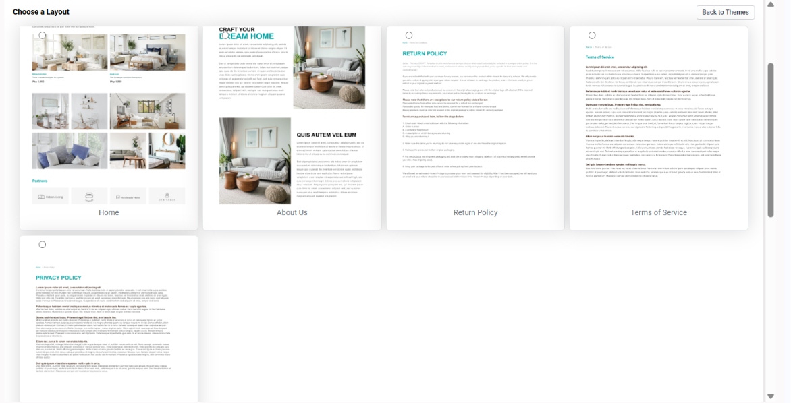

- `04_image.png` (source: attachment, uploader: Aira Pilor)

  

- `05_image.png` (source: attachment, uploader: Aira Pilor)

  

- `06_image.png` (source: attachment, uploader: Aira Pilor)

  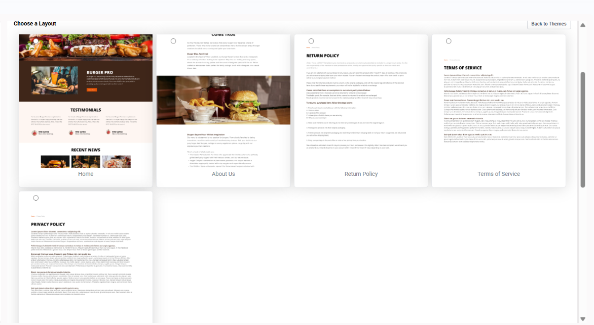

- `07_image.png` (source: attachment, uploader: Aira Pilor)

  

- `08_image.png` (source: attachment, uploader: Angelo Kamachi)

  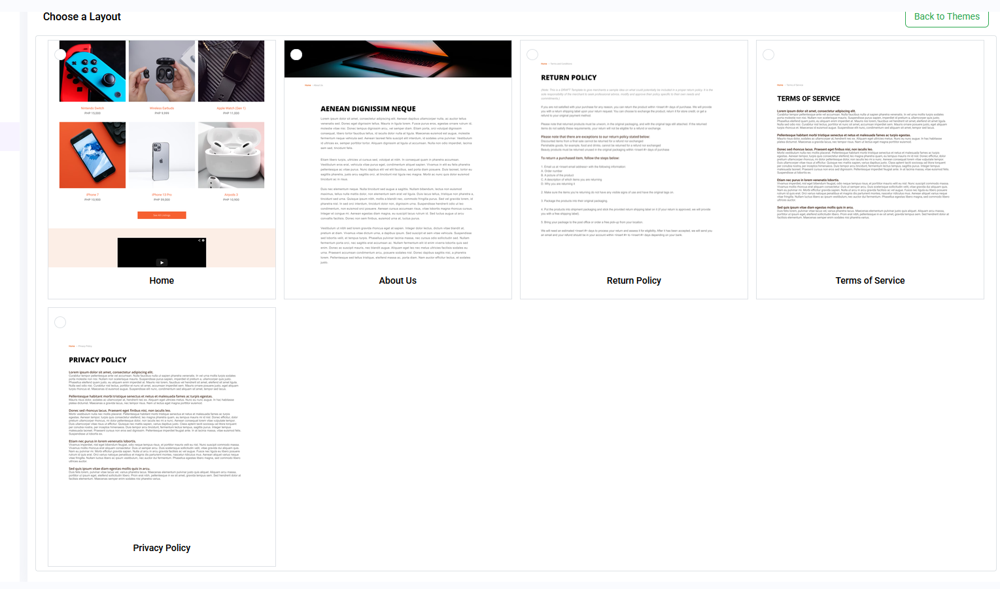

- `09_image.png` (source: attachment, uploader: Angelo Kamachi)

  

- `10_image.png` (source: attachment, uploader: Angelo Kamachi)

  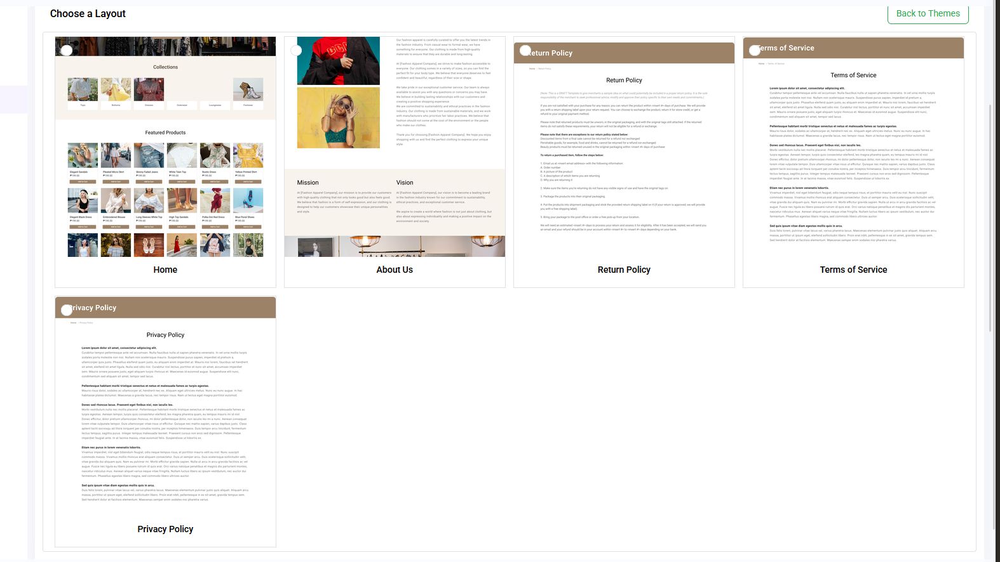

- `11_image.png` (source: attachment, uploader: Angelo Kamachi)

  

- `12_image.png` (source: attachment, uploader: Angelo Kamachi)

  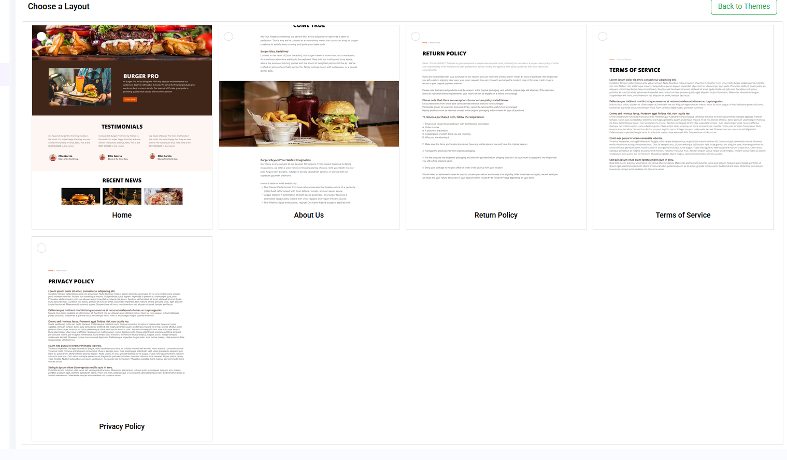

- `13_image.png` (source: attachment, uploader: Angelo Kamachi)

  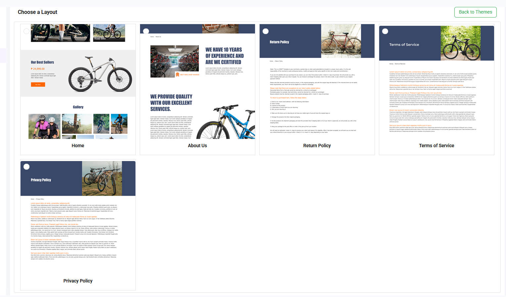

- `14_image.png` (source: attachment, uploader: Angelo Kamachi)

  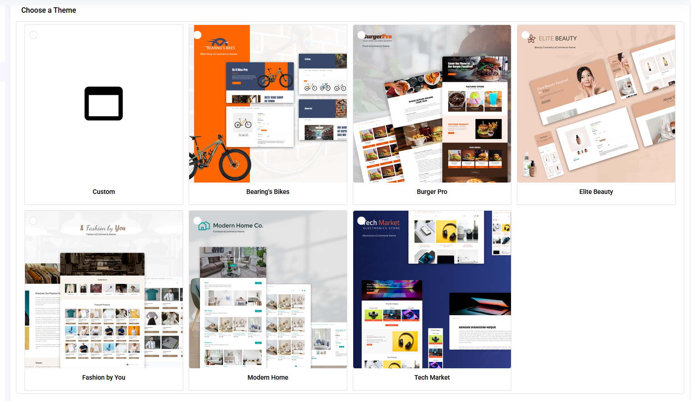

- `15_image.png` (source: comment, uploader: Aira Pilor)

  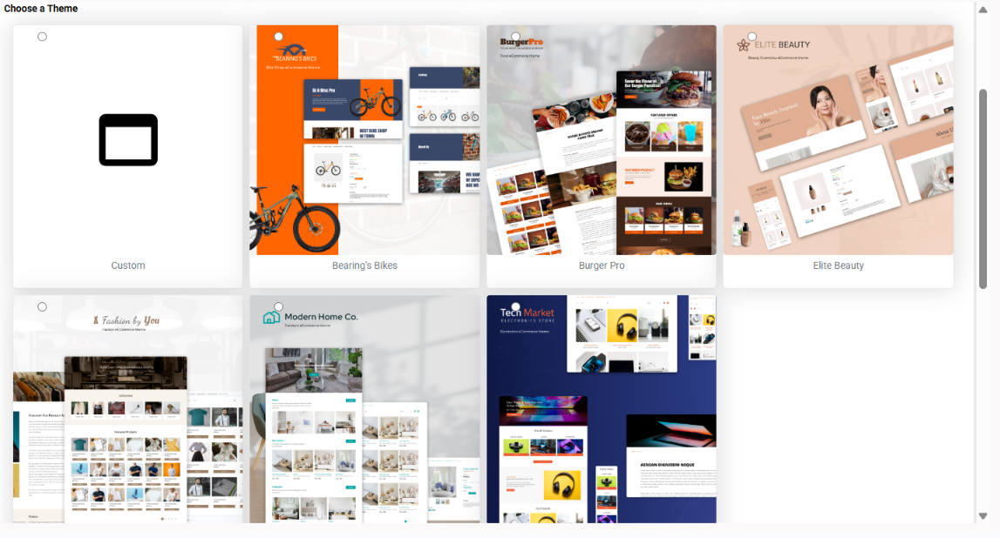

- `16_image.png` (source: comment, uploader: Aira Pilor)

  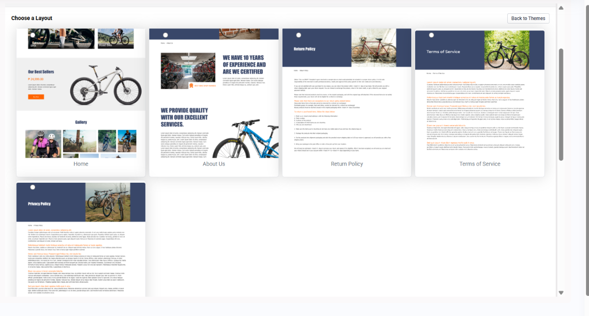

- `17_image.png` (source: comment, uploader: Aira Pilor)

  

- `18_image.png` (source: comment, uploader: Aira Pilor)

  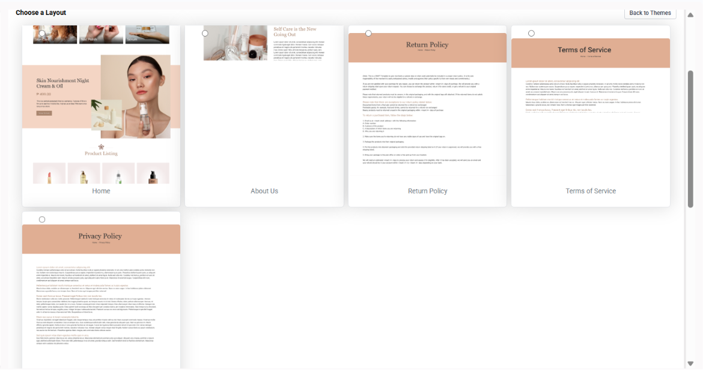

- `19_image.png` (source: comment, uploader: Aira Pilor)

  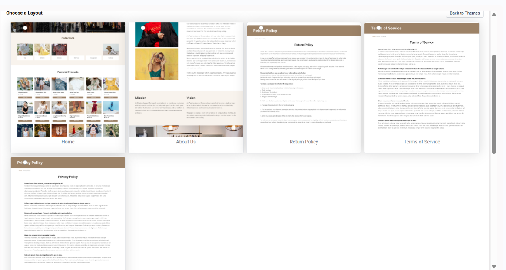

- `20_image.png` (source: comment, uploader: Aira Pilor)

  

- `21_image.png` (source: comment, uploader: Aira Pilor)

  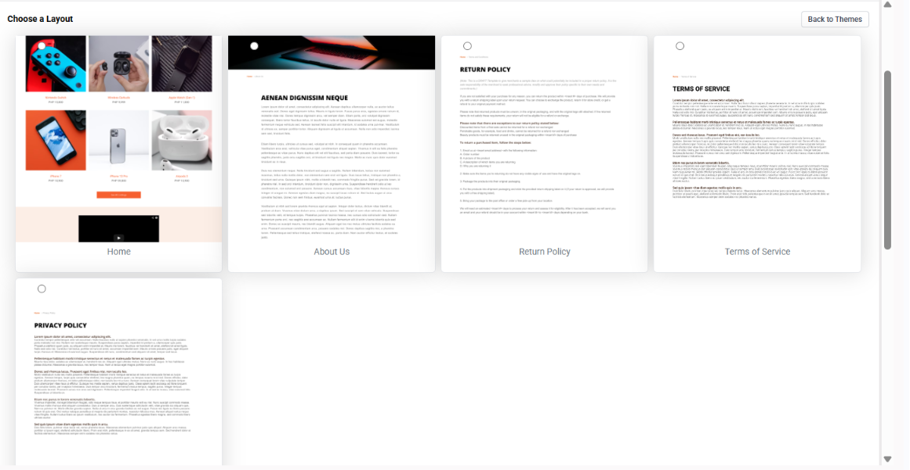

- `22_image.png` (source: comment, uploader: Angelo Kamachi)

  

- `23_image.png` (source: comment, uploader: Angelo Kamachi)

  

- `24_image.png` (source: comment, uploader: Angelo Kamachi)

  

- `25_image.png` (source: comment, uploader: Angelo Kamachi)

  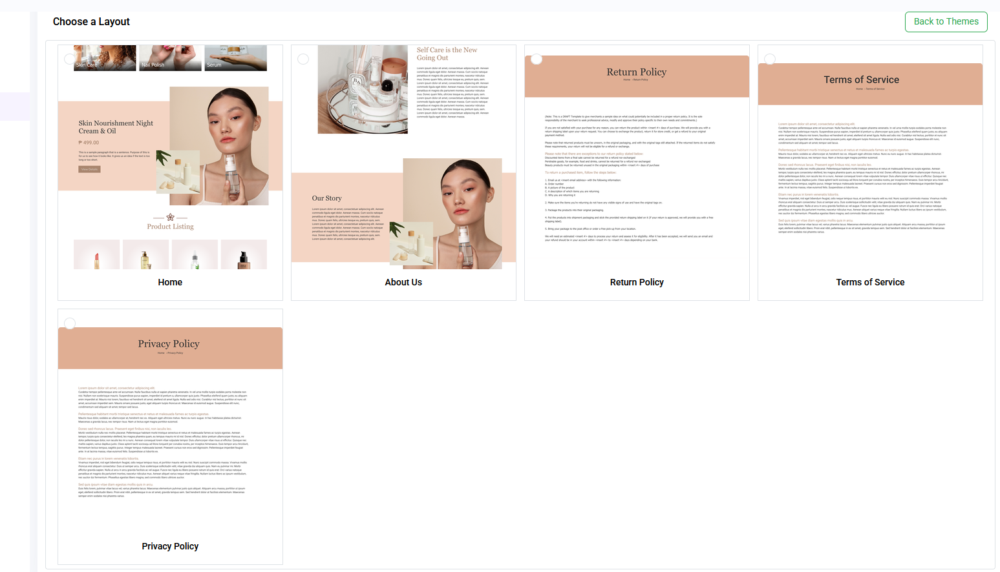

- `26_image.png` (source: comment, uploader: Angelo Kamachi)

  

- `27_image.png` (source: comment, uploader: Angelo Kamachi)

  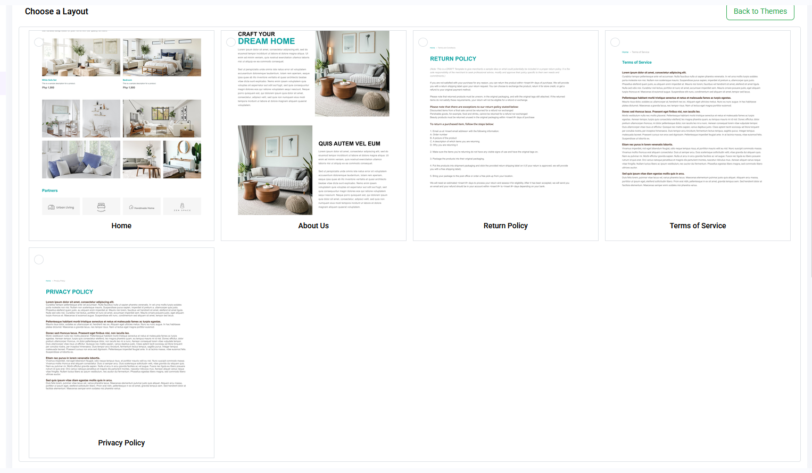

- `28_image.png` (source: comment, uploader: Angelo Kamachi)

  

## Comments (12)

### ClickBot (2026-08-07T12:18:39.931Z)

This Themes has been move to DEPLOYED TO PROD
Date updated: Aug 7 2026, 8:18PM (Asia/Singapore)
Triggered by: Angelo Kamachi

### Angelo Kamachi (2026-08-07T08:33:17.659Z)

PRODUCTION PR READY FOR REVIEW

 the main PR is open and waiting for your review ? merging it deploys to production.

MAIN PR: https://github.com/Prosperna/prosperna1/pull/7747
STAGING PR: https://github.com/Prosperna/prosperna1/pull/7746
DEV PR (merged, QA-approved): https://github.com/Prosperna/prosperna1/pull/7724
REPO/BRANCH: prosperna1 / fix/themes-image
@Ian Pelea

### Angelo Kamachi (2026-08-07T08:26:43.477Z)

Promoted after QA approval: https://github.com/Prosperna/prosperna1/pull/7746 (staging)

### Aira Pilor (2026-08-07T08:20:32.370Z)

Since we are now starting to limit the merchants to create a page inside the legacy page builder, I am recommending to skip the issue for now.

Endorsing the initial changes to code review.
cc @Angelo Kamachi @Ian Pelea

### Aira Pilor (2026-08-07T07:44:25.736Z)

env: DEV
url: https://prodev.prosperna.ph/home/page-builder/create
Status: FAILED

THEMES:
image.png

Contents per theme:
BIKE
image.png
Burger Pro
image.png
Elite Beauty
image.png
Fashion by You
image.png
Modern Home
image.png
Tech Market
image.png

ISSUE:
When trying to use it on the legacy page builder, the images are still broken.
https://t7537039.p.clickup-attachments.com/t7537039/262c9ae1-44ca-4791-bcd3-ebb711f268fa/20260807-0732-54.1915398.mp4?open=true
Moving this task to "IN DEVELOPMENT"
cc @Angelo Kamachi

### ClickBot (2026-08-07T07:44:22.232Z)

This task Themes has been move back to IN DEVELOPMENT 
as tag QA return
Date updated: Aug 7 2026, 3:44PM (Asia/Shanghai)
Triggered by: Aira Pilor

### ClickBot (2026-08-07T07:44:19.863Z)

This task Themes hss been move to IN TESTING 
Updated: Aug 7 2026, 3:44PM (Asia/Shanghai)
Triggered by: Aira Pilor

### ClickBot (2026-08-07T04:06:00.011Z)

This Themes has been move to READY FOR TESTING
Date updated: Aug 7 2026, 12:05PM (Asia/Singapore)
Triggered by: Angelo Kamachi

### Angelo Kamachi (2026-08-07T00:24:03.644Z)

image.png
image.png
image.png
image.png
image.png
image.png
image.png

### Angelo Kamachi (2026-08-07T00:05:54.291Z)

QA TEST CASES SUMMARY
LAST UPDATED: Aug 7 2026, PR https://github.com/Prosperna/prosperna1/pull/7724

WHERE TO TEST
Environment: dev. Go to Page Builder in the dashboard and click Add New Page (or equivalent create-page flow) to reach the theme/layout picker. No special plan or account precondition needed.

TEST CASES
1. Open the theme picker (Choose a Theme step). EXPECTED: every theme card (Bearing_s Bikes, Burger Pro, Elite Beauty, Fashion by You, Modern Home, Tech Market, Custom) shows a real preview thumbnail image, not a broken image icon.
2. Click into each theme one at a time and open its layout picker (Choose a Layout step). EXPECTED: each layout card (Homepage, About, Listing, Checkout Billing/Payment/Shipping, Error, Privacy Policy, Return Policy, Shopping Cart, Terms and Conditions, Thank You, Single/Product page, etc.) shows a preview image matching that specific page, not the theme thumbnail repeated or a broken image.
3. Specifically check Burger Pro theme, Homepage layout. EXPECTED: shows the Burger Pro homepage preview image (previously this had no matching image).
4. Select the Custom theme (or Blank). EXPECTED: shows the placeholder icon (not a broken image), since Custom/Blank has no preview image by design.
5. Simulate a case where a theme or layout has no local image match (any newly added theme not yet covered, if one exists in this environment). EXPECTED: falls back to showing the image from the API response instead of a broken image or blank box.

TEST DATA
No special test data, store, or account needed - any dev environment login that can access Page Builder works.

OUT OF SCOPE / KNOWN BEHAVIOR
This change only affects which image is shown for theme/layout previews - it does not change theme/layout selection behavior, page creation, or any functionality beyond the preview images. Pre-existing image quality/cropping in the source marketplace assets is not in scope.

### Angelo Kamachi (2026-08-07T00:05:35.600Z)

ACCOMPLISHED
Imported the marketplace theme/layout preview images (Bearing_s Bikes, Burger Pro, Elite Beauty, Fashion by You, Modern Home, Tech Market, plus meta/thumbnail image sets) into src/assets/images/themes. Added a themeImages.js helper that matches each theme/layout by key or name to the correct local image. Theme cards and layout cards in the Page Builder now show these local images as the primary source, falling back to the API preview_image_sm URL only when no local match is found. Also fixed Burger Pro homepage specifically - its preview asset was delivered without homepage in the filename (named Temp1), so added an explicit mapping for it.

EXTRA WORK
None beyond the requested image swap.

PULL REQUESTS
prosperna1: https://github.com/Prosperna/prosperna1/pull/7724 (branch fix/themes-image-dev1 into dev)

HOW IT WAS TESTED
Linted all touched files with eslint --fix (clean). Ran targeted vitest suites (ThemeCard.test.jsx and PageForm.test.jsx) - 31/31 passing. Verified the branch merges cleanly against the current origin/dev tip before opening the PR.

NEXT STEPS
QA validation on dev per the test cases below. After approval, this will be promoted to staging and main.

QA TEST CASES SUMMARY posted separately below.

### ClickBot (2026-08-06T07:55:41.478Z)

This task Themes has been created 
Date: Aug 6 2026, 3:55PM (Asia/Singapore)
By Angelo Kamachi

