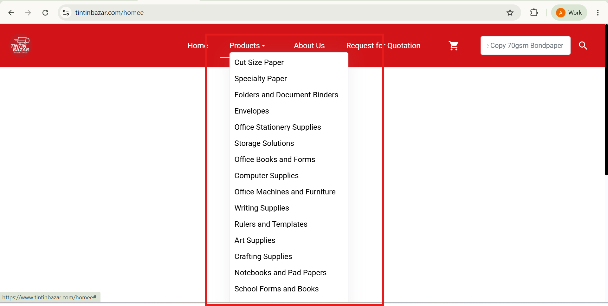
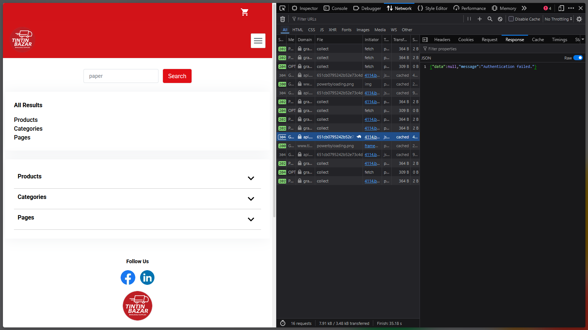
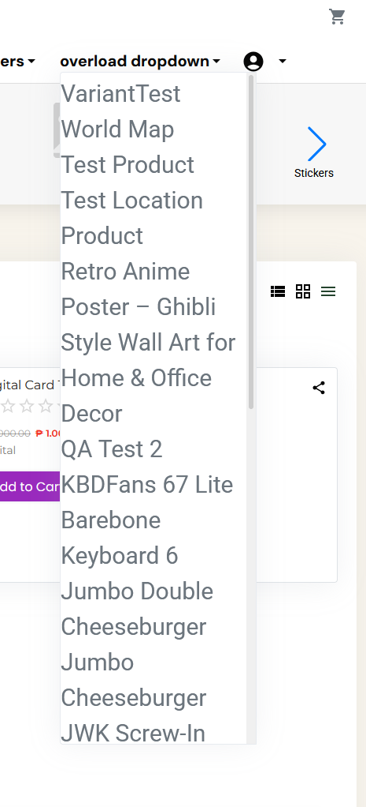
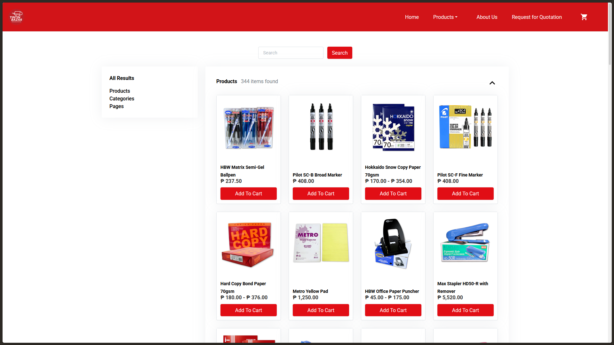
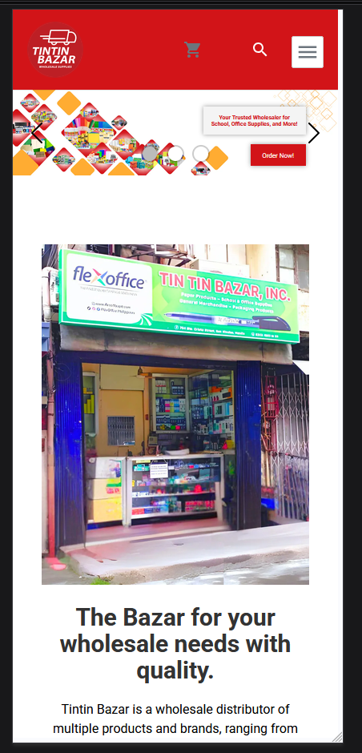
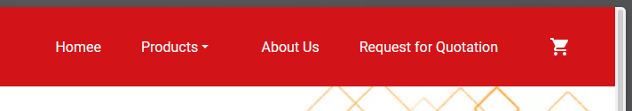
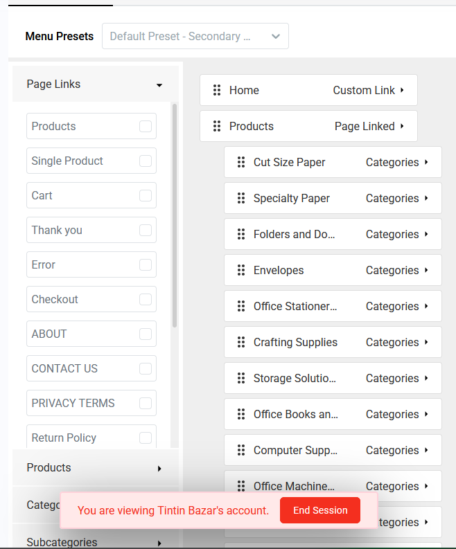
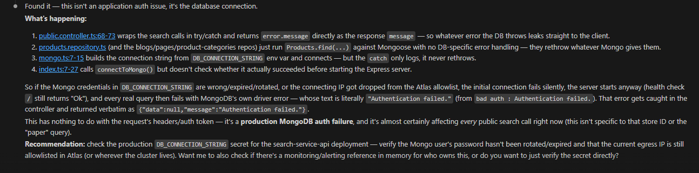

# Website Revision | Tintin Bazaar

- **Task ID**: `86eyhjnmd`
- **URL**: https://app.clickup.com/t/86eyhjnmd
- **Status**: deployed to prod
- **Assignees**: Angelo Kamachi, Aira Pilor
- **Created**: 2026-08-05T10:16:37.466Z
- **Updated**: 2026-09-23T02:11:05.800Z
- **List**: P1 Customer Delivery
- **Folder**: Shared with me

## Description

**Support Link:** [https://www.tidio.com/panel/inbox/tickets/operator-3838959/13545](https://www.tidio.com/panel/inbox/tickets/operator-3838959/13545)
**Client Name/ Store Link: Tintin Bazaar**

**Description:**
We would like to inquire about some issues we are encountering, though we tried to fix them ourselves at first but hit a wall; thus, we'd like to address these issues:
1\. The search bar issue: I did what you instructed and still had the same issue, which is still no search results via the search bar.
3\. The cart is not aligned with the menu. We don't know what happened because it was aligned with the menu.
4\. The menu preview is different from the actual one on mobile. I hope you do something about it, because we have clients who are having difficulty navigating our websites. Additionally, the landing page takes a little longer to load compared to before.

In addition, we hope that there is another way to upload product images or create a product list in the fastest way, such as bulk upload or editing directly on the website.

We look forward to a positive response to our concern. Thank you and have a great day!

## Media (22)

- `01_image.png` (source: attachment, uploader: Angelo Kamachi)

  

- `02_image.png` (source: attachment, uploader: Aira Pilor)

  

- `03_image.png` (source: attachment, uploader: Angelo Kamachi)

  

- `04_image.png` (source: attachment, uploader: Angelo Kamachi)

  

- `05_image.png` (source: attachment, uploader: Angelo Kamachi)

  

- `06_image.png` (source: attachment, uploader: Angelo Kamachi)

  

- `07_image.png` (source: attachment, uploader: Angelo Kamachi)

  

- `08_image.png` (source: attachment, uploader: Angelo Kamachi)

  

- `09_image.png` (source: attachment, uploader: Angelo Kamachi)

  

- `10_image.png` (source: attachment, uploader: Angelo Kamachi)

  

- `11_image.png` (source: attachment, uploader: Angelo Kamachi)

  

- `12_image.png` (source: comment, uploader: Angelo Kamachi)

  

- `13_image.png` (source: comment, uploader: Aira Pilor)

  

- `14_image.png` (source: comment, uploader: Angelo Kamachi)

  

- `15_image.png` (source: comment, uploader: Angelo Kamachi)

  

- `16_image.png` (source: comment, uploader: Angelo Kamachi)

  

- `17_image.png` (source: comment, uploader: Angelo Kamachi)

  

- `18_image.png` (source: comment, uploader: Angelo Kamachi)

  

- `19_image.png` (source: comment, uploader: Angelo Kamachi)

  

- `20_image.png` (source: comment, uploader: Angelo Kamachi)

  

- `21_image.png` (source: comment, uploader: Angelo Kamachi)

  

- `22_image.png` (source: comment, uploader: Angelo Kamachi)

  

## Comments (20)

### Dyne (2026-09-23T02:11:00.643Z)

Hello @Fro Oliva Can we close this ticket? Any new feedback will be treated as support ticket

### Dennis Velasco (2026-09-08T08:48:37.648Z)

@Fro Oliva What's the status of this?
We need to finish by Friday, Sept. 11.

### Aira Pilor (2026-08-12T12:47:34.943Z)

Store Name: Tintin Bazaar
url: https://www.tintinbazar.com/homee
Status: 100% DONE

What we did:
Unpublish this site - https://www.tintinbazar.com/home-for-performance-update
For having too many categories, use this task 86eykz7bt

Endorsing this task to "CLIENT REVIEW"
cc @Angelo Kamachi

### Angelo Kamachi (2026-08-10T06:00:17.429Z)

Kuya Ian was removed since the search bar has been fixed already

### Angelo Kamachi (2026-08-10T05:58:51.398Z)

undefinedthis page is inaccessible from any point in the nav bar or any visible link from the site, was likely a page left published but otherwise unused

### Angelo Kamachi (2026-08-10T05:57:06.883Z)

image.png
farmwithmaricph.prodev.prosperna.ph/locations 
 Developed a new scrollbar in customer side prodev to fix the issue

### Aira Pilor (2026-08-09T04:18:03.599Z)

Store Name: Tintin Bazaar
url: https://www.tintinbazar.com/homee
Status: 99% DONE

TO DO:
Make this list of product categories scrollable, because the remaining 6 are not visible on my end.
image.png
This page has broken images https://www.tintinbazar.com/home-for-performance-update

Moving this task to "IN DEVELOPMENT"
cc @Angelo Kamachi

### Angelo Kamachi (2026-08-07T12:20:53.771Z)

image.png
confirmed, search bar has been fixed, ready for testing again

### Angelo Kamachi (2026-08-06T03:50:33.831Z)

Added kuya Ian as he will be handling the search bar fix

### Angelo Kamachi (2026-08-06T02:32:03.387Z)

@Aira Pilor All Issues reported in the task description has been fixed and documented. The search bar issue has been passed to kuya Ian. Thank you

### Angelo Kamachi (2026-08-06T02:07:31.476Z)

image.png
fixed the extra e in Homee

### Angelo Kamachi (2026-08-06T02:06:13.927Z)

image.png
mobile menu bar has been fixed

### Angelo Kamachi (2026-08-06T02:01:57.957Z)

image.png
Menu bar has been fixed

### Angelo Kamachi (2026-08-06T01:26:09.852Z)

image.png
Issue traced, they were using a secondary menu bar without realising, fixing it by moving everything to the primary menu bar

### Angelo Kamachi (2026-08-06T01:24:22.882Z)

image.png
menu bar found to be very strange in mobile view

### Angelo Kamachi (2026-08-06T01:22:19.493Z)

confirmed will be fixed by kuya Ian, onto the next issue regarding Cart not aligned with Menu
image.png

### Angelo Kamachi (2026-08-06T01:16:08.858Z)

image.png
It appears to be an issue with the database connection, preventing searches from working, I'll ask kuya Ian for confirmation

### Angelo Kamachi (2026-08-06T01:01:44.705Z)

image.png
investigating issue. For the search bar doesnt work issue, the network trace returned with an authentication issue, will update later as to what causes this

### Dyne (2026-08-05T10:21:42.202Z)

@Angelo Kamachi  please work on this

### Dyne (2026-08-05T10:19:40.469Z)

image.png
image.png
image.png
image.png
image.png
image.png
image.png

