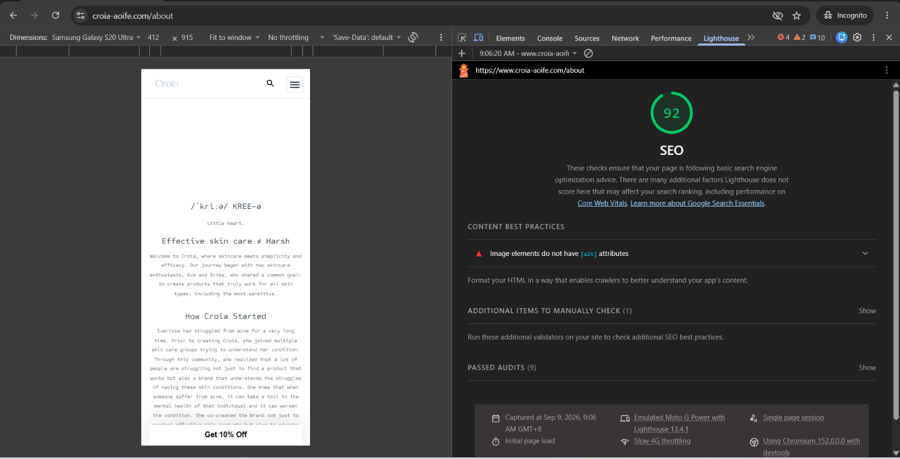
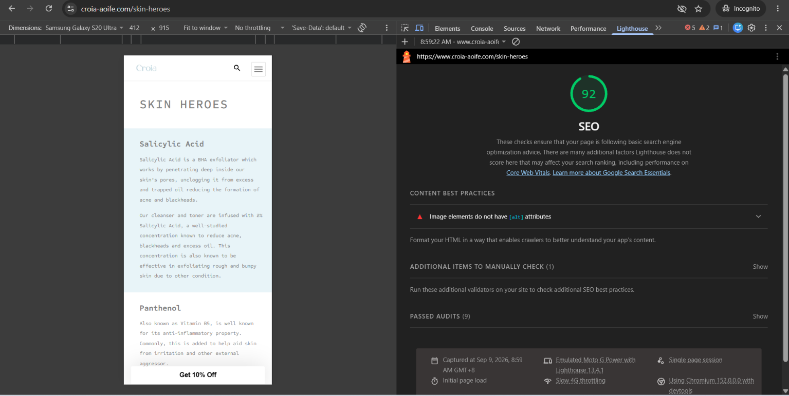
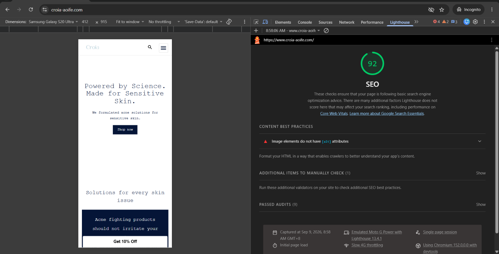
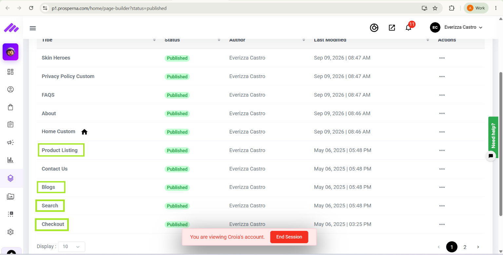
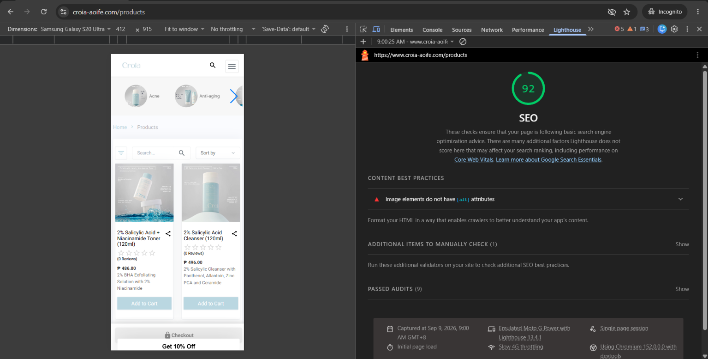
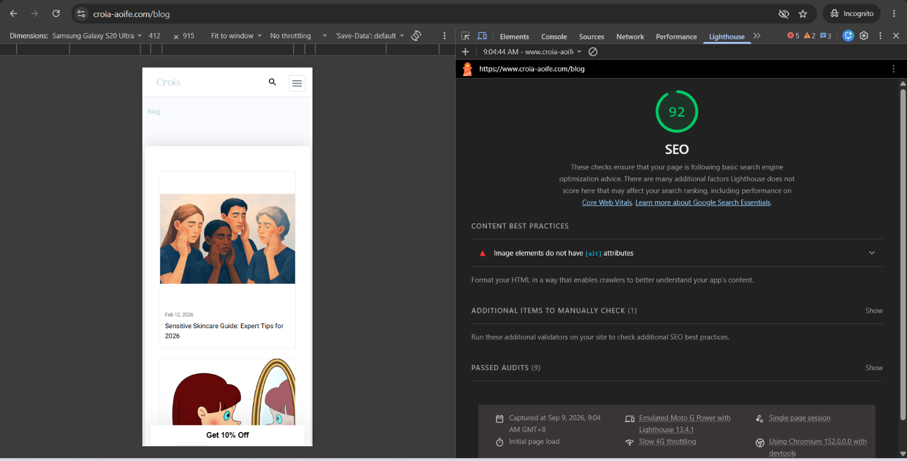
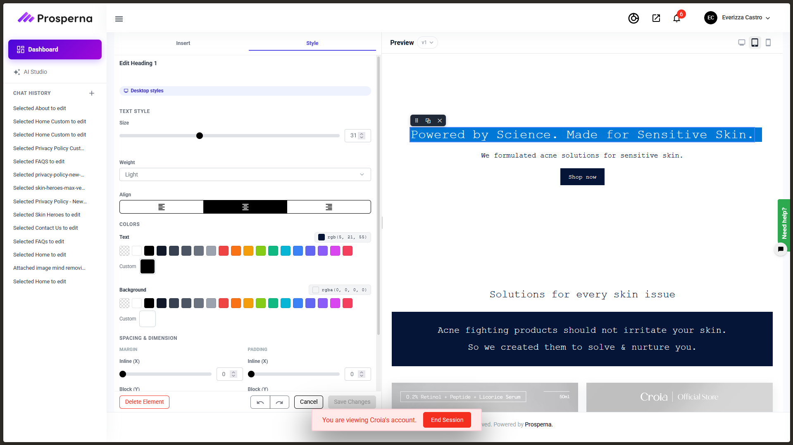
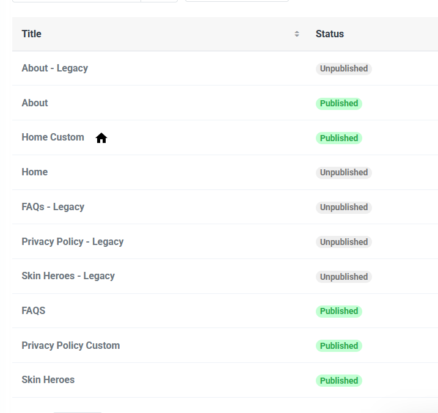

# Migration | Legacy Page Builder to Max AI | Croia

- **Task ID**: `86eyn9gjb`
- **URL**: https://app.clickup.com/t/86eyn9gjb
- **Status**: deployed to prod
- **Assignees**: Angelo Kamachi, Aira Pilor
- **Created**: 2026-08-17T04:53:35.887Z
- **Updated**: 2026-09-11T03:27:24.096Z
- **List**: P1 Customer Delivery
- **Folder**: Shared with me

## Description

**Support Link: Internal**
**Client Name/ Store Link:** [https://www.croia-aoife.com](https://www.croia-aoife.com)

**Description:**
Migration Legacy Page Builder to Max AI

## Media (22)

- `01_image.png` (source: attachment, uploader: Aira Pilor)

  

- `02_image.png` (source: attachment, uploader: Aira Pilor)

  

- `03_image.png` (source: attachment, uploader: Aira Pilor)

  

- `04_image.png` (source: attachment, uploader: Aira Pilor)

  

- `05_image.png` (source: attachment, uploader: Aira Pilor)

  

- `06_image.png` (source: attachment, uploader: Aira Pilor)

  

- `07_image.png` (source: attachment, uploader: Angelo Kamachi)

  

- `08_image.png` (source: attachment, uploader: Angelo Kamachi)

  

- `09_image.png` (source: attachment, uploader: Angelo Kamachi)

  

- `10_image.png` (source: attachment, uploader: Angelo Kamachi)

  

- `11_image.png` (source: attachment, uploader: Angelo Kamachi)

  

- `12_image.png` (source: comment, uploader: Aira Pilor)

  

- `13_image.png` (source: comment, uploader: Aira Pilor)

  

- `14_image.png` (source: comment, uploader: Aira Pilor)

  

- `15_image.png` (source: comment, uploader: Aira Pilor)

  

- `16_image.png` (source: comment, uploader: Aira Pilor)

  

- `17_image.png` (source: comment, uploader: Aira Pilor)

  

- `18_image.png` (source: comment, uploader: Angelo Kamachi)

  

- `19_image.png` (source: comment, uploader: Angelo Kamachi)

  

- `20_image.png` (source: comment, uploader: Angelo Kamachi)

  

- `21_image.png` (source: comment, uploader: Angelo Kamachi)

  

- `22_image.png` (source: comment, uploader: Angelo Kamachi)

  

## Comments (9)

### Aira Pilor (2026-09-09T01:09:52.008Z)

Store Name: Croia
url: https://www.croia-aoife.com/
Status: VERIFIED → PASSED

All the pages are migrated to Max AI except these:
image.png
but it is intended as per AI dev.

Website Performance:

HOME → 92%
image.png

SKIN HEROES → 92%
image.png

SHOP → 92%
image.png

BLOGS → 92%
image.png

ABOUT → 92%
image.png

We can now close this task.
cc @Angelo Kamachi

### Angelo Kamachi (2026-08-17T08:17:23.273Z)

Ready for testing newly migrated pages

cc: @Aira Pilor

### Angelo Kamachi (2026-08-17T08:17:02.956Z)

image.png
image.png

Max AI Visual Editor was found to not have and font family dropdown, Max AI was also prompted to change font style and was unable to

Suggestion: A new feature to allow font editing in visual editor

### Angelo Kamachi (2026-08-17T08:12:09.870Z)

image.png
image.png
Privacy Policy New has been renamed to Privacy Policy Custom to fortify naming convention. Footer has been edited to link to new URL path

### Angelo Kamachi (2026-08-17T08:09:37.907Z)

System Pages have been left alone

### Angelo Kamachi (2026-08-17T08:09:24.476Z)

All previous pages have been marked as -Legacy and was unpublished. The newly migrated pages have been renamed to shorten their URL paths

### Angelo Kamachi (2026-08-17T08:08:20.589Z)

image.png

### Dyne (2026-08-17T04:08:34.184Z)

Note: @Aira Pilor please double check to ensure the MAX Ai pages are published and legacy pages are unpublished and all pages are linked together
cc @Fro Oliva @Dennis Velasco

### ClickBot (2026-08-12T23:07:12.967Z)

This task External has been created 
Date: Aug 13 2026, 7:07AM (Asia/Taipei)
By Dyne

