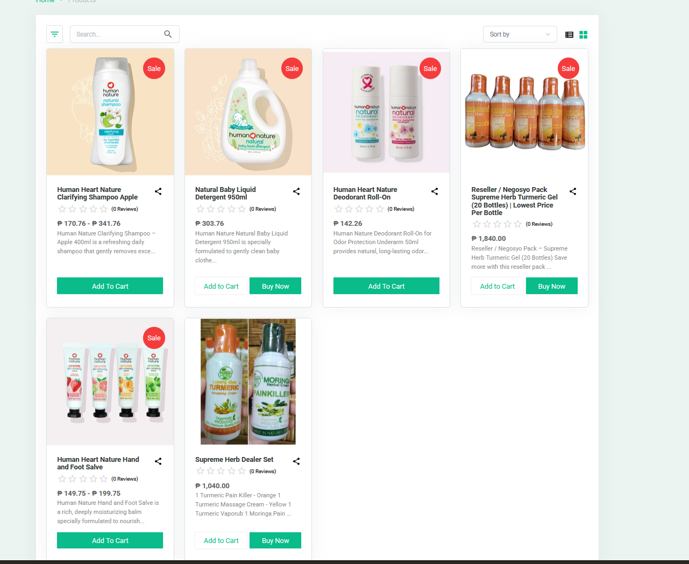
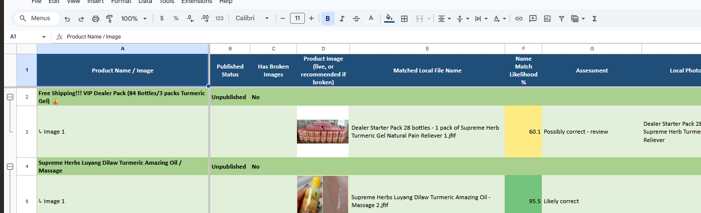
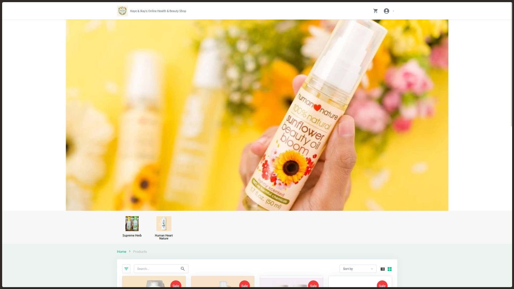

# Website Restore | Kaye & Ikay's Online Health & Beauty Shop

- **Task ID**: `z93r0b1enj`
- **URL**: https://app.clickup.com/t/z93r0b1enj
- **Status**: deployed to prod
- **Assignees**: Angelo Kamachi, Aira Pilor
- **Created**: 2026-09-01T03:53:31.627Z
- **Updated**: 2026-10-06T03:33:17.217Z
- **List**: P1 Customer Delivery
- **Folder**: Shared with me

## Description

**Support Link:** [https://www.tidio.com/panel/inbox/tickets/operator-3838959/13652](https://www.tidio.com/panel/inbox/tickets/operator-3838959/13652)
**Client Name/ Store Link:** [https://kayeandikays.prosperna.com](https://kayeandikays.prosperna.com)

**Description:**
7/11 Attack Client wants to restore site

## Media (6)

- `01_image.png` (source: attachment, uploader: Angelo Kamachi)

  

- `02_image.png` (source: attachment, uploader: Angelo Kamachi)

  

- `03_image.png` (source: attachment, uploader: Angelo Kamachi)

  

- `04_image.png` (source: comment, uploader: Angelo Kamachi)

  

- `05_image.png` (source: comment, uploader: Angelo Kamachi)

  

- `06_image.png` (source: comment, uploader: Angelo Kamachi)

  

## Comments (21)

### Aira Pilor (2026-10-06T02:31:27.018Z)

All the unpublished and published product inside the inventory has been revive.
No more broken images under Media Library.

Moving this to "Client Review" for missing images/mismatch images that the client wants to change.

### Angelo Kamachi (2026-09-28T06:40:46.498Z)

Google Sheet has been set to viewable by anyone

### Angelo Kamachi (2026-09-28T06:40:29.405Z)

image.png
all images have been recovered, some images were not found in external sources, nearest closest image used, images marked yellow is unlikely to be correct

### Dyne (2026-09-28T06:32:51.060Z)

@Angelo Kamachi please provide access to anyone who has link

### Angelo Kamachi (2026-09-28T06:02:31.173Z)

All images possible were recovered, some images couldn't be found in the drive, details in the sheet

### Angelo Kamachi (2026-09-28T01:35:33.601Z)

I can recover the unpublished ones as well if necessary 

### Angelo Kamachi (2026-09-28T01:35:20.539Z)

Because those 7 were the only published ones ma'am

### Dyne (2026-09-28T01:35:03.406Z)

image.png
Why only these are restored

### Dyne (2026-09-28T01:34:49.851Z)

@Angelo Kamachi but in the google drive there are a LOTs of product

### Angelo Kamachi (2026-09-28T01:34:37.989Z)

Should I also recover as much of the unpublished items?

### Angelo Kamachi (2026-09-28T01:34:18.200Z)

Since only 7 items were published as soon as restoration started, only 7 were recovered

### Angelo Kamachi (2026-09-28T01:33:47.857Z)

Good day! Only the published items were recovered

### Dyne (2026-09-28T01:32:22.639Z)

Hello @Aira Pilor@Angelo Kamachi
image.png
How true is this client claim?

image.png
Why not all the products are updated and showing in the site?

### Aira Pilor (2026-09-14T08:06:36.798Z)

Store Name: Kaye & Ikay's Online Health & Beauty Shop
url: https://kayeandikays.prosperna.com/
Status: PASSED

Gdrive for Images: https://drive.google.com/drive/folders/1o9npmlX8_nOZdLRDiTno5OE6TUWTFvz3?usp=drive_link

No more issues found for this issue.
Restoration done 100%.
We can now close this task.
cc @Angelo Kamachi @Dyne

### Angelo Kamachi (2026-09-14T01:36:45.959Z)

no other pages were found in the navigation bar, therefore no other restoration and migration was made

### Angelo Kamachi (2026-09-14T01:36:02.677Z)

image.png
had no idea what the original cover photo was so I replaced it with this

### Angelo Kamachi (2026-09-14T01:35:16.168Z)

image.png
all 6 products restored

Hand and Foot Salve images was salvaged from humanheartnature.com/buy/ceramide-skin-renewing-salve-30g.html?srsltid=AfmBOorKBviXsK_n5kNpU5jhhHP-eW9sV7uovNr9t-WFJwuEyqSSOoQ- 
 

### Brian Millonte (2026-09-07T04:17:15.519Z)

image.png
requested access for the assets @Dyne

### Dyne (2026-09-07T03:55:39.281Z)

@Dennis Velasco please help assign

### Dyne (2026-09-02T02:53:24.487Z)

@Michael Joseph Santos @Brian Millonte who can work on this?

### Dyne (2026-09-01T03:54:23.222Z)

drive.google.com/drive/folders/1UwUfiNS436471vjPll5U3S-1ikYlUuxZ 
 

