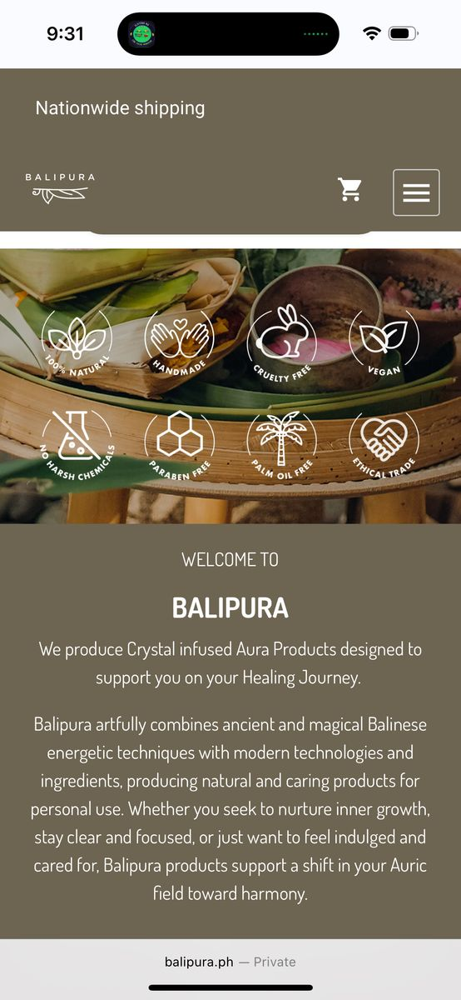
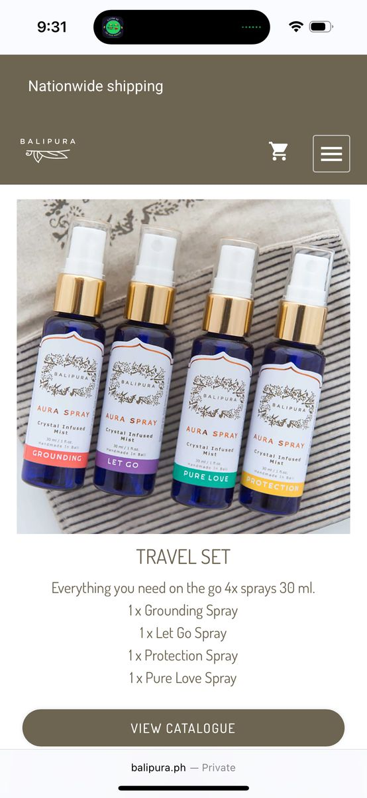
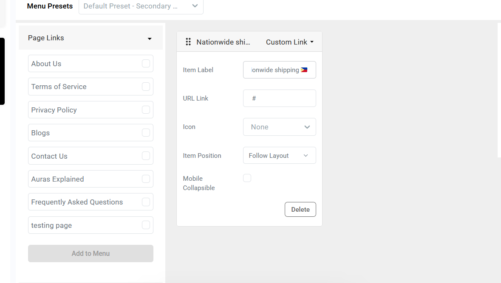
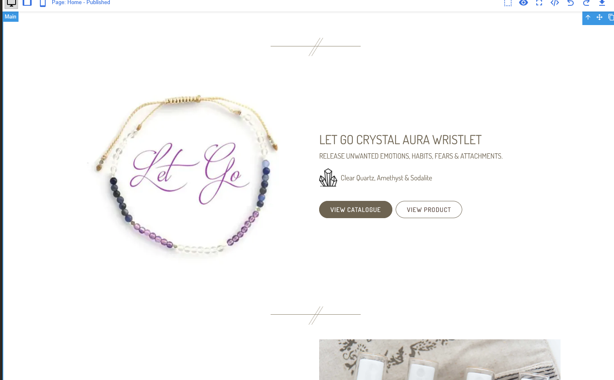
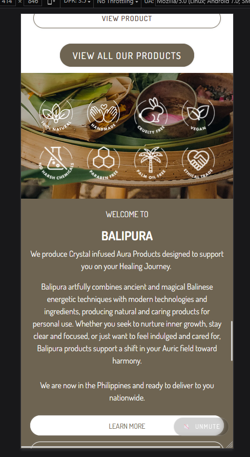
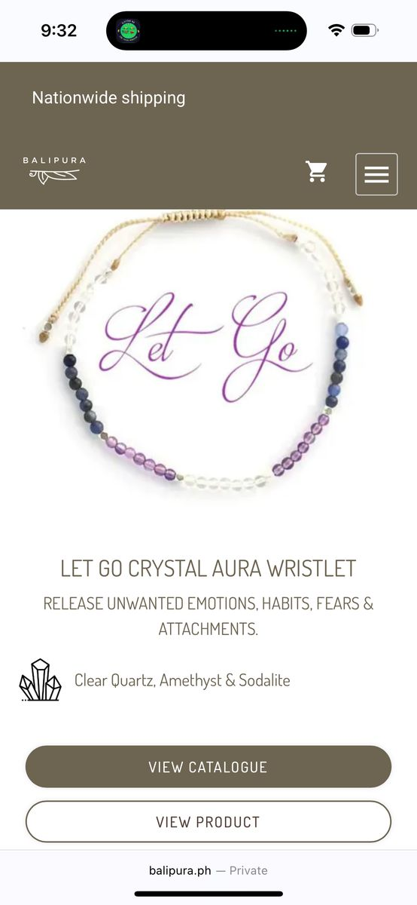
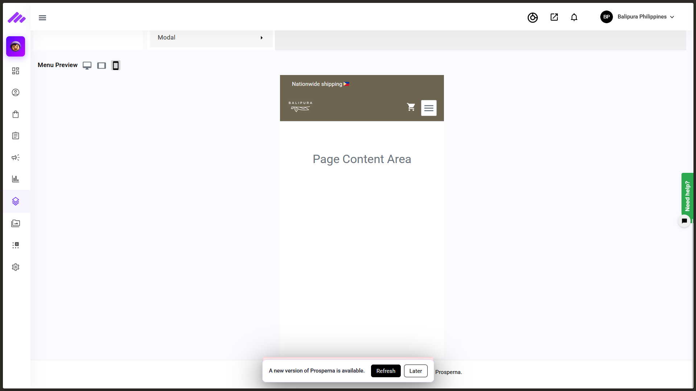
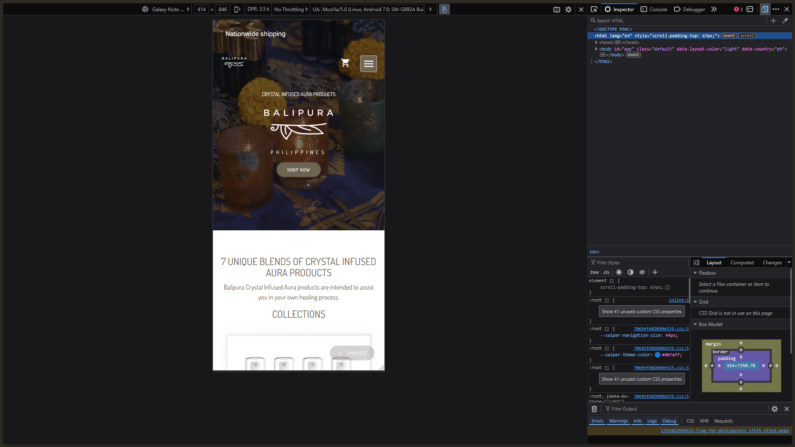

# Website Revision | Fixing Balipura Website Errors

- **Task ID**: `z93r0b1ng9`
- **URL**: https://app.clickup.com/t/z93r0b1ng9
- **Status**: deployed to prod
- **Assignees**: Angelo Kamachi, Aira Pilor
- **Created**: 2026-09-03T02:47:20.617Z
- **Updated**: 2026-09-15T01:40:04.973Z
- **List**: P1 Customer Delivery
- **Folder**: Shared with me

## Description

**Support Link:** [https://www.tidio.com/panel/inbox/tickets/operator-3838959/13664](https://www.tidio.com/panel/inbox/tickets/operator-3838959/13664)
**Client Name/ Store Link: Balipura**

**Description:**
I hope that all is well with you! Thank you for your assistance in fixing the Balipura website recently. I’ve noticed a few more errors (all on mobile view) that need be resolved and would like to request for your assistance once more please. Thank you.

**Please see comments.**

## Media (18)

- `01_image.png` (source: attachment, uploader: Aira Pilor)

  

- `02_image.png` (source: attachment, uploader: Aira Pilor)

  

- `03_image.png` (source: attachment, uploader: Aira Pilor)

  

- `04_image.png` (source: attachment, uploader: Angelo Kamachi)

  

- `05_image.png` (source: attachment, uploader: Angelo Kamachi)

  

- `06_image.png` (source: attachment, uploader: Angelo Kamachi)

  

- `07_image.png` (source: attachment, uploader: Angelo Kamachi)

  

- `08_image.png` (source: attachment, uploader: Angelo Kamachi)

  

- `09_image.png` (source: attachment, uploader: Angelo Kamachi)

  

- `10_image.png` (source: comment, uploader: Aira Pilor)

  

- `11_image.png` (source: comment, uploader: Aira Pilor)

  

- `12_image.png` (source: comment, uploader: Aira Pilor)

  

- `13_image.png` (source: comment, uploader: Angelo Kamachi)

  

- `14_image.png` (source: comment, uploader: Angelo Kamachi)

  

- `15_image.png` (source: comment, uploader: Angelo Kamachi)

  

- `16_image.png` (source: comment, uploader: Angelo Kamachi)

  

- `17_image.png` (source: comment, uploader: Angelo Kamachi)

  

- `18_image.png` (source: comment, uploader: Angelo Kamachi)

  

## Comments (17)

### Aira Pilor (2026-09-14T07:46:47.447Z)

We can now close this task.

cc @Angelo Kamachi @Dyne 

### Dyne (2026-09-14T07:45:39.352Z)

@Aira Pilor BLOCKAGE:
Dev has reported that there's an issue in adding Philippine flag next to "Nationwide Shipping".

As per client there is no need of this please proceed to the next step

### Aira Pilor (2026-09-09T01:43:19.428Z)

Store Name: Balipura
url: https://www.balipura.ph/
Status: PASSED → BLOCKAGE

VERIFIED:
"Let Go" text inside the bracelet
image.png
Travel Set image
image.png
Icons above "Welcome to Balipura" are not cropped anymore.
image.png

BLOCKAGE:
Dev has reported that there's an issue in adding Philippine flag next to "Nationwide Shipping".
What should we do? @Angelo Kamachi @Dyne

Moving this task to "Ready for Development" as per its blockage.
cc @Angelo Kamachi @Dyne

### Dyne (2026-09-07T01:41:14.812Z)

@Aira Pilor please check on this

### Angelo Kamachi (2026-09-07T00:25:15.413Z)

All issues fixed except for reported system bug

### Angelo Kamachi (2026-09-07T00:24:33.773Z)

image.png
image.png
image.png
emoji was rendered in merchant side and correctly set, but doesn't appear in customer side. This is likely a system bug that prevents emojis from being rendered in the actual website

### Angelo Kamachi (2026-09-07T00:19:53.697Z)

image.png
Let go bracelet fixed

### Angelo Kamachi (2026-09-07T00:13:54.937Z)

image.png
travel set swapped

### Angelo Kamachi (2026-09-07T00:06:19.878Z)

image.png
mobile view fixed

### Dyne (2026-09-03T02:53:12.624Z)

@Angelo Kamachi  please work on this

### Dyne (2026-09-03T02:51:33.655Z)

image.png
6.) Missing Philippine flag after Nationwide shipping

### Dyne (2026-09-03T02:51:15.012Z)

image.png
5.) Let Go font should be like this but in Violet

### Dyne (2026-09-03T02:50:59.116Z)

image.png
4.) Missing Violet font that says Let Go

### Dyne (2026-09-03T02:50:39.392Z)

image.png
3.) This is the correct photo for Travel Set on the homepage

### Dyne (2026-09-03T02:49:51.906Z)

image.png
2.) This is the wrong image for Travel set on the home page

### Dyne (2026-09-03T02:49:26.840Z)

image.png
1.) This image is cropped

### ClickBot (2026-09-03T02:47:22.020Z)

This task External has been created 
Date: Sep 3 2026, 10:47AM (Asia/Taipei)
By Dyne

