# Website Restore | GoNegosyo

- **Task ID**: `z93r0b2552`
- **URL**: https://app.clickup.com/t/z93r0b2552
- **Status**: deployed to prod
- **Assignees**: Angelo Kamachi, Aira Pilor
- **Created**: 2026-09-08T08:00:14.050Z
- **Updated**: 2026-09-24T06:01:54.319Z
- **List**: P1 Customer Delivery
- **Folder**: Shared with me

## Description

**Goal:** Restore all the website images and migrate from Legacy Page Builder to Max AI.
Username: [dennis+3@prosperna.com](mailto:dennis+3@prosperna.com)
Pw: frM5MDPf#

Website Link: [https://gonegosyo.prosperna.com/](https://gonegosyo.prosperna.com/)
Figma: [https://www.figma.com/design/Ad1mdZE9Vq0LG93TrFfjyF/GONegosyo?node-id=0-1&t=p1gQp8WxEX6GpZRg-1](https://www.figma.com/design/Ad1mdZE9Vq0LG93TrFfjyF/GONegosyo?node-id=0-1&t=p1gQp8WxEX6GpZRg-1)
Homepage Design: [https://drive.google.com/file/d/1a\_EyWyhSxWFEwFwQ0XvLqPWStpfpYtYw/view?usp=sharing](https://drive.google.com/file/d/1a_EyWyhSxWFEwFwQ0XvLqPWStpfpYtYw/view?usp=sharing)
Assets: [https://drive.google.com/drive/folders/13X4BvqAlcrdI7jRpDp-3fVn5Y5\_9ZQ17?usp=sharing](https://drive.google.com/drive/folders/13X4BvqAlcrdI7jRpDp-3fVn5Y5_9ZQ17?usp=sharing)

## Media (66)

- `01_image.png` (source: attachment, uploader: Angelo Kamachi)

  

- `02_image.png` (source: attachment, uploader: Angelo Kamachi)

  

- `03_image.png` (source: attachment, uploader: Aira Pilor)

  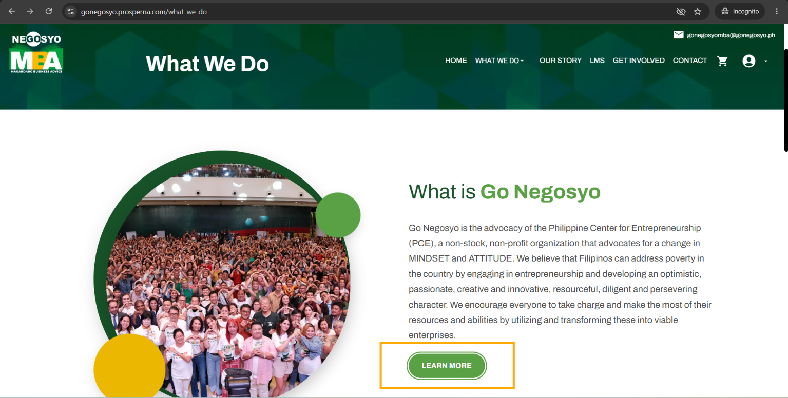

- `04_image.png` (source: attachment, uploader: Aira Pilor)

  

- `05_image.png` (source: attachment, uploader: Aira Pilor)

  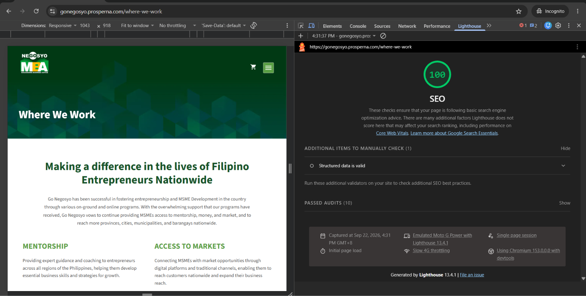

- `06_image.png` (source: attachment, uploader: Aira Pilor)

  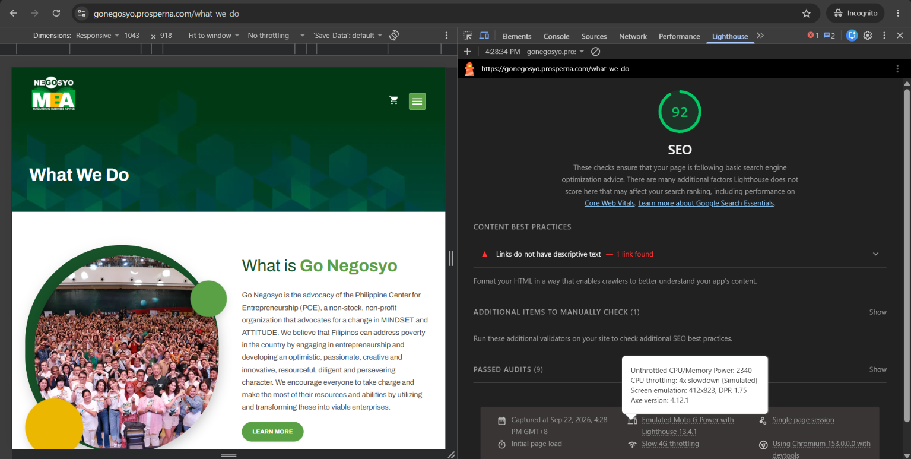

- `07_image.png` (source: attachment, uploader: Aira Pilor)

  

- `08_image.png` (source: attachment, uploader: Aira Pilor)

  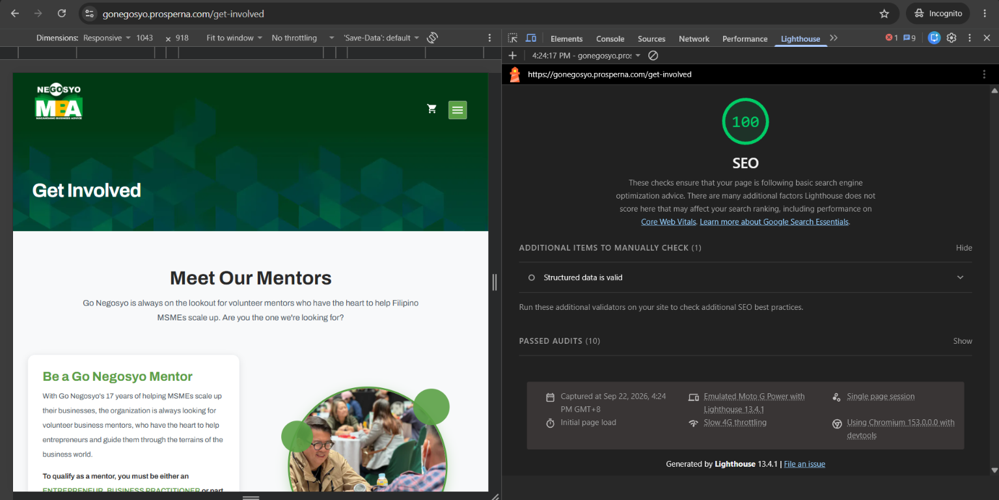

- `09_image.png` (source: attachment, uploader: Aira Pilor)

  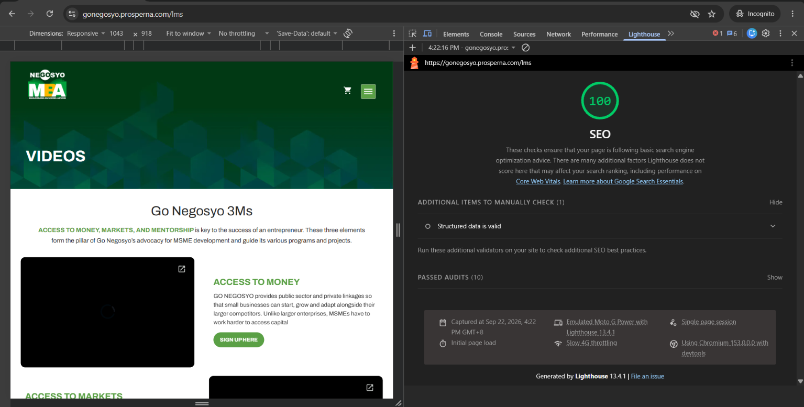

- `10_image.png` (source: attachment, uploader: Aira Pilor)

  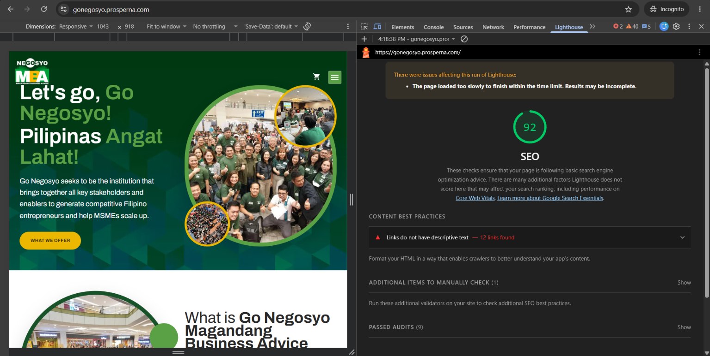

- `11_image.png` (source: attachment, uploader: Angelo Kamachi)

  

- `12_image.png` (source: attachment, uploader: Angelo Kamachi)

  

- `13_image.png` (source: attachment, uploader: Angelo Kamachi)

  

- `14_image.png` (source: attachment, uploader: Angelo Kamachi)

  

- `15_image.png` (source: attachment, uploader: Angelo Kamachi)

  

- `16_image.png` (source: attachment, uploader: Angelo Kamachi)

  

- `17_image.png` (source: attachment, uploader: Angelo Kamachi)

  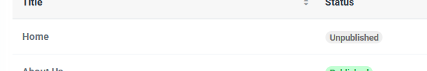

- `18_image.png` (source: attachment, uploader: Aira Pilor)

  

- `19_image.png` (source: attachment, uploader: Angelo Kamachi)

  

- `20_image.png` (source: attachment, uploader: Angelo Kamachi)

  

- `21_image.png` (source: attachment, uploader: Angelo Kamachi)

  

- `22_image.png` (source: attachment, uploader: Angelo Kamachi)

  

- `23_image.png` (source: attachment, uploader: Angelo Kamachi)

  

- `24_image.png` (source: attachment, uploader: Angelo Kamachi)

  

- `25_image.png` (source: attachment, uploader: Angelo Kamachi)

  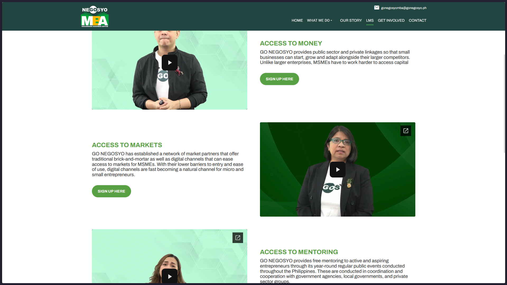

- `26_image.png` (source: attachment, uploader: Angelo Kamachi)

  

- `27_image.png` (source: attachment, uploader: Angelo Kamachi)

  

- `28_image.png` (source: attachment, uploader: Angelo Kamachi)

  

- `29_image.png` (source: attachment, uploader: Angelo Kamachi)

  

- `30_image.png` (source: attachment, uploader: Angelo Kamachi)

  

- `31_image.png` (source: attachment, uploader: Angelo Kamachi)

  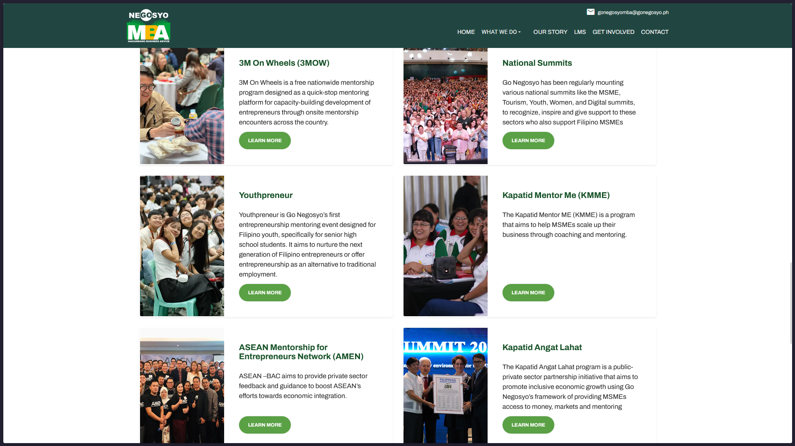

- `32_image.png` (source: attachment, uploader: Angelo Kamachi)

  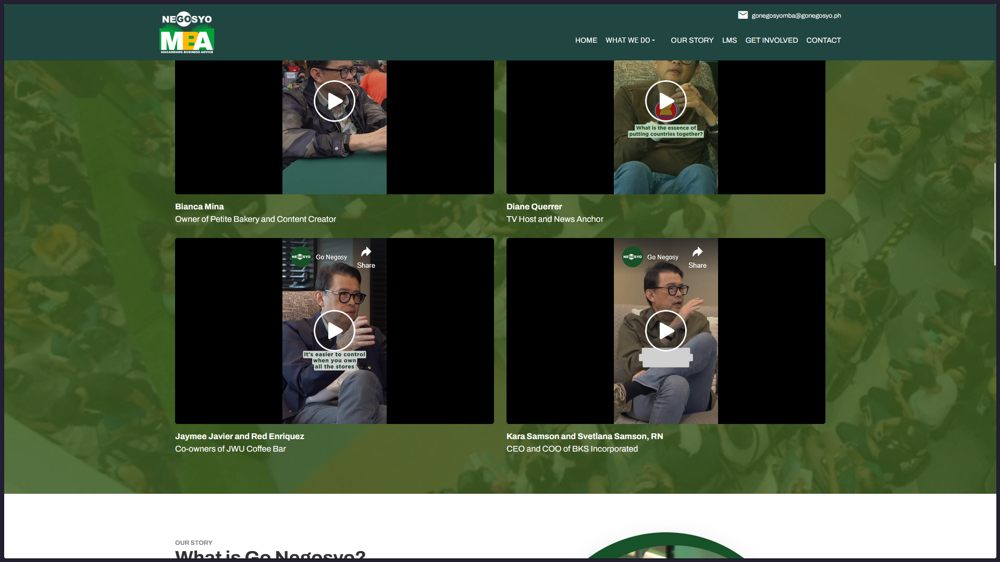

- `33_image.png` (source: attachment, uploader: Angelo Kamachi)

  

- `34_image.png` (source: comment, uploader: Angelo Kamachi)

  

- `35_image.png` (source: comment, uploader: Angelo Kamachi)

  

- `36_image.png` (source: comment, uploader: Aira Pilor)

  

- `37_image.png` (source: comment, uploader: Aira Pilor)

  

- `38_image.png` (source: comment, uploader: Aira Pilor)

  

- `39_image.png` (source: comment, uploader: Aira Pilor)

  

- `40_image.png` (source: comment, uploader: Aira Pilor)

  

- `41_image.png` (source: comment, uploader: Aira Pilor)

  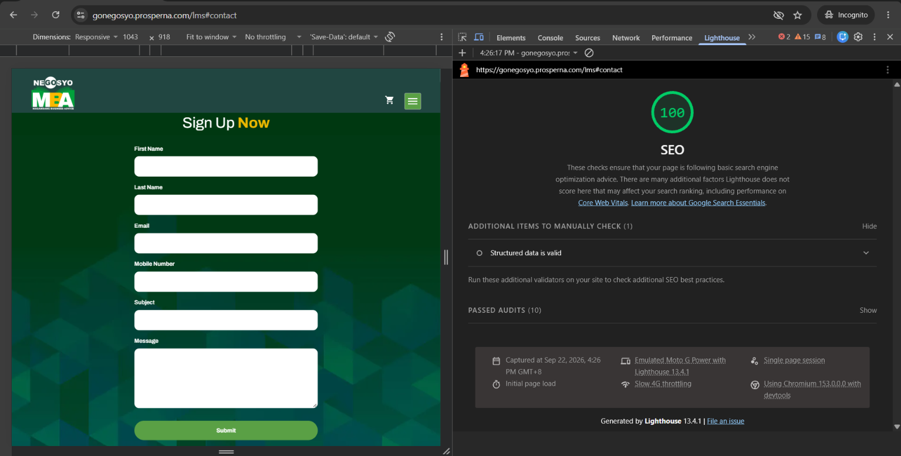

- `42_image.png` (source: comment, uploader: Aira Pilor)

  

- `43_image.png` (source: comment, uploader: Aira Pilor)

  

- `44_image.png` (source: comment, uploader: Angelo Kamachi)

  

- `45_image.png` (source: comment, uploader: Angelo Kamachi)

  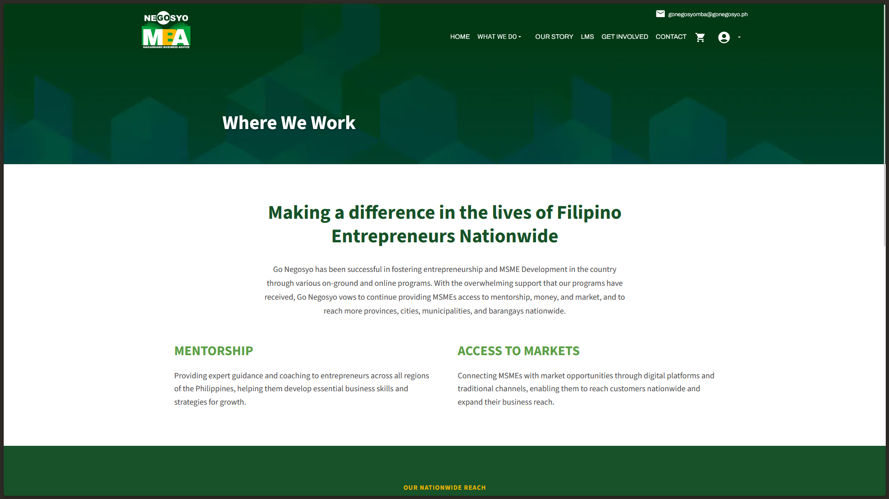

- `46_image.png` (source: comment, uploader: Angelo Kamachi)

  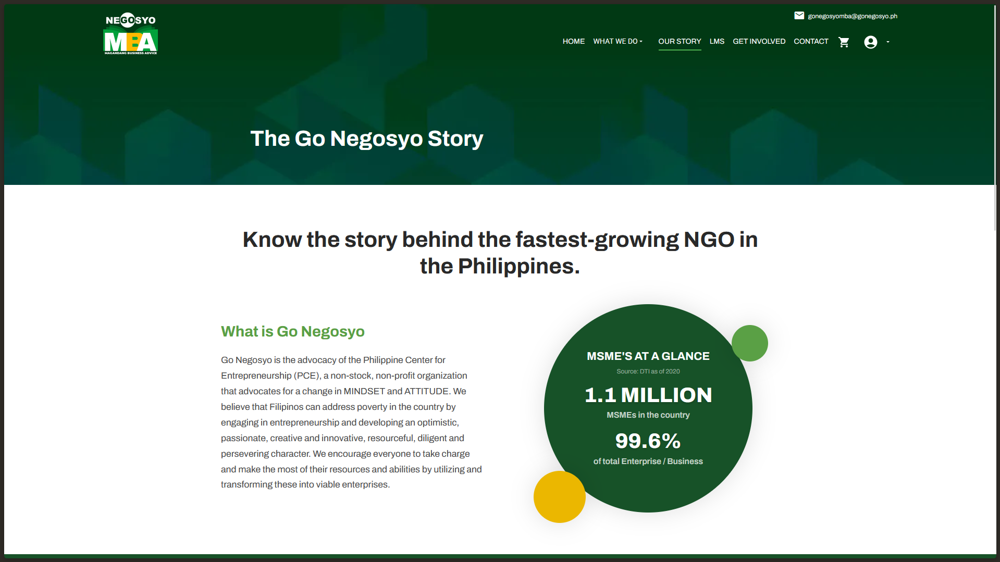

- `47_image.png` (source: comment, uploader: Angelo Kamachi)

  

- `48_image.png` (source: comment, uploader: Angelo Kamachi)

  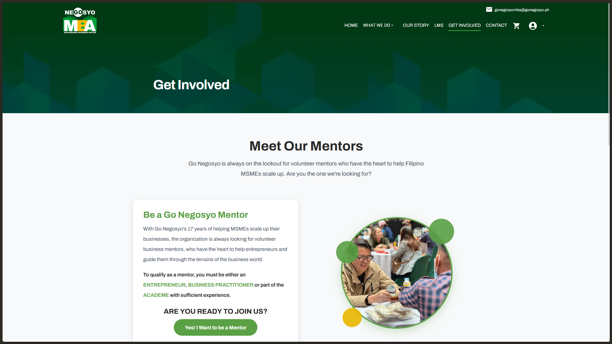

- `49_image.png` (source: comment, uploader: Angelo Kamachi)

  

- `50_image.png` (source: comment, uploader: Angelo Kamachi)

  

- `51_image.png` (source: comment, uploader: Aira Pilor)

  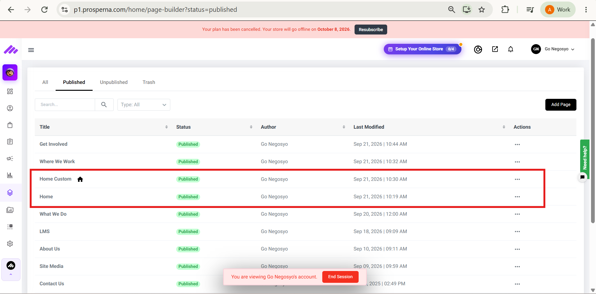

- `52_image.png` (source: comment, uploader: Angelo Kamachi)

  

- `53_image.png` (source: comment, uploader: Angelo Kamachi)

  

- `54_image.png` (source: comment, uploader: Angelo Kamachi)

  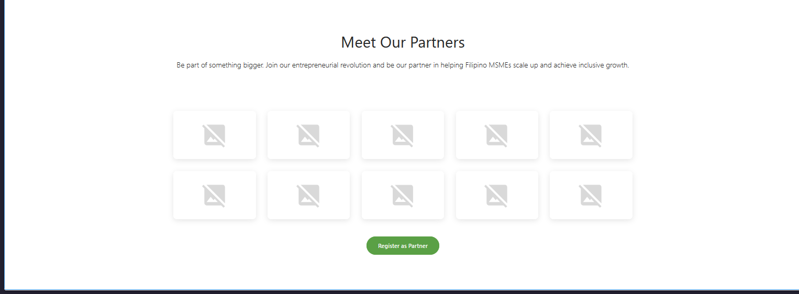

- `55_image.png` (source: comment, uploader: Angelo Kamachi)

  

- `56_image.png` (source: comment, uploader: Angelo Kamachi)

  

- `57_image.png` (source: comment, uploader: Angelo Kamachi)

  

- `58_image.png` (source: comment, uploader: Angelo Kamachi)

  

- `59_image.png` (source: comment, uploader: Angelo Kamachi)

  

- `60_image.png` (source: comment, uploader: Angelo Kamachi)

  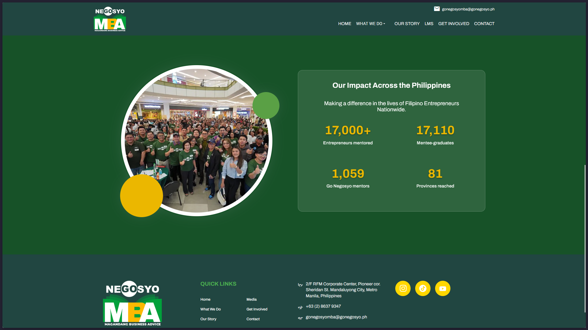

- `61_image.png` (source: comment, uploader: Angelo Kamachi)

  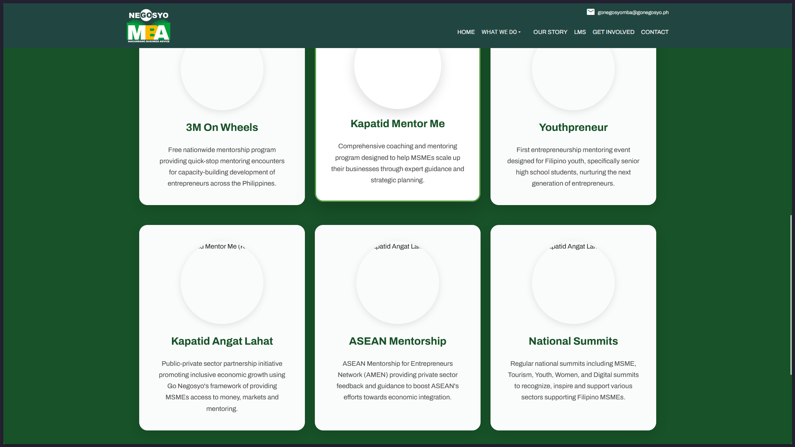

- `62_image.png` (source: comment, uploader: Angelo Kamachi)

  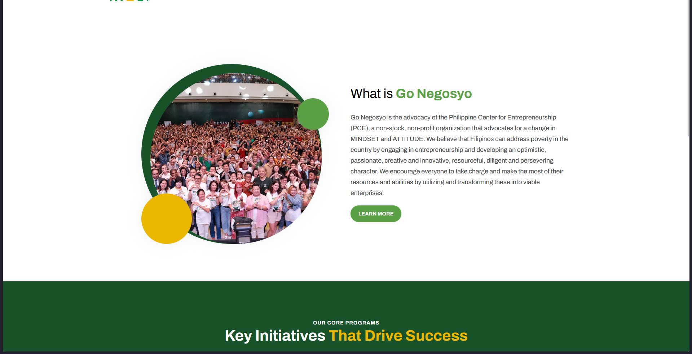

- `63_image.png` (source: comment, uploader: Angelo Kamachi)

  

- `64_image.png` (source: comment, uploader: Angelo Kamachi)

  

- `65_image.png` (source: comment, uploader: Angelo Kamachi)

  

- `66_image.png` (source: comment, uploader: Angelo Kamachi)

  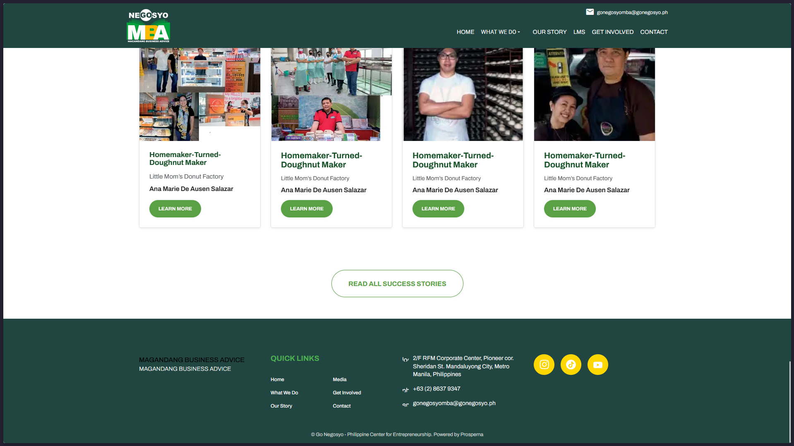

## Comments (22)

### Dennis Velasco (2026-09-24T04:50:14.285Z)

Approved to mark this task as DEPLOYED to PROD

### Aira Pilor (2026-09-23T02:40:37.552Z)

Store Name: GO NEGOSYO
url: https://gonegosyo.prosperna.com/
Status: PASSED

No more issue found.

We can now close this task.
cc @Angelo Kamachi

### Angelo Kamachi (2026-09-23T02:37:14.071Z)

image.png
image.png
button linking fixed

### Aira Pilor (2026-09-22T08:35:55.025Z)

Store Name: GO NEGOSYO
url: https://gonegosyo.prosperna.com/
Status: FAILED

ISSUE:
Buttons that redirect customers to page 404
image.png
image.png

WEBSITE PERFORMANCE:

HOME → 92%
image.png
LMS → 100%
image.png
GET INVOLVED → 100%
image.png
CONTACT → 100%
image.png
WHAT WE DO → 92%
image.png
WHERE WE WORK → 100%
image.png

Moving this task to "Waiting for Client Review"
cc @Angelo Kamachi

### Angelo Kamachi (2026-09-22T01:25:09.776Z)

image.png
image.png
image.png
image.png
image.png

All pages now have consistent header size and layout

### Angelo Kamachi (2026-09-22T00:20:35.589Z)

image.png
links changed to /about-us

### Angelo Kamachi (2026-09-22T00:13:27.304Z)

Missing pages issue, according to last week's SNT, the pages not found in figma will be disregarded in favor of keeping the basic form link

### Angelo Kamachi (2026-09-22T00:12:33.616Z)

image.png
home unpublished

### Aira Pilor (2026-09-21T11:32:22.166Z)

Store Name: GO NEGOSYO
url: https://gonegosyo.prosperna.com/
Status: FAILED

ISSUE:
All the "Learn More" and "Real All Success Stories" are all redirecting to /about which is currently unpublished, therefor return 404. But we currently have a link of /about-us
Missing Pages:
Task Comment preview 1100740000050064There are 2 Home Page:
image.png
The background of every page name does not have the same height.
https://t7537039.p.clickup-attachments.com/t7537039/ecffa11b-13bf-4059-8bb6-f2f5f85d2f5b/20260921-1130-33.7721410.mp4?view=open

Moving this task to "Ready for Development"
cc @Angelo Kamachi

### Angelo Kamachi (2026-09-15T06:33:56.863Z)

image.png
new BanKo page was made in respect to figma

### Dennis Velasco (2026-09-15T05:59:21.651Z)

@Angelo Kamachi - I spoke to the client and here's what you need to fix:
On this page (https://gonegosyo.prosperna.com/lms):
Under the "ACCESS TO MONEY" section, link the SIGN UP HERE button to the "Our Partners > Money" page in the Figma () Note that you still need to create this page.
On the "Money" page link the "GET STARTED" button under the "BanKo" tile to the "BanKo" page in the Figma () Note that you still need to create this page.
Under the "ACCESS TO MARKETS" section, link the SIGN UP HERE button to the "Our Partners > Market" page in the Figma () Note that you still need to create this page.
Under the "ACCESS TO MENTORING" section, link the SIGN UP HERE button to the "Our Partners > Mentor" page in the Figma () Note that you still need to create this page.
In the footer, replace the broken images for the location pin, telephone icon and email icon as shown in the footer of the Figma ().

Watch the attached demo video that displays how these missing pages are supposed to look.
https://t7537039.p.clickup-attachments.com/t7537039/f5597c44-972c-4434-8254-091fe115de61/GONEGOSYOFINAL3.mp4?view=open

### Angelo Kamachi (2026-09-14T08:08:56.657Z)

image.png
the images here ma'am, I have sent an email to boss for the client's support

### Dyne (2026-09-14T08:07:51.026Z)

@Angelo Kamachi what do you need from us?

pending feedback from client via @Dennis Velasco

### Angelo Kamachi (2026-09-08T09:46:39.654Z)

12 + 7 + 16 + 28 + 4 + 2 + 15 = 84

Go Negosyo was found to have 84 Partners, will be prioritizing top 10 in platinum to be placed here
image.png
image.png

### Angelo Kamachi (2026-09-08T09:43:01.703Z)

image.png
contact auto links to LMS (intended)

### Angelo Kamachi (2026-09-08T09:42:11.124Z)

image.png
get involved restored

### Angelo Kamachi (2026-09-08T09:41:42.652Z)

image.png
LMS restored

### Angelo Kamachi (2026-09-08T09:41:26.360Z)

image.png
assets missing from source

### Angelo Kamachi (2026-09-08T09:41:05.757Z)

image.png
where we work restored

### Angelo Kamachi (2026-09-08T09:40:43.091Z)

image.png
assets missing from source

### Angelo Kamachi (2026-09-08T09:39:25.390Z)

image.png
what we do restored

### Angelo Kamachi (2026-09-08T09:38:58.014Z)

image.png
image.png
image.png
image.png
Home page restored

